# SDD Conventions — Voice AI Agent for Egyptian Clinics

> Single shared reference for every `sdd-*` skill. Skills link here instead of repeating rules.
> Changing this file is a **process change** → do it through `sdd-replan` on a `replan/<topic>` branch.

---

## 1. The Lifecycle

### 1.0 Execution Modes
| Mode | Default? | Skill | Gates | Use for |
|:---|:---|:---|:---|:---|
| **Phase mode** | ✅ Default | `sdd-phase` | Phase Gate 1 (all specs) → Phase Gate 2 (push + merge) | Normal work: a whole roadmap phase at once, one fresh subagent per feature, local commit per feature |
| **Feature mode** | On request / sensitive | `sdd-feature-spec` → `sdd-implement` → `sdd-review` | Gates 1–3 (§5) | Security/PII, DB schema or booking writes, the state machine, payments, or when the human asks |

The diagram below is the **feature mode** loop. Phase mode runs the same steps per feature inside one orchestrated run (see `sdd-phase`).

```mermaid
flowchart LR
    C["Constitution<br/>mission / tech / roadmap"] --> S["sdd-feature-spec<br/>interview + 3 spec files"]
    S -->|"GATE 1: spec approved"| I["sdd-implement"]
    I --> V["sdd-validation<br/>(execute mode)"]
    V --> R["sdd-review<br/>5 questions (+ deep review)"]
    R -->|"GATE 2: approved to commit"| K["commit + changelog + push phase branch"]
    K -->|"GATE 3: approved next feature"| P["sdd-replan<br/>(quick check)"]
    P --> S
    P -->|"phase complete"| M["merge phase branch to main"]
```

| Skill | Use when |
|:---|:---|
| `sdd-phase` | **Default**: plan + implement + validate an entire roadmap phase with two gates. |
| `sdd-constitution` | Creating or regenerating `spec/mission.md`, `spec/tech.md`, `spec/roadmap.md` (greenfield or brownfield). |
| `sdd-feature-spec` | Starting any feature: next roadmap item, or a new idea of any size. |
| `sdd-implement` | Spec approved (Gate 1 passed) → write the code. |
| `sdd-validation` | Writing `validation.md` (spec mode) or running it (execute mode). |
| `sdd-review` | After validation runs: 5-question review, optional deep review, Gate 2, commit. |
| `sdd-changelog` | After an approved feature: update `CHANGELOG.md` for stakeholders. |
| `sdd-replan` | Between features/phases, change of direction, constitution or process updates, phase merge. |
| `sdd-research-backlog` | Mid-feature idea or research you don't want to lose and don't want on the roadmap yet. |

---

## 2. Sources of Truth

- **`spec/` is the only source of truth** for intent: `mission.md`, `tech.md`, `roadmap.md`, `architecture.md`, `adr/`, `security/`, `features/`, `backlog/`.
- `spec/archive/` (e.g. old `TASK_PLAN.md`, `implementation_plan.md`) is **historical — never read for decisions, never update**.
- The agent is stateless: always re-read the spec files from disk at the start of a skill. Never rely on memory of a previous conversation.
- **No drift rule**: any change requested by the human (during review, validation, or replanning) is applied to the **spec first**, then to the code, in the same step. Never change only the code, and never rename/move files without updating every spec/README reference.

---

## 3. Feature Identity & Folders

- Roadmap ID: `Feature <phase>.<n>` (e.g. `Feature 5.3`).
- Folder: `spec/features/feature-<phase><nn>-<kebab-slug>/` where `<nn>` is the two-digit feature index (e.g. Phase 5 / Feature 3 → `feature-513-…` following the current Phase 5 convention, Phase 4 / Feature 8 → `feature-408-…`).
- If the computed number collides with an existing (legacy) folder, pick the next free number. The `plan.md` header **must** always state `Roadmap ID: Feature X.Y` so the mapping is unambiguous.
- Each feature folder contains exactly: `plan.md`, `requirements.md`, `validation.md`. Optional: `review.md` (review report), `summary_ar.md` (Arabic summary for the human).
- Phase mode adds a phase folder: `spec/phases/phase-<N>-<kebab-slug>/` with `phase-overview.md` (goal, feature order, dependencies, shared decisions, phase-level integration validation, execution log) and `phase-review.md`. The phase slug matches the phase branch name.

---

## 4. Git Strategy

| Work type | Branch | Created from | Merged to `main` |
|:---|:---|:---|:---|
| Roadmap phase (all its features) | `phase/<N>-<kebab-slug>` e.g. `phase/5-livekit-voice-core` | latest `main`, when the first feature of the phase starts | Only when **every** feature of the phase is checked off **and** a phase-close replan was done (`sdd-replan` mode D) |
| Constitution / roadmap / process change | `replan/<kebab-topic>` | latest `main` | After human approval of the replan |

Rules:
- One commit per feature on the phase branch (spec commits may be separate: `docs(spec): …`). Conventional Commits: `feat(scope): implement Feature X.Y <title>`.
  - Feature mode: commit after Gate 2 approval.
  - Phase mode: **local** commit as soon as the feature's validation is green and the orchestrator has verified it (rollback checkpoint). Changes requested at Phase Gate 2 → extra `fix(...)` commits, no history rewriting.
- **Push only after Gate 2 (feature mode) or Phase Gate 2 (phase mode) approval.** Never push unreviewed work. Never force-push. Never commit `.env` or secrets.
- A checked roadmap box (`- [x] Feature X.Y`) is part of the feature commit — small roadmap ticks stay on the phase branch. Anything bigger than a tick (new phases, reordering, tech changes) goes to a `replan/` branch.
- Before creating or switching branches: `git status` must be clean, or the human must decide what happens to uncommitted changes. Never stash/discard human work silently.

---

## 5. Human-in-the-Loop Gates

**Feature mode gates:**

| Gate | Where | Agent stops after… | Human unlocks with |
|:---|:---|:---|:---|
| **Gate 1** | `sdd-feature-spec` | writing `plan.md`, `requirements.md`, `validation.md` | approval to implement |
| **Gate 2** | `sdd-review` | implementation + validation run + review report | approval to commit & push |
| **Gate 3** | `sdd-review` | commit + push + changelog, with a quick roadmap check | approval to start the next feature |

**Phase mode gates** (`sdd-phase`):

| Gate | Agent stops after… | Human unlocks with |
|:---|:---|:---|
| **Phase Gate 1** | phase interview + `phase-overview.md` + all feature specs of the phase | approval to implement the whole phase |
| **Phase Gate 2** | all features implemented and committed locally + phase integration validation + deep review + `phase-review.md` | approval to push + merge to `main` |
| **Unplanned stop** | a feature stays red after 2 fix attempts, or a fix needs a change to intent, scope, or a `tech.md` invariant | human decision; then resume from that feature |

- Approval words (either language): `approved`, `go ahead`, `proceed`, `اعتمد`, `كمل`, `موافق`, `تمام اعتمد`.
- Anything else (questions, "looks good but…", requested changes) is **not** approval: apply changes (spec first), re-present, and wait again.
- Never skip a gate, even if the change seems trivial.

---

## 6. Language

- Skills, spec files, code, commits, and `CHANGELOG.md`: **English**.
- Every message to the human: **Egyptian Arabic** (technical terms, file names, and code stay in English). Optionally add `summary_ar.md` in the feature folder for long specs.

---

## 7. Clean-Slate Checklist (start of every feature)

Run before `sdd-feature-spec` starts any new feature:
1. `git status` → no unfinished work (or the human decided what to do with it).
2. Previous feature is committed (and pushed) on its phase branch.
3. You are on the right branch: the current phase branch, or a new `phase/<N>-…` from `main` if this is the phase's first feature.
4. The next roadmap item still makes sense (quick replan check).
5. Recommend the human start a **fresh conversation / cleared context** so the spec, not chat memory, carries intent.

---

## 8. Right Level of Detail (spec writing rule)

Treat the agent as a highly capable pair programmer:
- **Do write**: goals, why, scope/exclusions, user flows, constraints, invariants from `tech.md`, success criteria, key decisions and trade-offs.
- **Don't write**: variable names, trivial file-internal structure, line-level instructions the implementer can decide.
- Every requirement must be testable and traceable to a validation check.

---

## 9. Real Project Commands (verify they still exist before use)

| Purpose | Command |
|:---|:---|
| Install / sync | `uv sync --all-extras --dev` |
| Full test suite | `uv run pytest -v` |
| Targeted tests | `uv run pytest tests/<file>.py -v` |
| Lint | `uv run ruff check .` |
| Golden evals (when `src/ai_core/**`, `src/rag/**`, prompts or models change) | `uv run pytest tests/evals/test_golden_evals.py -v` (mirrors `.github/workflows/evals.yml`) |
| Type checking | **Not configured** (no `mypy`/`pyright` in `pyproject.toml`) → mark Not Applicable unless added via replan |

Templates live in [`templates/`](templates/).

