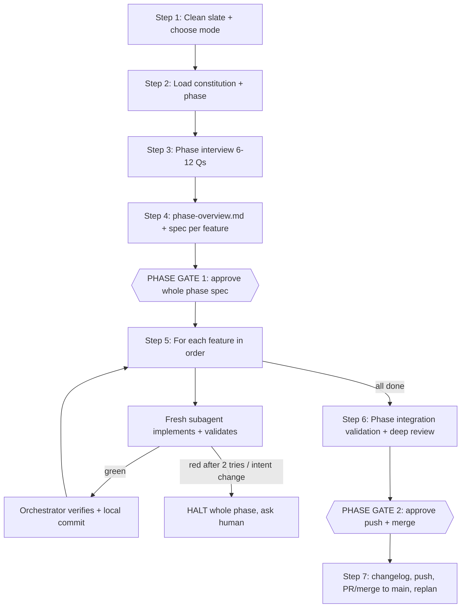

# sdd-phase — One Phase, Two Gates

Shared rules: [`.agents/sdd/conventions.md`](../../sdd/conventions.md). This skill **orchestrates** the other `sdd-*` skills; it doesn't replace their rules.

---

## Step 1 — Clean Slate & Mode Choice
1. Run the Clean-Slate Checklist (conventions §7). Phase branch: `phase/<N>-<slug>` from latest `main`, or continue the existing one if the phase already started.
2. **Existing uncommitted work** that belongs to this phase is treated as existing code: inspect it, don't discard it, and include it in the relevant feature's spec review.
3. **Sensitivity check**: if the phase touches security/PII, DB schema or booking writes, the state machine, or payments, **recommend** feature-by-feature mode (`sdd-feature-spec` → `sdd-implement` → `sdd-review`) for those features, or for the whole phase. The human decides; phase mode is the default.

## Step 2 — Load Context From Disk
`spec/mission.md`, `spec/tech.md`, `spec/roadmap.md` (the target phase), `spec/architecture.md`, relevant `spec/adr/`, `spec/security/threat_model.md`, open `spec/backlog/` items, existing feature folders of this phase, and the source files the phase will touch. Never `spec/archive/`.

## Step 3 — Phase Interview (one interview, 6–12 questions)
Use `ask_question`, in batches, each question with a **recommended answer** first:
- **Batch 1 — phase level**: scope in/out, merging/splitting/reordering features, shared technical decisions, phase-wide validation strategy (manual voice tests? real calls?), sensitivity/mode choice.
- **Batch 2 — per feature**: only what is genuinely open for each feature.
Anything already decided by the constitution, ADRs, or an existing approved spec → don't ask; record it as a decision with its source.

## Step 4 — Write the Phase Spec
1. `spec/phases/phase-<N>-<slug>/phase-overview.md` ← [`templates/phase-overview.md`](../../sdd/templates/phase-overview.md).
2. For **each** unfinished feature: `spec/features/feature-<phase><nn>-<slug>/` with `plan.md`, `requirements.md`, `validation.md`, following `sdd-feature-spec` Step 6 quality rules and `sdd-validation` spec mode. Existing feature specs → review and update them for consistency with the overview; don't rewrite what's still valid.
3. Cross-check: features don't overlap in scope; interfaces between features are defined in the overview; every requirement traces to validation.
4. If the roadmap changes (merge, split, reorder, add) → only within this phase's section, listed explicitly for the human.

## Step 5 — 🛑 PHASE GATE 1
Present in **Egyptian Arabic**: phase goal, feature list and order, shared decisions, key per-feature decisions, risks, stop conditions, links to all files. Optionally write `phase-overview` highlights in a `summary_ar.md` next to it.
Requested changes → update the overview and all affected feature specs consistently → present again. Only an approval word (conventions §5) continues. Then commit the specs locally: `docs(spec): add Phase N specs`.

## Step 6 — Orchestrated Implementation (no stops between features)
For each feature **in order** (sequential: features depend on each other):
1. **Launch a fresh subagent** (type `self`, same workspace) with a prompt like:
   > Implement Feature X.Y using the `sdd-implement` skill (`.agents/skills/sdd-implement/SKILL.md`) and `sdd-validation` execute mode. Spec: `spec/features/<folder>/`. Phase context: `spec/phases/<phase>/phase-overview.md`. Read everything from disk. Stay strictly in scope. Do NOT commit, push, or tick the roadmap. If validation stays red after 2 fix attempts, or the fix needs a change to intent, scope, or a `tech.md` invariant, STOP and report. Return: files changed, R-ID coverage, validation results with evidence, spec edits made, and open issues.
2. **Orchestrator verifies** (don't trust, verify): re-run the feature's targeted tests plus `uv run ruff check .`, check `git diff --stat` against `plan.md` §6, and confirm `validation.md` §5 is filled.
3. **Green** → tick `- [x] **Feature X.Y**` in the roadmap, then make a local commit on the phase branch (no push):
   `feat(<scope>): implement Feature X.Y <title>`. Log it in the overview's Execution Log.
4. **Red after 2 attempts, or intent/scope/invariant change needed** → 🛑 **HALT the whole phase**. Report in Egyptian Arabic: what failed, why, options (each with a recommendation). Previously committed features stay. Resume from this feature after the human decides (spec first, then code).
5. Extra ideas found along the way → `sdd-research-backlog`, never into the code.

## Step 7 — Phase Validation & Deep Review
1. Run Phase-Level Integration Validation (overview §5): end-to-end scenarios, full suite, lint, golden evals if applicable. Fill in results.
2. Run the **deep review** (`sdd-review` Step 3, four parallel read-only subagents: Security & PII, Architecture & invariants, Spec drift, Test quality) across the **whole phase diff** (`git diff main...HEAD`).
3. Fix high and medium findings (as `fix(...)` commits; spec first if intent changes) → re-run validation. Low findings → fix, backlog, or accept with a reason.
4. Write `spec/phases/<phase>/phase-review.md` using the 5 core questions ([`templates/review-report.md`](../../sdd/templates/review-report.md)), answered for the phase as a whole plus a per-feature verdict row.

## Step 8 — 🛑 PHASE GATE 2
Present in Egyptian Arabic: per-feature summary (what was built and why), validation evidence, deep-review findings and their handling, spec changes made during implementation, **manual checks for the human** (exact commands, e.g. a live voice call), the commit list (`git log --oneline main..HEAD`), and the proposed merge plan. Then stop.
Requested changes → `fix(...)` commits (spec first) → re-validate → present again.

## Step 9 — After Phase Gate 2 Approval
1. Run `sdd-changelog`: one entry per feature, plus the phase summary. Commit `docs(changelog): Phase N`.
2. `git push -u origin phase/<N>-<slug>`.
3. Merge to `main` via PR (preferred) or `git merge --no-ff` as in `sdd-replan` mode D. Set the overview Status to `Merged`.
4. Run `sdd-replan` mode D's retrospective (and mode A for the next phase): what went well, spec gaps, process friction. Recommend a **fresh context** for the next phase.

