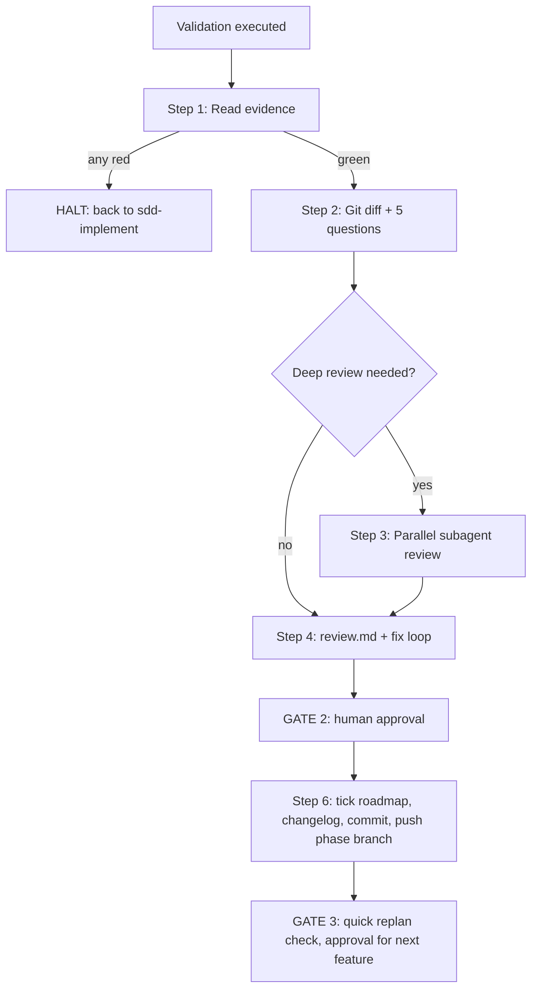

# sdd-review — Review, Gate 2, Commit, Gate 3

Shared rules: [`.agents/sdd/conventions.md`](../../sdd/conventions.md).



---

## Step 1 — Read the Validation Evidence
- `validation.md` §5 Execution Results is filled in and all automated checks are ✅ (0 failures, 0 errors).
- Every tier is either covered or N/A with a real technical justification.
- Golden evals ran if `src/ai_core/**`, `src/rag/**`, prompts or models changed.

> ⚠️ Any failure or missing evidence → **HALT**, go back to `sdd-implement`. Don't review a red build.

## Step 2 — Diff Review Against the 5 Core Questions
```powershell
git status --short
git diff --stat
git diff            # unstaged
git diff --staged   # staged
```
| # | Question | Fails when… |
|:---|:---|:---|
| 1 | **Does it work?** | Stubs, `TODO`, `pass`, placeholder returns, mock-only illusions, unrun paths |
| 2 | **Does it match the spec?** | Missing R/NFR, changed business logic, **scope creep** (unspecified extras) |
| 3 | **Does it respect the architecture?** | Breaks `tech.md` invariants or ADRs: bypasses `src/config.py`, violates latency budgets / write gates / PII-before-trace, new unapproved dependency, layer violations, circular imports |
| 4 | **Is the diff free of unrelated changes?** | Formatting churn, unrelated files, debug `print`, scratch files, deleted comments/docstrings |
| 5 | **Is existing behaviour unbroken?** | Full-suite failures, changed public signatures without compatibility, broken tools/session flows |

Also check **spec sync**: does every changed file appear in `plan.md` §6, and does every spec item have code?

## Step 3 — Deep Review With Subagents (conditional)
Run it when **any** of these hold: the feature is Big/Medium; it touches security, PII, booking/DB writes, the state machine, the model gateway, or FinOps; it is the last feature of a phase; or the human asks ("deep review", "راجع بعمق").

Launch read-only subagents **in parallel** (keeps the main context clean). Each gets the feature folder path, the diff summary, and one lens:
1. **Security & PII**: OWASP LLM risks, prompt injection paths, secrets, Presidio redaction before tracing, `spec/security/threat_model.md`.
2. **Architecture & invariants**: `spec/tech.md`, `spec/architecture.md`, ADRs, latency/timeouts, config centralisation.
3. **Spec drift**: requirements ↔ validation ↔ code ↔ roadmap ↔ README/architecture docs consistency.
4. **Test quality**: fabricated or over-mocked tests, missing edge cases, flaky async tests.

Each subagent returns findings as `severity (high/medium/low) · file:line · issue · suggested fix`. Triage: fix high and medium now (spec first if intent changes); low ones → fix, or record via `sdd-research-backlog`, or accept with a reason.

## Step 4 — Write `review.md` and Loop
Write `spec/features/<feature>/review.md` from [`templates/review-report.md`](../../sdd/templates/review-report.md).
Any ❌ → fix, re-run `sdd-validation` (execute mode), and repeat Steps 1–4.

## Step 5 — 🛑 GATE 2: Approval to Commit
Present in **Egyptian Arabic**: what was built and why (per group, R-IDs), the validation summary, the 5-question verdicts, deep-review findings and how they were handled, spec changes, **manual checks the human should do** (exact commands), and the proposed commit message. Then stop.

Requested changes → spec first, then code, re-validate, re-review, present again. Only an approval word (conventions §5) continues.

## Step 6 — After Gate 2 Approval
1. Tick the roadmap: `- [x] **Feature X.Y**` in `spec/roadmap.md`. Set the `plan.md` Status to `Committed`.
2. Run the **`sdd-changelog` skill** (read `.agents/skills/sdd-changelog/SKILL.md`).
3. Confirm you are on `phase/<N>-<slug>`, then stage only the feature's files (no `.env`, no scratch):
   ```powershell
   git add <feature files> spec/roadmap.md CHANGELOG.md spec/features/<feature>/
   git commit -m "feat(<scope>): implement Feature X.Y <title>"
   git push -u origin phase/<N>-<slug>
   ```
4. Never merge to `main` here. Phase merges happen in `sdd-replan` mode D.

## Step 7 — 🛑 GATE 3: Next Feature
Do a quick replan check (`sdd-replan` mode A, read-only): is the next roadmap item still right? Was this the last feature of the phase (then propose phase close, mode D)? Did a backlog item become urgent?
Report in Egyptian Arabic, recommend a fresh context for the next feature, and stop until the human approves.

