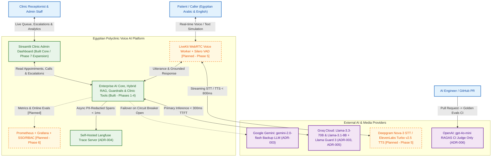
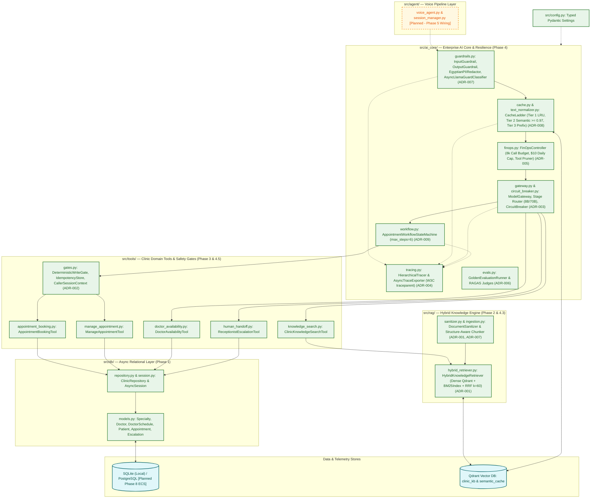
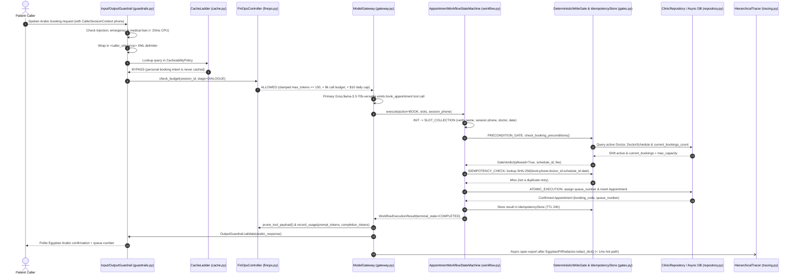
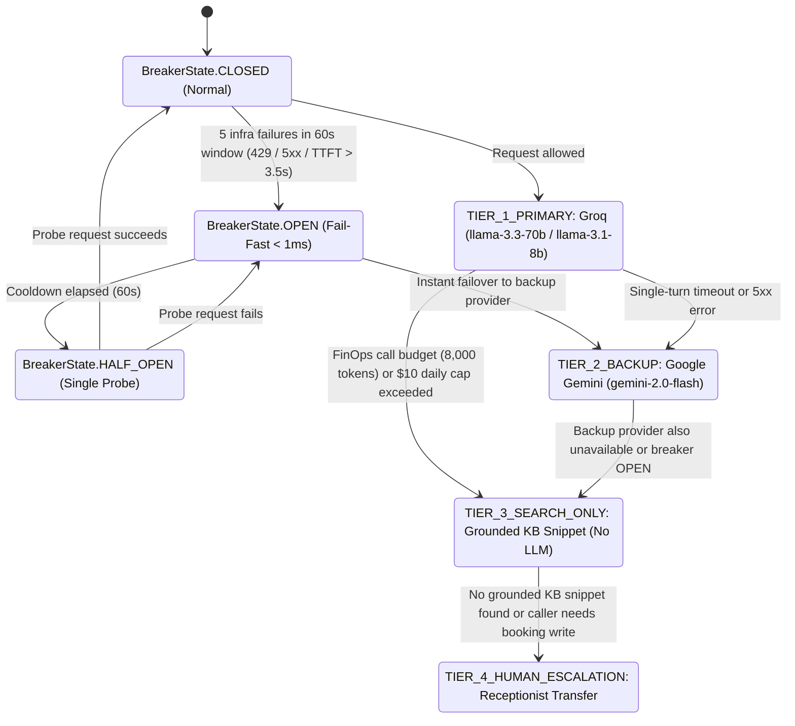
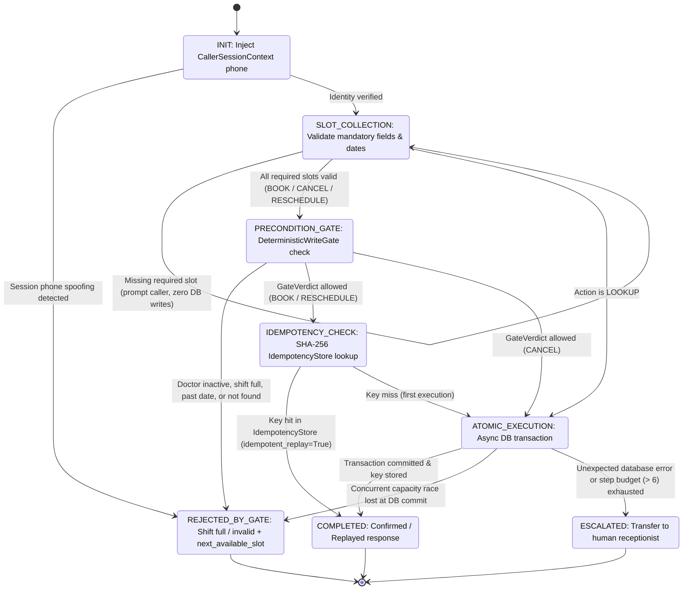
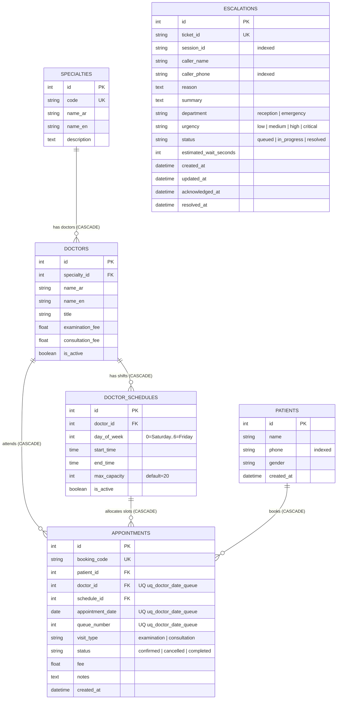

# المعمارية الهندسية الشاملة والمخططات ككود (System Architecture & Diagram-as-Code)

يمثّل هذا المستند المرجع المعماري الرسمي لنظام **المساعد الصوتي الذكي للعيادات والمراكز الطبية المصرية (Voice AI Medical Receptionist)** وفق منهجية **C4 Model** ومبدأ **المخططات ككود (Diagram-as-Code)**.

- للاطلاع على التبرير الهندسي والبدائل المرفوضة لكل قرار معماري، راجع [**فهرس سجلات القرارات المعمارية (`spec/adr/README.md`)**](./adr/README.md).
- للاطلاع على نموذج التهديدات الأمنية وضوابط OWASP LLM Top 10، راجع [**`spec/security/threat_model.md`**](./security/threat_model.md).

---

## دليل الترميز البصري في المخططات (Built vs. Planned Legend)

التزاماً بمبدأ **الكود هو مصدر الحقيقة (As-Built Source of Truth)**:
- **المكوّنات المبنية فعلياً (Phases 1–4 & Initial Dashboard)**: تُرسم **بخط متصل (`Solid Line`)** وتعمل حالياً في المستودع مع تغطية اختبارية كاملة.
- **المكوّنات المخطط لاستكمالها في المراحل القادمة (Phases 5, 6, 8)**: تُرسم **بخط متقطع (`Dashed Line`)** وتُميَّز بالصنف البصري `classDef planned` مع الوسم الصريح `[Planned]`.

---

## 1. مخطط سياق النظام — المستوى الأول (C4 Level 1: System Context)

يوضّح هذا المخطط موقع المساعد الصوتي الذكي للعيادة وعلاقته بالمرضى، وموظفي الاستقبال، والمزوّدين السحابيين، ومنظومة الرصد والتقييم.

- القرارات المرتبطة: [ADR-003 (Model Gateway & Gemini Fallback)](./adr/003-multi-tier-model-gateway.md)، [ADR-004 (Self-Hosted Langfuse)](./adr/004-self-hosted-langfuse-tracing.md)، [ADR-006 (RAGAS CI Gate)](./adr/006-ragas-ci-evaluation.md).

---

## 2. مخطط الحاويات والمكوّنات البرمجية — المستوى الثاني والثالث (C4 Level 2/3: Containers & `src/` Components)

يوضّح هذا المخطط البنية الداخلية للحزم البرمجية في `src/` (`src/ai_core/`، `src/rag/`، `src/tools/`، `src/db/`، `src/config.py`) وكيفية تفاعلها مع مخازن البيانات.

- القرارات المرتبطة: [ADR-001](./adr/001-hybrid-search-rrf.md)، [ADR-002](./adr/002-deterministic-gates-vs-prompt-rules.md)، [ADR-003](./adr/003-multi-tier-model-gateway.md)، [ADR-004](./adr/004-self-hosted-langfuse-tracing.md)، [ADR-005](./adr/005-finops-budgets-and-stage-routing.md)، [ADR-007](./adr/007-owasp-trust-layer.md)، [ADR-008](./adr/008-three-tier-cache-ladder.md)، [ADR-009](./adr/009-state-machine-over-agent-loop.md).

---

## 3. مخطط التتابع الزمني لدورة مكالمة حجز كاملة (Sequence Diagram: End-to-End Booking Call Lifecycle)

يوضّح هذا المخطط المسار الزمني الكامل لطلب مريض حجز موعد جديد، بدءاً من فحص حواجز الحماية، مروراً بالكاش وبوابة FinOps وبوابة النماذج، ثم آلة الحالة المحدودة وبوابة الشروط المسبقة ومفتاح عدم التكرار، وصولاً إلى المعاملة الذرية في قاعدة البيانات وتصدير أثر التتبع المنقّى من البيانات الشخصية.

- القرارات المرتبطة: [ADR-002](./adr/002-deterministic-gates-vs-prompt-rules.md)، [ADR-003](./adr/003-multi-tier-model-gateway.md)، [ADR-004](./adr/004-self-hosted-langfuse-tracing.md)، [ADR-005](./adr/005-finops-budgets-and-stage-routing.md)، [ADR-007](./adr/007-owasp-trust-layer.md)، [ADR-008](./adr/008-three-tier-cache-ladder.md)، [ADR-009](./adr/009-state-machine-over-agent-loop.md).

---

## 4. مخطط حالة قاطع الدائرة ومستويات التدهور الأربعة (State Diagram: Circuit Breaker & 4-Tier Graceful Degradation)

يمثّل هذا المخطط حالات `BreakerState` الفعلية في `src/ai_core/circuit_breaker.py` (`CLOSED`، `OPEN`، `HALF_OPEN`) وكيف تتكامل مع مستويات التدهور الأربعة `DegradationTier` في `src/ai_core/gateway.py` وقاطع التكلفة في `src/ai_core/finops.py`.

- القرارات المرتبطة: [ADR-003 (Multi-Tier Model Gateway)](./adr/003-multi-tier-model-gateway.md)، [ADR-005 (FinOps Cost Breaker)](./adr/005-finops-budgets-and-stage-routing.md).

---

## 5. مخطط حالة سير عمل المواعيد الحتمي (State Diagram: `AppointmentWorkflowStateMachine`)

يمثّل هذا المخطط حالات `WorkflowState` الثماني المعتمدة في `src/ai_core/workflow.py` لإدارة عمليات `BOOK` و`CANCEL` و`RESCHEDULE` و`LOOKUP` مع سقف الخطوات الصارم (`workflow_max_steps = 6`).

- القرارات المرتبطة: [ADR-002 (Deterministic Write Gates & Idempotency)](./adr/002-deterministic-gates-vs-prompt-rules.md)، [ADR-009 (State Machine over Agent Loop)](./adr/009-state-machine-over-agent-loop.md).

---

## 6. مخطط علاقات كيانات قاعدة بيانات العيادة (ER Diagram: Clinic Relational Models)

يمثّل هذا المخطط الجداول الستة الفعلية في `src/db/models.py` (`specialties`، `doctors`، `doctor_schedules`، `patients`، `appointments`، `escalations`) وعلاقات المفاتيح الأجنبية وقيد التفرد الذري `uq_doctor_date_queue`.

- القرارات المرتبطة: [ADR-002 (Deterministic Write Gates & Atomic Queue Assignment)](./adr/002-deterministic-gates-vs-prompt-rules.md).

---

## 7. سجل الديون التقنية المستبعدة من المخططات (Technical Debt — Legacy Restaurant Artifacts)

بموجب القرار الهندسي المتفق عليه (السؤال الخامس والقيود `C2`)، يحتوي المستودع على بقايا قديمة من النموذج الأولي السابق (نموذج المطعم) تم الإبقاء عليها مؤقتاً لعدم كسر اختبارات التوافق الرجعي، ولكنها **مستبعدة تماماً من معمارية العيادة الطبية ومن المخططات أعلاه**:

| الملف البرمجي أو الاختبار | الوصف | خطة المعالجة المستقبلية |
|:---|:---|:---|
| `src/tools/order_status.py` | أداة قديمة للاستعلام عن حالة طلبات المطعم | تُحذف في تنظيف ما قبل الإطلاق النهائي بعد إزالة الاختبارات المرتبطة بها |
| `src/tools/reservation.py` | أداة قديمة لحجز طاولات المطعم (حلّت محلها `src/tools/appointment_booking.py`) | تُحذف مع `order_status.py` |
| `src/tools/legacy_schemas.py` | مخططات Pydantic القديمة لأدوات المطعم (حلّت محلها `src/tools/schemas.py`) | تُحذف بعد ترحيل أي إشارات متبقية في اختبارات التوافق |
| `tests/test_order_status.py` و`tests/test_reservation.py` و`tests/test_tools.py` | اختبارات وحدات قديمة تختبر أدوات المطعم المذكورة أعلاه | تُستبدل بالكامل باختبارات `tests/test_clinic_tools.py` و`tests/test_agent.py` في المرحلة الخامسة |

