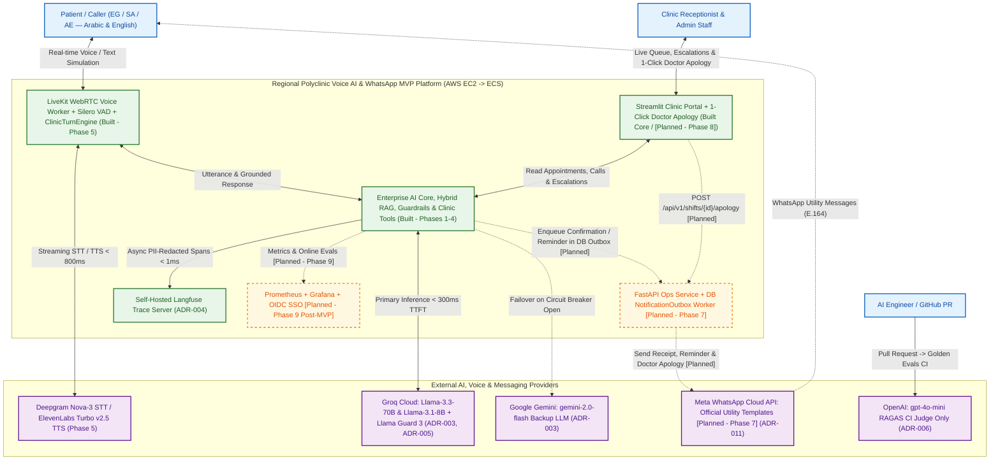
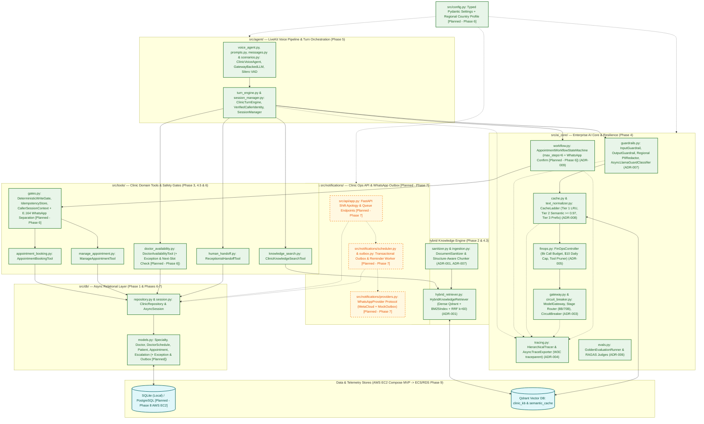
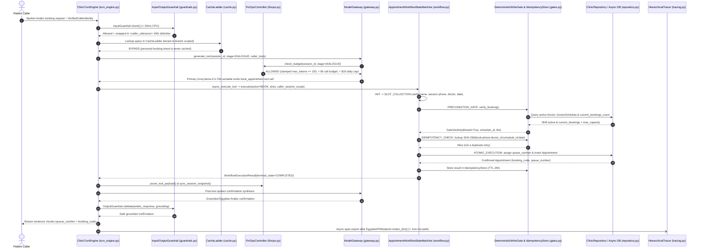
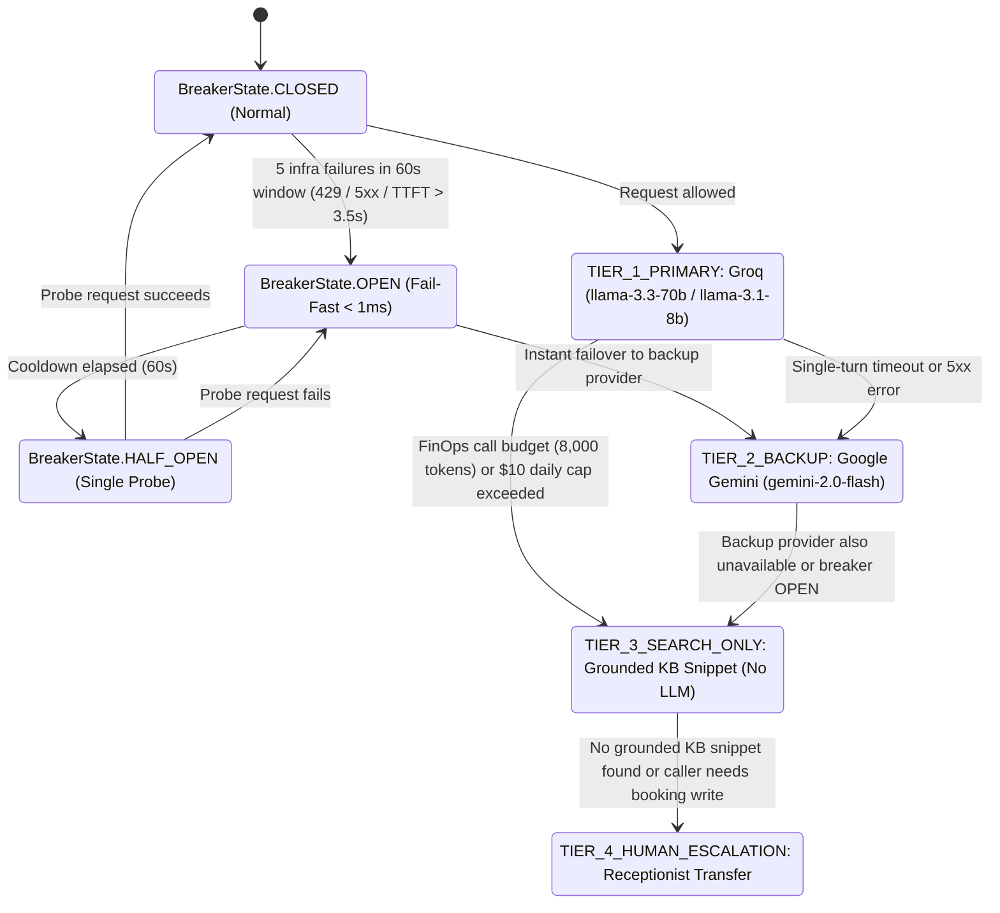
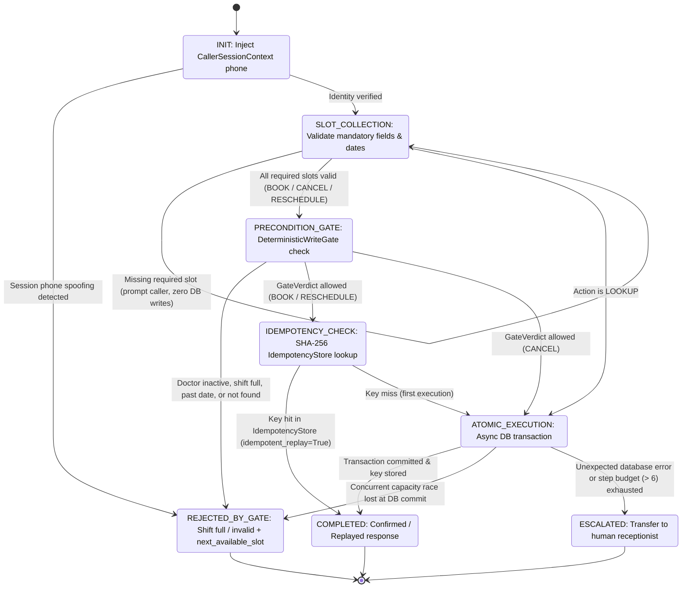
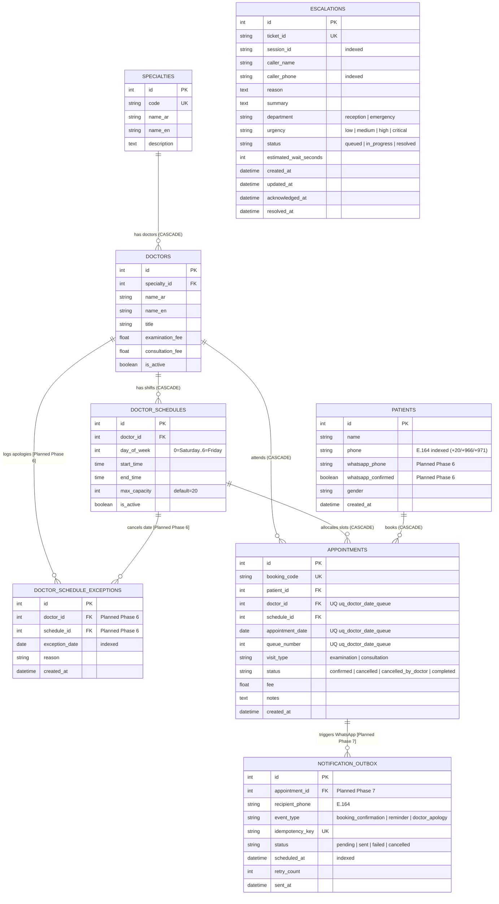

# المعمارية الهندسية الشاملة والمخططات ككود (System Architecture & Diagram-as-Code)

يمثّل هذا المستند المرجع المعماري الرسمي لنظام **المساعد الصوتي الذكي ومنظومة إشعارات الواتساب للعيادات والمراكز الطبية في مصر والسعودية والإمارات (Voice AI Medical Receptionist & WhatsApp Operations Platform)** وفق منهجية **C4 Model** ومبدأ **المخططات ككود (Diagram-as-Code)**.

- للاطلاع على التبرير الهندسي والبدائل المرفوضة لكل قرار معماري، راجع [**فهرس سجلات القرارات المعمارية (`spec/adr/README.md`)**](./adr/README.md).
- للاطلاع على نموذج التهديدات الأمنية وضوابط OWASP LLM Top 10، راجع [**`spec/security/threat_model.md`**](./security/threat_model.md).

---

## دليل الترميز البصري في المخططات (Built vs. Planned Legend)

التزاماً بمبدأ **الكود هو مصدر الحقيقة (As-Built Source of Truth)**:
- **المكوّنات المبنية فعلياً (Phases 1–5 & Core Admin Dashboard)**: تُرسم **بخط متصل (`Solid Line`)** وتعمل حالياً في المستودع مع تغطية اختبارية كاملة.
- **المكوّنات المخطط لاستكمالها في مراحل الـ MVP والتوسع القادمة (Phases 6–9)**: تُرسم **بخط متقطع (`Dashed Line`)** وتُميَّز بالصنف البصري `classDef planned` مع الوسم الصريح `[Planned]`.

---

## 1. مخطط سياق النظام — المستوى الأول (C4 Level 1: System Context)

يوضّح هذا المخطط موقع المساعد الصوتي الذكي ومنظومة الواتساب وعلاقتهما بالمرضى (في مصر والسعودية والإمارات)، وموظفي الاستقبال، والمزوّدين السحابيين (`Meta WhatsApp Cloud API`، `Groq`، `Deepgram`، `ElevenLabs`).

- القرارات المرتبطة: [ADR-003 (Model Gateway & Gemini Fallback)](./adr/003-multi-tier-model-gateway.md)، [ADR-004 (Self-Hosted Langfuse)](./adr/004-self-hosted-langfuse-tracing.md)، [ADR-006 (RAGAS CI Gate)](./adr/006-ragas-ci-evaluation.md)، [ADR-010 (E.164 & WhatsApp Contact Separation)](./adr/010-e164-and-whatsapp-contact-separation.md)، [ADR-011 (WhatsApp Adapter & DB Outbox)](./adr/011-whatsapp-adapter-and-db-outbox.md)، [ADR-012 (Lean AWS EC2 to ECS Deployment)](./adr/012-lean-aws-ec2-to-ecs-deployment.md).

---

## 2. مخطط الحاويات والمكوّنات البرمجية — المستوى الثاني والثالث (C4 Level 2/3: Containers & `src/` Components)

يوضّح هذا المخطط البنية الداخلية للحزم البرمجية المبنية حالياً في `src/` (`src/agent/`، `src/ai_core/`، `src/rag/`، `src/tools/`، `src/db/`، `src/dashboard/`، `src/config.py`) والحزمتين المخططتين للإطلاق الأول (`src/api/`، `src/notifications/`).

- القرارات المرتبطة: [ADR-001](./adr/001-hybrid-search-rrf.md)، [ADR-002](./adr/002-deterministic-gates-vs-prompt-rules.md)، [ADR-003](./adr/003-multi-tier-model-gateway.md)، [ADR-004](./adr/004-self-hosted-langfuse-tracing.md)، [ADR-005](./adr/005-finops-budgets-and-stage-routing.md)، [ADR-007](./adr/007-owasp-trust-layer.md)، [ADR-008](./adr/008-three-tier-cache-ladder.md)، [ADR-009](./adr/009-state-machine-over-agent-loop.md)، [ADR-010](./adr/010-e164-and-whatsapp-contact-separation.md)، [ADR-011](./adr/011-whatsapp-adapter-and-db-outbox.md)، [ADR-012](./adr/012-lean-aws-ec2-to-ecs-deployment.md).

---

## 3. مخطط التتابع الزمني لدورة مكالمة حجز كاملة (Sequence Diagram: End-to-End Booking Call Lifecycle)

يوضّح هذا المخطط المسار الزمني الكامل لطلب مريض حجز موعد جديد عبر `ClinicTurnEngine`، بدءاً من فحص حواجز الحماية، مروراً بالكاش وبوابة FinOps وبوابة النماذج، ثم آلة الحالة المحدودة وبوابة الشروط المسبقة ومفتاح عدم التكرار، وصولاً إلى المعاملة الذرية في قاعدة البيانات وتصدير أثر التتبع المنقّى من البيانات الشخصية.

- القرارات المرتبطة: [ADR-002](./adr/002-deterministic-gates-vs-prompt-rules.md)، [ADR-003](./adr/003-multi-tier-model-gateway.md)، [ADR-004](./adr/004-self-hosted-langfuse-tracing.md)، [ADR-005](./adr/005-finops-budgets-and-stage-routing.md)، [ADR-007](./adr/007-owasp-trust-layer.md)، [ADR-008](./adr/008-three-tier-cache-ladder.md)، [ADR-009](./adr/009-state-machine-over-agent-loop.md).

---

## 4. مخطط حالة قاطع الدائرة ومستويات التدهور الأربعة (State Diagram: Circuit Breaker & 4-Tier Graceful Degradation)

يمثّل هذا المخطط حالات `BreakerState` الفعلية في `src/ai_core/circuit_breaker.py` (`CLOSED`، `OPEN`، `HALF_OPEN`) وكيف تتكامل مع مستويات التدهور الأربعة `DegradationTier` في `src/ai_core/gateway.py` وقاطع التكلفة في `src/ai_core/finops.py`.

- القرارات المرتبطة: [ADR-003 (Multi-Tier Model Gateway)](./adr/003-multi-tier-model-gateway.md)، [ADR-005 (FinOps Cost Breaker)](./adr/005-finops-budgets-and-stage-routing.md).

---

## 5. مخطط حالة سير عمل المواعيد الحتمي (State Diagram: `AppointmentWorkflowStateMachine`)

يمثّل هذا المخطط حالات `WorkflowState` الثماني المعتمدة في `src/ai_core/workflow.py` لإدارة عمليات `BOOK` و`CANCEL` و`RESCHEDULE` و`LOOKUP` مع سقف الخطوات الصارم (`workflow_max_steps = 6`).

- القرارات المرتبطة: [ADR-002 (Deterministic Write Gates & Idempotency)](./adr/002-deterministic-gates-vs-prompt-rules.md)، [ADR-009 (State Machine over Agent Loop)](./adr/009-state-machine-over-agent-loop.md).

---

## 6. مخطط علاقات كيانات قاعدة بيانات العيادة (ER Diagram: Clinic Relational Models)

يمثّل هذا المخطط الجداول الستة المبنية فعلياً في `src/db/models.py` (`specialties`، `doctors`، `doctor_schedules`، `patients`، `appointments`، `escalations`) بالإضافة إلى الجدولين والحقول المخططة للإطلاق الأول (`doctor_schedule_exceptions` `[Planned - Phase 6]`، و`notification_outbox` `[Planned - Phase 7]`).

- القرارات المرتبطة: [ADR-002 (Deterministic Write Gates & Atomic Queue Assignment)](./adr/002-deterministic-gates-vs-prompt-rules.md)، [ADR-010 (E.164 & WhatsApp Contact Separation)](./adr/010-e164-and-whatsapp-contact-separation.md)، [ADR-011 (WhatsApp Adapter & DB Outbox)](./adr/011-whatsapp-adapter-and-db-outbox.md).

---

## 7. بروتوكول إشعارات الواتساب واعتذار الطبيب وطوبولوجيا النشر السحابي (`Phases 6–8 MVP`)

- **عزل الواتساب عن المسار الصوتي الحرج ([ADR-011](./adr/011-whatsapp-adapter-and-db-outbox.md))**: تكتفي معاملة الحجز أو الإلغاء الصوتية بإدراج صفوف في جدول `notification_outbox` خلال أقل من `5ms`، بينما يتولى العامل الخلفي المستقل إرسال قوالب `Meta WhatsApp Cloud API` الرسمية (تأكيد فوري عقب الحجز + تذكير قبل الشيفت بـ `24` ساعة أو `3` ساعات لحجوزات نفس اليوم).
- **سير عمل اعتذار الطبيب بضغطة زر (`FastAPI` + `Streamlit`)**: عند تسجيل اعتذار طبيب عن تاريخ محدد، تنفذ خدمة `FastAPI` معاملة ذرية تُنشئ سجل `doctor_schedule_exceptions` لإغلاق الشيفت فوراً أمام المتصلين الجدد، وتحوّل حجوزات اليوم المؤكدة إلى `cancelled_by_doctor` دون ترحيل قسري يكسر سعة الشيفت القادم، وتلغي التذكيرات المعلقة، وتجدول رسائل اعتذار واتساب تتضمن أقرب شيفت قادم للطبيب به أماكن شاغرة فعلياً.
- **طوبولوجيا النشر السحابي الاقتصادي القابل للتوسع ([ADR-012](./adr/012-lean-aws-ec2-to-ecs-deployment.md))**: تُغلَّف مكوّنات النظام في حاويات `12-Factor` عديمة الحالة (`voice-worker`، `ops-api-scheduler`، `dashboard`، `postgres`، `qdrant`) تُبنى عبر `GitHub Actions` وتُدفع إلى `AWS ECR`، وتعمل في الإطلاق الأول على عقدة `AWS EC2` موفرة مع أسرار `AWS SSM` ونسخ احتياطي يومي على `Amazon S3`، مع جاهزية الانتقال الصفري لنفس الصور إلى `AWS ECS Fargate + RDS` في `Phase 9`.

