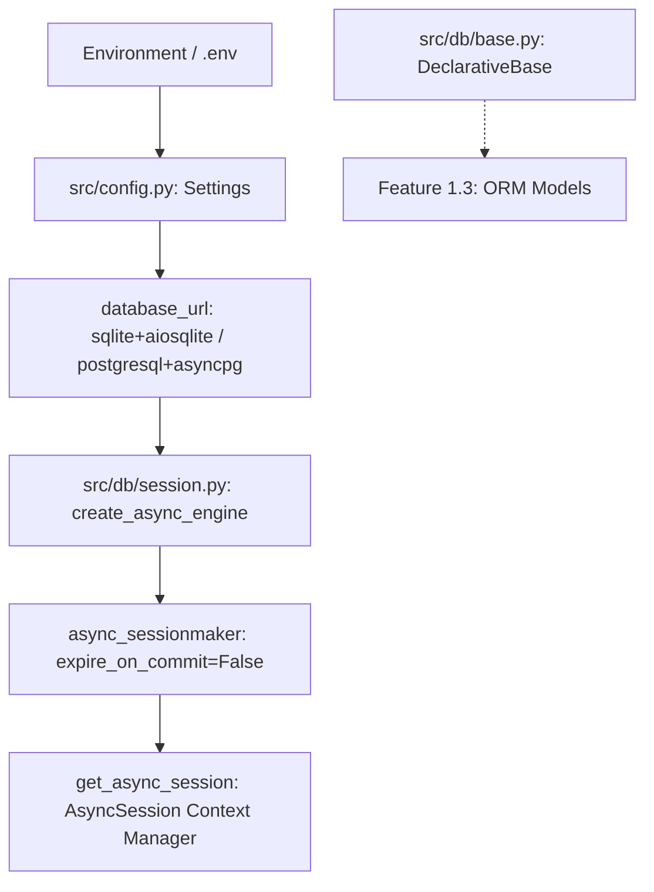

# Feature Plan: Feature 1.2 — Clinic Configuration & Async Database Engine

## 1. Objective & Why
Transition the application configuration from the legacy restaurant domain to the **Egyptian Polyclinics & Medical Centers** domain in `src/config.py`, and establish the asynchronous relational database foundation in `src/db/session.py` and `src/db/base.py`.

### Why:
- The Voice AI agent requires grounded clinic configurations (clinic name, phone, address, working hours, and vector collection names).
- Booking appointments, tracking doctor shifts, and preventing double-booking requires an asynchronous, ACID-compliant relational database engine (SQLAlchemy 2.0 with `aiosqlite` for local dev/testing and `asyncpg` for production).
- Establishing the engine and session factory independently guarantees clean separation of concerns before defining domain-specific entities (Specialty, Doctor, Schedule, Patient, Appointment) in Feature 1.3.

---

## 2. Scope & Boundaries

### In Scope:
- **Clinic Configuration Updates (`src/config.py`)**:
  - Replace restaurant fields with polyclinic fields: `clinic_name`, `clinic_tagline`, `clinic_phone`, `clinic_address`, `clinic_working_hours`, `agent_name`, `emergency_phone`.
  - Update default Qdrant collection to `clinic_kb`.
  - Add `database_url` (default: `sqlite+aiosqlite:///./data/clinic.db`) and `database_echo` setting.
  - Add helper methods `is_database_configured()` and `get_sqlite_db_path()`.
- **Database Engine & Session Management (`src/db/session.py` & `src/db/base.py`)**:
  - SQLAlchemy 2.0 `AsyncEngine` creation with connection pooling / SQLite concurrency flags (`check_same_thread=False`).
  - `async_sessionmaker` configured with `expire_on_commit=False`.
  - Async context manager / dependency generator `get_async_session()`.
  - Declarative base (`Base = declarative_base()`) in `src/db/base.py` for subsequent model definitions.
  - Lifecycle utilities `init_db()` and `close_db()`.
- **Project Dependency Specification (`pyproject.toml`)**:
  - Include `sqlalchemy>=2.0.0` and `aiosqlite>=0.20.0` in dependencies.
- **Unit & Edge-Case Tests (`tests/test_database_engine.py`)**:
  - Verification of settings defaults and environment variable overrides.
  - Async engine connection test with in-memory SQLite (`sqlite+aiosqlite:///:memory:`).
  - Session lifecycle, rollback on error, and transaction commit verification.

### Out of Scope:
- Relational ORM models (`Specialty`, `Doctor`, `DoctorSchedule`, `Patient`, `Appointment`) — deferred to **Feature 1.3**.
- Database seeders and repositories (`src/db/repository.py`, `scripts/seed_clinic_db.py`) — deferred to **Feature 1.4**.
- Modifying audio pipeline or dashboard pages.

---

## 3. Relevant Existing Architecture
- `src/config.py`: Currently contains restaurant settings (`restaurant_name="السوري"`, `restaurant_kb`).
- `pyproject.toml`: Uses `uv` package manager with Python 3.12 virtual environment (`.venv`), Hatchling build backend, and `pytest`.
- Currently passes 110/110 existing tests across agent, dashboard, and tools.

---

## 4. Proposed Architecture & Data Flow

### Key Architectural Decisions:
1. **Dialect Agnostic**: Engine accepts both `sqlite+aiosqlite` and `postgresql+asyncpg` connection strings.
2. **Auto-Directory Creation**: When using SQLite file paths (`./data/clinic.db`), ensure the parent directory (`./data`) is automatically created if it does not exist.
3. **Connection Pooling**: Use NullPool for in-memory SQLite and sensible connection pool defaults for persistent engines.
4. **Session Hygiene**: `get_async_session()` guarantees transaction rollback on unhandled exceptions and session closure in a `finally` block.

---

## 5. Expected Files Affected
| File Path | Action | Description |
|:---|:---|:---|
| `pyproject.toml` | Modify | Add `sqlalchemy>=2.0.0` and `aiosqlite>=0.20.0` to dependencies |
| `src/config.py` | Modify | Add clinic parameters, database settings, update RAG collection |
| `src/db/__init__.py` | Create | Export engine, sessionmaker, and Base |
| `src/db/base.py` | Create | Declarative base for ORM entities |
| `src/db/session.py` | Create | Async engine, sessionmaker, and `get_async_session()` context manager |
| `tests/test_database_engine.py` | Create | Unit and error tests for config and database session engine |
| `TASK_PLAN.md` | Modify | Update task status after completion |

---

## 6. Execution Breakdown (Atomic Steps)
1. **Execution Group 1: Dependencies & Configuration**:
   - Update `pyproject.toml` with `sqlalchemy` and `aiosqlite`.
   - Update `src/config.py` with Egyptian Polyclinic parameters (`clinic_name="مجمع عيادات النور التخصصي"`, `agent_name="نور"`, `database_url`, etc.).
2. **Execution Group 2: Async Database Engine & Session**:
   - Create `src/db/__init__.py`, `src/db/base.py`, and `src/db/session.py`.
   - Implement `get_engine()`, `get_session_factory()`, `get_async_session()`, and `init_db()`.
3. **Execution Group 3: Automated Verification**:
   - Create `tests/test_database_engine.py` covering settings parsing, connection testing, session rollbacks, and directory creation.
   - Run full regression test suite (`uv run pytest`) to guarantee zero regressions.

---

## 7. Risks & Trade-offs
- **SQLite Concurrency & Multi-threading**: SQLite has write-lock limitations under heavy concurrency.
  - *Mitigation*: Configure `check_same_thread=False` and timeout parameters for SQLite, while structuring the engine to be drop-in ready for PostgreSQL in production.
- **Backwards Compatibility**: Existing restaurant tests in `tests/test_reservation.py` or `tests/test_prompts.py` might reference `restaurant_name`.
  - *Mitigation*: Provide backward-compatibility property aliases in `Settings` (e.g. `@property def restaurant_name(self) -> str: return self.clinic_name`) until later phases refactor those legacy modules.
