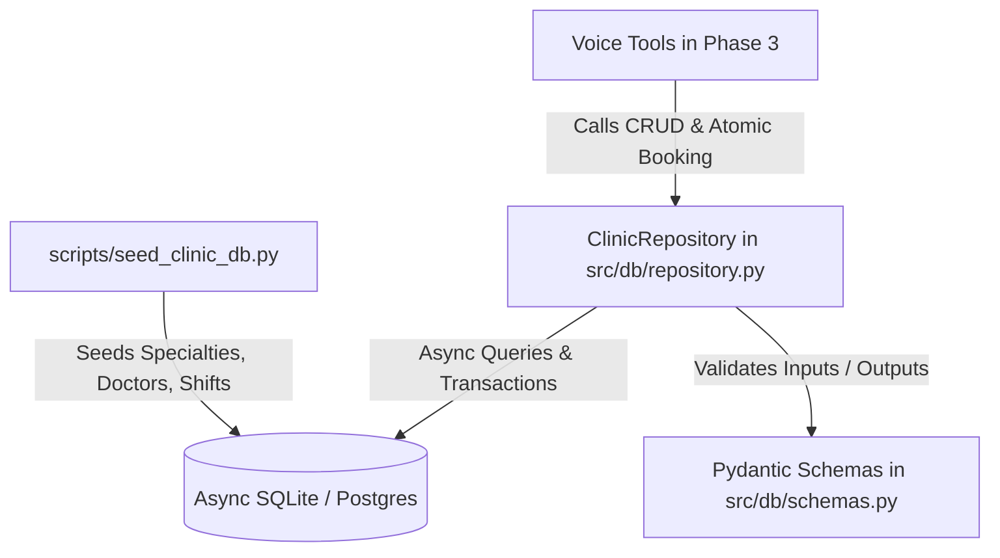

# Feature Plan: Feature 1.4 — Clinic Database Seeder & Repository Layer

## 1. Objective & Why
Feature 1.4 establishes the high-performance async data access layer (`ClinicRepository`) and the initial database seeding pipeline (`scripts/seed_clinic_db.py`) for the Egyptian Polyclinic voice agent. 
Without a dedicated repository, voice tools would couple business logic directly to low-level SQLAlchemy queries, risking race conditions during concurrent bookings. This layer provides clean, ACID-compliant abstractions for doctor availability queries, patient registration, atomic appointment booking with sequential queue numbering, and realistic seed data reflecting real-world Egyptian polyclinic operations.

---

## 2. Scope & Boundaries

### In Scope:
1. **Async Clinic Repository (`src/db/repository.py`)**:
   - `get_specialties()` & `get_specialty_by_code()`: Query active clinic departments.
   - `get_doctors_by_specialty()` & `get_doctor_by_id()`: Retrieve doctor profiles, qualifications, and fees.
   - `get_doctor_availability()`: Query upcoming shifts, operating hours, and remaining slots (`max_capacity - booked_count`) for a doctor or specialty on a given date.
   - `get_or_create_patient()`: Lookup or register a patient using clean Egyptian phone numbers.
   - `create_appointment()`: Atomic booking within a transaction that checks shift capacity, assigns next sequential `queue_number` starting from 1, generates unique `booking_code` (e.g. `APT-YYYYMMDD-001`), and commits.
   - `get_patient_appointments()`, `get_appointment_by_code()`, `cancel_appointment()`: Manage existing bookings.
2. **Database Seeding CLI Pipeline (`scripts/seed_clinic_db.py`)**:
   - Seeds 5 core Egyptian specialties (الباطنة، الأطفال، العظام، النساء والتوليد، الأسنان).
   - Seeds 10 realistic Egyptian doctors (Consultants and Specialists) with realistic Egyptian market fees (200 - 450 EGP).
   - Seeds weekly recurring shifts (`DoctorSchedule`) with realistic shift times and capacity caps (15-20 patients per shift).
   - CLI flags: `--reset` to wipe and recreate tables, and regular run supporting idempotent upsert without destroying past patient bookings.
3. **Repository Unit & Integration Tests (`tests/test_clinic_repository.py`)**:
   - Comprehensive test suite covering all repository methods, concurrency/capacity edge cases, and CLI seeding execution.

### Out of Scope:
- Voice LLM tool functions (deferred to Phase 3: `src/tools/`).
- Qdrant knowledge base vector ingestion (deferred to Phase 2: Feature 2.2).
- LiveKit streaming audio integration (deferred to Phase 4).

---

## 3. Relevant Architecture & Invariants

From `spec/tech.md`:
- **Async SQLAlchemy 2.0**: All repository operations use `AsyncSession` with async context managers (`async with`).
- **Atomic Booking & Shift Capacity**: Bookings must verify `current_bookings_count < max_capacity` and assign queue numbers atomically inside a transaction to prevent race conditions or double bookings.
- **Visit Type Pricing & Policy**: Differentiate between `examination` (كشف جديد) and `consultation` (استشارة).
- **Egyptian Phone Standardization**: All patient lookups leverage `clean_egyptian_phone` from `src/db/schemas.py`.

---

## 4. Components & Data Flow

---

## 5. Affected Files

| File | Change Type | Purpose |
|:---|:---|:---|
| `src/db/repository.py` | Create | Implements `ClinicRepository` async data access methods |
| `src/db/__init__.py` | Modify | Export `ClinicRepository` |
| `scripts/seed_clinic_db.py` | Create | CLI seeder for realistic Egyptian clinic records |
| `tests/test_clinic_repository.py` | Create | Verification tests for repository and seeder |

---

## 6. Execution Breakdown

- **Sub-step 1.4.1**: Implement `ClinicRepository` in `src/db/repository.py` with specialty, doctor, and schedule queries.
- **Sub-step 1.4.2**: Implement patient lookup, atomic appointment booking with queue numbering, and appointment cancellation in `ClinicRepository`.
- **Sub-step 1.4.3**: Implement CLI database seeder script in `scripts/seed_clinic_db.py` with 5 specialties, 10 doctors, shift schedules, and `--reset` support.
- **Sub-step 1.4.4**: Build automated test suite in `tests/test_clinic_repository.py` and run full validation suite.

---

## 7. Risks & Trade-offs

1. **Race Conditions in Queue Numbering**:
   - *Mitigation*: Calculate the next queue number inside an active serializable / write transaction, or increment an atomic counter, while catching `IntegrityError` if a collision occurs.
2. **Idempotent Seeding vs Duplicate Unique Constraints**:
   - *Mitigation*: Lookup existing specialties by `code` and doctors by `name_ar` / `phone_number` before inserting to avoid constraint violations during non-reset runs.
