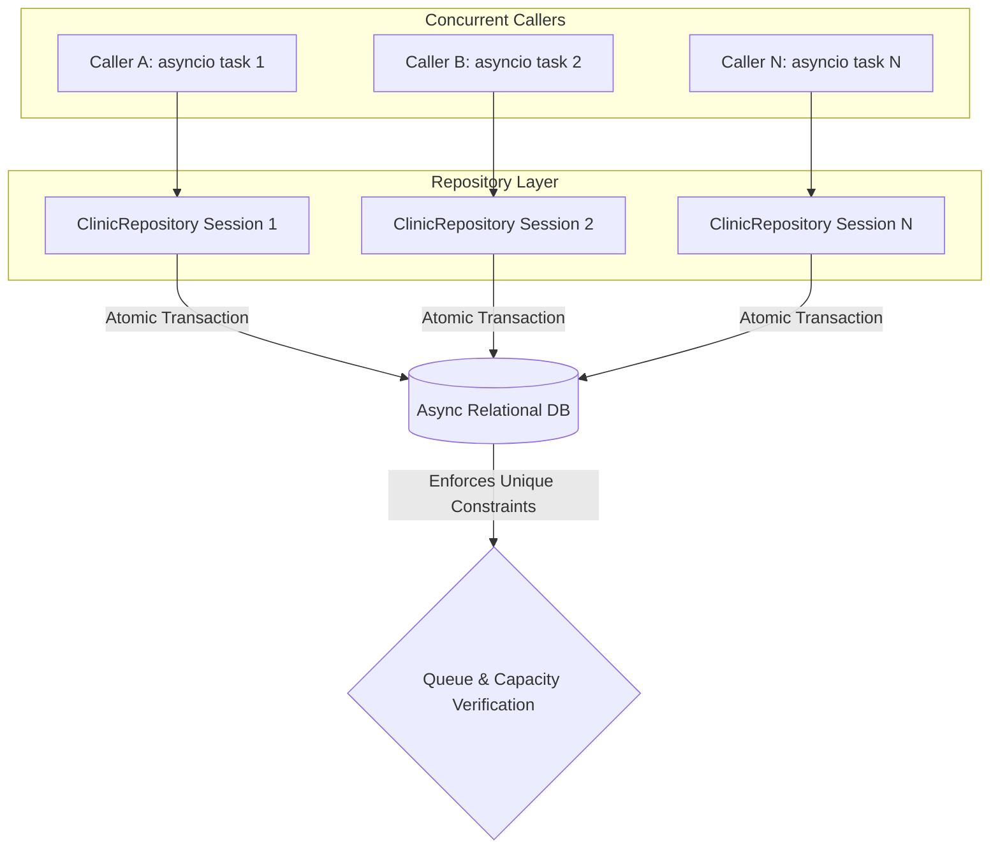

# Feature Plan: Feature 1.5 — Automated Database & Concurrency Test Suite

## 1. Objective & Why
Feature 1.5 completes Phase 1 (Project Foundation & Async Database Layer) by establishing a comprehensive, high-concurrency automated test suite (`tests/test_database.py`).
In an operational Voice AI deployment, multiple callers frequently interact with the clinic voice agent simultaneously during peak hours (e.g. 6:00 PM – 9:00 PM). If two or more callers attempt to reserve an appointment for the same doctor at the exact same millisecond, naive database operations can suffer race conditions: duplicate queue numbers, double bookings, or exceeding shift capacity limits.
This feature builds automated stress tests simulating concurrent incoming callers, verifying atomic transaction serialization, capacity cap enforcement under race conditions, rollback resilience during mid-transaction failures, and complex operational flows such as appointment rescheduling and multi-doctor shifts.

---

## 2. Scope & Boundaries

### In Scope:
1. **Concurrent Booking Simulation (`asyncio.gather`)**:
   - Simulate 5 to 10 simultaneous booking attempts for the same doctor shift on the same date.
   - Assert queue numbers increment strictly without duplicates (`1, 2, 3...`).
   - Assert booking codes are strictly unique.
2. **Race-Condition Shift Capacity Enforcement**:
   - Set a shift with limited capacity (e.g., `max_capacity = 4`).
   - Fire 8 concurrent booking attempts simultaneously.
   - Assert that exactly 4 bookings succeed and the remaining 4 fail gracefully with `ShiftCapacityExceededError`.
   - Verify database state remains completely consistent (no orphaned records, no half-committed appointments).
3. **Multi-Doctor Concurrent Shifts**:
   - Simulate concurrent bookings across different doctors on the same date.
   - Assert that each doctor maintains their own independent queue numbering starting from 1.
4. **Transaction Integrity & Rollback**:
   - Simulate booking failures (e.g. database constraint error, unhandled exception mid-flow).
   - Assert session rolls back completely and no partial state persists.
5. **Operational Rescheduling Flow**:
   - Verify cancellation of existing appointment and subsequent booking into a new slot.
   - Assert capacity of cancelled shift is restored and new shift capacity is consumed.

### Out of Scope:
- Voice pipeline audio streaming (LiveKit WebRTC — Phase 4).
- Voice tool function wrapping (Pydantic tool schemas — Phase 3).
- Vector knowledge base indexing (Qdrant RAG — Phase 2).

---

## 3. Relevant Architecture & Invariants

From `spec/tech.md`:
- **Shift Capacity & Queue Number Invariant**: Appointments must be booked inside atomic transactions, enforcing `current_bookings < max_capacity` and generating unique sequential queue numbers.
- **SQLAlchemy 2.0 Async Session Isolation**: Independent `AsyncSession` instances simulate distinct caller phone connections.
- **SQLite Concurrency & In-Memory Pooling**: Test suite leverages `StaticPool` for in-memory isolation or file-based SQLite with write-ahead logging (WAL) / retry handling.

---

## 4. Components & Data Flow

---

## 5. Affected Files

| File | Change Type | Purpose |
|:---|:---|:---|
| `tests/test_database.py` | Create | Comprehensive concurrency, transaction, and operational test suite |
| `src/db/repository.py` | Refine (if needed) | Ensure atomic queue lock and concurrency safety if tests identify race windows |

---

## 6. Execution Breakdown

- **Sub-step 1.5.1**: Author `tests/test_database.py` with multi-session concurrency fixtures and helper generators for concurrent callers.
- **Sub-step 1.5.2**: Implement concurrent booking test cases asserting strictly sequential queue numbers and zero duplicate booking codes.
- **Sub-step 1.5.3**: Implement concurrent overbooking test asserting strict capacity cap enforcement (`max_capacity` bound).
- **Sub-step 1.5.4**: Implement multi-doctor simultaneous shifts and rescheduling operational flow tests.
- **Sub-step 1.5.5**: Run validation suite, check linting, and confirm zero regressions across all 136 existing tests.

---

## 7. Risks & Trade-offs

1. **SQLite Database Locking Under High Concurrency**:
   - *Risk*: SQLite file databases only support one writer at a time, potentially raising `OperationalError: database is locked` if concurrency is too high without transaction retry.
   - *Mitigation*: Use session-isolated transactions with serialized retry or concurrency throttles matching realistic clinic telephone trunks (5-10 concurrent lines).
