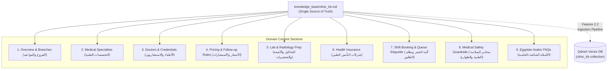

# Feature Plan: Feature 2.1 — Egyptian Clinic Knowledge Base Document

## 1. Objective & Why
Feature 2.1 initiates **Phase 2 (Egyptian Clinic Knowledge Base Engine — Qdrant RAG)** by authoring a comprehensive, authoritative, medical-center-grounded knowledge base document (`knowledge_base/clinic_kb.md`).
In an operational Voice AI deployment for Egyptian polyclinics, callers routinely ask unstructured questions that cannot be answered strictly via relational database lookups:
- *"هل عندكم دكاترة استشاريين قلب وأوعية دموية؟"* (Do you have consultant cardiologists?)
- *"لازم أكون صايم قبل تحليل السكر التراكمي ووظائف الكبد؟"* (Do I need to fast before HbA1c and liver function tests?)
- *"هل بتقبلوا تأمين شركة أكسا أو ميتلايف ونسبة التحمل كام؟"* (Do you accept AXA or MetLife insurance and what is the co-payment?)
- *"الكشف بيشمل الاستشارة ولا الاستشارة منفصلة وميعادها إمتى؟"* (Does the examination include follow-up and what is the validity window?)
- *"عندي ألم شديد ومفاجئ في الصدر وضيق تنفس، أعمل إيه؟"* (Emergency red-flag symptom triage requiring immediate ER redirection).

This document acts as the single source of truth for semantic vector retrieval (Qdrant RAG), prompt grounding, and medical receptionist safety guardrails.

---

## 2. Scope & Boundaries

### In Scope:
1. **Creation of `knowledge_base/clinic_kb.md`**:
   - Comprehensive polyclinic profile for **مجمع عيادات النور التخصصي** (Al-Nour Specialized Clinics).
   - Detailed coverage across 9 core knowledge domains:
     1. General clinic information, branches (Maadi, Nasr City, New Cairo, Dokki, Sheikh Zayed), working hours, hotlines.
     2. Medical specialty departments, clinical scopes, and diagnostic units.
     3. Doctor credentials, titles (Professor, Consultant, Specialist), and practicing departments aligned with the database.
     4. Examination & consultation pricing tiers, 14-day follow-up rules, and accepted payment methods.
     5. Diagnostic lab (تحاليل طبية) and radiology/imaging (أشعة وسونار) services with precise patient preparation guidelines (fasting hours, full bladder requirements, etc.).
     6. Private & corporate health insurance networks (AXA, MetLife, Bupa, Misr Insurance, Gig, MedNet, Allianz), approval requirements, and co-payment policies.
     7. Booking mechanics, shift arrival guidelines (15-30 mins prior), and queue numbering etiquette.
     8. Strict medical safety guardrails: Zero over-the-phone diagnosis, zero medication prescriptions, and mandatory immediate emergency redirection to Hotline 123.
     9. High-frequency caller FAQs in natural Egyptian Arabic paired with English terminology.
2. **Chunking & Semantic Optimization**:
   - Structured markdown with standardized headings, bullet points, and tables designed for high semantic density and clean text chunking in downstream RAG ingestion (Feature 2.2).
   - Bilingual coverage: Spoken Egyptian Arabic for voice synthesis paired with Modern Standard Arabic and English medical terms.

### Out of Scope:
- Ingestion scripts and vector chunk embedding into Qdrant (`scripts/ingest_clinic_knowledge.py` — Feature 2.2).
- Vector retrieval test suite and semantic search benchmarking (`tests/test_clinic_rag.py` — Feature 2.3).
- LiveKit tool execution function (`src/tools/knowledge_search.py` — Phase 3).

---

## 3. Relevant Architecture & Invariants

From `spec/tech.md` and `spec/mission.md`:
- **Medical Safety & Liability Invariant**: Strict prohibition of medical diagnosis and drug prescriptions over audio.
- **RAG Latency Budget**: Content formatted for clean chunking (300-500 tokens per chunk) ensuring retrieval latency < 150ms.
- **Consistent Data Invariant**: Specialty names, doctor names, shift timings, and fees must be strictly coherent with the database seeder (`scripts/seed_clinic_db.py`).

---

## 4. Components & Content Architecture

---

## 5. Affected Files

| File | Change Type | Purpose |
|:---|:---|:---|
| `knowledge_base/clinic_kb.md` | Create | Rich Egyptian polyclinic knowledge base document for RAG ingestion |
| `knowledge_base/restaurant_kb.md` | Deprecate / Archive | Legacy restaurant knowledge base retained or superseded |

---

## 6. Execution Breakdown

- **Sub-step 2.1.1**: Author clinic overview, multi-branch contact info, operating hours, and specialty departments.
- **Sub-step 2.1.2**: Author doctor profiles, fee schedules, 14-day follow-up rules, and accepted payment methods.
- **Sub-step 2.1.3**: Author diagnostic lab and radiology services with strict patient preparation rules (fasting, hydration).
- **Sub-step 2.1.4**: Author insurance network policies, approval steps, and co-payment guidelines.
- **Sub-step 2.1.5**: Author medical safety guardrails (emergency 123 redirection) and comprehensive Egyptian Arabic FAQs.
- **Sub-step 2.1.6**: Validate structural markdown syntax, heading hierarchy, semantic chunkability, and coherence with database seeder.

---

## 7. Risks & Trade-offs

1. **Risk of Document Hallucination vs Relational Database Desynchronization**:
   - *Risk*: If doctor fees or specialties in `clinic_kb.md` contradict `src/db/seeder.py`, the agent may produce conflicting answers.
   - *Mitigation*: Ensure 100% alignment between `clinic_kb.md` and the 10 doctors, 5 core specialties, and shift fees registered in `scripts/seed_clinic_db.py`.
2. **Medical Liability Risk**:
   - *Risk*: A caller asking about symptoms might be given clinical advice.
   - *Mitigation*: Prominently embed explicit disclaimers and immediate emergency handoff triggers in both Arabic and English within the document.
