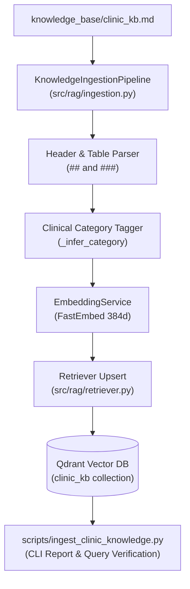

# Feature Plan: Feature 2.2 — Vector Store Ingestion & CLI Pipeline for `clinic_kb` Collection

## 1. Objective & Why
Feature 2.2 continues **Phase 2 (Egyptian Clinic Knowledge Base Engine — Qdrant RAG)** by implementing a dedicated, robust ingestion pipeline and CLI tool (`scripts/ingest_clinic_knowledge.py`) to parse, semantically chunk, categorize, embed, and index `knowledge_base/clinic_kb.md` into Qdrant (`clinic_kb` collection).
While Feature 2.1 created the authoritative clinical knowledge base document, semantic search requires transforming that document into vectorized points with rich metadata (`category`, `section`, `source`).
In a Voice AI system, sub-second RAG retrieval (< 150ms) depends heavily on:
1. High-precision semantic chunking (headers and tables intact, avoiding fragmented context).
2. Domain-adapted clinical category tagging (e.g. `specialties`, `doctors`, `pricing`, `lab_radiology`, `insurance`, `booking_queue`, `safety_guardrails`, `faqs`).
3. Seamless execution across both local in-memory Qdrant and cloud Qdrant instances.
4. Idempotent index management (recreate collection flag vs upsert).

---

## 2. Scope & Boundaries

### In Scope:
1. **Clinic Category Inference in Ingestion Pipeline (`src/rag/ingestion.py`)**:
   - Update `KnowledgeIngestionPipeline._infer_category` to recognize Egyptian clinic domain keywords in both Arabic and English:
     - `specialties`: تخصصات، عيادات، أطفال، عظام، باطنة، قلب، أسنان، نساء وتوليد، جلدية، عيون، أنف وأذن، مخ وأعصاب.
     - `doctors`: أطباء، استشاري، أخصائي، د.، درجات علمية، كفاءات، جدول الأطباء.
     - `pricing`: أسعار، كشف، استشارة، 14 يوم، رسوم، فيزا، كاش، تقسيط، فاليو، سهولة.
     - `lab_radiology`: تحاليل، معمل، أشعة، سونار، صيام، بول، براز، وظائف كبد، وظائف كلى، سكر صائم، دهون، رنين.
     - `insurance`: تأمين، أكسا، ميتلايف، بوبا، مصر للتأمين، كارت، نسبة تحمل، موافقة مسبقة.
     - `booking_queue`: حجز، طابور، نمرة، شيفت، حضور، تأخير، إلغاء، تعديل، أسبقية.
     - `safety_guardrails`: طوارئ، إسعاف، 123، ألم صدر، جلطة، اختناق، تحذير، محاذير، حظر تشخيص.
     - `faqs`: أسئلة شائعة، استفسارات، سيناريوهات.
     - `general`: فروع، مواعيد العمل، المعادي، مدينة نصر، التجمع، الدقي، الشيخ زايد، الخط الساخن.
2. **Dedicated CLI Ingestion Pipeline (`scripts/ingest_clinic_knowledge.py`)**:
   - Command-line arguments:
     - `--kb-path`: Path to markdown file (default `knowledge_base/clinic_kb.md`).
     - `--recreate`: Boolean flag to reset collection before ingestion.
     - `--test-query`: Sample query to verify vector retrieval immediately after ingestion.
   - Outputs: Clear CLI progress reporting (chunks parsed, categories breakdown, embedding generation time, sample retrieval scores).
3. **Multi-Platform UTF-8 & OS Resilience**:
   - Safe UTF-8 console output for Arabic text on Windows shells.

### Out of Scope:
- Authoring the knowledge base text (completed in Feature 2.1).
- Automated pytest retrieval test suite and benchmarking (`tests/test_clinic_rag.py` — Feature 2.3).
- LiveKit voice pipeline integration (`src/tools/knowledge_search.py` — Phase 3).

---

## 3. Relevant Architecture & Invariants

From `spec/tech.md`:
- **Vector DB**: Qdrant (local `:memory:` or Qdrant Cloud) using collection name `settings.qdrant_collection` (`clinic_kb`).
- **Embedding Model**: FastEmbed `paraphrase-multilingual-MiniLM-L12-v2` (384-dimensional dense vectors, ONNX runtime, zero PyTorch overhead).
- **Latency Budget**: Chunking designed to keep chunks within 300–500 tokens for sub-150ms semantic search.

---

## 4. Components & Data Flow

---

## 5. Affected Files

| File | Change Type | Purpose |
|:---|:---|:---|
| `scripts/ingest_clinic_knowledge.py` | Create | Dedicated CLI runner for clinic knowledge ingestion and verification |
| `src/rag/ingestion.py` | Refine | Enhance category classifier with Egyptian healthcare keywords |
| `src/rag/retriever.py` | Refine (if needed) | Ensure collection recreation / reset helper methods exist cleanly |

---

## 6. Execution Breakdown

- **Sub-step 2.2.1**: Update `src/rag/ingestion.py` category inference logic to prioritize medical and clinic operational categories.
- **Sub-step 2.2.2**: Author `scripts/ingest_clinic_knowledge.py` supporting `--kb-path`, `--recreate`, and sample verification queries.
- **Sub-step 2.2.3**: Execute CLI ingestion pipeline on `knowledge_base/clinic_kb.md` and verify chunks indexed in Qdrant.
- **Sub-step 2.2.4**: Run sample verification queries in colloquial Egyptian Arabic (fasting rules, doctor availability, insurance).
- **Sub-step 2.2.5**: Run full project regression suite (`pytest tests/`) and code formatting checks (`ruff check`).

---

## 7. Risks & Trade-offs

1. **Category Overlapping**:
   - *Risk*: A section discussing "fees of pediatric doctors" might match both `doctors` and `pricing`.
   - *Mitigation*: Title-first precedence with hierarchical rules, keeping metadata rich while general queries perform cross-category dense vector search.
2. **FastEmbed Model Download on Cold Run**:
   - *Risk*: FastEmbed may take a few seconds on initial invocation to load ONNX weights.
   - *Mitigation*: Leverage cached model singleton in `src/rag/embeddings.py`.
