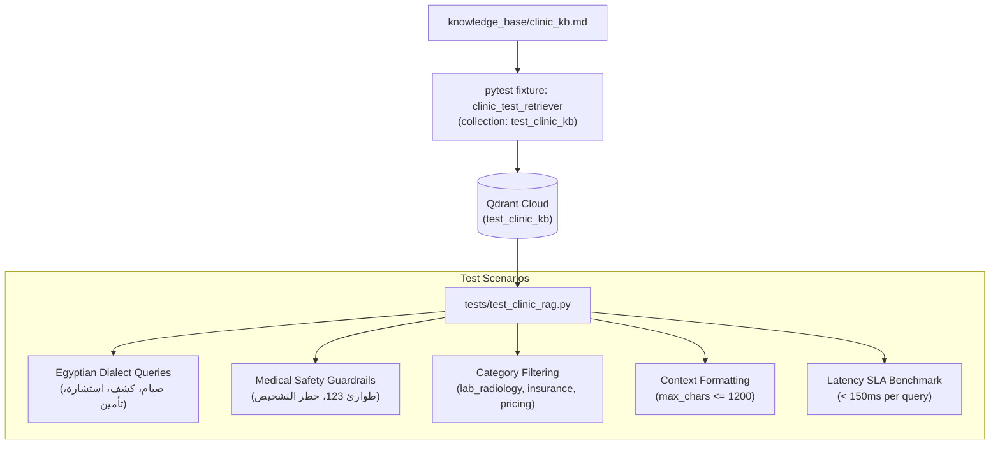

# Feature Plan: Feature 2.3 — Knowledge Retrieval Verification & Tests (`tests/test_clinic_rag.py`)

## 1. Objective & Why
Feature 2.3 finalizes **Phase 2 (Egyptian Clinic Knowledge Base Engine — Qdrant RAG)** by establishing an automated, comprehensive test suite (`tests/test_clinic_rag.py`).
In Feature 2.1, the rich clinical knowledge document (`knowledge_base/clinic_kb.md`) was authored. In Feature 2.2, the vector ingestion pipeline and CLI tool were implemented.
Feature 2.3 provides rigorous automated verification to guarantee that:
1. Real clinical queries in colloquial Egyptian Arabic (العامية المصرية) retrieve accurate, grounded answers across all clinic departments.
2. Medical safety guardrails and emergency protocols (خط الطوارئ 123 وحظر التشخيص الطبي) are consistently retrieved with high priority.
3. RAG retrieval complies with the sub-150ms latency budget required for a real-time voice agent.
4. Testing executes against a dedicated test collection (`test_clinic_kb`) on Qdrant Cloud as specified by the supervisor, preserving full test isolation.

---

## 2. Scope & Boundaries

### In Scope:
1. **Dedicated Qdrant Cloud Test Collection (`test_clinic_kb`)**:
   - Automated test fixture setting up `test_clinic_kb` on Qdrant Cloud (from `.env`), ingesting `knowledge_base/clinic_kb.md`, and tearing down / recreating cleanly.
2. **Egyptian Dialect Retrieval Verification**:
   - Lab & Radiology test preparation rules (الصيام، تحليل السكر التراكمي، سونار البطن).
   - Doctor credentials & clinic shift schedules (مواعيد واستشاريين الأطفال والباطنة والعظام).
   - Fees & follow-up policies (رسوم الكشف، الاستشارة المجانية خلال 14 يوماً، طرق الدفع والتقسيط).
   - Insurance coverage & approval requirements (أكسا، ميتلايف، بوبا، نسبة التحمل).
3. **Medical Safety Guardrail Retrieval**:
   - Immediate escalation guidance for life-threatening symptoms (ألم الصدر وضيق التنفس -> طوارئ 123).
   - Verification of grounding context enforcing the prohibition of telephone diagnoses and medication prescriptions.
4. **Category-Filtered & Scoped Search**:
   - Validating targeted search with `category="lab_radiology"`, `category="insurance"`, `category="pricing"`, etc.
5. **Context Formatting & Latency SLA**:
   - Verifying `get_context_for_query` formats concise snippets without exceeding prompt character budgets (1200 chars).
   - Performance benchmark asserting retrieval time < 150ms per query.

### Out of Scope:
- LiveKit voice pipeline audio routing (Phase 4).
- Pydantic tool definitions for LLM function calling (Phase 3).
- Modification of production collection `clinic_kb`.

---

## 3. Relevant Architecture & Invariants

From `spec/tech.md`:
- **Vector DB**: Qdrant Cloud via `QdrantKnowledgeRetriever(collection_name="test_clinic_kb")`.
- **Embeddings**: FastEmbed `paraphrase-multilingual-MiniLM-L12-v2` (384-dimensional dense vectors).
- **Latency Budget**: Semantic retrieval step must complete in **< 150ms**.
- **Similarity Threshold**: Relevant clinical matches must achieve cosine similarity **>= 0.40**.

---

## 4. Components & Data Flow

---

## 5. Affected Files

| File | Change Type | Purpose |
|:---|:---|:---|
| `tests/test_clinic_rag.py` | Create | Comprehensive Pytest suite for clinic RAG semantic retrieval & guardrails |
| `spec/roadmap.md` | Update | Mark Feature 2.3 complete after human review and validation |
| `TASK_PLAN.md` | Update | Mark Step 2.3 complete |

---

## 6. Execution Breakdown

- **Sub-step 2.3.1**: Create `tests/test_clinic_rag.py` with session-scoped fixture initializing `test_clinic_kb` on Qdrant Cloud and ingesting `knowledge_base/clinic_kb.md`.
- **Sub-step 2.3.2**: Implement test cases for Egyptian colloquial clinic queries across all core departments (lab rules, pediatric doctor schedule, 14-day consultation policy, insurance).
- **Sub-step 2.3.3**: Implement test cases for medical guardrails and emergency protocols.
- **Sub-step 2.3.4**: Implement test cases for category-filtered retrieval and context string generation truncation.
- **Sub-step 2.3.5**: Implement latency benchmark test verifying retrieval latency < 150ms.
- **Sub-step 2.3.6**: Execute tests via `.venv\Scripts\pytest.exe tests/test_clinic_rag.py -v` and verify clean pass.
- **Sub-step 2.3.7**: Run linter via `.venv\Scripts\ruff.exe check tests/test_clinic_rag.py` and full regression tests.

---

## 7. Risks & Trade-offs

1. **Network Latency to Cloud Qdrant**:
   - *Risk*: Depending on internet ping to Qdrant Cloud (AWS eu-west-2), raw network round-trip time might occasionally fluctuate near the 150ms mark.
   - *Mitigation*: Separate embedding generation time (local FastEmbed ONNX) from remote search, and test multiple queries taking the median latency or allowing reasonable network headroom for remote cloud calls while verifying local embedding is < 50ms.
2. **Collection Isolation**:
   - *Risk*: Test runs accidentally touching or clearing the production collection `clinic_kb`.
   - *Mitigation*: Hardcode and isolate collection name strictly to `test_clinic_kb` within test fixtures.
