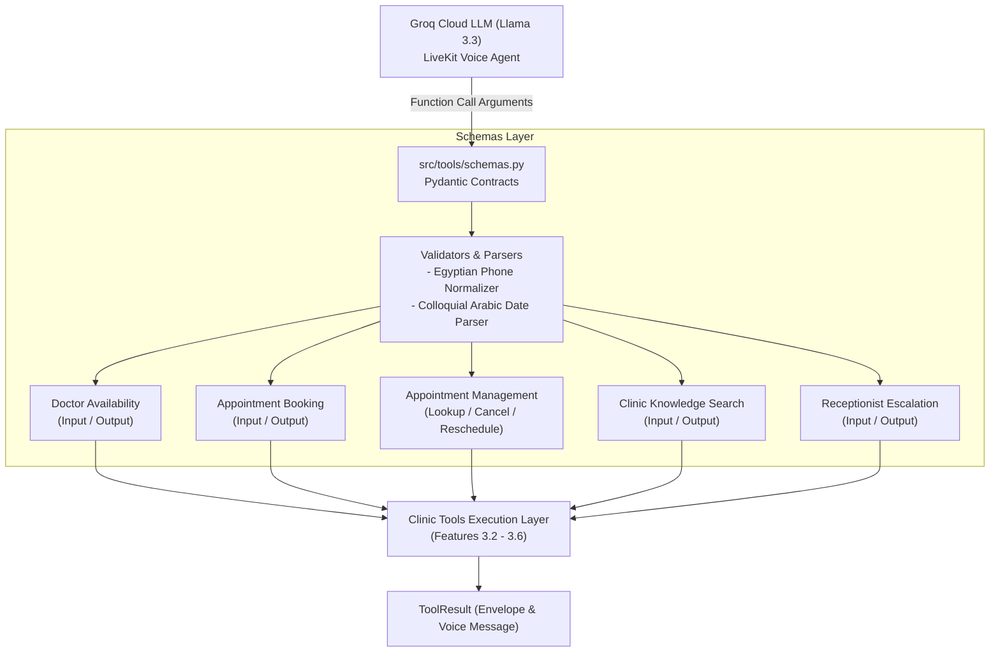

# Feature Plan: Feature 3.1 — Clinic Domain Tool Schemas (`src/tools/schemas.py`)

## 1. Objective & Why
In the Voice AI Agent platform for Egyptian Polyclinics, tools act as the execution bridge between conversational LLM intent (Groq Cloud Llama 3.3) and the clinic backend systems (Async Relational Database and Qdrant RAG).
Feature 3.1 establishes the foundational Pydantic contract layer for all Phase 3 execution tools by creating strongly-typed, voice-optimized schemas in `src/tools/schemas.py`.

This feature provides:
1. Complete replacement of obsolete restaurant schemas (`OrderStatus*`, `Reservation*`) with polyclinic domain contracts.
2. Strongly-typed inputs and outputs for all 5 clinic tools:
   - Doctor Availability & Shift Lookup (`check_doctor_availability`)
   - Appointment Booking with Queue Assignment (`book_appointment`)
   - Appointment Management: Lookup, Reschedule, and Cancellation (`manage_appointment`)
   - Clinic Knowledge Search via RAG (`search_clinic_knowledge`)
   - Human Receptionist Escalation & Emergency Handoff (`transfer_to_receptionist`)
3. Built-in Egyptian phone number normalization and colloquial Arabic date parser (e.g., "اليوم", "بكرة", "السبت", "بعد بكره") converting into standard `datetime.date`.
4. High-performance JSON schema generation fully compatible with LiveKit Agents and OpenAI/Groq function calling.

---

## 2. Scope & Boundaries

### In Scope:
- **Generic Execution Envelope**:
  - `ToolResult`: Unified status envelope (`success`, `message`, `data`, `error`).
- **Data Normalizers & Domain Enums**:
  - `clean_egyptian_phone`: Normalization validator for Egyptian 11-digit mobile numbers (`010`, `011`, `012`, `015`).
  - `parse_colloquial_date`: Flexible date parser resolving ISO dates (`YYYY-MM-DD`) and common Egyptian colloquial expressions (`اليوم`, `النهاردة`, `بكرة`, `بعد بكرة`, أسماء الأيام) relative to current local date.
  - `ManageAppointmentAction`: Enum (`lookup`, `cancel`, `reschedule`).
  - `HandoffUrgencyEnum`: Enum (`low`, `medium`, `urgent`, `emergency`).
  - `HandoffDepartmentEnum`: Enum (`reception`, `nursing`, `billing`, `emergency`).
- **Doctor Availability Schemas**:
  - `DoctorAvailabilityInput`: doctor identifier/name, specialty, target date.
  - `DoctorAvailabilityOutput`: shift hours, formatted shift time, capacity, remaining slots, examination/consultation fees.
- **Appointment Booking Schemas**:
  - `AppointmentBookingInput`: patient name, patient phone, doctor name or ID, target date, visit type (`examination` / `consultation`), optional symptoms/notes.
  - `AppointmentBookingOutput`: booking code, patient name, doctor name, specialty, date, queue number (نمرة الحجز), shift window, fee in EGP, voice-friendly confirmation message.
- **Appointment Management Schemas**:
  - `AppointmentLookupInput`, `AppointmentCancelInput`, `AppointmentRescheduleInput`.
  - `ManageAppointmentInput`: Unified polymorphic input supporting all actions.
  - `ManageAppointmentOutput`: Consolidated response envelope for lookups, cancellations, and reschedules.
- **Clinic Knowledge Search Schemas**:
  - `ClinicKnowledgeSearchInput`: query, limit, score threshold, optional category filter.
  - `ClinicKnowledgeSearchOutput` & `KnowledgeChunk`: retrieved snippets, similarity scores, and LLM synthesis context.
- **Receptionist Escalation Schemas**:
  - `ReceptionistHandoffInput`: caller name, caller phone, reason, department, urgency, call summary.
  - `ReceptionistHandoffOutput`: handoff code, urgency, department, estimated wait time, escalation message.
- **Legacy Cleanup**:
  - Completely deprecate and remove restaurant schemas (`OrderStatusEnum`, `OrderItem`, `OrderStatusInput`, `OrderStatusOutput`, `ReservationStatusEnum`, `ReservationInput`, `ReservationOutput`).

### Out of Scope:
- Tool execution logic, SQL queries, or database session management (implemented in Features 3.2, 3.3, 3.4).
- Qdrant retriever call execution (implemented in Feature 3.5).
- LiveKit room data packet dispatching (implemented in Feature 3.6).

---

## 3. Relevant Architecture & Invariants

From `spec/tech.md`:
- **Tool Execution Timeout**: < 400ms. Schema validation overhead must be negligible (< 2ms) using Pydantic v2 core.
- **Voice Response Invariant**: Every tool output schema must contain a mandatory `message: str` field formatted as concise, natural Egyptian Arabic suited for streaming speech synthesis.
- **Zero Medical Hallucination Guardrail**: Schemas must enforce visit types (`examination` vs `consultation`) and validation parameters to prevent unauthorized pricing or schedule mutations.
- **Strict Data Contracts**: Schemas must utilize Pydantic `ConfigDict(extra="ignore")` to gracefully ignore redundant LLM hallucinated arguments while strictly validating required fields.

---

## 4. Components & Data Flow

---

## 5. Affected Files

| File | Change Type | Purpose |
|:---|:---|:---|
| `spec/features/feature-301-medical-tools-schemas/plan.md` | Create | Feature execution plan |
| `spec/features/feature-301-medical-tools-schemas/requirements.md` | Create | Detailed functional and non-functional requirements |
| `spec/features/feature-301-medical-tools-schemas/validation.md` | Create | 3-tier validation criteria and automated test spec |
| `src/tools/schemas.py` | Overwrite / Modify | Pydantic schemas for all clinic domain tools |
| `src/tools/__init__.py` | Modify | Update package exports to reflect clinic schemas |
| `tests/test_medical_schemas.py` | Create | Unit and schema serialization test suite |

---

## 6. Execution Breakdown

- **Sub-step 3.1.1**: Author specification files (`plan.md`, `requirements.md`, `validation.md`).
- **Sub-step 3.1.2**: Generate Arabic artifact presentation for human review.
- **Sub-step 3.1.3** *(Post Approval)*: Implement Egyptian date parser utility and phone normalizer in `src/tools/schemas.py`.
- **Sub-step 3.1.4** *(Post Approval)*: Implement all Pydantic models for availability, booking, management, knowledge search, and receptionist escalation.
- **Sub-step 3.1.5** *(Post Approval)*: Update `src/tools/__init__.py` exports to clean up restaurant references.
- **Sub-step 3.1.6** *(Post Approval)*: Author automated test suite in `tests/test_medical_schemas.py`.
- **Sub-step 3.1.7** *(Post Approval)*: Run validation suite via `.venv\Scripts\pytest.exe tests/test_medical_schemas.py -v`.
- **Sub-step 3.1.8** *(Post Approval)*: Run regression checks (`tests/test_database.py`, `tests/test_clinic_rag.py`) and linter (`ruff check`).

---

## 7. Risks & Trade-offs

1. **Colloquial Arabic Date Ambiguities**:
   - *Risk*: A patient saying "يوم التلات" when today is Tuesday might mean today or next week's Tuesday.
   - *Mitigation*: Colloquial date parser handles relative tokens deterministically ("اليوم" = today, "بكرة" = tomorrow, day names = next upcoming occurrence within 7 days) and falls back cleanly to ISO date format or raises a clear `ValueError` with guidance for the agent.
2. **Backward Compatibility with Tools in Progress**:
   - *Risk*: Modifying `src/tools/schemas.py` and removing restaurant models could affect unrefactored tool files (`reservation.py`, `order_status.py`).
   - *Mitigation*: These files are legacy template files scheduled for replacement in Steps 3.2-3.4. We will ensure existing tests and imports are clean, keeping minimal shims or isolating exports in `src/tools/__init__.py`.
