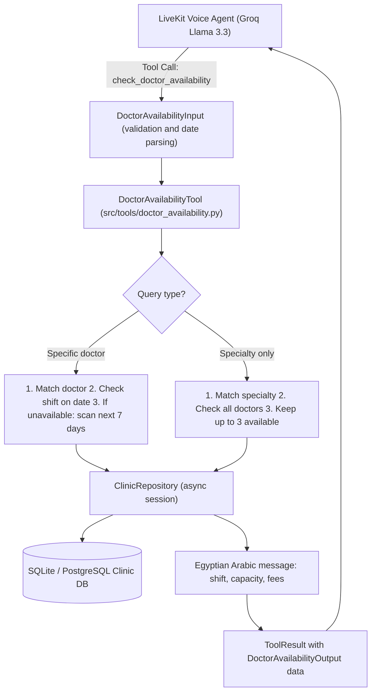

# Feature Plan: Feature 3.2 — Doctor Availability & Shift Lookup Tool (`src/tools/doctor_availability.py`)

## 1. Objective & Why
Asking about **doctor schedules, availability, and fees** is the most frequent request from callers to an Egyptian polyclinic.
Feature 3.2 builds a strongly-typed execution tool (`src/tools/doctor_availability.py`) that lets the LLM (Groq Llama 3.3 / LiveKit Voice Agent) query live data for:
1. A specific doctor (by name or ID): shift hours on a date, remaining capacity, examination and consultation fees.
2. The nearest alternative available day within the next 7 days when the doctor has no shift or the shift is fully booked.
3. A whole specialty (e.g. "دكاترة الباطنة بكرة"): up to 3 available doctors with their shifts and fees.

---

## 2. Scope & Boundaries

### In Scope
- **Fuzzy & canonical matcher for doctors and specialties**:
  - Arabic normalization: strip titles ("د.", "دكتور", ...), unify hamza forms (أ/إ/آ → ا), unify ة/ه and ى/ي, remove diacritics.
  - Partial or full matching on Arabic or English names (`name_ar`, `name_en`).
  - Specialty matching by code (e.g. `internal_medicine`) or Arabic name (e.g. "باطنة").
- **Specific doctor lookup**:
  - Uses `ClinicRepository.get_doctor_availability` to compare confirmed bookings with `max_capacity`.
  - If unavailable or full: scan the next 7 days and include the nearest available day in the spoken message.
- **Specialty lookup**:
  - Fetch active doctors in the specialty and check each one on the requested date.
  - Return up to 3 available doctors in a concise, TTS-friendly message.
  - If none are available that day, suggest the nearest upcoming day with available doctors.
- **Sync & async callables**: `check_doctor_availability`, `async_check_doctor_availability`, and a `DoctorAvailabilityTool` class wrapper registered in `TOOL_REGISTRY`.
- **Voice-friendly responses**: polite Egyptian Arabic messages wrapped in `ToolResult` / `DoctorAvailabilityOutput`.

### Out of Scope
- Booking and queue-number assignment (Feature 3.3 `book_appointment`).
- Cancelling or rescheduling appointments (Feature 3.4 `manage_appointment`).
- Any medical advice or diagnosis based on symptoms (strictly prohibited).
- Any change to the Feature 3.1 contracts in `src/tools/schemas.py` (used as-is).

### Approved Clarification Decisions
| # | Question | Decision |
|:---|:---|:---|
| D1 | Feature 3.1 was not committed | Committed 3.1 first (`c2db68b`) before starting 3.2 |
| D2 | Result shape for specialty lookup (up to 3 doctors) | `ToolResult` with `data={"doctors": [DoctorAvailabilityOutput, ...]}`, no 3.1 schema changes |
| D3 | Name matches more than one doctor | `ToolResult(success=False)` with candidates and their specialties in `data["candidates"]` so the agent asks the caller |
| D4 | Default date "today" | Computed by the tool in `Africa/Cairo` time, without touching `schemas.py` |
| D5 | Tier 7 (CLI) check | One `uv run python -c` command calling `check_doctor_availability` against the seeded database |

---

## 3. Relevant Existing Architecture & Invariants
- **Latency budget (< 400ms)**: DB queries for shifts and availability should run well under that on existing indexes (`doctor_id`, `appointment_date`, `is_active`).
- **Async DB layer**: reuse `get_async_session` and `ClinicRepository` from Phase 1.
- **Strict Pydantic contracts**: rely only on `DoctorAvailabilityInput`, `DoctorAvailabilityOutput`, and `ToolResult` from Feature 3.1.
- **No hallucinated schedules or fees**: the tool must never invent slots that are not backed by `DoctorSchedule` rows.

---

## 4. Components & Data Flow

---

## 5. Expected Affected Files

| File | Change | Purpose |
|:---|:---|:---|
| `spec/features/feature-302-doctor-availability-tool/plan.md` | Create | Feature plan |
| `spec/features/feature-302-doctor-availability-tool/requirements.md` | Create | Functional / non-functional requirements and constraints |
| `spec/features/feature-302-doctor-availability-tool/validation.md` | Create | Validation criteria |
| `src/tools/doctor_availability.py` | Create | Tool implementation |
| `src/tools/__init__.py` | Modify | Export and register the tool in `TOOL_REGISTRY` |
| `tests/test_doctor_availability.py` | Create | Unit, integration, and edge-case tests |

---

## 6. Execution Breakdown

- **Step 3.2.1**: Write the spec (`plan.md`, `requirements.md`, `validation.md`) and wait for human approval 🛑.
- **Step 3.2.2** *(after approval)*: Implement Arabic/English normalization and fuzzy matching for doctors and specialties.
- **Step 3.2.3** *(after approval)*: Implement specific-doctor lookup with the 7-day next-available fallback and ambiguity handling.
- **Step 3.2.4** *(after approval)*: Implement specialty lookup returning up to 3 available doctors with fees and shift hours.
- **Step 3.2.5** *(after approval)*: Register the tool in `src/tools/__init__.py` for LLM function calling.
- **Step 3.2.6** *(after approval)*: Write and run `tests/test_doctor_availability.py` plus regression, lint, and CLI checks.

---

## 7. Risks & Trade-offs

1. **Common, similar doctor names (e.g. "د. أحمد")**
   - *Risk*: multiple doctors share a first name.
   - *Mitigation*: narrow by specialty if given; if more than one candidate remains, return `ToolResult(success=False)` with the candidate list (D3) so the agent asks the caller to choose.
2. **UTC vs. Cairo time**
   - *Risk*: the 3.1 date parser uses UTC, so "today" may resolve to the previous day after midnight in Egypt.
   - *Mitigation*: the tool explicitly uses today's date in `Africa/Cairo` when no date is provided (D4).
3. **Queries far in the future**
   - *Risk*: a caller asking about a date months away could trigger many sequential checks.
   - *Mitigation*: the automatic fallback scan is limited to **7 consecutive days** to keep the response under 400ms.
