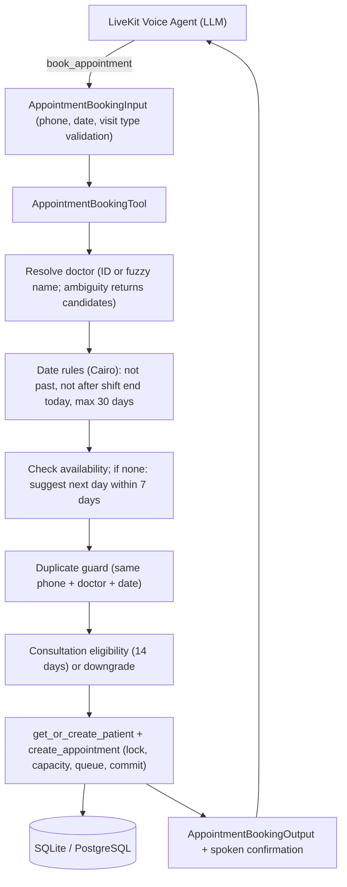

# Feature Plan: Feature 3.3 — Appointment Booking Tool with Atomic Queue Number Assignment (`src/tools/appointment_booking.py`)

## 1. Objective & Why
After a caller hears a doctor's availability (Feature 3.2), the natural next step is **"احجزلي"**.
Feature 3.3 builds the `book_appointment` execution tool that lets the LLM reserve a confirmed queue slot (نمرة الحجز) for a patient with a specific doctor on a specific date, safely and atomically, and read back a short spoken confirmation (booking code, queue number, shift window, fee).

Without this tool the agent can only inform; it cannot convert calls into bookings, which is the core business value in `spec/mission.md`.

---

## 2. Scope & Boundaries

### In Scope
- **Input**: `AppointmentBookingInput` from Feature 3.1 (patient name, Egyptian phone, `doctor_id` or `doctor_name`, date, visit type, optional notes).
- **Doctor resolution**: by ID, or by name reusing `match_doctors` / `normalize_text_ar` from Feature 3.2 (same ambiguity behavior: return candidates, never auto-select).
- **Date rules** (Cairo time): reject past dates, reject today if the shift already ended, reject dates more than 30 days ahead.
- **Duplicate guard**: reject if the same phone already has a confirmed booking with the same doctor on the same date, and return the existing booking code and queue number.
- **Unavailable shift**: if no shift / shift full, return `success=False` and suggest the nearest available day within 7 days (no automatic booking).
- **Consultation eligibility**: `consultation` is accepted only if the patient has a non-cancelled `examination` with the same doctor within the last 14 days; otherwise it is downgraded to `examination` and the message says so.
- **Atomic booking**: patient get-or-create + `ClinicRepository.create_appointment` (existing per-shift lock, capacity check, sequential queue number, unique booking code) in one session/transaction, with one retry on a DB uniqueness conflict.
- **Callables**: `book_appointment` (sync), `async_book_appointment` (async), `AppointmentBookingTool` class and singleton, registered in `TOOL_REGISTRY`.
- **Voice-friendly responses** in polite Egyptian Arabic wrapped in `ToolResult` with `AppointmentBookingOutput` data.

### Out of Scope
- Lookup, cancellation, rescheduling (Feature 3.4).
- Removing legacy restaurant tools such as `book_reservation` (separate cleanup feature — decision D5).
- Payments, SMS confirmations, idempotency keys and state machine (Feature 4.5).
- Any change to Feature 3.1 contracts in `src/tools/schemas.py` or to the repository's public behavior.
- Medical advice, triage, or diagnosis.

### Approved Clarification Decisions
| # | Question | Decision |
|:---|:---|:---|
| D1 | Same phone already booked with same doctor/date | Reject; return existing booking code and queue number politely |
| D2 | No shift or full shift on requested date | `success=False` + nearest available day within 7 days; no auto-booking |
| D3 | Allowed booking dates | No past dates; no "today" after shift end (Cairo time); max 30 days ahead |
| D4 | Consultation eligibility | Allowed only with a non-cancelled examination with same doctor in last 14 days; otherwise downgrade to examination and say so |
| D5 | Legacy `book_reservation` in registry | Keep as-is; remove all legacy tools later in a dedicated cleanup feature |

---

## 3. Relevant Existing Architecture & Invariants
- `ClinicRepository.create_appointment` already implements the atomic invariant from `spec/tech.md` §2: per-(doctor, date) `asyncio.Lock`, shift existence, capacity check, `max(queue)+1`, booking code `APT-YYYYMMDD-DDQQQ`, commit.
- `Appointment` has `UniqueConstraint(doctor_id, appointment_date, queue_number)` and a unique `booking_code` — the DB-level backstop against races.
- `ClinicRepository.get_or_create_patient` normalizes the phone and flushes the patient.
- `ClinicRepository.get_patient_appointments(phone)` supports duplicate and eligibility checks.
- Feature 3.2 helpers: `match_doctors`, `normalize_text_ar`, `get_cairo_today`, `CAIRO_TZ`.
- Latency budget: tool execution < 400ms.

---

## 4. Components & Data Flow

---

## 5. Expected Affected Files

| File | Change | Purpose |
|:---|:---|:---|
| `spec/features/feature-303-appointment-booking-tool/plan.md` | Create | Feature plan |
| `spec/features/feature-303-appointment-booking-tool/requirements.md` | Create | Requirements and constraints |
| `spec/features/feature-303-appointment-booking-tool/validation.md` | Create | Validation criteria |
| `src/tools/appointment_booking.py` | Create | Tool implementation |
| `src/tools/__init__.py` | Modify | Export and register `book_appointment` |
| `tests/test_appointment_booking.py` | Create | Unit, integration, edge-case tests |
| `spec/roadmap.md` | Modify (after validation) | Mark Feature 3.3 done |

---

## 6. Execution Breakdown

- **Step 3.3.1**: Write spec (`plan.md`, `requirements.md`, `validation.md`) and wait for approval 🛑.
- **Step 3.3.2** *(after approval)*: Doctor resolution (ID / fuzzy name / ambiguity) and Cairo date rules.
- **Step 3.3.3** *(after approval)*: Availability check with 7-day suggestion, duplicate guard, consultation eligibility.
- **Step 3.3.4** *(after approval)*: Atomic booking flow (patient + appointment), retry on uniqueness conflict, confirmation message and output.
- **Step 3.3.5** *(after approval)*: Sync/async wrappers and registration in `TOOL_REGISTRY`.
- **Step 3.3.6** *(after approval)*: `tests/test_appointment_booking.py`, regression, lint, and CLI checks.

---

## 7. Risks & Trade-offs

1. **In-process lock only**
   - *Risk*: the repository lock does not protect across multiple worker processes (e.g. PostgreSQL with several ECS tasks).
   - *Mitigation*: DB unique constraint on (doctor, date, queue) catches conflicts; the tool rolls back and retries once, then fails politely. Cross-process locking is deferred to Feature 4.5.
2. **UTC date parsing in the 3.1 schema**
   - *Risk*: when called through `execute_tool`, `AppointmentBookingInput` parses colloquial dates ("بكرة") with a UTC base before the tool sees them.
   - *Mitigation*: the tool re-parses raw strings with Cairo "today" when called directly (same approach as 3.2 D4); the registry-path limitation is documented and left to the Phase 4 gateway, without changing 3.1 contracts.
3. **Patient name overwrite on shared phone**
   - *Risk*: `get_or_create_patient` updates the stored name when a family member books using the same phone.
   - *Mitigation*: accepted for this feature (repository behavior unchanged); flagged for review in Feature 3.4 / dashboard work.
4. **Duplicate check outside the shift lock**
   - *Risk*: two simultaneous calls from the same phone could both pass the duplicate check.
   - *Mitigation*: extremely unlikely in voice usage; capacity and queue integrity are still guaranteed by the lock and DB constraint.
