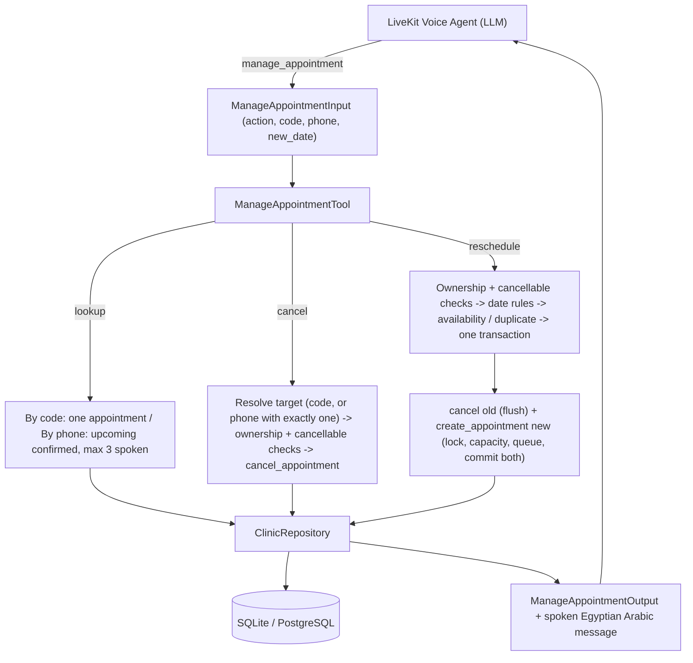

# Feature Plan: Feature 3.4 — Appointment Query, Cancellation & Rescheduling Tool (`src/tools/manage_appointment.py`)

## 1. Objective & Why
After booking (Feature 3.3), the next most common caller requests are **"هو أنا حاجز إمتى؟"**, **"عايز ألغي الحجز"**, and **"عايز أأجل الميعاد"**.
Feature 3.4 builds the unified `manage_appointment` tool (actions: `lookup`, `cancel`, `reschedule`) so the agent can handle these without a human receptionist, while keeping booking integrity (capacity, queue numbers) intact.

---

## 2. Scope & Boundaries

### In Scope
- **Lookup**
  - By booking code: return that appointment (any status) with its status in Arabic.
  - By phone: return **upcoming confirmed** appointments only (from Cairo today), sorted nearest first; spoken message mentions at most 3.
- **Cancel**
  - By booking code (phone optional; if given it must match the booking's phone).
  - By phone only, **when the phone has exactly one cancellable upcoming booking**. If it has several, list them (max 3 spoken) and ask for the booking code; if none, say so.
- **Reschedule**
  - Requires booking code (phone optional; must match if given).
  - Same doctor only; new appointment with a new queue number and new booking code on the new date; old one cancelled **in the same transaction** (if the new booking fails, the old one stays confirmed).
  - Same visit type; fee computed by the same rule as 3.3 (doctor's fee for that visit type).
  - Same date rules as 3.3: not past, not today after shift end, max 30 days ahead; no shift / full → `success=False` + nearest available day within 7 days (no auto-booking).
  - New date equal to the current date is rejected; an existing confirmed booking for the same phone/doctor on the new date is rejected (duplicate guard).
- **Cancellable / reschedulable rule**: only `confirmed` appointments whose date is in the future, or today **before the shift start** (Cairo time).
- **Schema change (minimal)**: `ManageAppointmentInput` cancel validation becomes "`booking_code` **or** `phone`" (decision D1). No other 3.1 contract change.
- **Callables**: `manage_appointment` (sync), `async_manage_appointment` (async), `ManageAppointmentTool` + singleton, registered in `TOOL_REGISTRY`.

### Out of Scope
- Changing the doctor during reschedule (book a new appointment instead).
- Fixing patient-name overwrite on shared phones (decision D5 — separate feature).
- Removing legacy restaurant tools (Feature 3.3 D5 cleanup feature).
- Refunds/payments, SMS notifications, waitlists, reusing freed queue numbers.
- Medical advice or diagnosis.

### Approved Clarification Decisions
| # | Question | Decision |
|:---|:---|:---|
| D1 | Ownership verification | Booking code is enough; phone optional but must match if given. Cancel by phone alone allowed only when exactly one cancellable upcoming booking exists |
| D2 | Lookup by phone returns | Upcoming confirmed only (from Cairo today), nearest first; message mentions at most 3 |
| D3 | What can be cancelled/rescheduled | Only `confirmed`, not past, and not today after shift start (Cairo time) |
| D4 | Reschedule mechanics | Same doctor; new booking (new queue + code) + cancel old in one transaction; same visit type/fee rule; same 3.3 date rules |
| D5 | Patient-name overwrite (from 3.3) | Not fixed here; documented as a risk for a separate feature |

---

## 3. Relevant Existing Architecture & Invariants
- `ClinicRepository.get_appointment_by_code`, `get_patient_appointments(phone, active_only)`, `cancel_appointment(code, reason, auto_commit)`, `create_appointment(..., auto_commit)`.
- `create_appointment` holds a per-(doctor, date) lock and commits inside it when `auto_commit=True`.
- Feature 3.3 helpers to reuse: `resolve_booking_date`, `check_date_window`, `shift_already_ended`, `get_cairo_now`, `format_fee`, and the 7-day next-available logic.
- Latency budget: tool execution < 400ms.

---

## 4. Components & Data Flow

**Transaction ordering for reschedule**: cancel the old appointment with `auto_commit=False` (flush only), then call `create_appointment(..., auto_commit=True)`. The commit happens inside the per-shift lock and persists both changes together; if the new booking raises, the session rollback restores the old appointment.

---

## 5. Expected Affected Files

| File | Change | Purpose |
|:---|:---|:---|
| `spec/features/feature-304-manage-appointment-tool/plan.md` | Create | Feature plan |
| `spec/features/feature-304-manage-appointment-tool/requirements.md` | Create | Requirements |
| `spec/features/feature-304-manage-appointment-tool/validation.md` | Create | Validation criteria |
| `src/tools/manage_appointment.py` | Create | Tool implementation |
| `src/tools/schemas.py` | Modify (1 validator) | Allow cancel by `booking_code` or `phone` (D1) |
| `src/tools/__init__.py` | Modify | Export and register `manage_appointment` |
| `tests/test_manage_appointment.py` | Create | Unit, integration, edge-case tests |
| `tests/test_medical_schemas.py` | Modify (add case) | Cover phone-only cancel validation |
| `spec/roadmap.md`, `TASK_PLAN.md` | Modify (after validation) | Mark Feature 3.4 done |

---

## 6. Execution Breakdown

- **Step 3.4.1**: Write spec and wait for approval 🛑.
- **Step 3.4.2** *(after approval)*: Schema validator change + shared helpers (appointment summary dict, cancellable rule).
- **Step 3.4.3** *(after approval)*: `lookup` (by code / by phone).
- **Step 3.4.4** *(after approval)*: `cancel` (by code with optional phone match; phone-only single-booking path).
- **Step 3.4.5** *(after approval)*: `reschedule` with date rules, availability/next-available, duplicate guard, atomic swap.
- **Step 3.4.6** *(after approval)*: Sync/async wrappers, registry, tests, regression, lint, CLI.

---

## 7. Risks & Trade-offs

1. **Booking code alone grants control (D1)**
   - *Risk*: anyone who knows a code can cancel/reschedule it.
   - *Mitigation*: codes are only spoken to the caller; phone is checked whenever provided; the agent prompt (Phase 5) should pass caller ID as `phone` by default.
2. **Phone-only cancel on shared family phones**
   - *Risk*: cancelling the wrong family member's booking.
   - *Mitigation*: only allowed when exactly one cancellable booking exists; the spoken message names the doctor, date, and patient name before/after cancelling. With several bookings the tool asks for the code.
3. **Freed queue numbers are not reused**
   - *Trade-off*: queue numbers on a day can have gaps after cancellations (repository uses `max + 1`). Capacity counting excludes cancelled bookings, so slots are freed correctly.
4. **Patient-name overwrite** (carried over from 3.3, D5) — unchanged.
5. **Cross-process locking** — same as 3.3: DB unique constraint is the backstop; deferred to Feature 4.5.
