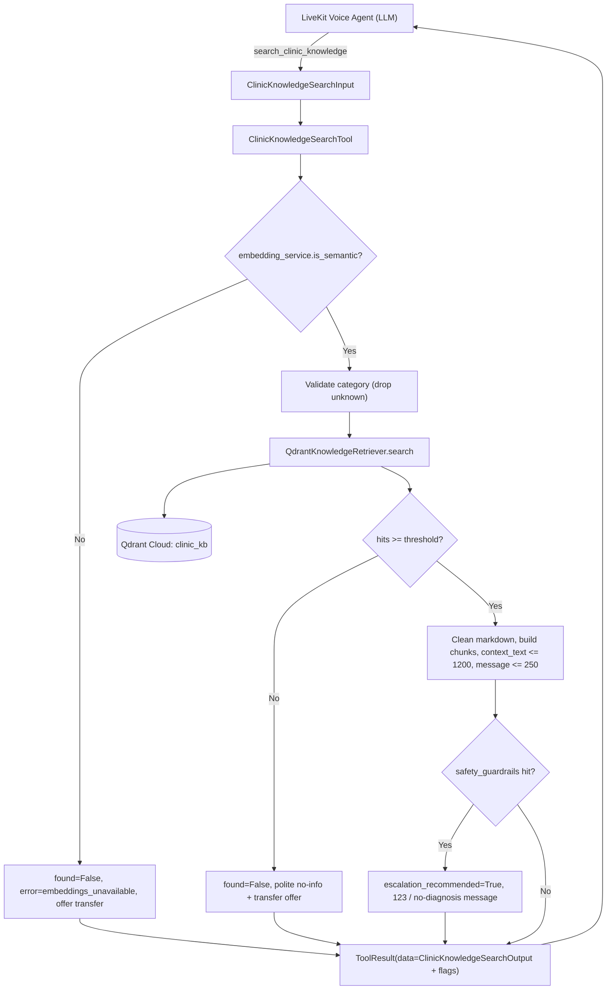

# Feature Plan: Feature 3.5 — Clinic Knowledge Search Tool (`src/tools/knowledge_search.py`)

## 1. Objective & Why
Callers constantly ask non-transactional questions: **"الكشف بكام؟"**, **"لازم أكون صايم قبل التحليل؟"**, **"بتقبلوا تأمين أكسا؟"**, **"العنوان فين؟"**.
Feature 3.5 delivers the `search_clinic_knowledge` tool so the agent answers these **only from the verified clinic knowledge base** (tech.md §3 — zero medical hallucination), returning a short TTS-friendly message plus bounded context for the LLM.

While researching, a blocking defect was found: **semantic search is currently non-functional** on the dev machine. `onnxruntime` fails to load (`DLL load failed`), so `EmbeddingService` silently switches to a hash-based fallback whose vectors (`sin(seed+i)`) all lie in a 2-D subspace — every query/chunk pair scores ≈ ±1 (e.g. a pizza query scores **0.998** against the safety chapter). This is why 6 tests in `tests/test_clinic_rag.py` fail. A knowledge tool on top of this would return confident garbage, so the fix and a guard are part of this feature (decisions D1, D2).

---

## 2. Scope & Boundaries

### In Scope
- **Environment fix (human action, D1)**: the supervisor installs *Microsoft Visual C++ Redistributable 2015–2022 (x64)*; we then verify FastEmbed loads the real model.
- **Re-ingestion**: recreate the Qdrant Cloud `clinic_kb` collection with real embeddings via the existing CLI `scripts/ingest_clinic_knowledge.py --recreate`.
- **Degraded-mode guard (D2)**:
  - `EmbeddingService.is_semantic` property (True only when the real FastEmbed model is loaded).
  - The tool refuses to search in fallback mode and returns a polite "info unavailable, transfer to reception?" result.
  - The ingestion CLI refuses to upsert fallback vectors (prevents poisoning the cloud collection again).
- **Tool rewrite (D3)**: replace the restaurant implementation in `src/tools/knowledge_search.py` with `ClinicKnowledgeSearchTool` using the existing 3.1 schemas `ClinicKnowledgeSearchInput` / `ClinicKnowledgeSearchOutput`, returning the standard `ToolResult` envelope (consistent with 3.2–3.4).
- **Spoken output**: markdown-stripped (tables, `**`, `<br>`, `---`), trimmed at a sentence boundary (≤ 250 chars); `context_text` bounded (≤ 1200 chars) for LLM synthesis.
- **Category filter**: only the 9 clinic categories are honored; unknown/hallucinated categories are dropped (search all) instead of failing.
- **Emergency flag (D4)**: when a returned hit belongs to `safety_guardrails`, set `data["escalation_recommended"]=True`; emergency content → message directs to **123** and offers transfer; diagnosis/prescription content → message declines medical advice and offers transfer. The tool does **not** call `transfer_to_receptionist` itself.
- **Latency guard**: async path enforces the 400ms tool budget (tech.md §1) with a friendly filler on timeout; `warm_up()` to pre-load the model.
- **Registry**: register `search_clinic_knowledge`; remove `search_restaurant_knowledge` from `TOOL_REGISTRY`.
- **Tests**: rewrite `tests/test_knowledge_search.py` for the clinic tool; update `tests/test_tools.py` registry expectations.

### Out of Scope
- Hybrid BM25 + dense retrieval, re-ranking, chunking changes (Feature 4.3).
- Query-side guardrails / injection filter / PII masking (Feature 4.4).
- Rewriting `src/agent/voice_agent.py` and `prompts.py` to the clinic tool (Phase 5). Deprecated aliases are kept so its imports don't break.
- Removing the other legacy restaurant tools (order status, reservation, handoff) — separate cleanup feature.
- Editing `knowledge_base/clinic_kb.md` content or `_infer_category` keyword rules.

### Approved Clarification Decisions
| # | Question | Decision |
|:---|:---|:---|
| D1 | onnxruntime DLL failure | Supervisor installs VC++ Redistributable x64; we re-ingest `clinic_kb` on Qdrant Cloud within this feature |
| D2 | Behaviour in fallback-embedding mode | Add `is_semantic`; tool returns `found=False` with polite transfer offer instead of wrong results |
| D3 | Legacy restaurant tool | Replace in-place with `search_clinic_knowledge`; remove restaurant entry from `TOOL_REGISTRY`; rewrite `test_knowledge_search.py`; update `test_tools.py` |
| D4 | Emergency-category hits | Return `escalation_recommended=True` + 123 guidance; agent (Phase 5) decides on `transfer_to_receptionist` |

---

## 3. Relevant Existing Architecture & Invariants
- `QdrantKnowledgeRetriever.search(query, limit, score_threshold, category)` → list of dicts `{id, score, text, category, section, source}` (Qdrant Cloud when configured — it is).
- `EmbeddingService` (FastEmbed `paraphrase-multilingual-MiniLM-L12-v2`, 384-d) with lazy load and silent hash fallback.
- `KnowledgeIngestionPipeline.parse_markdown` → 43 header-based chunks over 9 clinic categories: `general, specialties, doctors, pricing, lab_radiology, insurance, booking_queue, safety_guardrails, faqs`.
- 3.1 schemas: `ClinicKnowledgeSearchInput(query 2–500 chars, limit 1–10 = 3, score_threshold = 0.35, category?)`, `ClinicKnowledgeSearchOutput`, `KnowledgeChunk`, `ToolResult`.
- `execute_tool` / `async_execute_tool` pass `ToolResult` through unchanged.
- Invariants: tool execution < 400ms; tools never crash; outputs are short polite Egyptian Arabic; facts only from DB/RAG.

---

## 4. Components & Data Flow



**Async timeout**: `aexecute` runs the sync search in a worker thread wrapped by `asyncio.wait_for(..., 0.4s)`. On timeout → `success=False`, `error="timeout"`, filler message ("ثواني بس بدوّر على المعلومة...") so the agent can retry or move on.

### Sketch of the public surface
```python
class ClinicKnowledgeSearchTool:
    def __init__(self, retriever_instance=None, embeddings=None, timeout_s: float = 0.4): ...
    def warm_up(self) -> bool: ...                 # loads model, returns is_semantic
    def execute(self, query, limit=3, score_threshold=0.35, category=None) -> ToolResult: ...
    async def aexecute(...) -> ToolResult: ...     # with 400ms budget

clinic_knowledge_search_tool = ClinicKnowledgeSearchTool()
def search_clinic_knowledge(...) -> ToolResult: ...
async def async_search_clinic_knowledge(...) -> ToolResult: ...
# Deprecated aliases (Phase 5 removes): search_knowledge, async_search_knowledge,
# search_restaurant_knowledge, async_search_restaurant_knowledge, KnowledgeSearchTool, knowledge_search_tool
```

---

## 5. Expected Affected Files

| File | Change | Purpose |
|:---|:---|:---|
| `spec/features/feature-305-clinic-knowledge-search-tool/*.md` | Create | Plan, requirements, validation |
| `src/rag/embeddings.py` | Modify (additive) | `is_semantic` property |
| `scripts/ingest_clinic_knowledge.py` | Modify (guard) | Abort if embeddings are in fallback mode |
| `src/tools/knowledge_search.py` | Rewrite | Clinic tool + deprecated aliases |
| `src/tools/__init__.py` | Modify | Register `search_clinic_knowledge`, drop restaurant entry, exports |
| `tests/test_knowledge_search.py` | Rewrite | Unit / integration / edge tests for clinic tool |
| `tests/test_tools.py` | Modify | Registry expectations + clinic knowledge dispatch test |
| Qdrant Cloud `clinic_kb` | Recreate (data) | Real embeddings |
| `spec/roadmap.md`, `TASK_PLAN.md` | Modify (after validation) | Mark Feature 3.5 done |

---

## 6. Execution Breakdown

- **Step 3.5.1**: Write spec and wait for approval 🛑.
- **Step 3.5.2** *(human)*: Install VC++ Redistributable x64; we verify `embedding_service.is_semantic is True` and `tests/test_clinic_rag.py` behaviour.
- **Step 3.5.3**: `is_semantic` + ingestion CLI guard; re-ingest `clinic_kb` with `--recreate --test-query`.
- **Step 3.5.4**: Rewrite `knowledge_search.py` (guard, category validation, cleaning/truncation, safety flag, timeout, warm-up, aliases).
- **Step 3.5.5**: Registry + exports in `src/tools/__init__.py`.
- **Step 3.5.6**: Tests (`test_knowledge_search.py`, `test_tools.py`), regression, lint, CLI/latency checks.

---

## 7. Risks & Trade-offs

1. **VC++ install may not fix the DLL error**
   - *Mitigation*: verify immediately in 3.5.2; if still failing, stop and report (fallback options: pin a different `onnxruntime` build). Steps 3.5.4–3.5.5 can still be unit-tested with a stub retriever, but the feature is not "done" without real retrieval.
2. **Score threshold calibration (0.35)** was never validated with real embeddings.
   - *Mitigation*: Tier 2/7 checks on real queries; if needed, tune the *tool's* call-site default within the schema range and document it (no schema change).
3. **Cold start vs. 400ms budget**: first model load takes seconds.
   - *Mitigation*: `warm_up()` (called at agent start in Phase 5); tests warm up first; timeout returns a filler instead of blocking the voice turn. The worker thread cannot be cancelled and finishes in the background — acceptable.
4. **Qdrant Cloud network latency** may approach the 400ms budget.
   - *Mitigation*: measured in Tier 7 (median/max over warm runs); exceeding is reported, not hidden. Caching is Feature 4.2.
5. **Safety flag false positives**: any `safety_guardrails` hit in top-k raises the flag.
   - *Trade-off (intentional)*: a false positive only causes a transfer offer; a false negative could miss an emergency.
6. **Removing `search_restaurant_knowledge` from the registry** changes legacy `test_agent.py` expectations.
   - `test_agent.py` already fails to collect (livekit DLL). If the VC++ install makes it collectable, its restaurant assertions will fail — documented as pre-existing legacy debt for Phase 5, not a regression of this feature.
7. **Re-ingestion overwrites cloud data** — approved (D1); `test_*` collections are untouched.
