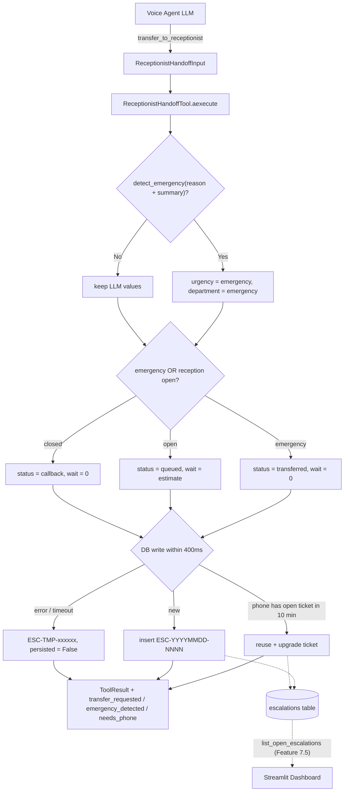

# Feature Plan: Feature 3.6 — Human Receptionist Escalation Tool with Dashboard Alert (`src/tools/human_handoff.py`)

## 1. Objective & Why
Some calls must reach a human: the caller asks for a person (**"عايز أكلم حد من الاستقبال"**), the request is outside the agent's tools (complaints, billing disputes, special cases), or — most critically — the caller reports **emergency symptoms** (**"عندي ألم جامد في صدري"**). tech.md §3 requires that emergencies immediately direct the caller to emergency care **and** trigger `transfer_to_receptionist`.

Feature 3.6 delivers the `transfer_to_receptionist` tool: it creates a **persistent escalation ticket** in the relational database (so the separate Streamlit dashboard process can alert staff), applies a **deterministic emergency safety net**, respects **reception working hours** (callback outside hours), avoids **duplicate tickets**, and always returns a short, reassuring Egyptian Arabic message. The current `human_handoff.py` is legacy restaurant code (kitchen / delivery departments, random wait times, fake agent names) and is replaced.

---

## 2. Scope & Boundaries

### In Scope
- **Persistence (D1)**: new `Escalation` ORM model / `escalations` table (created by the existing `init_db` → `Base.metadata.create_all`; additive, no migration tool in repo) + `EscalationStatus` enum.
- **Repository (D1, D9)**: `ClinicRepository` methods to create a ticket, find a recent open ticket by phone, count/list open tickets (priority-ordered), and update status (`acknowledged` / `resolved`) — the data layer Feature 7.5 will read.
- **Tool rewrite (D5)**: `ReceptionistHandoffTool` in `src/tools/human_handoff.py` using the existing 3.1 schemas `ReceptionistHandoffInput` / `ReceptionistHandoffOutput`, returning the standard `ToolResult` envelope (consistent with 3.2–3.5).
- **Emergency safety net (D2)**: keyword detector (Egyptian colloquial, MSA, English) over `reason` + `summary`; can only **upgrade** to `urgency=emergency`, `department=emergency`; never downgrades the LLM's choice.
- **Reception hours (D4)**: new settings `reception_open_time`, `reception_close_time`, `reception_friday_open_time` (Cairo time; defaults 09:00 / 22:00 / Friday 14:00). Outside hours → `status=callback`. Emergencies are handled the same at any hour.
- **De-duplication (D6)**: same caller phone with an open ticket created in the last 10 minutes → reuse that ticket (upgrade urgency/department/status if the new request is higher).
- **Deterministic wait estimate & ticket ID (D7)**: base by urgency + 30s per open ticket of equal/higher urgency, capped at 600s; ticket ID `ESC-YYYYMMDD-NNNN` (Cairo date, daily sequence). No fake staff names.
- **Resilience (D8)**: DB failure or > 400ms budget → still `success=True`, `transfer_requested=True`, `persisted=False`, temporary ticket `ESC-TMP-xxxxxx`, ERROR log.
- **Call linkage (D10)**: optional `session_id` stored on the ticket; accepted by the tool's Python functions only (not exposed in the LLM-facing schema).
- **Signals for Phase 5 (D3)**: `data["transfer_requested"]`, `data["emergency_detected"]`, `data["needs_phone"]`; the actual SIP/LiveKit call transfer is done by the voice agent in Phase 5.
- **Registry**: register `transfer_to_receptionist`; remove `escalate_to_human` from `TOOL_REGISTRY`.
- **Compatibility**: deprecated aliases `HumanHandoffTool`, `human_handoff_tool`, `escalate_to_human`, `async_escalate_to_human` stay importable (mapping legacy parameter names/values) so `src/agent/voice_agent.py` imports do not break until Phase 5.
- **Tests**: rewrite `tests/test_human_handoff.py`; add repository tests; update `tests/test_tools.py` registry expectations.

### Out of Scope
- Real call transfer via LiveKit SIP / phone bridge (Phase 5).
- Streamlit escalations page / live alert drawer UI (Feature 7.5).
- Editing `src/agent/voice_agent.py`, `src/agent/prompts.py` (Phase 5).
- Full idempotency keys / state machine (Feature 4.5); PII masking in traces (Feature 4.4).
- Notifications outside the DB (SMS, WhatsApp, email, push).
- Removing other legacy restaurant tools (`order_status`, `reservation`) — separate cleanup.
- Changing the 3.1 schemas `ReceptionistHandoffInput` / `ReceptionistHandoffOutput`.

### Approved Clarification Decisions
| # | Question | Decision |
|:---|:---|:---|
| D1 | Where are tickets stored? | New `escalations` table via Async SQLAlchemy + `ClinicRepository` |
| D2 | LLM forgets emergency urgency | Deterministic keyword safety net; upgrade-only to `emergency` |
| D3 | Does the tool transfer the call? | No — ticket + `transfer_requested=True`; real transfer in Phase 5 |
| D4 | Calls outside reception hours | Configurable hours (Cairo); outside → `callback`; emergency always 123 + `transferred` |
| D5 | Legacy restaurant tool | Replace in place; register `transfer_to_receptionist`, drop `escalate_to_human` from registry; keep deprecated aliases; rewrite tests |
| D6 | Repeated calls to the tool | Reuse open ticket for same phone within 10 min; upgrade if higher priority |
| D7 | Wait time & ticket ID | Deterministic estimate; `ESC-YYYYMMDD-NNNN`; no fake staff names |
| D8 | DB down / slow | Transfer beats logging: `success=True`, `persisted=False`, `ESC-TMP-…`, 400ms budget |
| D9 | Dashboard scope | Repository read/update methods only; UI in Feature 7.5 |
| D10 | Link ticket to call log | Optional `session_id` column + function parameter (not in LLM schema) |

---

## 3. Relevant Existing Architecture & Invariants
- **3.1 schemas** (`src/tools/schemas.py`): `ReceptionistHandoffInput(caller_name?, caller_phone? lenient-normalized, reason ≥3, department=reception, urgency=medium, summary? ≤1000)`; `ReceptionistHandoffOutput(ticket_id, status, urgency, department, estimated_wait_seconds, message)`; enums `HandoffUrgencyEnum(low, medium, urgent, emergency)`, `HandoffDepartmentEnum(reception, nursing, billing, emergency)`; `_normalize_arabic`.
- **DB layer**: `Base`, async models with `__init__` defaults, `get_async_session(factory)`, `init_db` uses `create_all` (adds new tables to an existing `clinic.db` without touching existing ones).
- **Tool pattern (3.4)**: `Tool(session_factory=None)` → `aexecute` (async core) + `execute` (thread-safe sync wrapper) + module singleton + `async_*`/sync convenience functions returning `ToolResult`.
- **Cairo clock helpers**: `get_cairo_now()` (`appointment_booking`) / `get_cairo_today()` (`doctor_availability`), patchable in tests.
- **Config**: `emergency_phone="123"`, `clinic_working_hours` (display string only).
- **Invariants**: tool < 400ms; tools never crash; outputs short polite Egyptian Arabic; no diagnosis; no hardcoded secrets; privacy-safe logs.

---

## 4. Components & Data Flow



### Status & message matrix
| Case | status | transfer_requested | wait | Spoken message gist |
|:---|:---|:---|:---|:---|
| Emergency (any hour) | `transferred` | True | 0 | Call **123** / nearest ER now; transferring you to reception immediately; ticket number |
| Open hours, non-emergency | `queued` | True | estimate | Transferring you to {department}; expected wait ≈ N seconds/minutes; ticket number |
| Closed hours, phone known | `callback` | False | 0 | Reception is closed now (hours); we'll call you on {masked phone} as soon as it opens; ticket number |
| Closed hours, no phone | `callback` | False | 0 | Same + asks for mobile number; `needs_phone=True` |
| DB failure / timeout | as computed | as computed | as computed | Same message, temporary ticket; `persisted=False` |

### Sketch of the public surface
```python
# src/db/schemas.py
class EscalationStatus(str, Enum):
    QUEUED = "queued"; TRANSFERRED = "transferred"; CALLBACK = "callback"
    ACKNOWLEDGED = "acknowledged"; RESOLVED = "resolved"
    # open = queued | transferred | callback

# src/db/models.py
class Escalation(Base):  # __tablename__ = "escalations"
    id, ticket_id (unique), session_id?, caller_name?, caller_phone? (index), reason, summary?,
    department, urgency, status, estimated_wait_seconds, created_at, updated_at,
    acknowledged_at?, resolved_at?

# src/db/repository.py (ClinicRepository)
async def create_escalation(...) -> Escalation
async def find_recent_open_escalation(phone, since: datetime) -> Escalation | None
async def count_open_escalations(min_urgency: str | None = None) -> int
async def list_open_escalations(limit: int = 50) -> Sequence[Escalation]   # urgency desc, created asc
async def update_escalation_status(ticket_id, status) -> Escalation        # acknowledged / resolved

# src/tools/human_handoff.py
def detect_emergency(text: str) -> bool
def is_reception_open(now_cairo: datetime, settings) -> bool
def estimate_wait_seconds(urgency, open_ahead: int) -> int
class ReceptionistHandoffTool:
    def __init__(self, session_factory=None, timeout_s: float = 0.4): ...
    async def aexecute(self, reason, caller_name=None, caller_phone=None, department="reception",
                       urgency="medium", summary=None, session_id=None) -> ToolResult
    def execute(...) -> ToolResult
receptionist_handoff_tool = ReceptionistHandoffTool()
def transfer_to_receptionist(...) -> ToolResult
async def async_transfer_to_receptionist(...) -> ToolResult
# Deprecated aliases (Phase 5 removes): HumanHandoffTool, human_handoff_tool,
# escalate_to_human, async_escalate_to_human
```

---

## 5. Expected Affected Files

| File | Change | Purpose |
|:---|:---|:---|
| `spec/features/feature-306-receptionist-escalation-tool/*.md` | Create | Plan, requirements, validation |
| `src/config.py` | Modify (additive) | Reception hours settings |
| `.env.example` | Modify (additive) | Document new settings |
| `src/db/schemas.py` | Modify (additive) | `EscalationStatus` enum |
| `src/db/models.py` | Modify (additive) | `Escalation` model |
| `src/db/repository.py` | Modify (additive) | Escalation CRUD/query methods |
| `src/db/__init__.py` | Modify (additive) | Exports |
| `src/tools/human_handoff.py` | Rewrite | Clinic tool + helpers + deprecated aliases |
| `src/tools/__init__.py` | Modify | Register `transfer_to_receptionist`, drop `escalate_to_human` entry, exports |
| `tests/test_human_handoff.py` | Rewrite | Unit / integration / edge tests for the tool |
| `tests/test_escalation_repository.py` | Create | Repository + model tests |
| `tests/test_tools.py` | Modify | Registry expectations + dispatch test |
| `spec/roadmap.md`, `implementation_plan.md`, `TASK_PLAN.md` | Modify (after validation) | Mark Feature 3.6 done |

---

## 6. Execution Breakdown

- **Step 3.6.1**: Write spec and wait for approval 🛑.
- **Step 3.6.2 — Data layer**: `EscalationStatus`, `Escalation` model, repository methods, exports; repository tests.
- **Step 3.6.3 — Config**: reception hours settings + `.env.example`.
- **Step 3.6.4 — Pure helpers**: `detect_emergency`, `is_reception_open`, `estimate_wait_seconds`, ticket ID generator, phone masking for speech, message builders.
- **Step 3.6.5 — Tool**: `ReceptionistHandoffTool` (safety net → hours → dedup → persist with 400ms budget → fallback), sync/async functions, deprecated aliases.
- **Step 3.6.6 — Registry**: `src/tools/__init__.py`.
- **Step 3.6.7 — Verification**: tool tests, `test_tools.py`, regression, ruff, CLI checks.

---

## 7. Risks & Trade-offs

1. **Keyword false positives** (e.g. "صدري" in a non-urgent context) → unnecessary emergency path.
   - *Trade-off (intentional)*: a false positive costs an extra 123 recommendation; a false negative could cost a life. Upgrade-only.
2. **Keyword false negatives** (unusual phrasing, STT errors).
   - *Mitigation*: the LLM can still set `emergency` itself; the safety net is an additional layer, not the only one. Coverage is extended in Feature 4.4 guardrails.
3. **`create_all` does not migrate existing tables** — fine here because `escalations` is a new table; existing `clinic.db` gets it on next `init_db`. No Alembic in repo.
4. **Daily sequence collisions under concurrency** (two inserts compute the same `NNNN`).
   - *Mitigation*: unique constraint on `ticket_id` + one retry with the next number; on second failure → temporary ticket path (D8).
5. **400ms budget on SQLite cold start** may trigger the fallback on the very first call.
   - *Mitigation*: acceptable by design (caller still hears the transfer message); tests inject a larger `timeout_s` for integration cases and a tiny one for the timeout case.
6. **Dispatcher schema validation** (`execute_tool`) rejects `reason` < 3 chars before the tool runs → generic error, not an escalation.
   - *Mitigation*: direct tool calls default an empty/short reason to "طلب التحدث مع موظف الاستقبال"; the 3.1 schema is unchanged (constraint). Revisit in Phase 5 prompt design.
7. **Legacy aliases change return type** (`ToolResult` instead of `HumanHandoffOutput`). `voice_agent.py` reads `res.department` → would hit its own `except` fallback.
   - Accepted: `voice_agent.py` cannot even import today (livekit DLL) and is rewritten in Phase 5; aliases only protect importability.
8. **Removing `escalate_to_human` from the registry** affects legacy `tests/test_agent.py` assertions — pre-existing Phase-5 debt (already not collectable), reported not fixed.
9. **Callback without real outbound dialing** — ticket is stored for staff to call back manually from the dashboard (6.5). Documented in the spoken message wording ("هنكلمك").
