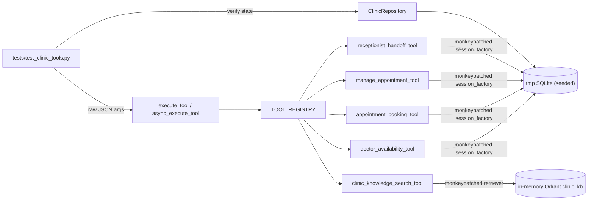

# Feature Plan: Feature 3.7 — Automated Unit & Integration Tests for Medical Tools (`tests/test_clinic_tools.py`)

## 1. Objective & Why
Features 3.1–3.6 each shipped with their **own** focused test file (`test_medical_schemas.py`, `test_doctor_availability.py`, `test_appointment_booking.py`, `test_manage_appointment.py`, `test_knowledge_search.py`, `test_human_handoff.py`). Each file proves its tool works **in isolation**, mostly by calling the tool class directly with an injected `session_factory`.

What is still **not** proven is how the tools behave **together, the way the Phase 5 voice agent will call them**:
- through the central dispatcher (`execute_tool` / `async_execute_tool`) with raw LLM-style JSON arguments,
- through the **module singletons** registered in `TOOL_REGISTRY` (not hand-built instances),
- across **multi-step patient journeys** where one tool's output becomes the next tool's input (availability → booking → lookup → reschedule → cancel → escalation),
- under **cross-cutting invariants** that every tool must respect (never raise, always `ToolResult`, spoken Arabic message, no PII in logs, latency budget).

Feature 3.7 closes Phase 3 by adding a single **cross-tool contract & journey suite** in `tests/test_clinic_tools.py`. It is the safety net Phase 4 (gateway, caching, guardrails, workflow gates) and Phase 5 (voice worker) will rely on when they wrap or re-wire these tools.

---

## 2. Scope & Boundaries

### In Scope
- **New file** `tests/test_clinic_tools.py` (only new test code; no duplication of per-tool cases already covered).
- **Shared test harness (fixtures inside the file)**:
  - Isolated file-based SQLite DB in `tmp_path` seeded with a small, deterministic clinic (2 specialties, 3 doctors, schedules incl. one low-capacity shift).
  - **Rebinding of registry singletons** (`doctor_availability_tool`, `appointment_booking_tool`, `manage_appointment_tool`, `receptionist_handoff_tool`) to the test `session_factory` via `monkeypatch.setattr(..., "session_factory", ...)` — so tests go through the real `TOOL_REGISTRY` path.
  - In-memory Qdrant collection built from `knowledge_base/clinic_kb.md` attached to `clinic_knowledge_search_tool.retriever` (module-scoped, same approach as `test_tools.py`).
  - Frozen Cairo clock (`get_cairo_today` / `get_cairo_now` patched in every tool module that defines/imports them).
- **Test groups**:
  1. **Registry contract** — the 5 clinic tools are registered; OpenAI/Groq schemas are valid JSON Schema objects; internal-only params (e.g. `session_id`) are not exposed to the LLM; registry callables map to the right singletons.
  2. **Patient journeys (end-to-end through dispatcher)** — happy path booking journey; reschedule journey; cancel journey; capacity journey (fill → full → suggestion → cancel frees slot → re-book).
  3. **Cross-tool state consistency** — availability's `remaining slots` reflects bookings/cancellations made by other tools; booking codes from `book_appointment` are accepted by `manage_appointment`.
  4. **Concurrency** — parallel `async_execute_tool("book_appointment", ...)` calls on a capacity-2 shift → exactly 2 successes, unique queue numbers, no exception.
  5. **Escalation & safety** — emergency phrase via dispatcher → `transfer_to_receptionist` returns emergency + persisted ticket visible via `ClinicRepository.list_open_escalations`; booking-failure message points to reception when no slots exist.
  6. **Knowledge search via dispatcher** — grounded answer for a fee/prep question; medical-diagnosis style question does not return a diagnosis (uses the tool's existing guardrail behaviour).
  7. **Cross-cutting invariants (parametrized over all 5 tools)** — for valid, invalid, and empty arguments: never raises, returns `ToolResult`, non-empty Arabic `message`, `success=False` carries `error`; sync and async dispatchers produce equivalent results; no raw caller phone number in captured logs.
  8. **Latency smoke check** — each DB-backed tool call through the async dispatcher completes within a generous CI budget (see D3).
- **Minimal bug fixes** in `src/tools/*` **only if** a new test exposes a real defect (see D2) — each fix reported explicitly.

### Out of Scope
- Rewriting or deleting the existing per-tool test files.
- Legacy restaurant tools (`get_order_status`, `book_reservation`) and their tests.
- Fixing pre-existing non-collectable legacy tests (`tests/test_agent.py` — Phase 5 debt).
- LLM-in-the-loop tests (real Groq tool-choice) — Phase 4.6 golden evals / Phase 5.
- Real network services (Qdrant Cloud, PostgreSQL) — local SQLite + in-memory Qdrant only.
- New dependencies (e.g. `hypothesis`, `pytest-benchmark`, `freezegun`) — only what is already in `pyproject.toml`.

### Proposed Decisions (need your confirmation)
| # | Question | Proposed decision |
|:---|:---|:---|
| D1 | How do tests reach the tools? | Through `TOOL_REGISTRY` + `execute_tool`/`async_execute_tool` with singletons rebound to a temp DB (mirrors Phase 5 exactly) |
| D2 | A new test reveals a real bug in a tool | Apply the **smallest** fix in the tool, report it to you with the reason; no refactors |
| D3 | Latency assertion vs CI flakiness | Assert a **generous smoke budget** (e.g. < 1.5s per call, warm DB) — strict 400ms is the tools' own timeout, already enforced inside each tool |
| D4 | Knowledge search uses real FastEmbed model | Yes, module-scoped in-memory collection (same as existing tests); skipped cleanly if the model cannot load |
| D5 | Seed data | Small deterministic in-file seed (not `scripts/seed`), so assertions on queue numbers/capacity are exact |

---

## 3. Relevant Existing Architecture
- **Registry** (`src/tools/__init__.py`): `TOOL_REGISTRY` with `check_doctor_availability`, `book_appointment`, `manage_appointment`, `search_clinic_knowledge`, `transfer_to_receptionist` (+ 2 legacy). Dispatchers validate args with the 3.1 input schema, call `sync_callable`/`async_callable`, and wrap any exception into a safe `ToolResult`.
- **Tool pattern**: `XTool(session_factory=None)` → `aexecute` + thread-safe `execute`; module singleton; `async_x`/`x` functions call the singleton. Singletons expose a mutable `session_factory` attribute (handoff also `timeout_s`; knowledge search `retriever`).
- **DB**: `Base.metadata.create_all`, `ClinicRepository` (availability, atomic `create_appointment` with per-shift lock, escalations).
- **Clock**: `get_cairo_today()` (`doctor_availability`), `get_cairo_now()` (`appointment_booking`), imported into other tool modules → must be patched at each import site.
- **Test stack**: `pytest`, `pytest-asyncio`, `uv run`, `ruff` (configured in `pyproject.toml`).

---

## 4. Components & Data Flow (test harness)



### Journey example (happy path)
```text
check_doctor_availability(doctor_name="الشريف", date=MON)   -> remaining = 5
book_appointment(..., date=MON, visit_type="examination")    -> booking_code X, queue 1
check_doctor_availability(doctor_name="الشريف", date=MON)   -> remaining = 4
manage_appointment(action="lookup", booking_code=X, phone)   -> found, confirmed
manage_appointment(action="reschedule", X, new_date=next MON)-> new code Y; X cancelled
manage_appointment(action="cancel", booking_code=Y, phone)   -> cancelled; slots restored
```

---

## 5. Expected Affected Files
| File | Change | Purpose |
|:---|:---|:---|
| `spec/features/feature-307-clinic-tools-integration-tests/*.md` | Create | Plan, requirements, validation |
| `tests/test_clinic_tools.py` | Create | Cross-tool contract, journey, concurrency & invariant suite |
| `src/tools/*.py` | Modify only if a real defect is found (D2) | Minimal bug fixes |
| `spec/roadmap.md`, `implementation_plan.md`, `TASK_PLAN.md` | Modify (after validation) | Mark Feature 3.7 / Phase 3 done |

---

## 6. Execution Breakdown
- **Step 3.7.1**: Write spec and wait for approval 🛑.
- **Step 3.7.2 — Harness**: seeded temp DB fixture, singleton rebinding fixture, frozen clock fixture, Qdrant fixture, small helpers (`call(tool, **args)` for sync/async).
- **Step 3.7.3 — Registry contract tests** (group 1).
- **Step 3.7.4 — Journey & state consistency tests** (groups 2–3).
- **Step 3.7.5 — Concurrency + escalation + knowledge tests** (groups 4–6).
- **Step 3.7.6 — Cross-cutting invariants + latency smoke** (groups 7–8).
- **Step 3.7.7 — Fix any real defects found** (D2), then full regression + ruff.

---

## 7. Risks & Trade-offs
1. **Singleton rebinding leaks between tests** → wrong DB used by later test files.
   - *Mitigation*: `monkeypatch` (auto-restored) per test; never assign attributes directly.
2. **Clock patching misses an import site** → journeys break on real dates.
   - *Mitigation*: patch every module that imports `get_cairo_today/now` (grep during implementation); add one sanity test asserting the frozen date is used.
3. **SQLite concurrency** (`database is locked`) in the parallel booking test.
   - *Mitigation*: file DB with `timeout=30` (same as existing tests); the repository's per-shift lock already serializes writes.
4. **FastEmbed model load time / offline machine** slows or breaks knowledge tests.
   - *Mitigation*: module scope (load once); `pytest.skip` with a clear reason if the model can't load (D4).
5. **Latency flakiness on slow CI**.
   - *Trade-off*: generous smoke budget (D3) — catches regressions like accidental N+1 or blocking calls, not micro-latency.
6. **Overlap with per-tool tests** → maintenance cost.
   - *Mitigation*: this suite tests only **composition, dispatcher path and invariants**; per-tool edge cases stay in their files.
7. **Tests may expose real bugs** → scope creep.
   - *Mitigation*: D2 — minimal fixes only, each reported; anything larger is logged as follow-up.
