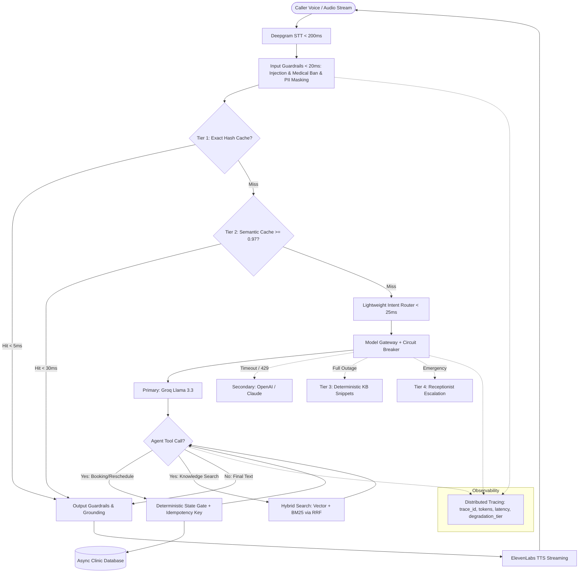

# Feature Plan: Feature 400 — Enterprise AI Architecture & Resilience Engine

## 1. Objective and Why
### Objective
Transform the Egyptian Polyclinic Voice AI Assistant from a standard prototype into an enterprise-grade, high-reliability, fault-tolerant production platform (**Production AI System**). This incorporates the 12 core design pillars from *Enterprise AI System Design (Feynman Methodology)* and *Codebasics Production AI Architecture*:
1. Model Gateway with Multi-Tier Routing & Circuit Breakers.
2. 3-Tier Caching Ladder (Exact Hash, Metadata-Scoped Semantic Cache $\ge 0.97$, Prompt Prefix Caching).
3. Hybrid RAG (Dense Vector Qdrant + Sparse BM25 via Reciprocal Rank Fusion & Structure-Aware Chunking).
4. Trust & Guardrails Layer (<20ms CPU injection & medical liability filter, pre-trace PII redaction).
5. Deterministic State Machine & Write Safety Gates ($0.95^{10}$ law, session-injected caller identity, idempotency keys).
6. End-to-End Tracing (`trace_id`, latency, token accounting) & CI/CD Golden Evaluation Dataset.
7. Architectural Decision Records (ADRs) & Diagram-as-Code.

### Why
1. **The 4 Core LLM Flaws**: LLMs are non-deterministic, slow, expensive, and confidently wrong. In a medical clinic domain, a hallucinated appointment or medical diagnosis can lead to legal liability, lost revenue, and patient danger.
2. **The 90/10 Rule**: Calling an LLM is 10% of the work; 90% is deterministic engineering around it (safeguards, cache, state gates, routing, and fallbacks).
3. **Strict Voice Latency Budget (<800ms)**: Voice calls cannot tolerate slow LLM thinking or cascading retry storms. Fast caching, circuit breakers, and streaming are critical.
4. **Data Integrity & Idempotency**: Network glitches or repeated agent tool emissions must never double-book or double-charge patient slots.

---

## 2. Scope and Exclusions

### In Scope
- **Model Gateway & Routing (`src/ai_core/gateway.py`)**:
  - Primary provider: Groq (`llama-3.3-70b-versatile`) for sub-300ms TTFT.
  - Secondary fallback provider: OpenAI (`gpt-4o-mini`) / Claude with LiteLLM abstraction.
  - Circuit Breaker pattern: 3.5s TTFT timeout; trips open after 5 consecutive 429/5xx errors, rerouting traffic instantly to secondary fallback.
- **3-Tier Caching Ladder (`src/ai_core/cache.py`)**:
  - Tier 1: Exact Hash Cache (SHA-256 normalized query string, <5ms).
  - Tier 2: Metadata-Scoped Semantic Cache in Qdrant (cosine similarity $\ge 0.97$ strictly partitioned by clinic specialty/category, ~30ms).
  - Tier 3: Static-First Prompt Prefix Caching for KV-cache reuse.
- **Hybrid RAG Retrieval (`src/rag/hybrid_retriever.py`)**:
  - Parallel Dense Vector search (Qdrant) + Sparse BM25 keyword search (for exact doctor names, test names like CBC/HbA1c, and fees).
  - Reciprocal Rank Fusion (RRF) to merge top candidates.
- **Trust & Runtime Guardrails (`src/ai_core/guardrails.py`)**:
  - Sub-20ms CPU/Regex filters for Prompt Injection and Medical Diagnosis / Drug Prescription requests (Invariant 3).
  - Pre-trace PII masking for Egyptian national IDs, phone numbers, and addresses.
  - Output grounding & "Never say" validation.
- **Deterministic State Machine & Safety Gates (`src/ai_core/workflow.py`, `src/tools/gates.py`)**:
  - Enforce $0.95^{10} \approx 60\%$ reliability law: booking workflows follow a deterministic state machine rather than open-ended agent loops.
  - Hard Python code gates verifying doctor shift active status and capacity (`current_bookings < max_capacity`) before DB write.
  - Deterministic `Idempotency-Key` (hash of `phone + doctor_id + shift_id + date`) to eliminate duplicate bookings.
  - Session-injected caller identity: LLM never supplies caller phone/identity; backend injects verified caller session phone.
- **Observability, Tracing & Golden Evals (`src/ai_core/tracing.py`, `tests/evals/`)**:
  - Unified `trace_id` logging prompt tokens, completion tokens, latency breakdown, degradation tier, and tool actions.
  - Golden Dataset of 50+ real Egyptian clinic queries with automated CI/CD gating tests.
- **Architecture Documentation (`spec/adr/`, `spec/architecture.md`)**:
  - 4-part ADRs (Context, Decision, Alternatives Rejected, Consequences).
  - Mermaid architecture diagrams.

### Exclusions (Out of Scope)
- Direct EHR/EMR legacy hospital protocols (SOAP/HL7) for external hospitals in this phase (retained for future enterprise integration).
- Dedicated GPU self-hosting (vLLM/TGI on H100); commercial API gateway is sufficient and cost-optimal.
- Real-time WebRTC audio worker execution (deferred to Phase 5: LiveKit Voice Agent Core).

---

## 3. Relevant Existing Architecture
- **Configuration Engine (`src/config.py`)**: Pydantic Settings supporting Groq, OpenAI, Qdrant, and Database configurations.
- **Relational Database (`src/db/`)**: Async SQLAlchemy models (`Doctor`, `Specialty`, `DoctorSchedule`, `Appointment`, `Patient`) with transaction support.
- **Knowledge Base RAG (`src/rag/`)**: FastEmbed embeddings + Qdrant client (`retriever.py`, `embeddings.py`, `ingestion.py`).
- **Domain Tools Schemas (`src/tools/schemas.py`)**: Pydantic schemas for medical tools.

---

## 4. Proposed Architectural Design & Data Flow

### Request Lifecycle (Online Voice/API Path)

---

## 5. Expected Files and Areas Affected

### New Modules
- `src/ai_core/__init__.py`
- `src/ai_core/gateway.py`: Model Gateway, LiteLLM wrapper, TTFT timeout, and Circuit Breaker.
- `src/ai_core/cache.py`: 3-Tier Caching Ladder (Exact SHA-256 + Qdrant Metadata Semantic Cache + Prompt Prefix Caching).
- `src/ai_core/guardrails.py`: Fast CPU injection detection, medical diagnosis prohibition, and Egyptian PII redaction.
- `src/ai_core/workflow.py`: Deterministic DAGs and state machine for appointment workflows.
- `src/ai_core/tracing.py`: OpenTelemetry-compatible trace logger and token/cost accountant.
- `src/rag/hybrid_retriever.py`: Hybrid search combining dense Qdrant embeddings with BM25 inverted index using RRF.
- `src/tools/gates.py`: Deterministic code preconditions, idempotency keys, and session caller injection.
- `spec/architecture.md`: High-level and Low-level architectural specification with Mermaid diagrams.
- `spec/adr/001-hybrid-search-rrf.md`: ADR on Hybrid Search vs Vector-only.
- `spec/adr/002-deterministic-gates-vs-prompt-rules.md`: ADR on Deterministic State Gates.
- `spec/adr/003-multi-tier-model-gateway.md`: ADR on Model Gateway and Circuit Breakers.
- `tests/evals/golden_dataset.json`: 50+ benchmark clinic queries covering normal, edge-case, injection, and safety scenarios.
- `tests/evals/test_golden_evals.py`: Automated CI/CD evaluation runner with grading assertions.

### Modified Files
- `src/config.py`: Add settings for caching thresholds, circuit breaker failure limits, and fallback model identifiers.
- `src/tools/schemas.py`: Incorporate `Idempotency-Key` and session metadata headers.
- `spec/roadmap.md`: Already updated to establish Phase 4 and renumber following phases.

---

## 6. Execution Breakdown (Manageable Atomic Groups)

### Group 1: Model Gateway, Fallbacks & Circuit Breakers (Feature 4.1)
- 1.1 Implement `CircuitBreaker` with failure threshold, cooldown window, and state tracking (CLOSED, OPEN, HALF_OPEN).
- 1.2 Implement `ModelGateway` dispatching to Groq Llama-3.3 with 3.5s TTFT timeout and automatic failover to secondary model.
- 1.3 Implement graceful 4-tier degradation fallback chain (Primary -> Secondary -> Search-only -> Receptionist).

### Group 2: 3-Tier Caching Ladder & Hybrid RAG (Features 4.2 & 4.3)
- 2.1 Implement Tier 1 Exact Hash Cache with normalization and TTL.
- 2.2 Implement Tier 2 Metadata-Scoped Semantic Cache in Qdrant with cosine similarity $\ge 0.97$.
- 2.3 Implement Hybrid RAG search merging BM25 and vector results via Reciprocal Rank Fusion (RRF).

### Group 3: Trust Layer & Runtime Guardrails (Feature 4.4)
- 3.1 Implement ultra-fast (<20ms CPU) regex/heuristic Prompt Injection detector.
- 3.2 Implement Medical Diagnosis and Drug Prescription prohibition guardrail.
- 3.3 Implement Egyptian PII masking (National ID, phone numbers) before logging/tracing.
- 3.4 Implement Output Guardrail for groundedness and policy verification.

### Group 4: Deterministic Workflow, Gates & Idempotency (Feature 4.5)
- 4.1 Implement `DeterministicGate` to validate shift capacity, doctor availability, and clinic hours in Python code before DB writes.
- 4.2 Implement deterministic `Idempotency-Key` calculation and cache verification to eliminate duplicate bookings.
- 4.3 Enforce session-injected caller phone verification (stripping phone from LLM tool arguments).

### Group 5: Distributed Tracing, Golden Evals & ADRs (Features 4.6 & 4.7)
- 5.1 Implement `trace_id` context manager capturing tokens, latency, degradation tier, and tool executions.
- 5.2 Curate `golden_dataset.json` with 50+ clinic evaluation scenarios.
- 5.3 Implement automated CI/CD evaluation runner (`test_golden_evals.py`).
- 5.4 Document Architecture Decision Records (`spec/adr/`) and system architecture diagram (`spec/architecture.md`).

---

## 7. Risks and Trade-Offs

| Risk / Trade-Off | Mitigation Strategy |
|:---|:---|
| **Latency Overhead from Multiple Defenses**: Adding guardrails, caching, and routers might inflate voice turn turnaround. | All guardrails execute via CPU/regex in <20ms; caching eliminates LLM latency entirely on hits; intent router uses lightweight regex/rules (<25ms). |
| **Semantic Cache False Positives**: Similar sounding queries returning wrong procedures/fees. | Mandatory metadata scoping (category/specialty) and strict cosine similarity cutoff ($\ge 0.97$). |
| **Cross-Provider Schema Fragility**: Groq and OpenAI returning differing tool-calling formats during failover. | Centralized Pydantic schemas and standard OpenAI-compatible function calling specifications via LiteLLM abstraction. |
| **Circuit Breaker False Trips**: Temporary network spike tripping the breaker prematurely. | Require 5 consecutive failures before tripping; half-open test probe after 60 seconds. |
