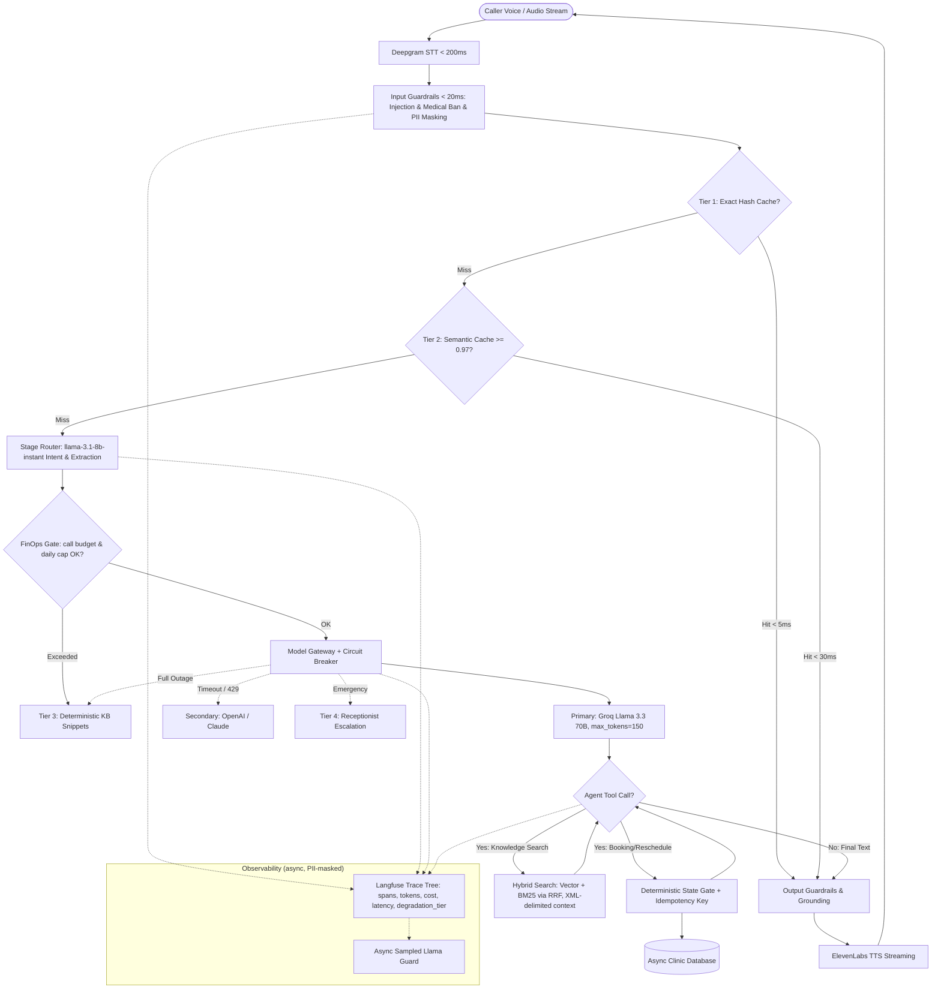

# Feature Plan: Feature 400 — Enterprise AI Architecture & Resilience Engine

## 1. Objective and Why
### Objective
Transform the Egyptian Polyclinic Voice AI Assistant from a standard prototype into an enterprise-grade, high-reliability, fault-tolerant production platform (**Production AI System**). This incorporates the core design pillars from *Enterprise AI System Design (Feynman Methodology)*, *Codebasics Production AI Architecture*, and the design-time pillars of the *LLMOps Reference Guide (Weeks 12 & 13)*:
1. Model Gateway with Stage-Based Model Routing & Circuit Breakers.
2. 3-Tier Caching Ladder (Exact Hash, Metadata-Scoped Semantic Cache $\ge 0.97$, Prompt Prefix Caching).
3. Hybrid RAG (Dense Vector Qdrant + Sparse BM25 via Reciprocal Rank Fusion & Structure-Aware Chunking).
4. OWASP-Aligned Trust & Guardrails Layer (<20ms CPU injection & medical liability filter, XML delimiters, ingestion sanitization, Literal/Enum outputs, Presidio pre-trace PII redaction, async sampled Llama Guard).
5. Deterministic State Machine & Write Safety Gates ($0.95^{10}$ law, session-injected caller identity, idempotency keys).
6. Hierarchical LLM Trace Logging (self-hosted Langfuse + OpenTelemetry spans, `contextvars`, async batch export).
7. FinOps Token Budgets & Cost Circuit Breaker.
8. Golden Evaluation Dataset with RAGAS metrics as a GitHub Actions CI gate.
9. Architectural Decision Records (ADRs) & Diagram-as-Code.

> Runtime LLMOps pillars (Prometheus/Grafana, online sampled evaluation, SSO/RBAC, multi-branch isolation, load testing, SLA) are deferred to **Phase 6: LLMOps Production Operations**.

### Why
1. **The 4 Core LLM Flaws**: LLMs are non-deterministic, slow, expensive, and confidently wrong. In a medical clinic domain, a hallucinated appointment or medical diagnosis can lead to legal liability, lost revenue, and patient danger.
2. **The 90/10 Rule**: Calling an LLM is 10% of the work; 90% is deterministic engineering around it (safeguards, cache, state gates, routing, and fallbacks).
3. **Strict Voice Latency Budget (<800ms)**: Voice calls cannot tolerate slow LLM thinking or cascading retry storms. Fast caching, circuit breakers, and streaming are critical.
4. **Data Integrity & Idempotency**: Network glitches or repeated agent tool emissions must never double-book or double-charge patient slots.
5. **Silent Semantic Failure**: An HTTP 200 / successful turn can still carry a hallucinated fee or wrong doctor. Hierarchical tracing + RAGAS (Faithfulness vs Context Recall) is the only way to tell retrieval failures from generation failures.
6. **Unit Economics**: Cost and security must be first-class from Day 1 — output tokens dominate cost, and agent loops accumulate tokens per step.

---

## 2. Scope and Exclusions

### In Scope
- **Model Gateway & Stage-Based Routing (`src/ai_core/gateway.py`)**:
  - Primary dialogue model: Groq (`llama-3.3-70b-versatile`) for sub-300ms TTFT.
  - Lightweight stage model: Groq (`llama-3.1-8b-instant`) deterministically bound to intent classification and entity extraction nodes (no LLM call to choose an LLM).
  - Secondary fallback provider: OpenAI (`gpt-4o-mini`) / Claude with LiteLLM abstraction.
  - `max_tokens=150` per voice turn (output tokens are the highest-leverage cost control).
  - Circuit Breaker pattern: 3.5s TTFT timeout; trips open after 5 consecutive 429/5xx errors, rerouting traffic instantly to secondary fallback.
- **3-Tier Caching Ladder (`src/ai_core/cache.py`)**:
  - Tier 1: Exact Hash Cache (SHA-256 normalized query string, <5ms).
  - Tier 2: Metadata-Scoped Semantic Cache in Qdrant (cosine similarity $\ge 0.97$ strictly partitioned by clinic specialty/category, ~30ms).
  - Tier 3: Static-First Prompt Prefix Caching for KV-cache reuse.
- **Hybrid RAG Retrieval (`src/rag/hybrid_retriever.py`)**:
  - Parallel Dense Vector search (Qdrant) + Sparse BM25 keyword search (for exact doctor names, test names like CBC/HbA1c, and fees).
  - Reciprocal Rank Fusion (RRF) to merge top candidates.
- **OWASP-Aligned Trust & Runtime Guardrails (`src/ai_core/guardrails.py`, `src/rag/sanitizer.py`)**:
  - Sub-20ms CPU/Regex filters for Prompt Injection and Medical Diagnosis / Drug Prescription requests (Invariant 3).
  - XML delimiters (`<caller_utterance>`, `<retrieved_context>`) around untrusted content with explicit "treat as data" system rules (LLM01).
  - Ingestion-time sanitization of knowledge documents to strip hidden/embedded instructions (indirect prompt injection).
  - Literal/Enum-constrained Pydantic outputs; LLM text never reaches `eval`, `subprocess`, or raw SQL (LLM05).
  - Pre-trace PII masking via Presidio with custom Egyptian recognizers (mobile numbers, 14-digit national IDs).
  - Llama Guard executed asynchronously on sampled turns (off the hot path) to preserve the 800ms budget.
  - Output grounding & "Never say" validation.
  - Formal threat model (`spec/security/threat_model.md`).
- **Deterministic State Machine & Safety Gates (`src/ai_core/workflow.py`, `src/tools/gates.py`)**:
  - Enforce $0.95^{10} \approx 60\%$ reliability law: booking workflows follow a deterministic state machine rather than open-ended agent loops.
  - Hard Python code gates verifying doctor shift active status and capacity (`current_bookings < max_capacity`) before DB write.
  - Deterministic `Idempotency-Key` (hash of `phone + doctor_id + shift_id + date`) to eliminate duplicate bookings.
  - Session-injected caller identity: LLM never supplies caller phone/identity; backend injects verified caller session phone.
- **Hierarchical Trace Logging (`src/ai_core/tracing.py`)**:
  - Self-hosted Langfuse (Docker) with OpenTelemetry-compatible spans: `trace_id`, `span_id`, `parent_span_id`.
  - Spans for guardrails, cache tiers, router, LLM calls (prompt/completion tokens, cost, TTFT), tool executions, and degradation tier.
  - `contextvars`-based isolation for concurrent async calls; W3C `traceparent` propagation across services.
  - Asynchronous batch export (in-memory buffer + background flush) with <1ms hot-path overhead.
- **FinOps Token Budgets (`src/ai_core/finops.py`)**:
  - Per-call token budget (8,000) and per-turn `max_tokens` (150).
  - Daily spend accumulator with alert at 80% of a $10/day cap and a hard cost circuit breaker degrading to Tier 3 / Tier 4.
  - Tool payload pruning before appending to message state to prevent token accumulation.
- **Golden Evals & RAGAS CI Gate (`tests/evals/`, `.github/workflows/evals.yml`)**:
  - Golden Dataset of 50+ real Egyptian clinic queries.
  - Deterministic exact-match on structured fields (tool name, specialty, escalation flag).
  - RAGAS metrics: Faithfulness ≥ 0.90, Context Recall ≥ 0.85, Context Precision ≥ 0.80, Answer Relevancy ≥ 0.85 (judge: `gpt-4o-mini`).
  - GitHub Actions workflow triggered on PRs touching prompts, model config, or RAG.
- **Architecture Documentation (`spec/adr/`, `spec/architecture.md`)**:
  - 4-part ADRs (Context, Decision, Alternatives Rejected, Consequences).
  - Mermaid architecture diagrams.

### Exclusions (Out of Scope)
- Direct EHR/EMR legacy hospital protocols (SOAP/HL7) for external hospitals in this phase (retained for future enterprise integration).
- Dedicated GPU self-hosting (vLLM/TGI on H100); commercial API gateway is sufficient and cost-optimal.
- Real-time WebRTC audio worker execution (deferred to Phase 5: LiveKit Voice Agent Core).
- Prometheus/Grafana metrics, online sampled evaluation, SSO/RBAC, multi-branch tenant isolation, load testing, and SLA contract (deferred to Phase 6: LLMOps Production Operations).

---

## 3. Relevant Existing Architecture
- **Configuration Engine (`src/config.py`)**: Pydantic Settings supporting Groq, OpenAI, Qdrant, and Database configurations.
- **Relational Database (`src/db/`)**: Async SQLAlchemy models (`Doctor`, `Specialty`, `DoctorSchedule`, `Appointment`, `Patient`) with transaction support.
- **Knowledge Base RAG (`src/rag/`)**: FastEmbed embeddings + Qdrant client (`retriever.py`, `embeddings.py`, `ingestion.py`).
- **Domain Tools Schemas (`src/tools/schemas.py`)**: Pydantic schemas for medical tools.

---

## 4. Proposed Architectural Design & Data Flow

### Request Lifecycle (Online Voice/API Path)

---

## 5. Expected Files and Areas Affected

### New Modules
- `src/ai_core/__init__.py`
- `src/ai_core/gateway.py`: Model Gateway, LiteLLM wrapper, stage-based routing, TTFT timeout, and Circuit Breaker.
- `src/ai_core/cache.py`: 3-Tier Caching Ladder (Exact SHA-256 + Qdrant Metadata Semantic Cache + Prompt Prefix Caching).
- `src/ai_core/guardrails.py`: Fast CPU injection detection, medical diagnosis prohibition, XML delimiting, Presidio Egyptian PII redaction, async Llama Guard hook.
- `src/ai_core/workflow.py`: Deterministic DAGs and state machine for appointment workflows.
- `src/ai_core/tracing.py`: Langfuse/OpenTelemetry hierarchical span tracer with `contextvars` and async export.
- `src/ai_core/finops.py`: Token budgets, cost accountant, daily cap, and cost circuit breaker.
- `src/rag/hybrid_retriever.py`: Hybrid search combining dense Qdrant embeddings with BM25 inverted index using RRF.
- `src/rag/sanitizer.py`: Ingestion-time document sanitization against indirect prompt injection.
- `src/tools/gates.py`: Deterministic code preconditions, idempotency keys, and session caller injection.
- `spec/architecture.md`: High-level and Low-level architectural specification with Mermaid diagrams.
- `spec/security/threat_model.md`: OWASP LLM Top 10 threat model for the clinic voice agent.
- `spec/adr/001-hybrid-search-rrf.md`: ADR on Hybrid Search vs Vector-only.
- `spec/adr/002-deterministic-gates-vs-prompt-rules.md`: ADR on Deterministic State Gates.
- `spec/adr/003-multi-tier-model-gateway.md`: ADR on Model Gateway and Circuit Breakers.
- `spec/adr/004-self-hosted-langfuse-tracing.md`: ADR on Langfuse self-hosted vs LangSmith SaaS (data sovereignty).
- `spec/adr/005-finops-budgets-and-stage-routing.md`: ADR on token budgets, cost breaker, and stage-bound model tiers.
- `spec/adr/006-ragas-ci-evaluation.md`: ADR on RAGAS metrics, thresholds, and judge model selection.
- `tests/evals/golden_dataset.json`: 50+ benchmark clinic queries covering normal, edge-case, injection, and safety scenarios (with reference contexts/answers).
- `tests/evals/test_golden_evals.py`: Automated evaluation runner with exact-match and RAGAS assertions.
- `.github/workflows/evals.yml`: CI workflow gating PRs on golden evals.

### Modified Files
- `src/config.py`: Add settings for caching thresholds, circuit breaker limits, fallback/stage model identifiers, token budgets, daily cost cap, Langfuse host/keys, RAGAS thresholds, and Llama Guard sampling rate.
- `src/rag/ingestion.py`: Invoke sanitizer before indexing.
- `src/tools/schemas.py`: Incorporate `Idempotency-Key`, session metadata headers, and Literal/Enum output constraints.
- `spec/roadmap.md`: Updated to expand Phase 4 (4.1–4.9), add Phase 6 (LLMOps), and renumber following phases.

---

## 6. Execution Breakdown (Manageable Atomic Groups)

### Group 1: Model Gateway, Stage Routing & Circuit Breakers (Feature 4.1)
- 1.1 Implement `CircuitBreaker` with failure threshold, cooldown window, and state tracking (CLOSED, OPEN, HALF_OPEN).
- 1.2 Implement `ModelGateway` dispatching to Groq Llama-3.3 with 3.5s TTFT timeout, `max_tokens=150`, and automatic failover to secondary model.
- 1.3 Bind `llama-3.1-8b-instant` to classification/extraction stages.
- 1.4 Implement graceful 4-tier degradation fallback chain (Primary -> Secondary -> Search-only -> Receptionist).

### Group 2: 3-Tier Caching Ladder & Hybrid RAG (Features 4.2 & 4.3)
- 2.1 Implement Tier 1 Exact Hash Cache with normalization and TTL.
- 2.2 Implement Tier 2 Metadata-Scoped Semantic Cache in Qdrant with cosine similarity $\ge 0.97$.
- 2.3 Implement Hybrid RAG search merging BM25 and vector results via Reciprocal Rank Fusion (RRF).

### Group 3: OWASP-Aligned Trust Layer (Feature 4.4)
- 3.1 Implement ultra-fast (<20ms CPU) regex/heuristic Prompt Injection detector.
- 3.2 Implement Medical Diagnosis and Drug Prescription prohibition guardrail.
- 3.3 Implement XML delimiting of caller utterances and retrieved context.
- 3.4 Implement ingestion-time document sanitizer and wire it into `ingestion.py`.
- 3.5 Implement Presidio-based Egyptian PII masking (National ID, phone numbers) before tracing.
- 3.6 Implement Output Guardrail for groundedness, policy verification, and Literal/Enum validation.
- 3.7 Implement async sampled Llama Guard hook (off hot path).
- 3.8 Author `spec/security/threat_model.md`.

### Group 4: Deterministic Workflow, Gates & Idempotency (Feature 4.5)
- 4.1 Implement `DeterministicGate` to validate shift capacity, doctor availability, and clinic hours in Python code before DB writes.
- 4.2 Implement deterministic `Idempotency-Key` calculation and cache verification to eliminate duplicate bookings.
- 4.3 Enforce session-injected caller phone verification (stripping phone from LLM tool arguments).

### Group 5: Hierarchical Trace Logging (Feature 4.6)
- 5.1 Implement span context manager/decorator with `trace_id`/`parent_span_id` using `contextvars`.
- 5.2 Implement Langfuse exporter (async batch) with local no-op fallback when Langfuse is unavailable.
- 5.3 Instrument guardrails, cache, router, gateway, and tools with spans.

### Group 6: FinOps Budgets (Feature 4.7)
- 6.1 Implement per-call token budget and cost accountant (price table in config).
- 6.2 Implement daily cap accumulator with 80% alert and cost circuit breaker degrading to Tier 3 / Tier 4.
- 6.3 Implement tool payload pruning before message-state append.

### Group 7: Golden Evals, RAGAS CI & ADRs (Features 4.8 & 4.9)
- 7.1 Curate `golden_dataset.json` with 50+ clinic evaluation scenarios including reference contexts.
- 7.2 Implement evaluation runner with exact-match + RAGAS metrics and thresholds.
- 7.3 Add `.github/workflows/evals.yml` gating PRs that touch prompts/models/RAG.
- 7.4 Document ADRs 001–006 (`spec/adr/`) and system architecture diagram (`spec/architecture.md`).

---

## 7. Risks and Trade-Offs

| Risk / Trade-Off | Mitigation Strategy |
|:---|:---|
| **Latency Overhead from Multiple Defenses**: Adding guardrails, caching, and routers might inflate voice turn turnaround. | All hot-path guardrails execute via CPU/regex in <20ms; caching eliminates LLM latency entirely on hits; Llama Guard and Presidio run off the hot path / pre-trace only. |
| **Semantic Cache False Positives**: Similar sounding queries returning wrong procedures/fees. | Mandatory metadata scoping (category/specialty) and strict cosine similarity cutoff ($\ge 0.97$). |
| **Cross-Provider Schema Fragility**: Groq and OpenAI returning differing tool-calling formats during failover. | Centralized Pydantic schemas and standard OpenAI-compatible function calling specifications via LiteLLM abstraction. |
| **Circuit Breaker False Trips**: Temporary network spike tripping the breaker prematurely. | Require 5 consecutive failures before tripping; half-open test probe after 60 seconds. |
| **Tracing Overhead / Langfuse Downtime**: Tracing could block calls or fail if Langfuse is down. | Async buffered export with background flush; tracer degrades to no-op without affecting the call. |
| **RAGAS Judge Bias & Arabic Quality**: Judge model may mis-score Egyptian Arabic or favor its own model family. | Use a different family (`gpt-4o-mini`) than the generator (Llama); calibrate thresholds on the golden set; keep deterministic exact-match checks alongside. |
| **CI Cost & Flakiness**: LLM-judged evals cost money and are non-deterministic. | Trigger only on PRs touching prompts/models/RAG; `temperature=0`; thresholds on aggregate scores, not single cases. |
| **Budget Breaker Impacting Patients**: Hard cap could degrade service mid-day. | 80% early alert; degrade to search-only / receptionist (never drop the call); cap configurable in `config.py`. |
