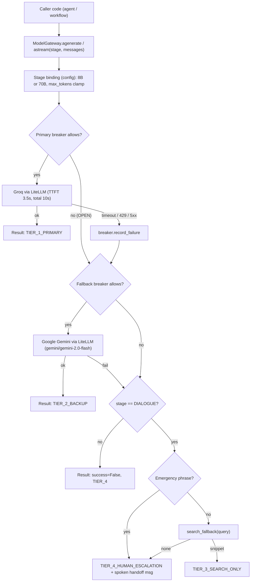

# Feature Plan: Feature 4.1 — Model Gateway, Stage-Based Model Routing & Circuit Breaker (`src/ai_core/gateway.py`)

> Parent spec: `spec/features/feature-400-enterprise-ai-architecture-and-resilience/` (Execution Group 1, requirements R1 + R2).

## 1. Objective and Why

### Objective
Introduce a single, provider-agnostic **Model Gateway** that every LLM call in the system must go through. It:
1. Binds model tiers **deterministically** to workflow stages (`llama-3.1-8b-instant` for classification/extraction, `llama-3.3-70b-versatile` for caller-facing dialogue).
2. Enforces a **3.5s TTFT timeout** on the primary provider and a hard **`max_tokens=150`** cap on caller-facing turns.
3. Protects the voice SLA with a per-provider **Circuit Breaker** (CLOSED → OPEN → HALF_OPEN) that fails over instantly to Google Gemini (`gemini/gemini-2.0-flash` via LiteLLM).
4. Implements the **4-tier graceful degradation chain** (Primary Groq → Backup Gemini → Search-only → Receptionist) and stamps every result with a `degradation_tier`.

### Why
- **Today there is no gateway**: the only LLM wiring is the LiveKit Groq plugin in `src/agent/voice_agent.py`. A Groq outage or 429 storm = dead calls.
- **Voice cannot wait**: without a breaker, every caller pays the full 3.5s timeout before failover. After 5 failures we stop trying the sick provider and route instantly.
- **FinOps from Day 1**: the 8B model costs a fraction of the 70B; routing it to cheap stages by code (not by asking an LLM) is free money and deterministic.
- **Foundation for 4.2–4.7**: caching, guardrails, tracing, and FinOps all need one choke point to hook into. The gateway result already carries tokens, TTFT, provider, and tier for those features.

---

## 2. Scope and Exclusions

### In Scope
- `Stage` enum + static stage → model binding (from `src/config.py`).
- Provider adapter built on **LiteLLM** (`litellm.acompletion`) — one unified OpenAI-format call for Groq (`groq/...`, primary) and Google Gemini (`gemini/...`, fallback).
- `CircuitBreaker` (per provider, in-process, async-safe, injectable clock for tests).
- `ModelGateway` with `agenerate()` (full response, supports `tools` pass-through) and `astream()` (text chunks for TTS).
- TTFT timeout, total request timeout, `max_tokens` clamping, zero hot-path retries.
- 4-tier degradation with a pluggable search-only fallback (default adapter → existing `search_clinic_knowledge` tool) and receptionist message (emergency phrases reuse `detect_emergency` from `src/tools/human_handoff.py`).
- New config fields + `.env.example` entries (`GEMINI_API_KEY`, `GEMINI_FALLBACK_MODEL`, `GEMINI_BASE_URL`).
- Unit/integration tests with fake providers (no network) + a CLI smoke script for live checks.

### Exclusions (Out of Scope)
- Wiring the gateway into the LiveKit voice worker (deferred to **Feature 5.3** per supervisor direction).
- Claude as a third provider (postponed per supervisor direction; architecture protocol enables adding it later).
- Caching (4.2), guardrails/PII (4.4), Langfuse spans (4.6), token budgets/cost breaker (4.7). The gateway only **exposes** the data/hook points they need.
- Distributed (Redis-shared) breaker state across workers — in-process per worker is enough until Phase 8 scaling.
- Actually executing `transfer_to_receptionist` from inside the gateway — Tier 4 returns a flag + spoken message; the agent layer executes the tool (keeps the gateway side-effect free).

---

## 3. Relevant Existing Architecture
- `src/config.py`: Pydantic Settings — has `groq_api_key`, `groq_model`, `llm_temperature`, `llm_max_tokens=512`; no Gemini or breaker settings yet.
- `src/agent/voice_agent.py`: builds `livekit.plugins.groq.LLM` directly (untouched in this feature; linked in Feature 5.3).
- `src/agent/session_manager.py`: already produces OpenAI/Groq-format message lists (`to_openai_format`) — the gateway accepts exactly that format.
- `src/tools/knowledge_search.py`: RAG tool used as the default Tier 3 source.
- `src/tools/human_handoff.py`: `detect_emergency()` reused for Tier 4 decision.
- `tech.md` already names **LiteLLM** as the provider abstraction layer; it is **not installed yet** and will be added via `uv add litellm`. LiteLLM normalizes requests, streaming chunks, tool calls, usage, and exceptions across Groq, Gemini, and (later) Claude.

---

## 4. Proposed Approach

### Key Decisions
| # | Decision | Rationale |
|:--|:--|:--|
| D1 | Use **LiteLLM** (`litellm.acompletion`, `stream=True`) as the single provider client for Groq and Gemini; add `litellm` to `pyproject.toml`. Model IDs use LiteLLM prefixes: `groq/llama-3.3-70b-versatile`, `groq/llama-3.1-8b-instant`, `gemini/gemini-2.0-flash`. | Supervisor decision; aligns with `tech.md`; adding Claude later = one config line. |
| D1b | Use LiteLLM **only as the client**, NOT its `Router` fallbacks/cooldowns. Failover and breaker stay in our own `ModelGateway` + `CircuitBreaker`. | LiteLLM Router cooldowns don't match R5 (5 consecutive in 60s, single half-open probe) and would hide which tier served the call. |
| D1c | Harden LiteLLM: `num_retries=0`, explicit `api_key` per call (no env leakage between providers), `litellm.telemetry=False`, no success/failure callbacks, `drop_params=True` for cross-provider params. | Hot-path latency, privacy (NFR4), no content sent to third-party loggers. |
| D2 | Stage binding is a **static dict in config**: `CLASSIFICATION`, `EXTRACTION` → 8B; `DIALOGUE` → 70B. Fallback for all stages → `gemini/gemini-2.0-flash`. | Invariant 8: no LLM chooses an LLM. |
| D3 | TTFT measured on a **streaming** call: wait for the first chunk with `asyncio.wait_for(3.5s)`; a separate total timeout (default 10s) bounds the whole call. `agenerate()` also streams internally and assembles. | One code path, real TTFT measurement for tracing. |
| D4 | Breaker trips after **5 consecutive retryable failures within 60s**; OPEN for 60s; then HALF_OPEN allows **exactly one** probe — concurrent requests during the probe go straight to fallback. | R1.3 / R1.4; prevents probe stampede. |
| D5 | Retryable (count toward breaker), mapped from LiteLLM exceptions: `Timeout`, `APIConnectionError`, `RateLimitError` (429), `ServiceUnavailableError`/`InternalServerError` (5xx). Non-retryable: `BadRequestError`, `AuthenticationError`, `PermissionDeniedError`, `NotFoundError`, `UnprocessableEntityError` — **do not** trip the breaker but the single request still fails over. | Bad config shouldn't look like an outage, but the caller still gets an answer. |
| D6 | **Zero retries on the hot path** (`num_retries=0` in LiteLLM). | Retry storms kill the 800ms budget; failover is the retry. |
| D7 | `DIALOGUE` `max_tokens` is **clamped** to `voice_max_tokens=150` (caller can ask for less, never more). Other stages use `stage_max_tokens=256`. Existing `llm_max_tokens` stays untouched for the LiveKit plugin until 5.3. | R1.6 without breaking current agent code. |
| D8 | **Mid-stream failure** (after the first token was yielded) does **not** fail over (can't un-say audio); the stream ends, result marked `truncated=True`, and the failure counts toward the breaker. | Honest voice behaviour. |
| D9 | Tier 3/4 only apply to `DIALOGUE`. For `CLASSIFICATION`/`EXTRACTION` total failure returns `success=False`, tier `TIER_4_HUMAN_ESCALATION`, no text — the caller decides. | Search snippets are meaningless as an intent label. |
| D10 | Unconfigured provider (missing/placeholder key) is **skipped** (logged once), not treated as a failure. | Local dev without Gemini key still works. |

### Components & Data Flow

### Public Contract
- `Stage(str, Enum)`: `CLASSIFICATION`, `EXTRACTION`, `DIALOGUE`.
- `DegradationTier(str, Enum)`: `TIER_1_PRIMARY`, `TIER_2_BACKUP`, `TIER_3_SEARCH_ONLY`, `TIER_4_HUMAN_ESCALATION`.
- `GatewayResult` (Pydantic): `success`, `text`, `tool_calls`, `stage`, `provider`, `model`, `degradation_tier`, `escalate`, `truncated`, `ttft_ms`, `latency_ms`, `prompt_tokens`, `completion_tokens`, `error_class`, `attempts` (list of provider/outcome).
- `CircuitBreaker`: `allow_request()`, `record_success()`, `record_failure()`, `state`, `snapshot()`.
- `get_gateway()` singleton factory built from settings.

---

## 5. Expected Files / Areas Affected

### New
- `src/ai_core/__init__.py` — package exports.
- `src/ai_core/circuit_breaker.py` — `CircuitBreaker`, `BreakerState`.
- `src/ai_core/gateway.py` — `Stage`, `DegradationTier`, `GatewayResult`, `LLMProvider` protocol, `LiteLLMProvider`, `ModelGateway`, `get_gateway()`.
- `tests/test_circuit_breaker.py`, `tests/test_model_gateway.py`.
- `scripts/gateway_smoke.py` — CLI live check (`--stage`, `--prompt`, `--simulate-primary-outage`).

### Modified
- `src/config.py` — new fields: `llm_stage_model`, `gemini_api_key`, `gemini_fallback_model` (LiteLLM-prefixed IDs built by a helper, e.g. `groq/<groq_model>`), `llm_ttft_timeout_s=3.5`, `llm_request_timeout_s=10`, `voice_max_tokens=150`, `stage_max_tokens=256`, `circuit_breaker_failure_threshold=5`, `circuit_breaker_window_s=60`, `circuit_breaker_cooldown_s=60`, helper `is_gemini_configured()`.
- `.env.example` — matching entries (placeholders only).
- `pyproject.toml` / `uv.lock` — add `litellm` via `uv add litellm`.
- `spec/tech.md` + `spec/roadmap.md` — fallback row/line updated from OpenAI `gpt-4o-mini` to Gemini `gemini-2.0-flash` (via LiteLLM).

---

## 6. Execution Breakdown

### Group 1 — Configuration & Types
- 1.1 Add config fields + `is_gemini_configured()`; update `.env.example`; `uv add litellm` and verify it resolves with existing pins (`onnxruntime<1.20`).
- 1.2 Define `Stage`, `DegradationTier`, `GatewayResult`, error classification helper.

### Group 2 — Circuit Breaker
- 2.1 State machine with consecutive-failure counter inside a rolling window, cooldown, single half-open probe, `asyncio.Lock`, injectable clock.

### Group 3 — Provider Adapter
- 3.1 `LLMProvider` protocol + `LiteLLMProvider` wrapping `litellm.acompletion` (streaming, `stream_options.include_usage`, TTFT + total timeouts, `num_retries=0`, tool-call delta assembly, LiteLLM exception → error-class mapping). One instance per provider (Groq, Gemini).

### Group 4 — Gateway & Degradation
- 4.1 Stage binding + `max_tokens` clamping.
- 4.2 Failover loop over `[primary, fallback]` guarded by breakers.
- 4.3 Tier 3 search fallback (default: knowledge-search tool, with its own 400ms timeout) and Tier 4 escalation message (emergency via `detect_emergency`).
- 4.4 `astream()` with D8 semantics; `get_gateway()` singleton.

### Group 5 — Tests & CLI
- 5.1 Breaker unit tests (fake clock), gateway tests with scripted fake providers.
- 5.2 `scripts/gateway_smoke.py`.

---

## 7. Risks and Trade-Offs

| Risk / Trade-Off | Mitigation |
|:--|:--|
| LiteLLM is a **heavy dependency** (many transitive packages, frequent releases). | Pin a minimum version in `uv.lock`; use only `acompletion` + exception classes behind our `LLMProvider` protocol so it can be swapped. |
| LiteLLM import time / first-call overhead. | Import once at startup (`get_gateway()`), not per request; NFR1 measured excluding network. |
| LiteLLM telemetry/callbacks could leak content. | Telemetry off, no callbacks registered; verified by the log/privacy test. |
| Groq/Gemini tool-call format differences. | LiteLLM normalizes to OpenAI format; tests cover tool-call assembly from streamed deltas. |
| Breaker false trips on short spikes. | Requires 5 **consecutive** failures in 60s; any success resets the counter. |
| Per-worker breaker state ≠ global view. | Acceptable at current scale; distributed state deferred to Phase 8. |
| Tier 3 snippet may be imprecise for the question. | Only used when both LLMs are down; message prefixed with a short apology and offers receptionist. |
| Live smoke test needs real keys/network. | Automated suite is fully offline with fakes; CLI check is a manual Tier 7 step. |
| 150-token cap could cut long answers. | Voice answers should be short by design; `truncated`/`finish_reason=length` is surfaced for prompt tuning in 5.1. |
