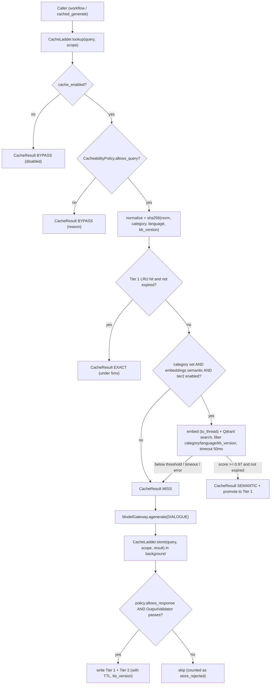

# Feature Plan: Feature 4.2 — 3-Tier Caching Ladder (`src/ai_core/cache.py`)

> Parent spec: `spec/features/feature-400-enterprise-ai-architecture-and-resilience/` (Execution Group 2, requirement R3 + NFR1).
> Depends on: Feature 4.1 (`ModelGateway`, `Stage`, `GatewayResult`) — completed.
> Design decisions D1–D13 were agreed with the supervisor in a `/grill-me` session (2026-10-26).

## 1. Objective and Why

### Objective
Add a deterministic, privacy-safe **3-tier caching ladder** in front of the Model Gateway so repeated **public clinic questions** (hours, fees, insurance, lab prep, specialties, FAQs) are answered without an LLM call:
1. **Tier 1 — Exact Hash Cache**: Arabic-aware normalization → SHA-256 key → in-memory LRU+TTL (< 5ms).
2. **Tier 2 — Metadata-Scoped Semantic Cache**: FastEmbed vector → Qdrant `semantic_cache` collection, cosine ≥ **0.97**, hard-filtered by `category` + `language` + `kb_version` (< 30ms).
3. **Tier 3 — Prompt Prefix Cache**: a `PromptPrefixBuilder` that orders prompts static-first / dynamic-last so provider KV-cache (Groq/Gemini) can reuse the prefix.

### Why
- **Latency**: a cache hit replaces a ~300–800ms LLM turn with < 30ms — the single biggest lever for the 800ms voice SLA.
- **FinOps**: public FAQ questions repeat constantly at a polyclinic front desk; each hit is zero tokens (feeds Feature 4.7).
- **Safety**: in a medical domain a wrong cached answer is worse than a slow one — hence strict allowlists, metadata scoping, KB-versioned invalidation, guardrail-gated writes, and fail-open behaviour.
- **Foundation**: `CacheResult` + `snapshot()` are the hook points for Langfuse spans (4.6) and Prometheus cache-hit ratio (6.1).

---

## 2. Scope and Exclusions

### In Scope
- `src/ai_core/cache.py`: `CacheLadder` (`lookup()`, `store()`, `invalidate()`, `snapshot()`), `CacheScope`, `CacheResult`, `CacheTier`, `BypassReason`.
- Arabic/English text normalizer + SHA-256 key builder.
- `CacheBackend` protocol + `InMemoryLRUBackend` (TTL + max entries) for Tier 1.
- `SemanticCacheStore` over Qdrant (`semantic_cache` collection, payload indexes on `category`, `language`, `kb_version`).
- `CacheabilityPolicy` (category allowlist + deny rules) applied to both lookup and store.
- `OutputValidator` protocol + conservative `DefaultOutputValidator` (replaced in 4.4).
- `kb_version` (content hash of `knowledge_base/clinic_kb.md`) embedded in keys/filters.
- `PromptPrefixBuilder` + `prefix_hash`.
- Optional helper `cached_generate(gateway, cache, messages, scope)` wrapping `ModelGateway.agenerate()` for `Stage.DIALOGUE`.
- Config fields + `.env.example` entries; offline tests; `scripts/cache_calibration.py` (report only) and `scripts/cache_smoke.py`.

### Exclusions (Out of Scope)
- Wiring into the LiveKit voice worker (`src/agent/voice_agent.py`) → **Feature 5.3**.
- Rewriting `src/agent/prompts.py` (still restaurant-themed, and puts `current_datetime` mid-prompt which defeats prefix caching) → recorded as a requirement for **Feature 5.1**.
- Real output guardrails (never-say list, grounding) → **Feature 4.4** (we only define the hook).
- Redis / cross-worker shared cache → **Phase 8** (backend protocol makes it a drop-in).
- Langfuse spans / Prometheus metrics → **4.6 / 6.1** (we only expose `CacheResult` + `snapshot()`).
- Caching tool calls, booking/appointment answers, emergency turns, or anything personal.
- Calling an LLM to decide cacheability or category (Invariant 8).

---

## 3. Relevant Existing Architecture
- `src/ai_core/gateway.py`: `ModelGateway.agenerate(stage, messages, ...) -> GatewayResult` with `degradation_tier`, `tool_calls`, `truncated`. Cache helper wraps this; gateway itself is **not modified**.
- `src/rag/embeddings.py`: `embedding_service` (FastEmbed `paraphrase-multilingual-MiniLM-L12-v2`, 384-dim, **synchronous**); `is_semantic` is `False` when it falls back to hash vectors.
- `src/rag/retriever.py`: Qdrant client selection (Cloud vs `:memory:`) via `settings.is_qdrant_cloud()`; collection + `category` payload-index pattern we mirror.
- `src/tools/knowledge_search.py`: `ALLOWED_CATEGORIES` (`general`, `specialties`, `doctors`, `pricing`, `lab_radiology`, `insurance`, `booking_queue`, `safety_guardrails`, `faqs`).
- `src/tools/human_handoff.py`: `detect_emergency()` reused by the deny rules.
- `src/config.py`: Pydantic Settings — all new thresholds go here (Invariant 8 / parent C2).

---

## 4. Proposed Approach

### Key Decisions (agreed in grill-me)
| # | Decision | Rationale |
|:--|:--|:--|
| D1 | Standalone `CacheLadder` + optional `cached_generate()` helper; no change to `ModelGateway`; voice-worker wiring in 5.3. | Same pattern as 4.1; offline-testable; gateway stays single-purpose. |
| D2 | Tier 1 = in-memory LRU + TTL behind a `CacheBackend` protocol; Redis later. | No new dependency now; per-worker cache acceptable at current scale. |
| D3 | Tier 2 = separate Qdrant collection `semantic_cache` (same client mode + same embedding service). **Tier 2 auto-disabled when `embedding_service.is_semantic` is False.** | Never mix cache entries with KB chunks; hash vectors would produce false "hits". |
| D4 | Caller supplies `category` (from `ALLOWED_CATEGORIES`, produced by the 8B classification stage). No category → Tier 2 bypassed (Tier 1 only). | Deterministic, no extra LLM call. |
| D5 | Cacheability = category allowlist (`general`, `specialties`, `pricing`, `lab_radiology`, `insurance`, `faqs`) **+** deny rules: phone/national-ID-like digits, personal words (حجزي، ميعادي، نمرتي، اسمي…/my appointment…), response with `tool_calls`, `detect_emergency()` true, response from Tier 3/4, truncated/empty response. | R3.2 — never cache personal or time-sensitive data. `doctors` excluded (schedules change), `booking_queue` (personal), `safety_guardrails` (must be fresh). |
| D6 | `store()` passes the response through an injectable `OutputValidator`; default validator rejects drug/dosage/diagnosis/discount wording. **Fail-closed** (validator error → no store). | R3.3 until Feature 4.4 supplies the real guardrail. |
| D7 | Per-category TTL in config + `kb_version` (SHA-256 of KB file content, first 12 hex) in Tier 1 key and Tier 2 filter + manual `invalidate(category=None)`. | Price changes in the KB must invalidate stale answers automatically. |
| D8 | Medium Arabic normalization before hashing: strip tashkeel + tatweel, unify أ/إ/آ→ا, ى→ي, ة→ه, Arabic-Indic digits → ASCII, strip punctuation, collapse whitespace, lowercase. No filler-word removal. | Absorbs STT spelling variance without changing meaning; Tier 2 handles paraphrases. |
| D9 | `PromptPrefixBuilder` (static instructions → tool schemas → few-shots, then dynamic context last) + `prefix_hash`; byte-stability test. `prompts.py` untouched. | R3.1 Tier 3 without overlapping Feature 5.1. |
| D10 | **Fail-open**: any cache error/timeout = MISS. Tier 2 bounded by `cache_semantic_timeout_ms` (50ms) incl. embedding, run via `asyncio.to_thread`. `store()` runs as a background task. Tier 2 hit is promoted into Tier 1. | Cache must never hurt a call; hot path stays non-blocking. |
| D11 | `language` (`ar`/`en`, default `ar`) is a mandatory scope field (Tier 1 key + Tier 2 filter). | Multilingual embeddings could otherwise return an Arabic answer to an English caller. |
| D12 | Rich `CacheResult` (`hit`, `tier`, `similarity`, `latency_ms`, `bypass_reason`, `text`) + in-process counters + `snapshot()`. Query text is **never** logged. | Observability hooks for 4.6/6.1; privacy (NFR4). |
| D13 | Threshold default 0.97, validated `0.90 ≤ x ≤ 1.0`; `scripts/cache_calibration.py` prints similarity report; kill switches `cache_enabled`, `cache_exact_enabled`, `cache_semantic_enabled`. | Safety over hit-rate; data-driven tuning later; instant disable in production. |

### Components & Data Flow

### Public Contract (summary)
- `CacheScope(category: str | None, language: Literal["ar","en"] = "ar", specialty: str | None = None)`.
- `CacheTier(str, Enum)`: `EXACT`, `SEMANTIC`, `MISS`, `BYPASS`.
- `BypassReason(str, Enum)`: `disabled`, `category_not_allowed`, `personal_query`, `emergency`, `embedding_fallback`, `timeout`, `backend_error`, `empty_query`.
- `CacheResult`: `hit`, `tier`, `text`, `similarity`, `latency_ms`, `bypass_reason`, `kb_version`.
- `CacheLadder.lookup(query, scope) -> CacheResult` (never raises).
- `CacheLadder.store(query, scope, response_text, *, degradation_tier, tool_calls, truncated) -> bool` + `schedule_store(...)` (background).
- `CacheLadder.invalidate(category: str | None = None) -> int`, `snapshot() -> dict`.
- `PromptPrefixBuilder(static_instructions, tool_schemas, few_shots).build(dynamic_context, history) -> (messages, prefix_hash)`.
- `cached_generate(gateway, cache, messages, scope, **kwargs) -> CachedTurnResult(text, cache: CacheResult, gateway: GatewayResult | None)`.
- `get_cache_ladder()` singleton factory.

---

## 5. Expected Files / Areas Affected

### New
- `src/ai_core/cache.py` — ladder, scope/result types, policy, validator protocol + default, backends, semantic store, prefix builder, `cached_generate`, `get_cache_ladder()`.
- `src/ai_core/text_normalizer.py` — Arabic/English normalization + key hashing (pure functions).
- `tests/test_cache_normalizer.py`, `tests/test_cache_ladder.py`, `tests/test_prompt_prefix.py`.
- `scripts/cache_smoke.py` — CLI demo of miss → store → exact hit → paraphrase semantic hit → bypass cases.
- `scripts/cache_calibration.py` — similarity report for similar / dissimilar Arabic question pairs (no config change).

### Modified
- `src/ai_core/__init__.py` — export cache public API.
- `src/config.py` — `cache_enabled`, `cache_exact_enabled`, `cache_semantic_enabled`, `cache_semantic_threshold=0.97`, `cache_semantic_timeout_ms=50`, `cache_semantic_collection="semantic_cache"`, `cache_max_entries=2000`, `cache_ttl_by_category` (pricing/insurance 6h, others 24h), `cache_default_ttl_s`, `cache_allowed_categories`, `cache_kb_path="knowledge_base/clinic_kb.md"`.
- `.env.example` — matching entries.
- `spec/roadmap.md` — mark 4.2 done (after validation); note for 5.1 about `prompts.py` prefix ordering.

---

## 6. Execution Breakdown

### Group 1 — Config & Pure Helpers
- 1.1 Config fields + validators (threshold range, TTL map keys ⊆ `ALLOWED_CATEGORIES`); `.env.example`.
- 1.2 `text_normalizer.py`: `normalize_query()`, `build_exact_key()`, `compute_kb_version()`.

### Group 2 — Policy & Validator
- 2.1 `CacheabilityPolicy.allows_query()` / `allows_response()` with deny regexes (Egyptian mobile `01[0125]\d{8}`, 14-digit national ID, long digit runs, personal-word lists AR/EN, emergency via `detect_emergency`).
- 2.2 `OutputValidator` protocol + `DefaultOutputValidator` (fail-closed).

### Group 3 — Tier 1
- 3.1 `CacheBackend` protocol + `InMemoryLRUBackend` (TTL per entry, max entries, injectable clock, `asyncio`-safe).

### Group 4 — Tier 2
- 4.1 `SemanticCacheStore`: lazy collection creation + payload indexes, upsert with deterministic point id (uuid5 of exact key), filtered search, expiry check via `expires_at` payload, `invalidate`.
- 4.2 Embedding via `asyncio.to_thread`, overall `asyncio.wait_for` timeout, `is_semantic` guard.

### Group 5 — Ladder, Prefix Builder & Helper
- 5.1 `CacheLadder` orchestration, promotion, counters, `snapshot()`, background `schedule_store()`.
- 5.2 `PromptPrefixBuilder` + `prefix_hash`.
- 5.3 `cached_generate()` helper + `get_cache_ladder()`.

### Group 6 — Tests & CLI
- 6.1 Unit + integration tests (fake clock, in-memory Qdrant, fake embedder, fake gateway).
- 6.2 `scripts/cache_smoke.py`, `scripts/cache_calibration.py`.

---

## 7. Risks and Trade-Offs

| Risk / Trade-Off | Mitigation |
|:--|:--|
| **Semantic false positive** (e.g., pediatric fee vs dental fee) returns a wrong price. | Hard `category` filter, threshold 0.97, KB-versioned entries, calibration report, kill switch. |
| **Low hit rate** at 0.97 with MiniLM on Egyptian dialect. | Accepted (safety first). Tier 1 normalization + promotion capture exact repeats; calibration script informs future tuning. |
| **Stale answers** after KB edit. | `kb_version` in key/filter + per-category TTL + manual `invalidate()`. |
| **Personal data leaking into cache.** | Two-layer policy on lookup *and* store, tool-call/Tier 3/4 exclusion, fail-closed validator, tests with phone/ID/personal phrases. |
| **Default validator is weak** until 4.4. | Conservative (rejects on doubt); `OutputValidator` protocol lets 4.4 swap it without touching cache code. |
| **Embedding latency** (sync FastEmbed, ~10–30ms CPU) eats budget. | `to_thread` + 50ms timeout → MISS; first-load warm-up outside hot path. |
| **Per-worker cache** (no sharing across ECS tasks). | Acceptable now; `CacheBackend` protocol → Redis in Phase 8. |
| **Memory growth.** | LRU `cache_max_entries` cap; Tier 2 expired points ignored on read and purged by `invalidate()`. |
| **Category supplied wrongly by caller.** | Unknown category → Tier 2 bypass; allowlist enforced inside the cache, not trusted from caller. |
| **Prefix caching benefit depends on provider.** | Builder guarantees structure; actual KV reuse is provider-side and not asserted in tests (byte-stability is). |
