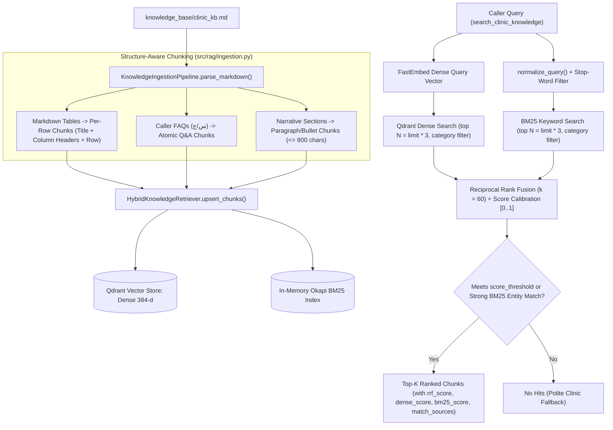

# Feature Plan: Feature 4.3 — Hybrid RAG Upgrade (`src/rag/hybrid_retriever.py`)

> Parent spec: `spec/features/feature-400-enterprise-ai-architecture-and-resilience/` (Execution Group 2, requirement R4: R4.1–R4.3).
> Depends on: Phase 2 (`src/rag/embeddings.py`, `src/rag/retriever.py`, `src/rag/ingestion.py`), Phase 3 (`src/tools/knowledge_search.py`), and Feature 4.2 (`src/ai_core/text_normalizer.py`) — all completed.
> Design decisions D1–D5 were agreed with the supervisor in a `/grill-me` session (2026-10-30).

---

## 1. Objective and Why

### Objective
Upgrade the Egyptian Polyclinic Knowledge Base retrieval engine from dense-only vector similarity to a **Hybrid RAG Architecture** combining:
1. **Structure-Aware Chunking (`src/rag/ingestion.py`)**: Splitting Markdown tables (doctors, lab tests, radiology procedures) into self-contained row-level chunks that preserve section titles and column headers, splitting oversized prose on paragraph/bullet boundaries, and keeping FAQ items (`س/ج`) as atomic chunks.
2. **Sparse BM25 Keyword Engine (`BM25Index` in `src/rag/hybrid_retriever.py`)**: A zero-dependency, pure-Python Okapi BM25 inverted index ($k_1 = 1.5, b = 0.75$) using Arabic/English normalization (`normalize_query`) and stop-word filtering for exact entity matching.
3. **Reciprocal Rank Fusion (`HybridKnowledgeRetriever` in `src/rag/hybrid_retriever.py`)**: Executing Dense Vector (Qdrant) + Sparse Keyword (BM25) retrieval and merging candidate lists via Reciprocal Rank Fusion ($k = 60$), while exposing detailed provenance (`rrf_score`, `dense_score`, `bm25_score`, `match_sources`) and maintaining calibrated `[0.0, 1.0]` scores compatible with `ClinicKnowledgeSearchTool`.

### Why
- **Exact Clinical Entity Recall**: Dense multilingual embeddings (`paraphrase-multilingual-MiniLM-L12-v2`) capture semantic intent well, but often under-rank exact medical abbreviations (`CBC`, `HbA1c`, `ESR`, `CRP`, `DEXA`, `ECG`), specific doctor names (`د. عمرو خالد النجار`, `د. هالة مصطفى رضوان`), insurance company names (`AXA`, `MetLife`, `NextCare`), or exact numbers (`19876`, `350 ج`). Sparse BM25 guarantees exact lexical recall.
- **Eliminating Table Truncation in Voice Responses**: Previously, `parse_markdown()` indexed an entire 10-doctor or 11-lab-test Markdown table as a single 2,000+ character chunk. When `ClinicKnowledgeSearchTool` trimmed the top hit to `max_chars=220` for TTS playback, rows in the middle or bottom of the table (e.g., `CBC`, `Thyroid Profile`, `DEXA Scan`, `Dr. Yasmine`) were cut off. Structure-aware row chunking ensures each retrieved chunk is focused on the exact doctor or test asked about.
- **Sub-400ms Voice Tool Budget**: Pure-Python in-memory BM25 over the clinic knowledge base executes in **< 2ms** on CPU, adding virtually zero latency to the Qdrant retrieval path and requiring zero new external packages or Qdrant schema migrations.

---

## 2. Scope and Exclusions

### In Scope
- **`src/rag/hybrid_retriever.py`**:
  - `BM25Index`: Pure-Python Okapi BM25 ($k_1 = 1.5, b = 0.75$) with Arabic/English normalization (`normalize_query`), bilingual stop-word filtering, category-scoped filtering, and informative token matching.
  - `reciprocal_rank_fusion()`: Standard RRF merger ($\text{score}(d) = \sum \frac{1}{k + \text{rank}_i(d)}$, default $k = 60$) with deterministic tie-breaking and score calibration to `[0.0, 1.0]`.
  - `HybridKnowledgeRetriever`: Drop-in wrapper around `QdrantKnowledgeRetriever` exposing identical methods (`search`, `upsert_chunks`, `recreate_collection`, `get_context_for_query`, `sync_bm25_from_qdrant`, `warm_up`) and singleton `hybrid_retriever`.
- **`src/rag/ingestion.py`**:
  - Upgrade `KnowledgeIngestionPipeline.parse_markdown()` to perform **structure-aware chunking**:
    - Detect Markdown tables and emit self-contained row-level chunks containing `[Section Title] — Header1: Val1 | Header2: Val2 ...` so every doctor, lab test, and radiology procedure is independently retrievable and voice-ready.
    - Split long narrative prose sections (`> chunk_max_chars`, default 800 chars) along paragraph/bullet boundaries while preserving section header context.
    - Keep FAQ (`### س ...`) sections atomic so question and model answer never separate.
- **`src/tools/knowledge_search.py`**:
  - Wire `ClinicKnowledgeSearchTool` to use `hybrid_retriever` by default (when `settings.hybrid_search_enabled` is `True`), and enhance `warm_up()` to ensure the KB is indexed in in-memory mode if empty.
- **`src/config.py` & `.env.example`**:
  - Add configurable Hybrid RAG settings (`hybrid_search_enabled=True`, `hybrid_rrf_k=60`, `hybrid_bm25_k1=1.5`, `hybrid_bm25_b=0.75`, `hybrid_candidate_multiplier=3`, `rag_chunk_max_chars=800`).
- **`scripts/ingest_clinic_knowledge.py`**:
  - Support hybrid verification (`--test-query`) displaying `score`, `rrf_score`, `dense_score`, `bm25_score`, and `match_sources`.
- **Tests**:
  - `tests/test_hybrid_rag.py` covering BM25 tokenization/scoring, RRF math, structure-aware table/prose/FAQ chunking, exact medical entity queries (`CBC`, `HbA1c`, `DEXA`, doctor names, fees), category filtering, and latency SLA.

### Exclusions (Out of Scope)
- **Ingestion-time prompt-injection sanitization (`src/rag/sanitizer.py`) and XML context delimiters (`<retrieved_context>`)** → Scoped to **Feature 4.4 (OWASP-Aligned Trust Layer & Runtime Guardrails)** per `spec/roadmap.md`.
- **External sparse-vector dependencies (`rank-bm25`, SPLADE, or Qdrant sparse vector schema migration)** → Excluded per D1 to maintain zero new runtime dependencies and 100% backward compatibility with existing `clinic_kb` collections.
- **Langfuse trace spans for RAG retrieval** → Scoped to **Feature 4.6 (Hierarchical LLM Trace Logging)**.
- **RAGAS golden dataset evaluation gate** → Scoped to **Feature 4.8 (Golden Evaluation Suite & RAGAS CI Gate)**.

---

## 3. Relevant Existing Architecture
- **`src/rag/embeddings.py`**: `EmbeddingService` (`paraphrase-multilingual-MiniLM-L12-v2`, 384-dim dense vectors, `is_semantic` flag).
- **`src/rag/retriever.py`**: `QdrantKnowledgeRetriever` managing Qdrant collection `clinic_kb`, `upsert_chunks()`, `search()`, and `get_context_for_query()`.
- **`src/rag/ingestion.py`**: `KnowledgeIngestionPipeline` parsing `knowledge_base/clinic_kb.md` and inferring 9 validated clinic categories (`general`, `specialties`, `doctors`, `pricing`, `lab_radiology`, `insurance`, `booking_queue`, `safety_guardrails`, `faqs`).
- **`src/ai_core/text_normalizer.py`**: `normalize_query()` providing deterministic Arabic/English text normalization (stripping tashkeel/tatweel, unifying `أ/إ/آ→ا`, `ى→ي`, `ة→ه`, Arabic-Indic digits `٠-٩→0-9`, punctuation stripping, lowercase).
- **`src/tools/knowledge_search.py`**: `ClinicKnowledgeSearchTool` enforcing the 400ms tool timeout, `is_semantic` guard, `ALLOWED_CATEGORIES` validation, safety escalation flags (`escalation_recommended`), and speech-friendly formatting.

---

## 4. Proposed Approach & Architectural Design

### Key Design Decisions (Agreed in `/grill-me`)

| # | Decision | Rationale |
|:--|:---------|:----------|
| **D1** | **Pure-Python In-Memory `BM25Index`** reusing `normalize_query()` from `src/ai_core/text_normalizer.py` with bilingual stop-word removal. | Zero new dependencies in `pyproject.toml`; no Qdrant schema breaking change; < 2ms CPU execution; works offline and in cloud. |
| **D2** | **Structure-Aware Chunking**: Markdown tables split into self-contained per-row chunks (with section title + column headers); long prose split at paragraph/bullet boundaries (`<= 800` chars); FAQ (`س/ج`) sections kept atomic. | Prevents 220-char voice truncation from cutting off later rows in the 10-doctor or 11-lab-test tables; boosts dense & BM25 precision on specific entities. |
| **D3** | **RRF ($k=60$) Ranking + Calibrated `[0, 1]` Score**: Order strictly by RRF score; expose `rrf_score`, `dense_score`, `bm25_score`, `match_sources`; calibrate `hit["score"]` to `[0.0, 1.0]` and filter stop-word noise so `score_threshold=0.35` (and `0.60` out-of-domain checks) work seamlessly. | Satisfies R4.2 ($k=60$ RRF) while preserving 100% backward compatibility with `ClinicKnowledgeSearchTool` and `tests/test_clinic_rag.py`. |
| **D4** | **Drop-In Wrapper & Tool Wiring**: `HybridKnowledgeRetriever` wraps `QdrantKnowledgeRetriever` with identical methods; `ClinicKnowledgeSearchTool` and `ingestion_pipeline` use `hybrid_retriever` by default (`hybrid_search_enabled=True`). | Clean separation of concerns; `QdrantKnowledgeRetriever` remains untouched for legacy callers; instant upgrade for tool calls and Tier 3 gateway fallback. |
| **D5** | **Auto-Synchronization & Scope Boundary**: BM25 syncs automatically on `upsert_chunks()`, lazy-loads via Qdrant `scroll()` if needed, and auto-seeds from `clinic_kb.md` on `warm_up()` if in-memory Qdrant is empty. `sanitizer.py` and XML tags remain in Feature 4.4. | Guarantees BM25 and Qdrant never drift in tests, CLI scripts, or runtime; respects roadmap phase boundaries. |

### Components & Data Flow

---

## 5. Expected Files and Areas Affected

### New Files
- `src/rag/hybrid_retriever.py`: `BM25Index`, `tokenize_for_bm25()`, `reciprocal_rank_fusion()`, `HybridKnowledgeRetriever`, `hybrid_retriever` singleton.
- `tests/test_hybrid_rag.py`: Unit, integration, edge-case, and latency tests for structure-aware chunking, BM25, RRF fusion, and hybrid tool retrieval.

### Modified Files
- `src/rag/ingestion.py`: Upgrade `parse_markdown()` with structure-aware table row chunking and prose boundary splitting; bind default `ingestion_pipeline` to `hybrid_retriever`.
- `src/rag/__init__.py`: Export `BM25Index`, `HybridKnowledgeRetriever`, `hybrid_retriever`, `reciprocal_rank_fusion`.
- `src/tools/knowledge_search.py`: Use `hybrid_retriever` as default retriever when `settings.hybrid_search_enabled` is `True`; ensure `warm_up()` populates in-memory KB if empty.
- `src/config.py`: Add `hybrid_search_enabled`, `hybrid_rrf_k`, `hybrid_bm25_k1`, `hybrid_bm25_b`, `hybrid_candidate_multiplier`, `rag_chunk_max_chars`.
- `.env.example`: Document new Hybrid RAG configuration variables.
- `scripts/ingest_clinic_knowledge.py`: Use `hybrid_retriever` and display hybrid score breakdown (`score`, `rrf_score`, `dense_score`, `bm25_score`, `match_sources`) during `--test-query`.

---

## 6. Execution Breakdown (Manageable Atomic Groups)

### Group 1: Configuration & Structure-Aware Chunking (`src/config.py`, `src/rag/ingestion.py`)
- **1.1**: Add Hybrid RAG and chunking parameters (`hybrid_search_enabled`, `hybrid_rrf_k=60`, `hybrid_bm25_k1=1.5`, `hybrid_bm25_b=0.75`, `hybrid_candidate_multiplier=3`, `rag_chunk_max_chars=800`) to `src/config.py` and `.env.example`.
- **1.2**: Implement Markdown table detector and row-chunk formatter in `src/rag/ingestion.py` so each table row becomes a self-contained chunk with section title, introductory context, and `Column: Value` pairs, plus deterministic chunk metadata (`chunk_type="table_row" | "faq" | "section"`).
- **1.3**: Implement prose paragraph/bullet splitter for non-table sections exceeding `rag_chunk_max_chars` while keeping FAQ (`### س ...`) sections atomic.

### Group 2: Pure-Python BM25 Engine & Reciprocal Rank Fusion (`src/rag/hybrid_retriever.py`)
- **2.1**: Implement `tokenize_for_bm25(text)` using `normalize_query()` from `src/ai_core/text_normalizer.py` and bilingual Arabic/English stop-word filtering (preserving medical codes like `cbc`, `hba1c`, `esr`, `crp`, `dexa`, `123`, `19876`, doctor names, and prices).
- **2.2**: Implement `BM25Index` ($k_1 = 1.5, b = 0.75$) supporting `build()`, `upsert()`, `clear()`, and category-filtered `search()`.
- **2.3**: Implement `reciprocal_rank_fusion(dense_hits, bm25_hits, k=60, limit=5, score_threshold=None)` computing $\text{RRF}(d) = \sum \frac{1}{k + \text{rank}(d)}$, attaching `rrf_score`, `dense_score`, `bm25_score`, `dense_rank`, `bm25_rank`, and `match_sources`, and calibrating `score` in `[0.0, 1.0]`.

### Group 3: `HybridKnowledgeRetriever` & Tool/CLI Wiring (`src/rag/hybrid_retriever.py`, `src/tools/knowledge_search.py`, `scripts/ingest_clinic_knowledge.py`)
- **3.1**: Implement `HybridKnowledgeRetriever` wrapping `QdrantKnowledgeRetriever`, auto-syncing `BM25Index` on `upsert_chunks()` / `recreate_collection()`, and lazy-syncing from Qdrant via `scroll()` when queried against a pre-populated collection.
- **3.2**: Wire `hybrid_retriever` into `src/rag/ingestion.py`, `src/tools/knowledge_search.py`, and `scripts/ingest_clinic_knowledge.py`.

### Group 4: Automated Verification Suite (`tests/test_hybrid_rag.py`)
- **4.1**: Write unit tests for structure-aware chunking (table rows, FAQs, long prose), BM25 tokenization/scoring, and RRF rank fusion mathematics.
- **4.2**: Write integration and regression tests verifying exact medical codes (`CBC`, `HbA1c`, `DEXA Scan`), specific doctor names (`د. عمرو خالد النجار`, `د. ياسمين عادل إبراهيم`), fee queries, category isolation, out-of-domain rejection, and retrieval latency SLA.

---

## 7. Risks and Trade-Offs

| Risk / Trade-Off | Mitigation Strategy |
|:-----------------|:--------------------|
| **Common Arabic words ("سعر", "كشف", "عايز") causing false BM25 matches on out-of-domain queries (e.g. pizza price).** | Curated Arabic/English stop-word list + generic query-filler filtering in `tokenize_for_bm25()`; BM25-only promotion requires informative domain token matches, otherwise `score_threshold` on dense similarity governs. |
| **Raw RRF score scale ($\le 0.0328$ at $k=60$) breaking callers expecting `[0, 1]` cosine scores.** | Keep RRF ($k=60$) as the strict ranking key and expose `rrf_score` in every result dict, while calibrating `hit["score"]` onto `[0.0, 1.0]` from dense similarity + RRF lexical boost so `score_threshold=0.35` and existing tests work unchanged. |
| **Table row chunks losing surrounding section context.** | Every table-row chunk prepends the section title and pairs every cell with its column header (`اسم الطبيب: ... | التخصص: ... | سعر الكشف: ...`), making each row chunk 100% self-contained for both embedding and TTS reading. |
| **BM25 index out of sync when Qdrant already has points at startup.** | `HybridKnowledgeRetriever` checks if `BM25Index` is empty before search and lazy-loads existing points via `client.scroll(collection_name=...)`; `upsert_chunks()` and `recreate_collection()` update both stores atomically. |
| **More chunks from row-splitting increasing search latency.** | Splitting 3 tables (~27 rows) increases `clinic_kb` from ~24 chunks to ~50 chunks. At 50 chunks, in-memory BM25 takes < 0.5ms and Qdrant vector search takes < 5ms — well inside the 400ms tool budget. |
