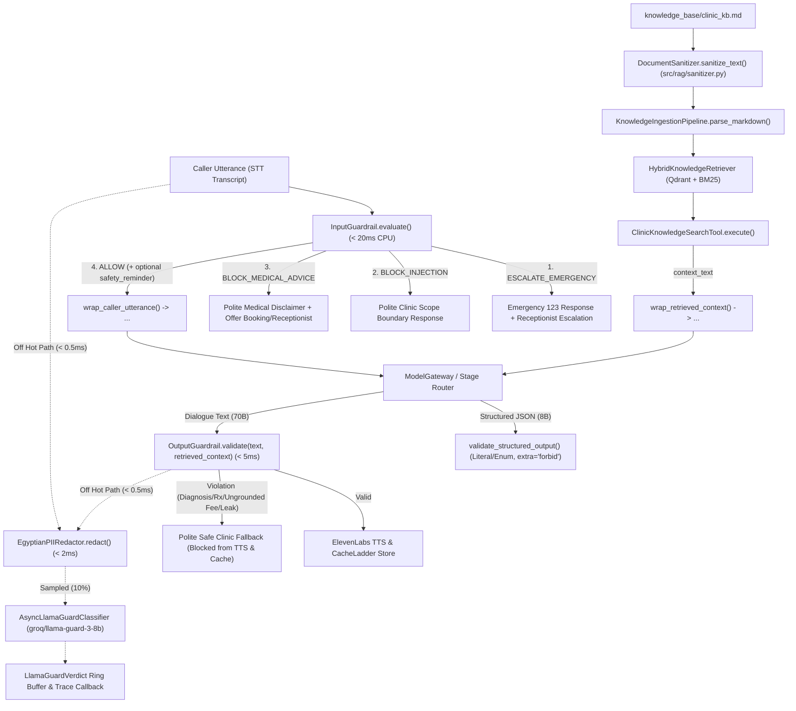

# Feature Plan: Feature 4.4 — OWASP-Aligned Trust Layer & Runtime Guardrails (`src/ai_core/guardrails.py`, `src/rag/sanitizer.py`, `spec/security/threat_model.md`)

> Parent spec: `spec/features/feature-400-enterprise-ai-architecture-and-resilience/` (Execution Group 3, requirements R5, R6, R7, R13, R15).
> Depends on: Phase 2 & 4.3 (`src/rag/ingestion.py`, `src/rag/hybrid_retriever.py`), Phase 3 (`src/tools/human_handoff.py`, `src/tools/knowledge_search.py`), and Feature 4.1/4.2 (`src/ai_core/gateway.py`, `src/ai_core/cache.py`, `src/ai_core/text_normalizer.py`) — all completed.
> Design decisions D1–D5 were agreed with the supervisor in a `/grill-me` session (2026-10-30).

---

## 1. Objective and Why

### Objective
Build a defense-in-depth **OWASP-Aligned Trust Layer & Runtime Guardrails** for the Egyptian Polyclinic Voice AI Agent consisting of:
1. **Context-Aware Input Guardrails (< 20ms CPU, `InputGuardrail` in `src/ai_core/guardrails.py`)**: Fast deterministic regex/heuristic 4-way triage classifying incoming caller utterances into `EMERGENCY`, `PROMPT_INJECTION`, `MEDICAL_ADVICE_REQUEST`, or `ALLOW` (distinguishing between prohibited medical diagnosis/prescription requests and legitimate appointment booking/specialty inquiries that mention symptoms).
2. **Breakout-Safe XML Delimiter Wrapping (`wrap_caller_utterance`, `wrap_retrieved_context` in `src/ai_core/guardrails.py`)**: Neutralizing embedded XML tags (`<caller_utterance>`, `</caller_utterance>`, `<retrieved_context>`, `</retrieved_context>`) and wrapping untrusted caller speech and RAG context with explicit data-only boundaries (OWASP LLM01).
3. **Ingestion-Time Document Sanitizer (`DocumentSanitizer` in `src/rag/sanitizer.py`)**: Surgical multi-layer sanitization integrated into `KnowledgeIngestionPipeline.parse_markdown()` to strip hidden HTML comments, dangerous tags, zero-width / BiDi-override Unicode characters, markdown image exfiltration links, and indirect prompt injection directives while preserving legitimate ` ` cell separators and Markdown tables.
4. **Output Guardrails, Grounding Verification & `Literal`/`Enum` Structured Output Validation (`OutputGuardrail`, `validate_structured_output` in `src/ai_core/guardrails.py`)**: Enforcing the strict "Never Say" policy (no diagnoses, drug prescriptions/dosages, unauthorized discounts, system prompt/secret leaks, or SQL/code execution strings), verifying numeric fee/phone grounding against retrieved RAG context, implementing the `OutputValidator` protocol as a drop-in upgrade for `CacheLadder`, and constraining structured stage outputs via strict `Literal`/`Enum` Pydantic models (`extra="forbid"`).
5. **Lightweight Presidio-Compatible Egyptian PII Redactor (`EgyptianPIIRedactor` in `src/ai_core/guardrails.py`)**: Sub-2ms pre-trace and pre-external-audit PII masking for Egyptian mobile numbers (`010/011/012/015` + `+20`), 14-digit Egyptian National IDs (with century, date, and governorate code validation), landlines, emails, and payment cards across both ASCII (`0-9`) and Arabic-Indic (`٠-٩`) numerals, operating via `presidio-analyzer` in regex-only mode when installed or a built-in Presidio-compatible `PatternRecognizer` engine without heavy `spacy` NLP downloads.
6. **Asynchronous Sampled Safety Classifier (`AsyncLlamaGuardClassifier` in `src/ai_core/guardrails.py`)**: Off-hot-path (`< 0.5ms` scheduling overhead via `asyncio.create_task`) secondary safety auditing on a configurable turn sample (`llama_guard_sample_rate=0.10`) using `groq/llama-guard-3-8b` over PII-redacted text, storing structured `LlamaGuardVerdict` records in a bounded ring buffer and firing registered trace/audit hooks.
7. **Formal OWASP LLM Top 10 Threat Model (`spec/security/threat_model.md`)**: Comprehensive security specification mapping OWASP LLM01–LLM10 risks to Egyptian polyclinic attack vectors, trust boundaries, and verified code mitigations.

### Why
- **Strict Medical Liability & Safety Invariant (`spec/tech.md` Invariant 3)**: Under Egyptian medical regulations and clinic policy, a voice receptionist must never diagnose illnesses or prescribe medications/dosages, and must immediately route red-flag emergency symptoms to ambulance (`123`) and front-desk staff.
- **Preventing False-Positive Rejections on Legitimate Bookings**: Callers naturally mention symptoms when asking to book a doctor (e.g., *"عندي وجع في ركبتي وعايز أحجز دكتور عظام"*). Context-aware 4-way triage ensures booking requests proceed smoothly with a safety reminder while explicit requests for prescriptions or diagnoses are intercepted in `< 20ms`.
- **Defending Against Direct & Indirect Prompt Injection (OWASP LLM01)**: Untrusted caller transcripts and external knowledge documents can contain instruction overrides or hidden Unicode/HTML payloads. Combining ingestion-time sanitization with breakout-safe XML delimiters neutralizes both vectors.
- **Zero PII Leakage in Telemetry & Third-Party Audits (`spec/tech.md` Invariant 7)**: Egyptian mobile numbers and 14-digit national IDs must be deterministically masked in `< 2ms` before leaving the voice hot path for trace logging or async Llama Guard inspection.
- **Sub-800ms Voice Latency Budget (`spec/tech.md` Invariant 1)**: Synchronous LLM-based guardrails would add 300–600ms per turn and break the voice SLA. Running CPU regex/heuristic guardrails synchronously (`< 20ms`) and Llama Guard asynchronously off the hot path achieves enterprise safety without sacrificing conversational responsiveness.

---

## 2. Scope and Exclusions

### In Scope
- **`src/ai_core/guardrails.py`**:
  - `InputAction` (`ALLOW`, `BLOCK_INJECTION`, `BLOCK_MEDICAL_ADVICE`, `ESCALATE_EMERGENCY`), `GuardrailCategory`, and `InputGuardrailResult`.
  - `InputGuardrail`: 4-way context-aware triage in `< 20ms` CPU, reusing `detect_emergency()` from `src/tools/human_handoff.py` and distinguishing symptom-accompanied booking intents from explicit medical diagnosis/prescription requests.
  - `wrap_caller_utterance()` and `wrap_retrieved_context()` + `SYSTEM_UNTRUSTED_DATA_RULES`: Breakout-safe XML delimiter helpers.
  - `OutputGuardrail` & `OutputGuardrailResult`: Implements `OutputValidator` (`is_valid(text) -> bool`) for `CacheLadder` compatibility + rich `validate(response_text, retrieved_context=None)` checking "Never Say" prohibitions, system/secret leaks, SQL/code patterns, and numeric fee grounding against retrieved context.
  - `IntentClassificationSchema`, `EntityExtractionSchema`, and `validate_structured_output()`: `Literal`/`Enum`-constrained Pydantic validation (`extra="forbid"`) rejecting unsafe strings (`eval`, `subprocess`, SQL DDL/DML).
  - `PIIEntityMatch`, `PatternRecognizer`, `EgyptianPhoneRecognizer`, `EgyptianNationalIDRecognizer`, `EmailRecognizer`, `CreditCardRecognizer`, and `EgyptianPIIRedactor`: Presidio-compatible recognizer engine supporting ASCII and Arabic-Indic numerals (`٠-٩`), recursive `redact_dict()` for trace payloads, and `< 2ms` execution.
  - `LlamaGuardVerdict` and `AsyncLlamaGuardClassifier`: Off-hot-path sampled safety evaluation via `groq/llama-guard-3-8b` (or injected provider), PII pre-redaction, S1–S14 hazard code parsing, bounded verdict ring buffer, and callback hooks.
- **`src/rag/sanitizer.py`**:
  - `SanitizationFinding`, `SanitizationReport`, and `DocumentSanitizer`: Strips HTML comments, dangerous tags (`<script>`, `<style>`, `<iframe>`), zero-width/BiDi-override Unicode characters, external markdown image exfiltration (``), XML delimiter tags, and indirect prompt injection lines while preserving ` ` and Markdown table formatting.
- **`src/rag/ingestion.py` & `src/tools/knowledge_search.py`**:
  - Wire `DocumentSanitizer` into `KnowledgeIngestionPipeline.parse_markdown()` when `settings.rag_sanitize_on_ingest` is `True`.
  - Wire `wrap_retrieved_context()` into `ClinicKnowledgeSearchTool.execute()` so `context_text` (destined for LLM context) is enclosed in `<retrieved_context>` tags while `message` (destined for TTS speech playback) remains clean plain text.
- **`src/ai_core/cache.py` & `src/ai_core/__init__.py` & `src/rag/__init__.py`**:
  - Wire `OutputGuardrail` as the default `OutputValidator` in `CacheLadder` (keeping `DefaultOutputValidator` as a backward-compatible alias/subclass).
  - Export new guardrail and sanitizer symbols cleanly.
- **`src/config.py`**:
  - Add configurable guardrail, PII redaction, sanitizer, and Llama Guard settings (`guardrails_enabled`, `pii_redaction_enabled`, `rag_sanitize_on_ingest`, `llama_guard_enabled`, `llama_guard_model`, `llama_guard_sample_rate`, `llama_guard_timeout_s`).
- **`spec/security/threat_model.md`**:
  - Author formal OWASP LLM Top 10 threat model for the Egyptian polyclinic voice agent.
- **`tests/test_guardrails.py`**:
  - Comprehensive unit, integration, edge-case, and latency SLA test suite.

### Exclusions (Out of Scope)
- **Deterministic booking state machine, `Idempotency-Key`, and session-injected caller phone (`src/ai_core/workflow.py`, `src/tools/gates.py`)** → Scoped to **Feature 4.5**.
- **Langfuse / OpenTelemetry hierarchical span tracer (`src/ai_core/tracing.py`)** → Scoped to **Feature 4.6** (Feature 4.4 provides `EgyptianPIIRedactor` and `AsyncLlamaGuardClassifier` callback hooks ready for Feature 4.6 integration).
- **FinOps token budgets and daily cost circuit breaker (`src/ai_core/finops.py`)** → Scoped to **Feature 4.7**.
- **Golden dataset and RAGAS CI evaluation (`tests/evals/`)** → Scoped to **Feature 4.8**.

---

## 3. Relevant Existing Architecture
- **`src/tools/human_handoff.py`**: Provides `detect_emergency(text)` with compiled bilingual regexes for chest pain, shortness of breath, severe bleeding, fainting, seizures, stroke, poisoning, trauma, and self-harm.
- **`src/ai_core/text_normalizer.py`**: Provides `normalize_query(text)` unifying Arabic letter variants (`أ/إ/آ→ا`, `ى→ي`, `ة→ه`), stripping diacritics/tatweel, and converting Arabic-Indic numerals (`٠-٩→0-9`).
- **`src/ai_core/cache.py`**: Defines `OutputValidator` protocol (`is_valid(response_text: str) -> bool`), `DefaultOutputValidator`, and `PromptPrefixBuilder`.
- **`src/rag/ingestion.py`**: `KnowledgeIngestionPipeline.parse_markdown()` extracts Markdown tables (preserving ` ` until row parsing), atomic FAQs, and prose blocks.
- **`src/tools/knowledge_search.py`**: `ClinicKnowledgeSearchTool.execute()` builds `context_text` for LLM consumption and `message` for direct speech synthesis.

---

## 4. Proposed Approach & Architectural Design

### Key Design Decisions (Agreed in `/grill-me`)

| # | Decision | Rationale |
|:--|:---------|:----------|
| **D1** | **4-Way Context-Aware Triage in `InputGuardrail` (< 20ms CPU)**: (1) `ESCALATE_EMERGENCY` via `detect_emergency()`, (2) `BLOCK_INJECTION` for direct prompt injection / role hijack / XML breakout, (3) `BLOCK_MEDICAL_ADVICE` for explicit diagnosis or drug/dosage requests lacking booking intent, (4) `ALLOW` (with optional `safety_reminder` when benign symptoms accompany a booking or doctor/specialty inquiry). | Prevents blocking legitimate callers who mention symptoms while booking a doctor (*"ركبتي بتوجعني وعايز أحجز عظام"*), while strictly blocking explicit prescription/diagnosis traps and prompt injections in `< 20ms`. |
| **D2** | **Lightweight Presidio-Compatible `EgyptianPIIRedactor` (No SpaCy Dependency)**: Custom recognizers (`EgyptianPhoneRecognizer`, `EgyptianNationalIDRecognizer` with 14-digit century/date/governorate validation, `EmailRecognizer`, `CreditCardRecognizer`) supporting ASCII and Arabic-Indic (`٠-٩`) digits, using `presidio-analyzer` in regex-only mode if installed or built-in `PatternRecognizer` engine, plus recursive `redact_dict()`. | Guarantees `< 2ms` PII redaction with zero 500MB `spacy` download in local/CI environments while remaining 100% compatible with Microsoft Presidio's recognizer architecture. |
| **D3** | **Surgical `DocumentSanitizer` (`src/rag/sanitizer.py`) + Breakout-Safe XML Wrapping**: Strip HTML comments, `<script>/<style>/<iframe>`, zero-width/BiDi-override chars, markdown image exfiltration, and indirect injection lines while preserving ` ` and Markdown tables; wire into `ingestion.py`. Escape embedded XML delimiter tags before wrapping `<caller_utterance>` and `<retrieved_context>` (applied to `context_text`, leaving spoken `message` tag-free). | Defends against indirect prompt injection and XML breakout without corrupting clinic table parsing or making ElevenLabs TTS read XML tags aloud. |
| **D4** | **Unified `OutputGuardrail` + Numeric Grounding + `Literal`/`Enum` Structured Validator**: `OutputGuardrail` implements `OutputValidator.is_valid()` for `CacheLadder` and `validate(response_text, retrieved_context)` for "Never Say" rules, secret/prompt leaks, SQL/code blocks, and fee grounding against retrieved RAG context; `validate_structured_output()` enforces `Literal`/`Enum` Pydantic models (`extra="forbid"`). | Replaces basic cache validation with a comprehensive, fail-closed guardrail that catches hallucinated examination fees and unsafe structured outputs in `< 5ms`. |
| **D5** | **Off-Hot-Path `AsyncLlamaGuardClassifier` + `spec/security/threat_model.md`**: Pre-redact PII via `EgyptianPIIRedactor`, schedule `groq/llama-guard-3-8b` via `asyncio.create_task` (`< 0.5ms` hot-path cost) on `llama_guard_sample_rate` of turns, parse `safe`/`unsafe` + S1–S14 hazard codes into `LlamaGuardVerdict`, store in a ring buffer with callback hooks, and fail silently when unconfigured. | Satisfies secondary AI safety auditing (`spec/tech.md` Invariant 1 & R15.1) without adding network latency to the 800ms voice turn budget. |

### Components & Data Flow

---

## 5. Expected Files and Areas Affected

### New Files
- `src/ai_core/guardrails.py`: Core runtime trust layer (`InputGuardrail`, `OutputGuardrail`, `EgyptianPIIRedactor`, `AsyncLlamaGuardClassifier`, XML delimiter wrappers, `Literal`/`Enum` structured output schemas & validator).
- `src/rag/sanitizer.py`: Ingestion-time document sanitizer (`DocumentSanitizer`, `SanitizationReport`, `SanitizationFinding`).
- `spec/security/threat_model.md`: Formal OWASP LLM Top 10 threat model for the Egyptian Polyclinic Voice AI Agent.
- `tests/test_guardrails.py`: Comprehensive automated test suite covering all Feature 4.4 requirements.

### Modified Files
- `src/config.py`: Add guardrail, PII redaction, RAG sanitizer, and Llama Guard configuration fields to `Settings`.
- `src/rag/ingestion.py`: Integrate `DocumentSanitizer` into `KnowledgeIngestionPipeline.parse_markdown()` before chunk extraction.
- `src/tools/knowledge_search.py`: Wrap `context_text` using `wrap_retrieved_context()` while keeping spoken `message` clean.
- `src/ai_core/cache.py`: Use `OutputGuardrail` as the default `OutputValidator` in `CacheLadder` (maintaining `DefaultOutputValidator` compatibility).
- `src/ai_core/__init__.py` & `src/rag/__init__.py`: Export new public classes and functions.

---

## 6. Execution Breakdown (Atomic Sub-Steps)

1. **Step 1 — Configuration (`src/config.py`)**:
   - Add `guardrails_enabled`, `pii_redaction_enabled`, `rag_sanitize_on_ingest`, `llama_guard_enabled`, `llama_guard_model`, `llama_guard_sample_rate`, and `llama_guard_timeout_s` with validation bounds.
2. **Step 2 — Ingestion-Time Sanitizer (`src/rag/sanitizer.py` & `src/rag/ingestion.py`)**:
   - Implement `DocumentSanitizer` to strip HTML comments, `<script>/<style>/<iframe>`, zero-width/BiDi Unicode controls, markdown image exfiltration, XML breakout tags, and bilingual indirect prompt injection directives while preserving ` ` and Markdown tables.
   - Wire into `KnowledgeIngestionPipeline.parse_markdown()` and export in `src/rag/__init__.py`.
3. **Step 3 — XML Delimiters, Input Guardrail, Output Guardrail, Structured Output Validator, PII Redactor & Async Llama Guard (`src/ai_core/guardrails.py`)**:
   - Implement breakout-safe `wrap_caller_utterance()`, `wrap_retrieved_context()`, and `SYSTEM_UNTRUSTED_DATA_RULES`.
   - Implement 4-way context-aware `InputGuardrail` (`< 20ms`).
   - Implement `OutputGuardrail` (`is_valid()` + `validate(response_text, retrieved_context)`) with "Never Say" rules, secret/prompt leak checks, SQL/code checks, and numeric fee grounding.
   - Implement `Literal`/`Enum`-constrained `IntentClassificationSchema`, `EntityExtractionSchema`, and `validate_structured_output()`.
   - Implement Presidio-compatible `EgyptianPIIRedactor` (`redact()`, `analyze()`, `redact_dict()`) with Egyptian mobile, 14-digit National ID, landline, email, and card recognizers supporting ASCII and Arabic-Indic digits (`٠-٩`).
   - Implement `AsyncLlamaGuardClassifier` with pre-redaction, `asyncio.create_task` scheduling, S1–S14 parsing, ring buffer, and callback hooks.
4. **Step 4 — Tool & Cache Wiring (`src/tools/knowledge_search.py`, `src/ai_core/cache.py`, `src/ai_core/__init__.py`)**:
   - Format `context_text` in `ClinicKnowledgeSearchTool.execute()` with `wrap_retrieved_context()`.
   - Wire `OutputGuardrail` into `src/ai_core/cache.py` and export symbols in `src/ai_core/__init__.py`.
5. **Step 5 — Formal Threat Model (`spec/security/threat_model.md`)**:
   - Author the OWASP LLM Top 10 threat model mapped to clinic attack scenarios and implemented code controls.
6. **Step 6 — Automated Verification (`tests/test_guardrails.py`)**:
   - Write and run unit, integration, edge-case, latency SLA, and regression tests.

---

## 7. Risks and Trade-Offs

| Risk / Trade-Off | Mitigation Strategy |
|:---|:---|
| **False-Positive Blocking of Symptom-Bearing Booking Requests**: A caller saying *"عندي صداع وعايز أحجز مخ وأعصاب"* could be mistaken for a diagnosis request. | Context-aware 4-way triage in `InputGuardrail` explicitly checks for booking/schedule/doctor/specialty intent tokens alongside non-emergency symptoms and allows them through with a `safety_reminder`. |
| **False-Positive Grounding Rejections on Benign Numbers**: An LLM response saying *"عيادة رقم 3"* or *"خلال 14 يوم"* might be flagged as an ungrounded fee. | Numeric fee grounding specifically targets monetary amounts paired with currency/fee tokens (`جنيه`, `ج.م`, `ج`, `EGP`, `سعر الكشف`, `رسوم`) and compares them against numbers present in `retrieved_context`. |
| **Regex Overlap Between 14-Digit National ID and 11-Digit Phone Numbers**: A generic phone regex might match inside a 14-digit National ID. | `EgyptianNationalIDRecognizer` (14 digits starting with century `2` or `3`, valid month `01..12`, day `01..31`, and Egyptian governorate code) is evaluated with higher priority and non-overlapping span resolution before phone regexes. |
| **TTS Reading XML Delimiters Aloud**: If `<retrieved_context>` were added to `ToolResult.message`, ElevenLabs TTS would read the literal English tag names during fallback. | XML wrapping is applied exclusively to `ClinicKnowledgeSearchOutput.context_text` (consumed by the LLM), while `message` (consumed by TTS and Tier 3 fallback) remains pure spoken Arabic. |
