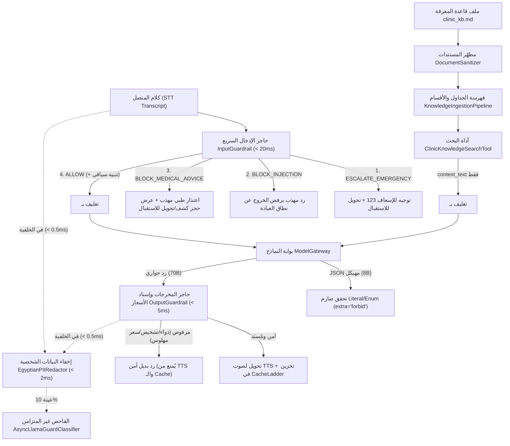

# ملخص شامل لمواصفات الميزة 4.4 — طبقة الثقة وحواجز الحماية المتوافقة مع OWASP
**(`Feature 4.4: OWASP-Aligned Trust Layer & Runtime Guardrails`)**

> يجمع هذا الملف ملخصاً تنفيذياً وهندسياً باللغة العربية للملفات الثلاثة:
> - خطة التنفيذ والتصميم المعماري (`plan.md`)
> - وثيقة المتطلبات الوظيفية وغير الوظيفية والقيود (`requirements.md`)
> - معايير التحقق والاختبار سباعية المستويات (`validation.md`)

---

## أولاً: ملخص خطة التنفيذ والتصميم (`plan.md`)

### 1. الهدف والغاية (Objective & Why)
بناء طبقة أمان وثقة دفاعية متعددة الطبقات (**Defense-in-Depth**) للمساعد الصوتي للعيادات المصرية تضمن:
- **منع المسؤولية الطبية والقانونية (Zero Medical Hallucination)**: الحظر الصارم لتشخيص الأمراض أو وصف الأدوية والجرعات هاتفياً، والتوجيه الفوري لحالات الطوارئ إلى الإسعاف (`123`) وموظف الاستقبال.
- **عدم تعطيل حجوزات المرضى الشرعية**: التمييز الذكي بين المريض الذي يذكر عرضاً طبياً لحجز موعد (*"ركبتي بتوجعني وعايز أحجز عظام"*) وبين المريض الذي يطلب تشخيصاً أو روشتة دواء.
- **الحماية من الحقن المباشر وغير المباشر (`OWASP LLM01`)**: عزل مدخلات المتصل وسياق البحث بوسوم XML محصّنة، وتطهير ملفات قاعدة المعرفة وقت الفهرسة.
- **حماية الخصوصية (`PII Redaction`)**: إخفاء أرقام الموبايل المصرية والرقم القومي (14 رقماً) قبل إرسال أي بيانات لسجلات التتبع أو نماذج الفحص الخلفية.
- **الحفاظ على سرعة الاستجابة الصوتية (`< 800ms`)**: تنفيذ جميع حواجز المسار الحرج على الـ CPU في أجزاء من المللي ثانية (`< 20ms`)، وتشغيل مصنّف `Llama Guard` بشكل غير متزامن في الخلفية (`Off Hot Path`).

### 2. المكونات المعمارية ومسار البيانات

### 3. الملفات المستهدفة وخطة التنفيذ الذرية (Execution Breakdown)
| الخطوة | الملفات المتأثرة | الدور التقني |
|:---|:---|:---|
| **الخطوة 1** | `src/config.py` | إضافة إعدادات تفعيل الحواجز، إخفاء PII، تطهير RAG، ونسبة عينة Llama Guard. |
| **الخطوة 2** | `src/rag/sanitizer.py`, `src/rag/ingestion.py` | بناء `DocumentSanitizer` لإزالة التعليقات واليونيكود الخفي والحقن غير المباشر مع الحفاظ على ` ` والجداول، وربطه بـ `parse_markdown()`. |
| **الخطوة 3** | `src/ai_core/guardrails.py` | بناء `InputGuardrail`، دوال تغليف XML، `OutputGuardrail` مع فحص إسناد الأسعار، `validate_structured_output`، `EgyptianPIIRedactor`، و`AsyncLlamaGuardClassifier`. |
| **الخطوة 4** | `src/tools/knowledge_search.py`, `src/ai_core/cache.py` | تغليف `context_text` بـ `<retrieved_context>` (مع إبقاء `message` الصوتي نظيفاً)، وترقية `CacheLadder` لاستخدام `OutputGuardrail`. |
| **الخطوة 5** | `spec/security/threat_model.md` | توثيق مصفوفة تهديدات **OWASP LLM Top 10** الكاملة وسيناريوهات العيادات المصرية. |
| **الخطوة 6** | `tests/test_guardrails.py` | حزمة اختبارات شاملة للوحدات، التكامل، الحالات الحدية، وميزانية زمن الاستجابة. |

---

## ثانياً: ملخص وثيقة المتطلبات (`requirements.md`)

### 1. المتطلبات الوظيفية (Functional Requirements)
- **`R1` — التصنيف الرباعي في `InputGuardrail`**:
  1. `ESCALATE_EMERGENCY`: اكتشاف الأعراض الحرجة (ألم الصدر، ضيق التنفس، النزيف، الإغماء...) وتوجيه المتصل فوراً للإسعاف `123` والاستقبال.
  2. `BLOCK_INJECTION`: حظر محاولات تجاوز التعليمات (عربي/إنجليزي) أو كسر وسوم XML.
  3. `BLOCK_MEDICAL_ADVICE`: حظر الطلبات الصريحة لتشخيص مرض أو وصف دواء/جرعة بدون نية حجز، والرد باعتذار طبي مهذب مع عرض الحجز.
  4. `ALLOW`: السماح بالاستفسارات العادية وطلبات الحجز المصحوبة بذكر عرض غير طارئ مع إرفاق `safety_reminder` للـ LLM.
- **`R2` — التغليف الآمن بوسوم XML**:
  - تجريد أي وسوم `<caller_utterance>` أو `<retrieved_context>` يحاول المهاجم دسّها داخل النص قبل التغليف.
  - تغليف `context_text` فقط في `ClinicKnowledgeSearchTool`، وترك حقل `message` المخصص للنطق الصوتي خالياً من أي وسوم XML.
- **`R3` — تطهير المستندات وقت الاستيعاب (`DocumentSanitizer`)**:
  - إزالة تعليقات HTML (`<!-- -->`)، وسوم `<script>/<style>/<iframe>`، محارف اليونيكود الخفية (`Zero-Width / BiDi Override`)، روابط الصور الخارجية الخبيثة، وأسطر الحقن غير المباشر.
  - الحفاظ التام على وسم ` ` وجداول الـ Markdown في `clinic_kb.md`، وإصدار تقرير `SanitizationReport`.
- **`R4` — حواجز المخرجات وإسناد الأسعار وتقييد المخرجات المهيكلة**:
  - تطبيق قائمة **"Never Say"**: منع الروشتات/الجرعات، التشخيص الطبي، الخصومات غير المصرح بها، تسريب الـ System Prompt أو مفاتيح الـ API، وأكواد SQL/Python.
  - **التحقق من إسناد الأسعار (`Numeric Fee Grounding`)**: رفض أي سعر كشف يذكره الـ LLM إذا لم يكن الرقم موجوداً فعلياً في `retrieved_context`.
  - التحقق الصارم من المخرجات المهيكلة (`IntentClassificationSchema`, `EntityExtractionSchema`) عبر `Literal`/`Enum` ومنع الحقول الإضافية (`extra="forbid"`).
- **`R5` — إخفاء البيانات الشخصية المصرية (`EgyptianPIIRedactor`)**:
  - اكتشاف وإخفاء أرقام الموبايل المصرية (`[REDACTED_PHONE]`)، الرقم القومي المكون من 14 رقماً مع التحقق من القرن والتاريخ وكود المحافظة (`[REDACTED_NATIONAL_ID]`)، البريد الإلكتروني (`[REDACTED_EMAIL]`)، وبطاقات الدفع (`[REDACTED_CARD]`).
  - دعم الأرقام الإنجليزية (`0-9`) والعربية الهندية (`٠-٩`)، ودعم الإخفاء المتداخل للقواميس والقوائم (`redact_dict`).
- **`R6` — المصنّف غير المتزامن (`AsyncLlamaGuardClassifier`)**:
  - إخفاء الـ PII أولاً، ثم جدولة الفحص في الخلفية (`asyncio.create_task`) لنسبة عينة (`10%`) عبر `groq/llama-guard-3-8b`، وتحليل أكواد المخاطر (`S1–S14`) في سجل دوري مع دعم `on_verdict` Callback.
- **`R7` — نموذج التهديدات الأمنية (`spec/security/threat_model.md`)**:
  - توثيق حدود الثقة ومصفوفة مخاطر **OWASP LLM01–LLM10** مقترنة بضوابط الكود الفعلي.

### 2. المتطلبات غير الوظيفية والقيود (NFRs & Constraints)
- **ميزانية السرعة (Latency SLA)**:
  - `InputGuardrail.evaluate()`: أقل من **`20ms`** على الـ CPU.
  - `EgyptianPIIRedactor.redact()`: أقل من **`2ms`** على الـ CPU (بدون تحميل نماذج `spacy`).
  - `OutputGuardrail.validate()`: أقل من **`5ms`** على الـ CPU.
  - `AsyncLlamaGuardClassifier.schedule_check()`: أقل من **`1ms`** على المسار الحرج.
- **القيود الصارمة**:
  - عدم كسر التوافق مع `DefaultOutputValidator` أو اختبارات المراحل `1–4` السابقة.
  - عدم إزالة ` ` قبل تحليل الجداول في `ingestion.py`، وعدم إضافة وسوم XML في الرسائل المنطوقة صوتياً.

---

## ثالثاً: ملخص معايير التحقق والاختبار (`validation.md`)

| المستوى (Tier) | الحالة | ماذا يثبت؟ |
|:---|:---|:---|
| **Tier 1: اختبارات الوحدات (Unit)** | ✅ مطبق | اختبار دوال `InputGuardrail` (الحالات الأربع بالعربية والإنجليزية)، تحييد كسر XML، تطهير `DocumentSanitizer` مع الحفاظ على ` `، فحص `OutputGuardrail` وإسناد الأسعار، تحقق `Literal`/`Enum`، وإخفاء PII المصري بالأرقام العربية والإنجليزية. |
| **Tier 2: اختبارات التكامل (Integration)** | ✅ مطبق | تكامل `DocumentSanitizer` مع `KnowledgeIngestionPipeline` على ملفات ملوثة، تغليف `context_text` في `ClinicKnowledgeSearchTool` دون المساس بـ `message`، ربط `OutputGuardrail` مع `CacheLadder`، وعمل `AsyncLlamaGuardClassifier` مع إخفاء PII المسبق. |
| **Tier 3: الحالات الحدية والأخطاء (Edge Cases)** | ✅ مطبق | صمود `AsyncLlamaGuardClassifier` عند انقطاع الشبكة أو غياب مفتاح API، عدم تصنيف أرقام عشوائية من 14 رقماً كرقم قومي، والتحقق الفعلي من ميزانية السرعة (`< 20ms`, `< 5ms`, `< 2ms`, `< 1ms`). |
| **Tier 4: فحص عدم الانحدار (Regression)** | ✅ مطبق | نجاح جميع اختبارات المشروع السابقة (`test_hybrid_rag.py`, `test_clinic_rag.py`, `test_knowledge_search.py`, `test_cache_ladder.py`, `test_model_gateway.py`, `test_clinic_tools.py`, `test_database.py`). |
| **Tier 5: الفحص الثابت والأنماط (Lint & Build)** | ✅ مطبق | فحص الكود والتنسيق عبر `uv run ruff check` و`uv run ruff format --check` والتأكد من سلامة الاستيراد (`Import Check`). *(فحص الأنواع `mypy` مُعفى لعدم وجوده في `pyproject.toml`)*. |
| **Tier 6: التحقق البصري/اليدوي (Visual/Manual)** | ⚪ غير منطبق | مبرر تقني: الميزة عبارة عن طبقة حماية خلفية (`ai_core` و`rag`) بدون تعديلات في واجهة Streamlit الرسومية. |
| **Tier 7: فحص التطبيق والـ CLI** | ✅ مطبق | تشغيل `scripts/ingest_clinic_knowledge.py --recreate --test-query` للتحقق من فهرسة الـ 71 مقطعاً بنجاح مع عمل `DocumentSanitizer` واسترجاع الإجابات الهجينة بدقة. |

