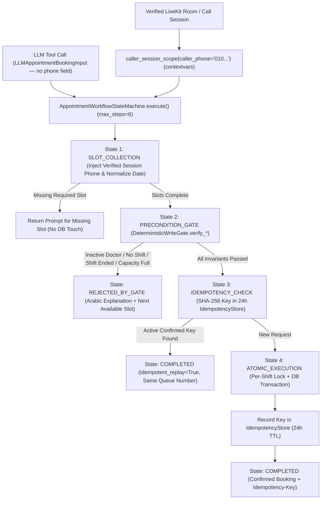

# Feature Plan: Feature 4.5 — Deterministic State Machine, Idempotency Keys & Write Safety Gates (`src/ai_core/workflow.py`, `src/tools/gates.py`)

> Parent spec: `spec/features/feature-400-enterprise-ai-architecture-and-resilience/` (Execution Group 4, requirements R8, R9, R10).
> Depends on: Phase 1 (`src/db/repository.py`, `src/db/models.py`), Phase 3 (`src/tools/schemas.py`, `src/tools/appointment_booking.py`, `src/tools/manage_appointment.py`), and Features 4.1–4.4 (`src/ai_core/gateway.py`, `src/ai_core/guardrails.py`) — all completed.

---

## 1. Objective and Why

### Objective
Eliminate unconstrained agent loop failures, duplicate bookings, race-condition overbooking, and confused-deputy phone spoofing by building a deterministic execution and safety gate layer consisting of:
1. **Deterministic Write Safety Gates (`DeterministicWriteGate` in `src/tools/gates.py`)**: Hard Python code preconditions executed before any state-mutating database operation (`book_appointment`, `cancel_appointment`, `reschedule_appointment`) that verify active doctor status, active shift existence on the target date, Cairo time window validity (not past, within 30 days, shift not ended/started today), and strict shift capacity (`booked_count < max_capacity`).
2. **Deterministic Booking Idempotency (`IdempotencyStore` & `compute_booking_idempotency_key` in `src/tools/gates.py`)**: Deterministic SHA-256 idempotency key calculation (`patient_phone + doctor_id + schedule_id + appointment_date`) backed by a 24-hour TTL cache cross-checked against live database `CONFIRMED` status, returning existing confirmed booking details (`idempotent_replay=True`) on network retries or repeated LLM tool emissions without incrementing queue numbers or creating duplicate rows.
3. **Session-Injected Caller Identity (`CallerSessionContext`, `caller_session_scope`, `LLMAppointmentBookingInput`, `LLMManageAppointmentInput` in `src/tools/gates.py` & `src/tools/schemas.py`)**: `contextvars`-isolated caller session context that injects the caller's verified phone number server-side into booking and appointment management tools while stripping `patient_phone`, `phone`, and `patient_id` from LLM-facing function schemas (`get_session_scoped_tool_definitions()`) to prevent parameter spoofing and confused-deputy attacks.
4. **Deterministic Appointment Workflow State Machine (`AppointmentWorkflowStateMachine` in `src/ai_core/workflow.py`)**: Enforces the $0.95^{10} \approx 59.8\%$ compound reliability law by governing `book`, `cancel`, and `reschedule` flows through explicit finite states (`INIT -> SLOT_COLLECTION -> PRECONDITION_GATE -> IDEMPOTENCY_CHECK -> ATOMIC_EXECUTION -> COMPLETED / REJECTED_BY_GATE / ESCALATED`) with a hard step-budget cap (`workflow_max_steps = 6`).

### Why
- **Compound Reliability Law ($0.95^{10} \approx 60\%$)**: In a voice call, letting an LLM autonomously improvise multi-step booking validation, phone ownership checks, and retry logic leads to compounding semantic failures. Moving state transitions and preconditions into deterministic Python code guarantees 100% predictable execution.
- **Zero Double-Booking on Retries (`spec/tech.md` Invariant 2)**: In real-time WebRTC audio, STT re-utterances, network timeouts, or duplicate LLM tool calls can emit the same booking request twice within seconds or hours. A deterministic `Idempotency-Key` returning the confirmed booking (`idempotent_replay=True`) prevents duplicate records and preserves patient experience.
- **Confused-Deputy & Identity Spoofing Prevention (`spec/tech.md` Invariant 9 & 10)**: If the LLM supplies `patient_phone` in `manage_appointment(action="cancel")` or `book_appointment`, a prompt injection or hallucination could cancel or look up another patient's appointment. Injecting `caller_phone` server-side from `CallerSessionContext` makes cross-patient spoofing impossible.

---

## 2. Scope and Exclusions

### In Scope
- **`src/tools/gates.py`**:
  - `CallerSessionContext`, `caller_session_scope()`, `get_current_caller_session()`, and `resolve_effective_caller_phone()`: `contextvars`-isolated caller identity binding and server-side phone injection (preventing LLM phone spoofing while maintaining backward compatibility when no session context is set).
  - `compute_booking_idempotency_key()` & `compute_reschedule_idempotency_key()`: Deterministic SHA-256 hash generators.
  - `IdempotencyRecord` & `IdempotencyStore`: Thread/async-safe 24-hour TTL idempotency registry with LRU capacity bound and automatic invalidation when an appointment is cancelled.
  - `GateVerdict` & `DeterministicWriteGate`: Pre-write Python code gate verifying doctor status, shift schedule existence, Cairo date/time bounds, consultation eligibility, ownership verification, and strict `booked_count < max_capacity` before any DB write.
- **`src/ai_core/workflow.py`**:
  - `WorkflowState` (`INIT`, `SLOT_COLLECTION`, `PRECONDITION_GATE`, `IDEMPOTENCY_CHECK`, `ATOMIC_EXECUTION`, `COMPLETED`, `REJECTED_BY_GATE`, `ESCALATED`), `WorkflowAction` (`BOOK`, `CANCEL`, `RESCHEDULE`, `LOOKUP`), `WorkflowStepTrace`, and `WorkflowExecutionResult`.
  - `AppointmentWorkflowStateMachine`: Deterministic DAG / state machine orchestrating slot validation, session identity injection, `DeterministicWriteGate` checks, `IdempotencyStore` replay, and atomic tool execution with a hard step budget (`workflow_max_steps = 6`, raising semantic step-budget exhaustion if exceeded).
- **`src/tools/schemas.py` & `src/tools/__init__.py`**:
  - Add `LLMAppointmentBookingInput` and `LLMManageAppointmentInput` (`ConfigDict(extra="forbid")`) omitting `patient_phone`, `phone`, and `patient_id` for session-scoped LLM tool calling.
  - Add `get_session_scoped_tool_definitions()` in `src/tools/__init__.py` returning OpenAI/Groq function definitions that use the session-scoped schemas for `book_appointment` and `manage_appointment` (while keeping `get_tool_definitions()` intact for backward compatibility).
- **`src/tools/appointment_booking.py` & `src/tools/manage_appointment.py`**:
  - Integrate `resolve_effective_caller_phone()`, `DeterministicWriteGate`, and `IdempotencyStore` invalidation/recording cleanly without breaking existing Phase 3 unit and integration tests.
- **`src/config.py`**:
  - Add `idempotency_ttl_s` (default `86400`), `idempotency_max_entries` (default `5000`), `workflow_max_steps` (default `6`), and `enforce_session_caller_identity` (default `True`).
- **`tests/test_workflow_gates.py`**:
  - Comprehensive unit, integration, concurrency, idempotency, spoofing-prevention, and step-budget test suite.

### Exclusions (Out of Scope)
- **Self-hosted Langfuse / OpenTelemetry hierarchical span tracer (`src/ai_core/tracing.py`)** → Scoped to **Feature 4.6**.
- **FinOps token budgets and daily cost circuit breaker (`src/ai_core/finops.py`)** → Scoped to **Feature 4.7**.
- **Golden evaluation dataset and RAGAS CI gate (`tests/evals/`)** → Scoped to **Feature 4.8**.
- **Architecture Decision Records (`spec/adr/`)** → Scoped to **Feature 4.9**.

---

## 3. Relevant Existing Architecture
- **`src/db/repository.py`**: `ClinicRepository` provides `_get_shift_lock(doctor_id, appointment_date)`, `get_doctor_availability()`, `create_appointment()`, and `cancel_appointment()`.
- **`src/tools/appointment_booking.py`**: `AppointmentBookingTool` resolves doctors by ID or Arabic/English name, checks Cairo date windows, checks 14-day consultation eligibility, and creates appointments.
- **`src/tools/manage_appointment.py`**: `ManageAppointmentTool` executes `lookup`, `cancel`, and atomic `reschedule` operations.
- **`src/tools/schemas.py` & `src/tools/__init__.py`**: Defines `AppointmentBookingInput`, `ManageAppointmentInput`, and `TOOL_REGISTRY`.

---

## 4. Proposed Approach & Architectural Design

### Key Design Decisions

| # | Decision | Rationale |
|:--|:---------|:----------|
| **D1** | **`contextvars`-Based `CallerSessionContext` with Dual-Mode Compatibility**: When `caller_session_scope(caller_phone="010...")` is active, `resolve_effective_caller_phone()` forcibly injects the verified session phone and blocks/overrides any conflicting phone passed in arguments (`spoof_attempt_blocked=True`). When no session context is active (standalone CLI or Phase 3 tests), it falls back to the explicit `patient_phone`/`phone` parameter. | Satisfies R10.1 & R10.2 (server-side phone injection & spoofing immunity in live voice sessions) while keeping 100% of existing tests in `tests/test_clinic_tools.py`, `tests/test_appointment_booking.py`, and `tests/test_manage_appointment.py` passing without modification. |
| **D2** | **Session-Scoped LLM Schemas (`LLMAppointmentBookingInput`, `LLMManageAppointmentInput`)**: Expose `get_session_scoped_tool_definitions()` where `book_appointment` and `manage_appointment` use strict schemas (`extra="forbid"`) that completely omit `patient_phone`, `phone`, and `patient_id`. | Guarantees the LLM cannot even see or populate caller identity fields during voice sessions (R10.1), while preserving `TOOL_REGISTRY` and `get_tool_definitions()` for legacy/direct callers. |
| **D3** | **24-Hour `IdempotencyStore` Cross-Checked with Live DB Status**: Compute `Idempotency-Key = sha256(f"{clean_phone}:{doctor_id}:{schedule_id}:{target_date.isoformat()}")`. In `AppointmentWorkflowStateMachine` (and when `idempotent_mode=True` on `DeterministicWriteGate`), a repeat request within 24h checks both `IdempotencyStore` and DB `CONFIRMED` status: if still confirmed, it returns `ToolResult(success=True, data={..., "idempotent_replay": True, "idempotency_key": key})` without incrementing `queue_number`. Cancelling or rescheduling an appointment automatically invalidates its old idempotency key. | Prevents duplicate bookings on network retries or repeated LLM tool calls (R9.1, R9.2) while allowing a patient who cancelled their booking to re-book the same doctor/shift later. |
| **D4** | **Explicit Finite State Machine (`AppointmentWorkflowStateMachine`) with Step Budget (`max_steps=6`)**: Transitions deterministically through `INIT -> SLOT_COLLECTION -> PRECONDITION_GATE -> IDEMPOTENCY_CHECK -> ATOMIC_EXECUTION -> COMPLETED` (or `REJECTED_BY_GATE` / `ESCALATED`), recording a `WorkflowStepTrace` for every state transition and aborting with `error_class="step_budget_exhausted"` if steps exceed `workflow_max_steps`. | Enforces the $0.95^{10}$ reliability law (R8.1) and produces structured state transition telemetry ready for Feature 4.6 tracing. |

### Components & Data Flow

---

## 5. Expected Files and Areas Affected

### New Files
- `src/tools/gates.py`: `CallerSessionContext`, `caller_session_scope`, `resolve_effective_caller_phone`, `compute_booking_idempotency_key`, `compute_reschedule_idempotency_key`, `IdempotencyRecord`, `IdempotencyStore`, `GateVerdict`, and `DeterministicWriteGate`.
- `src/ai_core/workflow.py`: `WorkflowState`, `WorkflowAction`, `WorkflowStepTrace`, `WorkflowExecutionResult`, and `AppointmentWorkflowStateMachine`.
- `tests/test_workflow_gates.py`: Comprehensive unit, integration, concurrency, idempotency, spoofing-prevention, and regression tests for Feature 4.5.

### Modified Files
- `src/config.py`: Add `idempotency_ttl_s`, `idempotency_max_entries`, `workflow_max_steps`, and `enforce_session_caller_identity` settings.
- `src/tools/schemas.py`: Add `LLMAppointmentBookingInput` and `LLMManageAppointmentInput` (`ConfigDict(extra="forbid")`, omitting caller phone/ID fields).
- `src/tools/appointment_booking.py`: Wire `resolve_effective_caller_phone()`, `DeterministicWriteGate`, and `Idempotency-Key` metadata enrichment / `IdempotencyStore` registration.
- `src/tools/manage_appointment.py`: Wire `resolve_effective_caller_phone()`, `DeterministicWriteGate`, and `IdempotencyStore` invalidation on cancel/reschedule.
- `src/tools/__init__.py` & `src/ai_core/__init__.py`: Export `get_session_scoped_tool_definitions()`, gates, and workflow state machine classes.

---

## 6. Execution Breakdown (Atomic Sub-Steps)

1. **Step 1 — Configuration (`src/config.py`)**:
   - Add `idempotency_ttl_s=86400`, `idempotency_max_entries=5000`, `workflow_max_steps=6`, and `enforce_session_caller_identity=True` to `Settings`.
2. **Step 2 — Session Identity, Idempotency Store & Deterministic Write Gates (`src/tools/gates.py`)**:
   - Implement `CallerSessionContext`, `caller_session_scope()`, and `resolve_effective_caller_phone()` using `contextvars`.
   - Implement `compute_booking_idempotency_key()`, `compute_reschedule_idempotency_key()`, and `IdempotencyStore` (with 24h TTL, LRU eviction, and cancellation invalidation).
   - Implement `DeterministicWriteGate` validating doctor status, shift schedule existence, Cairo time window, consultation eligibility, ownership verification, and shift capacity (`booked_count < max_capacity`).
3. **Step 3 — Session-Scoped LLM Schemas & Tool Wiring (`src/tools/schemas.py`, `src/tools/appointment_booking.py`, `src/tools/manage_appointment.py`, `src/tools/__init__.py`)**:
   - Define `LLMAppointmentBookingInput` and `LLMManageAppointmentInput` omitting `patient_phone`, `phone`, and `patient_id`.
   - Expose `get_session_scoped_tool_definitions()` in `src/tools/__init__.py`.
   - Wire session phone resolution and idempotency key tracking into `AppointmentBookingTool` and `ManageAppointmentTool`.
4. **Step 4 — Deterministic Workflow State Machine (`src/ai_core/workflow.py` & `src/ai_core/__init__.py`)**:
   - Implement `AppointmentWorkflowStateMachine` orchestrating `BOOK`, `CANCEL`, `RESCHEDULE`, and `LOOKUP` through deterministic states with step-budget enforcement (`workflow_max_steps=6`) and idempotent replay.
5. **Step 5 — Automated Verification (`tests/test_workflow_gates.py`)**:
   - Write and run unit, integration, concurrency, idempotency, spoofing-defense, and full regression tests.

---

## 7. Risks and Trade-Offs

| Risk / Trade-Off | Mitigation Strategy |
|:---|:---|
| **Breaking Phase 3 Direct Tool Tests (`test_appointment_booking.py`, `test_clinic_tools.py`)**: Existing tests call `book_appointment(patient_phone="010...")` without a `caller_session_scope` and expect direct duplicate calls on `AppointmentBookingTool` to return `error="duplicate_booking"`. | Dual-mode design: `caller_session_scope` overrides/injects phone when active in `contextvars`, while falling back to explicit `patient_phone` when no session scope is active. Direct `AppointmentBookingTool.aexecute()` preserves `error="duplicate_booking"` (while attaching `idempotency_key`), whereas `AppointmentWorkflowStateMachine` and `DeterministicWriteGate.execute_booking()` return `idempotent_replay=True` (`success=True`) on idempotent retries. |
| **Stale Idempotency Cache After Cancellation**: If a patient books, cancels, and re-books the same doctor/shift on the same day, an un-invalidated idempotency cache would return the cancelled booking. | `ManageAppointmentTool` and `AppointmentWorkflowStateMachine` invalidate the booking's idempotency key upon cancellation/rescheduling, and `IdempotencyStore` double-checks that the underlying DB appointment is still `CONFIRMED` before serving an idempotent replay. |
| **Concurrent Race Conditions Between Gate Check and DB Write**: Two simultaneous requests for the last slot could both pass a non-locked read gate. | `DeterministicWriteGate` pre-validates fast business rules and then delegates the final write inside `ClinicRepository._get_shift_lock(doctor_id, appointment_date)` atomic transaction, guaranteeing zero overbooking under concurrency. |
