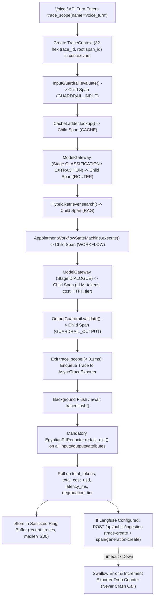

# Feature Plan: Feature 4.6 — Hierarchical LLM Trace Logging (`src/ai_core/tracing.py`)

> Parent spec: `spec/features/feature-400-enterprise-ai-architecture-and-resilience/` (Execution Group 5, requirements R6, R11, R15, NFR4, NFR5).
> Depends on: Features 4.1–4.5 (`src/ai_core/gateway.py`, `src/ai_core/cache.py`, `src/ai_core/guardrails.py`, `src/ai_core/workflow.py`, `src/rag/hybrid_retriever.py`) — all completed.

---

## 1. Objective and Why

### Objective
Establish an enterprise-grade, sub-millisecond (< 1ms hot-path overhead) **Hierarchical LLM Trace Logging** engine (`src/ai_core/tracing.py`) compatible with **self-hosted Langfuse** and **OpenTelemetry** (`W3C traceparent`) standards:
1. **Hierarchical Trace & Nested Span Tree (`TraceContext`, `SpanContext`, `TraceRecord`, `SpanRecord`)**: Every conversational turn creates a root `trace_id` (32-hex W3C trace ID) and nests child spans (`span_id` 16-hex, `parent_span_id` 16-hex) across `input_guardrail`, `cache_lookup`, `stage_router`, `llm_generation`, `hybrid_rag`, `workflow_execution`, `tool_execution`, `output_guardrail`, and `llama_guard_async`.
2. **`contextvars`-Based Async Isolation & W3C `traceparent` Propagation**: Isolate concurrent callers via Python `contextvars` (`trace_scope()`, `span_scope()`, `traced_span()`) and provide `format_traceparent()` / `parse_traceparent()` (`00-<trace_id>-<span_id>-01`) so cross-service or downstream calls maintain trace continuity without cross-call contamination.
3. **Token, Cost & Latency Rollup (`estimate_llm_cost_usd`, `TraceRecord`)**: Automatically calculate per-span prompt/completion token counts, estimated USD cost from a configurable model price table in `src/config.py`, TTFT (`ttft_ms`), total latency (`latency_ms`), and `degradation_tier`, rolling up cumulative tokens and cost to the root `TraceRecord`.
4. **Off-Hot-Path PII Redaction & Async Batch Export (`AsyncTraceExporter`)**: Buffer completed traces in memory on the hot path (< 0.1ms overhead) and process them asynchronously in the background:
   - Run mandatory Egyptian PII redaction (`EgyptianPIIRedactor.redact_dict()`) across all span inputs, outputs, and metadata before storing in the ring buffer or dispatching over HTTP.
   - Store sanitized traces in a bounded in-memory ring buffer (`recent_traces`, default 200) for deterministic test inspection and downstream Streamlit dashboard telemetry.
   - Export batches asynchronously via `httpx.AsyncClient` to the self-hosted Langfuse Ingestion API (`/api/public/ingestion`) when configured, degrading gracefully to a local no-op when Langfuse is unconfigured or unreachable.

### Why
- **Diagnosing Silent Semantic Failures**: An HTTP 200 voice turn can still fail semantically (e.g., wrong specialty routed, low-recall RAG chunk, or fallback to Tier 3). A hierarchical span tree is the only way to pinpoint whether latency or quality degraded in STT, Guardrails, Cache, Stage Router, RAG, LLM Gateway, or DB Tools.
- **Protecting the < 800ms Voice SLA (`spec/tech.md` Invariant 1 & 7)**: Synchronous network I/O or heavy serialization during a voice turn would violate the 800ms turnaround budget. In-memory span recording + off-hot-path PII redaction and batch flushing guarantees **< 1ms** hot-path overhead.
- **Strict Patient Data Sovereignty (`spec/tech.md` Invariant 7)**: Egyptian patient phone numbers (`010/011/012/015`) and 14-digit National IDs must never leak into trace storage, and traces must only target self-hosted clinic infrastructure (Langfuse OSS), never third-party SaaS.

---

## 2. Scope and Exclusions

### In Scope
- **`src/ai_core/tracing.py`**:
  - `SpanKind` enum (`TURN`, `GUARDRAIL_INPUT`, `GUARDRAIL_OUTPUT`, `CACHE`, `ROUTER`, `LLM`, `RAG`, `WORKFLOW`, `TOOL`, `SAFETY_ASYNC`).
  - `SpanStatus` enum (`OK`, `ERROR`, `DEGRADED`, `BLOCKED`, `BYPASSED`).
  - `ErrorCategory` enum (`NONE`, `INFRASTRUCTURE`, `SEMANTIC`, `SECURITY_BLOCK`).
  - `SpanRecord` & `TraceRecord`: Pydantic models holding OpenTelemetry-compatible `trace_id` (32-hex), `span_id` (16-hex), `parent_span_id` (16-hex or `None`), timestamps, `latency_ms`, `ttft_ms`, `prompt_tokens`, `completion_tokens`, `total_tokens`, `cost_usd`, `model`, `provider`, `degradation_tier`, `error_category`, `error_class`, and PII-redacted `input_payload`, `output_payload`, and `attributes`.
  - W3C Trace Context utilities: `generate_trace_id()`, `generate_span_id()`, `format_traceparent()`, `parse_traceparent()`, `inject_trace_headers()`.
  - `contextvars` lifecycle managers: `trace_scope()`, `span_scope()`, `get_current_trace()`, `get_current_span()`, and `@traced_span` decorator.
  - `estimate_llm_cost_usd()`: Deterministic cost calculator using per-1M token pricing configured in `src/config.py`.
  - `AsyncTraceExporter` & `HierarchicalTracer`: Non-blocking queue, off-hot-path `EgyptianPIIRedactor` scrubbing, bounded `recent_traces` ring buffer (`maxlen=200`), explicit `await tracer.flush()`, and Langfuse `/api/public/ingestion` batch HTTP client (`httpx.AsyncClient`) with automatic no-op fallback.
- **Transparent Auto-Instrumentation across AI Core**:
  - `src/ai_core/gateway.py`: Record child `SpanKind.LLM` (or `SpanKind.ROUTER` for classification/extraction stages) spans when an active trace exists, capturing `provider`, `model`, `prompt_tokens`, `completion_tokens`, `cost_usd`, `ttft_ms`, `degradation_tier`, `error_class`, and provider attempts.
  - `src/ai_core/cache.py`: Record child `SpanKind.CACHE` spans on `lookup()` and `store()`, capturing `tier` (`EXACT`, `SEMANTIC`, `MISS`, `BYPASS`), `similarity`, and `bypass_reason`.
  - `src/ai_core/guardrails.py`: Record child `SpanKind.GUARDRAIL_INPUT` and `SpanKind.GUARDRAIL_OUTPUT` spans on `InputGuardrail.evaluate()` and `OutputGuardrail.validate()`, and attach `AsyncLlamaGuardClassifier` verdicts back to the associated trace via `trace_id`.
  - `src/ai_core/workflow.py`: Record child `SpanKind.WORKFLOW` spans on `AppointmentWorkflowStateMachine.execute()`, capturing `action`, `terminal_state`, `steps_taken`, `idempotent_replay`, and `spoof_attempt_blocked`.
  - `src/rag/hybrid_retriever.py`: Record child `SpanKind.RAG` spans on `HybridRetriever.search()`, capturing `category`, `dense_count`, `sparse_count`, and fused `top_k`.
- **`src/config.py`**:
  - Add Langfuse & tracing settings (`tracing_enabled`, `langfuse_enabled`, `langfuse_host`, `langfuse_public_key`, `langfuse_secret_key`, `tracing_batch_size`, `tracing_flush_interval_s`, `tracing_max_queue_size`, `tracing_ring_buffer_size`, `llm_cost_per_1m_tokens`).
- **`tests/test_tracing.py`**:
  - Comprehensive unit, integration, concurrency, PII-redaction, W3C `traceparent`, Langfuse payload, latency budget (< 1ms), and regression test suite.

### Exclusions (Out of Scope)
- **FinOps per-call 8,000 token budget enforcement and $10/day cost circuit breaker (`src/ai_core/finops.py`)** → Scoped to **Feature 4.7**.
- **Golden evaluation dataset and RAGAS CI gate (`tests/evals/`)** → Scoped to **Feature 4.8**.
- **Prometheus metrics exporter (`src/ops/metrics.py`)** → Scoped to **Phase 6 (Feature 6.1)**.

---

## 3. Relevant Existing Architecture
- **`src/ai_core/guardrails.py`**: Provides `EgyptianPIIRedactor` (`get_pii_redactor()`) with `redact()` and `redact_dict()` (< 2ms CPU) and `AsyncLlamaGuardClassifier` accepting `trace_id`.
- **`src/ai_core/gateway.py`**: Returns `GatewayResult` with `prompt_tokens`, `completion_tokens`, `total_tokens`, `ttft_ms`, `latency_ms`, `provider`, `model`, `degradation_tier`, and `error_class`.
- **`src/ai_core/cache.py`**: `CacheLadder.lookup()` returns `CacheResult` (`hit`, `tier`, `similarity`, `latency_ms`, `bypass_reason`).
- **`src/ai_core/workflow.py`**: `AppointmentWorkflowStateMachine.execute()` returns `WorkflowExecutionResult` (`terminal_state`, `steps_taken`, `step_traces`, `idempotent_replay`, `spoof_attempt_blocked`).

---

## 4. Proposed Approach & Architectural Design

### Key Design Decisions

| # | Decision | Rationale |
|:--|:---------|:----------|
| **D1** | **Zero-Dependency OpenTelemetry + Langfuse Ingestion Protocol over `httpx`**: Use W3C-standard 128-bit `trace_id` (32 hex chars) and 64-bit `span_id` (16 hex chars) and export to Langfuse's `/api/public/ingestion` REST endpoint (`trace-create`, `span-create`, `generation-create`) via `httpx.AsyncClient`. | Avoids heavy SDK dependency conflicts in `pyproject.toml` while maintaining 100% compatibility with self-hosted Langfuse and W3C `traceparent` headers. |
| **D2** | **Off-Hot-Path PII Scrubbing & Batch Export (< 1ms Hot-Path SLA)**: During a voice turn, opening and closing spans only appends lightweight Python objects in memory. When the root `trace_scope` exits, the raw trace is enqueued (`put_nowait`) and scrubbed via `EgyptianPIIRedactor.redact_dict()` in the background flush worker before hitting `recent_traces` or network I/O. | Guarantees hot-path span creation/completion takes **< 0.1ms** (well within the < 1ms NFR5 budget) while ensuring zero unredacted PII ever enters the ring buffer or leaves the process. |
| **D3** | **Opt-In Auto-Instrumentation via Active `contextvars` Check**: `Gateway`, `CacheLadder`, `InputGuardrail`, `OutputGuardrail`, `AppointmentWorkflowStateMachine`, and `HybridRetriever` check `get_current_trace() is not None`. When a trace is active, they automatically emit nested child spans; when no trace is active, they incur a single pointer check (~50ns) and zero behavioral change. | Provides automatic end-to-end span trees inside `trace_scope()` while keeping 100% of existing unit/integration tests passing without modification. |
| **D4** | **Bounded Sanitized Ring Buffer (`recent_traces`, `maxlen=200`) + Explicit `flush()`**: Keep the last 200 PII-scrubbed `TraceRecord` objects in memory alongside optional Langfuse HTTP export, and support `await tracer.flush()` to deterministically drain pending items. | Enables fast, deterministic assertions in `tests/test_tracing.py`, allows async Llama Guard verdicts to attach to completed traces by `trace_id`, and feeds the Phase 7 Streamlit analytics dashboard. |

### Components & Data Flow

---

## 5. Expected Files and Areas Affected

### New Files
- `src/ai_core/tracing.py`: Complete hierarchical tracing engine (`SpanKind`, `SpanStatus`, `ErrorCategory`, `SpanRecord`, `TraceRecord`, `TraceContext`, `SpanContext`, `trace_scope`, `span_scope`, `traced_span`, `format_traceparent`, `parse_traceparent`, `estimate_llm_cost_usd`, `AsyncTraceExporter`, `HierarchicalTracer`, `get_tracer`).
- `tests/test_tracing.py`: Comprehensive test suite covering unit, integration, `contextvars` concurrency isolation, PII redaction, token/cost rollup, W3C `traceparent`, Langfuse batch export & graceful degradation, and < 1ms hot-path overhead.

### Modified Files
- `src/config.py`: Add tracing, Langfuse self-hosted connection settings, and `llm_cost_per_1m_tokens` pricing table.
- `src/ai_core/gateway.py`: Auto-instrument `astream()` with nested `SpanKind.LLM` / `SpanKind.ROUTER` spans when a trace context is active.
- `src/ai_core/cache.py`: Auto-instrument `lookup()` and `store()` with nested `SpanKind.CACHE` spans when a trace context is active.
- `src/ai_core/guardrails.py`: Auto-instrument `InputGuardrail.evaluate()` (`SpanKind.GUARDRAIL_INPUT`), `OutputGuardrail.validate()` (`SpanKind.GUARDRAIL_OUTPUT`), and link `AsyncLlamaGuardClassifier` verdicts to the trace in `HierarchicalTracer`.
- `src/ai_core/workflow.py`: Auto-instrument `AppointmentWorkflowStateMachine.execute()` with nested `SpanKind.WORKFLOW` spans when a trace context is active.
- `src/rag/hybrid_retriever.py`: Auto-instrument `HybridRetriever.search()` with nested `SpanKind.RAG` spans when a trace context is active.
- `src/ai_core/__init__.py`: Export tracing classes and helpers.

---

## 6. Execution Breakdown (Atomic Sub-Steps)

1. **Step 1 — Configuration (`src/config.py`)**:
   - Add `tracing_enabled=True`, `langfuse_enabled=False`, `langfuse_host="http://localhost:3000"`, `langfuse_public_key=""`, `langfuse_secret_key=""`, `tracing_batch_size=20`, `tracing_flush_interval_s=2.0`, `tracing_max_queue_size=1000`, `tracing_ring_buffer_size=200`, and `llm_cost_per_1m_tokens` dictionary.
   - Add `is_langfuse_configured()` helper on `Settings`.
2. **Step 2 — Core Hierarchical Tracer & Exporter (`src/ai_core/tracing.py`)**:
   - Implement W3C trace ID / span ID generation and `format_traceparent()` / `parse_traceparent()`.
   - Implement `SpanRecord`, `TraceRecord`, `TraceContext`, `SpanContext`, `trace_scope()`, `span_scope()`, and `@traced_span` using `contextvars`.
   - Implement `estimate_llm_cost_usd()` for Groq (`llama-3.3-70b-versatile`, `llama-3.1-8b-instant`, `llama-guard-3-8b`) and Gemini (`gemini-2.0-flash`).
   - Implement `AsyncTraceExporter` and `HierarchicalTracer` performing off-hot-path `EgyptianPIIRedactor.redact_dict()`, token/cost rollup, ring-buffer storage, Llama Guard verdict attachment, and Langfuse `/api/public/ingestion` HTTP batch export with no-op fallback.
3. **Step 3 — Transparent AI Core Instrumentation (`gateway.py`, `cache.py`, `guardrails.py`, `workflow.py`, `hybrid_retriever.py`, `src/ai_core/__init__.py`)**:
   - Wire lightweight `get_current_trace()` checks into each module so executing a turn inside `trace_scope()` automatically builds the full nested span tree.
4. **Step 4 — Verification & Regression Suite (`tests/test_tracing.py`)**:
   - Write and run unit, integration, concurrency, PII scrubbing, Langfuse mock HTTP ingestion, < 1ms hot-path benchmark, and full Phase 1–4 regression tests.

---

## 7. Risks and Trade-Offs

| Risk / Trade-Off | Mitigation Strategy |
|:---|:---|
| **Hot-Path Latency Inflation**: Synchronous PII regex scanning or JSON serialization inside `span_scope` could exceed the 1ms budget. | Perform only lightweight in-memory object creation on the hot path (< 0.1ms); defer `EgyptianPIIRedactor.redact_dict()` and JSON serialization to the async flush step. |
| **Langfuse Outage or Backpressure**: If self-hosted Langfuse is down or slow, an unbounded queue could leak memory or block the event loop. | Bounded queue (`tracing_max_queue_size=1000`) with `put_nowait` drop-oldest/drop-newest policy, short HTTP timeout (`2.0s`), and automatic silent degradation to local no-op. |
| **Cross-Call Span Contamination under Concurrency**: Parallel async calls sharing global state could mix spans across patients. | Strict `contextvars.ContextVar` management for both `_current_trace_var` and `_current_span_var`, verified by a 20-way concurrent `asyncio.gather` test. |
| **Async Llama Guard Arriving After Turn Trace Closes**: Sampled Llama Guard runs off the hot path and finishes after `trace_scope` exits. | `HierarchicalTracer.attach_llama_guard_verdict(trace_id, verdict)` updates the trace in `recent_traces` (and emits a follow-up Langfuse score/span event if enabled) using `trace_id`. |
