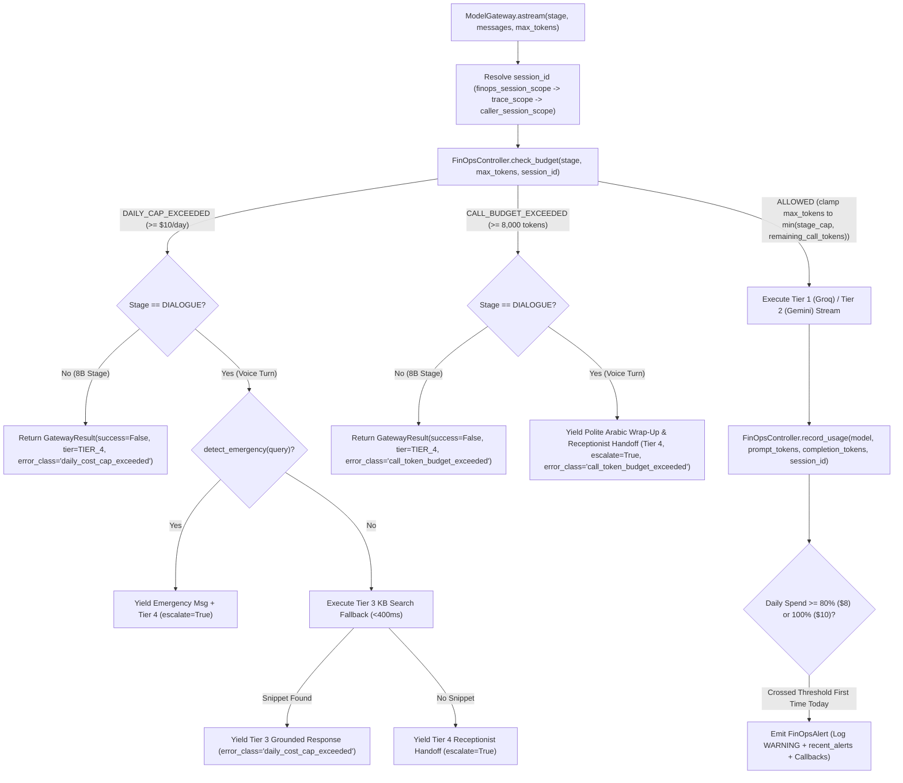

# Feature Plan: Feature 4.7 — FinOps Token Budgets & Cost Circuit Breaker (`src/ai_core/finops.py`)

> Parent spec: `spec/features/feature-400-enterprise-ai-architecture-and-resilience/` (Execution Group 6, requirements R1.6, R14.1–R14.4, C4).
> Depends on: Features 4.1–4.6 (`src/ai_core/gateway.py`, `src/ai_core/tracing.py`, `src/tools/gates.py`, `src/tools/schemas.py`) — all completed.

---

## 1. Objective and Why

### Objective
Build a deterministic, sub-millisecond **FinOps Token Budget, Cost Circuit Breaker, and Tool Payload Pruner** (`src/ai_core/finops.py`) deeply integrated with `ModelGateway` (`src/ai_core/gateway.py`) and `Settings` (`src/config.py`):
1. **Per-Call Token Budget Ledger (`CallBudgetLedger`, 8,000 tokens/call)**:
   - Track cumulative `prompt_tokens`, `completion_tokens`, `total_tokens`, and `total_cost_usd` per call session (`session_id`).
   - Resolve `session_id` automatically via `contextvars` hierarchy (`finops_session_scope` -> `trace_scope.session_id` -> `caller_session_scope.session_id` / `caller_phone`) or explicit argument.
   - Clamp final-turn `max_tokens` when remaining call tokens fall below the stage limit (`150` / `256`), and when cumulative tokens reach `>= 8,000` (or remaining `< 16` minimum turn tokens), bypass LLM calls and politely wrap up / escalate to the receptionist (**Tier 4 `TIER_4_HUMAN_ESCALATION`**, `escalate=True`, `error_class="call_token_budget_exceeded"`).
2. **Cairo-Day Spend Accumulator, 80% Alert & $10/day Cost Circuit Breaker (`DailySpendAccumulator`, `FinOpsController`)**:
   - Accumulate daily estimated USD spend keyed by Cairo calendar date (`Africa/Cairo`, `YYYY-MM-DD`) so the counter and alerts automatically roll over at midnight Cairo time without external cron jobs.
   - Emit a structured `FinOpsAlert` (`ALERT_80_PERCENT`, `BREACH_100_PERCENT`) once per Cairo day when spend crosses **80% ($8.00)** and **100% ($10.00)** of `finops_daily_spend_cap_usd`, logging a warning, appending to an in-memory `recent_alerts` ring buffer, and invoking optional registered callback hooks.
   - Trip the **Cost Circuit Breaker** when daily spend reaches `>= $10.00`: `ModelGateway` immediately degrades `Stage.DIALOGUE` requests to **Tier 3 (`TIER_3_SEARCH_ONLY`, `error_class="daily_cost_cap_exceeded"`)** (while still routing emergency utterances to **Tier 4**, and falling back to **Tier 4** if KB search returns no snippet), never dropping a patient call.
3. **Schema-Aware Tool Payload Pruner (`prune_tool_payload`, `prune_tool_message`, R14.4)**:
   - Deterministically prune `ToolResult` or raw dict outputs from clinic tools (`check_doctor_availability`, `book_appointment`, `manage_appointment`, `search_clinic_knowledge`, `transfer_to_receptionist`) before they are appended to LLM conversation history.
   - Retain `success`, `message`, `error`, and filter `data` to per-tool allowlisted essential keys, capping list lengths (default 5 items), individual string fields (default 300 chars), and serialized payload size (default 1,200 chars).

### Why
- **Preventing Runaway Call Loops (`spec/tech.md` Invariant 8)**: Unbounded multi-turn conversations or repeated tool retries can consume tens of thousands of tokens in a single call. A hard 8,000-token per-call ceiling guarantees unit-cost predictability per patient call.
- **Protecting Clinic Daily Cloud Spend ($10/day Cap)**: A traffic spike, bot flood, or adversarial loop could exhaust a clinic's monthly API budget in hours. An 80% early warning ($8.00) plus a 100% ($10.00) Cost Circuit Breaker that degrades to zero-LLM-cost Qdrant KB search (Tier 3) or receptionist transfer (Tier 4) ensures financial safety without dropping calls.
- **Preventing Context Window & Prompt Token Bloat (R14.4)**: Appending unpruned tool `data` payloads (full shift tables, raw RAG chunk metadata, internal DB fields) into `messages` compounds prompt tokens on every subsequent turn. Pruning tool payloads to essential fields cuts multi-turn prompt token growth by 50–70%.

---

## 2. Scope and Exclusions

### In Scope
- **`src/ai_core/finops.py`**:
  - `FinOpsDecision`, `FinOpsGateStatus` (`ALLOWED`, `CALL_BUDGET_EXCEEDED`, `DAILY_CAP_EXCEEDED`), `AlertLevel` (`WARNING_80_PERCENT`, `CRITICAL_100_PERCENT`), `FinOpsAlert`, `CallBudgetSnapshot`, `DailySpendSnapshot`.
  - `finops_session_scope(session_id)`: `contextvars` context manager + automatic fallback resolution from `get_current_trace()` (`src/ai_core/tracing.py`) and `get_current_caller_session()` (`src/tools/gates.py`).
  - `FinOpsController` (and singleton `get_finops_controller()`):
    - `check_budget(stage, requested_max_tokens, session_id=None) -> FinOpsDecision`
    - `record_usage(model, prompt_tokens, completion_tokens, session_id=None, cost_usd=None) -> tuple[CallBudgetSnapshot | None, DailySpendSnapshot]`
    - Bounded LRU storage for per-call ledgers (`finops_max_tracked_sessions = 2000`) and Cairo-date daily buckets (`finops_Rollover` via `CAIRO_TZ`).
    - Idempotent once-per-day 80% and 100% alert emission with callback registration (`register_alert_callback`).
  - `prune_tool_payload()` and `format_pruned_tool_message()`: Schema-aware allowlist pruner for all 5 clinic tools with list-item and character caps.
- **`src/config.py`**:
  - Add FinOps configuration settings (`finops_enabled`, `finops_call_token_budget`, `finops_min_turn_tokens`, `finops_daily_spend_cap_usd`, `finops_daily_alert_ratio`, `finops_max_tracked_sessions`, `finops_max_tool_list_items`, `finops_max_tool_field_chars`, `finops_max_tool_payload_chars`).
- **`src/ai_core/gateway.py`**:
  - Integrate `FinOpsController` into `ModelGateway`:
    - Pre-flight check in `_astream_impl`:
      - If `CALL_BUDGET_EXCEEDED`: for `Stage.DIALOGUE`, yield polite Arabic wrap-up/receptionist escalation (`DegradationTier.TIER_4_HUMAN_ESCALATION`, `escalate=True`, `error_class="call_token_budget_exceeded"`); for `CLASSIFICATION`/`EXTRACTION`, return `success=False`, `DegradationTier.TIER_4_HUMAN_ESCALATION`, `error_class="call_token_budget_exceeded"`.
      - If `DAILY_CAP_EXCEEDED`: skip Tier 1 (Groq) and Tier 2 (Gemini) providers and jump directly to the Tier 3 / Tier 4 degradation path (`DegradationTier.TIER_3_SEARCH_ONLY` with `error_class="daily_cost_cap_exceeded"`, emergency check -> Tier 4, or Tier 4 if search yields no snippet).
      - If `ALLOWED`: clamp `max_tokens` to `decision.effective_max_tokens` (respecting both stage cap `150`/`256` and remaining call budget).
    - Post-stream accounting: when a provider yields tokens (success or mid-stream partial), call `finops.record_usage(...)` so every generated token and its USD cost are accounted for.
- **`src/ai_core/__init__.py`**:
  - Export FinOps classes, context managers, and tool pruning helpers.
- **`tests/test_finops.py`**:
  - Comprehensive unit, integration, edge-case, concurrency, and regression test suite.

### Exclusions (Out of Scope)
- **Golden Evaluation Dataset & RAGAS CI Gate (`tests/evals/`)** → Scoped to **Feature 4.8**.
- **Architecture Decision Records (`spec/adr/`)** → Scoped to **Feature 4.9**.
- **Prometheus metrics exporter & Alertmanager (`src/ops/metrics.py`)** → Scoped to **Phase 6 (Features 6.1 & 6.2)**.

---

## 3. Relevant Existing Architecture
- **`src/ai_core/tracing.py`**: Already implements `estimate_llm_cost_usd(model, prompt_tokens, completion_tokens, settings)` and `get_current_trace()` (carrying `session_id` and `SpanKind`).
- **`src/tools/gates.py`**: Already implements `get_current_caller_session()` (`CallerSessionContext` carrying `session_id` and `caller_phone`) and imports `CAIRO_TZ` from `src/tools/doctor_availability.py`.
- **`src/ai_core/gateway.py`**: Already implements `ModelGateway` with `Stage` (`CLASSIFICATION`, `EXTRACTION`, `DIALOGUE`), `DegradationTier` (`TIER_1_PRIMARY`..`TIER_4_HUMAN_ESCALATION`), `_execute_search_fallback()`, and `detect_emergency()`.
- **`src/config.py`**: Already contains `voice_max_tokens=150`, `stage_max_tokens=256`, and `llm_cost_per_1m_tokens`.

---

## 4. Proposed Approach & Architectural Design

### Key Design Decisions

| # | Decision | Rationale |
|:--|:---------|:----------|
| **D1** | **Automatic Pre-Flight Gate & Post-Stream Accounting inside `ModelGateway`**: `ModelGateway` checks `self.finops.check_budget()` before contacting Groq/Gemini and calls `self.finops.record_usage()` immediately after stream completion (including partial mid-stream failures that consumed tokens). | Guarantees 100% enforcement across all LLM calls without requiring callers to remember manual checks, while allowing `FinOpsController` injection in tests. |
| **D2** | **3-Level Automatic `session_id` Resolution + Pre-Turn Remaining Budget Clamping**: Resolve `session_id` from: (1) explicit param / `finops_session_scope`, (2) `get_current_trace().session_id`, (3) `get_current_caller_session().session_id` or `caller_phone`. When remaining call tokens are between `16` and `150`, clamp the turn's `max_tokens` to `remaining_tokens`; when `< 16` or `>= 8,000` used, escalate to Tier 4 (`call_token_budget_exceeded`). | Prevents a call at 7,950 tokens from overshooting to 8,100 tokens on its final turn, and works seamlessly with existing `trace_scope` and `caller_session_scope` contexts. |
| **D3** | **Cairo Timezone (`Africa/Cairo`) Daily Bucket Auto-Rollover & Idempotent 80% / 100% Alerts**: Key daily spend by Cairo date (`YYYY-MM-DD`). Emit `WARNING_80_PERCENT` once per day at `>= $8.00` (without blocking calls) and `CRITICAL_100_PERCENT` at `>= $10.00` (tripping the Cost Circuit Breaker to Tier 3 / Tier 4). | Aligns financial day boundaries with Egyptian clinic operating hours and resets cleanly at midnight Cairo time with zero external scheduler dependencies. |
| **D4** | **Schema-Aware Per-Tool Allowlist Pruning (`prune_tool_payload`)**: Keep `success`, `message`, `error`, and filter `data` to essential fields per tool name (`check_doctor_availability`, `book_appointment`, `manage_appointment`, `search_clinic_knowledge`, `transfer_to_receptionist`), capping lists at 5 items, string values at 300 chars, and total JSON at 1,200 chars. | Preserves 100% of the structured facts the LLM needs (queue number, booking code, fee, shift hours) while eliminating verbose nested arrays and metadata that inflate prompt tokens. |

### Components & Data Flow

---

## 5. Expected Files and Areas Affected

### New Files
- `src/ai_core/finops.py`: Complete FinOps budget engine, daily cost circuit breaker, `finops_session_scope`, and tool payload pruner.
- `tests/test_finops.py`: Unit, integration, edge-case, concurrency, and regression test suite.

### Modified Files
- `src/config.py`: Add FinOps settings (`finops_enabled`, `finops_call_token_budget`, `finops_min_turn_tokens`, `finops_daily_spend_cap_usd`, `finops_daily_alert_ratio`, `finops_max_tracked_sessions`, `finops_max_tool_list_items`, `finops_max_tool_field_chars`, `finops_max_tool_payload_chars`).
- `src/ai_core/gateway.py`: Integrate `FinOpsController` pre-flight check, remaining-token `max_tokens` clamping, cost-breaker Tier 3/4 degradation, call-budget wrap-up escalation, and post-stream token/cost accounting.
- `src/ai_core/__init__.py`: Export FinOps types and helpers.

---

## 6. Execution Breakdown (Atomic Sub-Steps)

1. **Step 1 — FinOps Configuration (`src/config.py`)**:
   - Add configurable FinOps budget, daily cap, alert ratio, session LRU bound, and tool payload pruning thresholds to `Settings`.
2. **Step 2 — Core FinOps Engine & Tool Payload Pruner (`src/ai_core/finops.py`)**:
   - Implement `finops_session_scope` and 3-level `resolve_finops_session_id()`.
   - Implement `CallBudgetSnapshot`, `DailySpendSnapshot`, `FinOpsAlert`, `FinOpsDecision`, and `FinOpsController` with Cairo-day rollover (`CAIRO_TZ`), 8,000-token call enforcement, remaining-token clamping, 80% ($8.00) idempotent warning alert, and 100% ($10.00) Cost Circuit Breaker.
   - Implement `prune_tool_payload()` and `format_pruned_tool_message()` with per-tool allowlists for all 5 clinic tools and configurable list/field/payload size caps.
3. **Step 3 — `ModelGateway` Integration & Package Exports (`src/ai_core/gateway.py`, `src/ai_core/__init__.py`)**:
   - Wire `FinOpsController` into `ModelGateway.__init__` and `_astream_impl` (pre-flight budget check + post-stream `record_usage` + tracing span attributes for FinOps status).
   - Export new FinOps symbols from `src/ai_core/__init__.py`.
4. **Step 4 — Verification & Regression Suite (`tests/test_finops.py`)**:
   - Execute Tier 1–7 verification checks and full Phase 1–4 regression test suites.

---

## 7. Risks and Trade-Offs

| Risk / Trade-Off | Mitigation Strategy |
|:---|:---|
| **Existing Gateway Tests Sharing Singleton FinOps State**: If multiple tests run against a global singleton `FinOpsController`, accumulated spend in one test could affect another. | Provide `FinOpsController.reset()` and instantiate a dedicated `FinOpsController(settings=self.settings)` per `ModelGateway` instance unless an explicit controller (or singleton) is passed. |
| **Mid-Day Cost Cap Breach During Urgent Patient Call**: If the $10 daily cap is breached when a caller has chest pain or bleeding, degrading to Tier 3 search-only would be unsafe. | In `ModelGateway`, emergency symptom detection (`detect_emergency(user_query)`) always runs before Tier 3 search fallback on `DAILY_CAP_EXCEEDED`, immediately escalating emergencies to Tier 4 + ambulance hotline `123`. |
| **Unbounded In-Memory Session Ledgers**: Tracking every call session forever in a long-running worker would grow memory linearly. | Store per-call ledgers in an `OrderedDict` with strict LRU eviction at `finops_max_tracked_sessions` (default 2,000 calls) and retain only the last 7 Cairo days of daily spend buckets. |
| **Over-Aggressive Tool Pruning Dropping Needed Confirmation Numbers**: Stripping too many fields from `ToolResult.data` could prevent the LLM from reading back the queue number or booking code. | Explicitly allowlist `booking_code`, `queue_number`, `doctor_name`, `specialty`, `date`, `shift_start`, `shift_end`, `fee_egp`, `visit_type`, and `status`, and always preserve the voice-ready `ToolResult.message`. |

