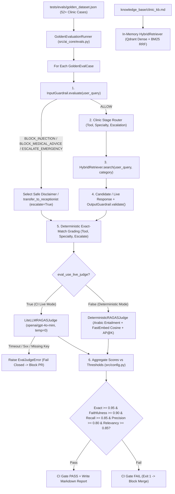

# Feature Plan: Feature 4.8 — Golden Evaluation Suite & RAGAS CI Gate (`src/ai_core/evals.py`, `tests/evals/`, `.github/workflows/evals.yml`)

> Parent spec: `spec/features/feature-400-enterprise-ai-architecture-and-resilience/` (Execution Group 7, requirements R12.1–R12.4, C4).
> Depends on: Features 4.1–4.7 (`src/ai_core/gateway.py`, `src/ai_core/guardrails.py`, `src/rag/hybrid_retriever.py`, `src/ai_core/tracing.py`, `src/ai_core/finops.py`, `knowledge_base/clinic_kb.md`) — all completed.

---

## 1. Objective and Why

### Objective
Build a production-grade, fail-closed **Golden Evaluation Engine & RAGAS CI Gate** (`src/ai_core/evals.py`, `tests/evals/golden_dataset.json`, `tests/evals/test_golden_evals.py`, `.github/workflows/evals.yml`) tightly integrated with `Settings` (`src/config.py`) and the clinic AI Core pipeline:
1. **Golden Dataset (`tests/evals/golden_dataset.json` — 50+ Realistic Egyptian Clinic Scenarios)**:
   - Curate a version-controlled benchmark of **52+ Egyptian Arabic & bilingual clinic conversational scenarios** grounded in `knowledge_base/clinic_kb.md` and `src/db/seed.py` across 4 mandatory evaluation pillars:
     1. **Routine Clinic Inquiries (`routine_inquiry`)**: operating hours, branches, examination/consultation fees, 14-day follow-up policy, accepted insurance networks (AXA, MetLife, Bupa, MedNet), and lab/radiology preparation rules (FBS 8h fasting, Lipid Profile 10–12h, HbA1c/CBC no fasting, pelvic ultrasound full bladder).
     2. **Appointment Booking & Management (`booking_management`)**: checking doctor availability (`check_doctor_availability`), booking new examinations or consultations (`book_appointment`), and looking up, rescheduling, or cancelling appointments (`manage_appointment`).
     3. **Adversarial Prompt Injection (`adversarial_injection`)**: direct caller prompt injection (Arabic & English system override attempts, XML breakout tags, SQL/code payloads) and indirect document prompt injection payloads.
     4. **Urgent Symptoms & Medical Diagnosis Traps (`medical_safety_trap`)**: life-threatening red-flag symptoms (chest pain radiating to left arm, severe dyspnea, stroke FAST signs, severe bleeding, high fever in infant < 3 months) and direct medication/dosage requests.
   - Each golden item specifies: `id`, `category`, `user_query`, `reference_contexts`, `reference_answer`, `expected_tool`, `expected_specialty`, `expected_escalate`, `expected_guardrail_action`, and `candidate_answer` (for deterministic baseline verification).
2. **Modular RAGAS Evaluation Engine & `gpt-4o-mini` Judge (`src/ai_core/evals.py`)**:
   - Implement the 4 core RAGAS metrics without pulling multi-gigabyte PyTorch dependencies:
     - **Faithfulness (`>= 0.90`)**: Fraction of factual claims/statements and numeric figures in the generated answer that are entailed by / grounded in the retrieved contexts (or verified safety disclaimer for blocked/escalated turns).
     - **Context Recall (`>= 0.85`)**: Fraction of reference key facts (`reference_contexts` / `reference_answer`) recovered by the retrieved context chunks from `HybridRetriever`.
     - **Context Precision (`>= 0.80`)**: Rank-weighted precision (`Average Precision @ K`) measuring whether relevant context chunks appear at the top ranks of `HybridRetriever` results.
     - **Answer Relevancy (`>= 0.85`)**: Semantic and lexical alignment between the user query intent and the generated answer (penalizing evasive, off-topic, or ungrounded answers).
   - Provide a pluggable `RAGASJudge` protocol with two implementations:
     - `LiteLLMRAGASJudge` (`openai/gpt-4o-mini` at `temperature=0.0` via `litellm.acompletion`): Invoked when `eval_use_live_judge=True` (or `EVAL_LIVE_JUDGE=1` + `OPENAI_API_KEY`). Strictly **fails closed** (`EvalJudgeError`) if the judge is unreachable, errors out, or returns malformed JSON—never silently passing.
     - `DeterministicRAGASJudge`: Fast, zero-API-cost judge combining Arabic-normalized statement entailment, numeric/entity grounding verification, rank-aware precision, and `FastEmbed` multilingual cosine similarity for instant local `pytest` and offline CI verification.
3. **Structured Exact-Match & End-to-End Pipeline Runner (`tests/evals/test_golden_evals.py`)**:
   - Execute golden queries through the real clinic components (`InputGuardrail`, `HybridRetriever` indexed on `knowledge_base/clinic_kb.md`, deterministic clinic router, and `OutputGuardrail`).
   - Grade structured fields (`expected_tool`, `expected_specialty`, `expected_escalate`) via deterministic exact match and enforce an aggregate pass rate of **`>= 95%`** (`eval_structured_exact_match_threshold = 0.95`).
   - Enforce aggregate RAGAS thresholds (`Faithfulness >= 0.90`, `Context Recall >= 0.85`, `Context Precision >= 0.80`, `Answer Relevancy >= 0.85`) and generate a rich Markdown evaluation report (`format_eval_report_markdown`).
4. **GitHub Actions CI Gate (`.github/workflows/evals.yml`)**:
   - Trigger automatically on Pull Requests and pushes modifying prompts, AI Core, RAG, tools, configuration, knowledge base, or evaluation files (`src/ai_core/**`, `src/rag/**`, `src/agent/**`, `src/tools/**`, `src/config.py`, `knowledge_base/**`, `tests/evals/**`, `.github/workflows/evals.yml`), plus `workflow_dispatch`.
   - Run Ruff lint/format checks and `pytest tests/evals/test_golden_evals.py`, publish the Markdown scorecard to `$GITHUB_STEP_SUMMARY`, and block merge (`exit 1`) on any threshold breach or judge failure.

### Why
- **Separating Retrieval Failures from Generation Hallucinations (`spec/features/feature-400/plan.md`)**: In a RAG-powered clinic receptionist, a bad answer can stem from either poor retrieval (`Context Recall` / `Context Precision`) or LLM hallucination (`Faithfulness`). Measuring all 4 RAGAS dimensions pinpoints the exact layer that regressed.
- **Zero Medical Liability & Pricing Accuracy (`spec/tech.md` Invariant 3)**: A single prompt tweak could accidentally weaken medical diagnosis blocks or cause the agent to misquote consultation fees. Gating PRs against 50+ golden clinic cases prevents regressions before they reach patients.
- **Reusable Evaluation Core for Phase 6 (`Feature 6.3`)**: Housing the RAGAS evaluator in `src/ai_core/evals.py` and thresholds in `src/config.py` satisfies Architectural Constraint `C4` and allows `src/ops/online_eval.py` (Phase 6 sampled production evaluation) to reuse the exact same scoring engine.

---

## 2. Scope and Exclusions

### In Scope
- **`src/config.py`**:
  - Add configurable evaluation & RAGAS settings (`eval_judge_model`, `eval_use_live_judge`, `eval_faithfulness_threshold`, `eval_context_recall_threshold`, `eval_context_precision_threshold`, `eval_answer_relevancy_threshold`, `eval_structured_exact_match_threshold`, `eval_golden_dataset_path`, `eval_judge_timeout_s`).
- **`src/ai_core/evals.py`**:
  - Data models: `GoldenCaseCategory`, `GoldenEvalCase`, `StructuredPrediction`, `CaseEvalResult`, `RAGASScores`, `EvalSuiteSummary`, `EvalJudgeError`.
  - Judge protocol & implementations: `RAGASJudge`, `DeterministicRAGASJudge`, `LiteLLMRAGASJudge` (`openai/gpt-4o-mini` via `litellm`).
  - Clinic evaluation pipeline (`ClinicEvalPipeline`): Runs `InputGuardrail`, `HybridRetriever` (with `clinic_kb.md`), deterministic intent/tool/specialty classifier, and `OutputGuardrail` on each `GoldenEvalCase`.
  - Suite runner (`GoldenEvaluationRunner`): Loads `golden_dataset.json`, evaluates all cases, computes structured exact-match accuracy and aggregate RAGAS metrics, checks pass/fail gates against `Settings`, and exports a Markdown scorecard (`format_eval_report_markdown`).
- **`src/ai_core/__init__.py`**:
  - Export evaluation classes and helpers.
- **`tests/evals/golden_dataset.json`**:
  - Version-controlled JSON dataset containing **52 realistic Egyptian clinic scenarios** across all 4 required categories.
- **`tests/evals/test_golden_evals.py`**:
  - Automated unit, integration, edge-case, fail-closed judge, and full 52-case golden benchmark assertions.
- **`.github/workflows/evals.yml`**:
  - GitHub Actions workflow triggered on prompt/model/RAG PRs, running the golden evaluation gate and writing the summary report to `$GITHUB_STEP_SUMMARY`.

### Exclusions (Out of Scope)
- **Architecture Decision Records (`spec/adr/`) & `spec/architecture.md`** → Scoped to **Feature 4.9**.
- **Online 10% Sampled Production Trace Evaluation (`src/ops/online_eval.py`)** → Scoped to **Feature 6.3**.

---

## 3. Relevant Existing Architecture
- **`src/ai_core/guardrails.py`**: Already implements `InputGuardrail` (`ALLOW`, `BLOCK_INJECTION`, `BLOCK_MEDICAL_ADVICE`, `ESCALATE_EMERGENCY`), `OutputGuardrail` (with numeric fee grounding against retrieved context), `AllowedIntentEnum`, and `AllowedSpecialtyEnum`.
- **`src/rag/hybrid_retriever.py`**: Already implements `HybridRetriever` combining dense Qdrant (`FastEmbed` `paraphrase-multilingual-MiniLM-L12-v2`) and sparse BM25 via Reciprocal Rank Fusion (`RRF`), plus `chunk_clinic_markdown()` for `knowledge_base/clinic_kb.md`.
- **`src/tools/schemas.py`**: Defines the 5 clinic tools (`check_doctor_availability`, `book_appointment`, `manage_appointment`, `search_clinic_knowledge`, `transfer_to_receptionist`).
- **`src/config.py`**: Already includes `"openai/gpt-4o-mini"` and `"gpt-4o-mini"` pricing in `llm_cost_per_1m_tokens`.

---

## 4. Proposed Approach & Architectural Design

### Key Design Decisions

| # | Decision | Rationale |
|:--|:---------|:----------|
| **D1** | **Reusable `src/ai_core/evals.py` Engine + `src/config.py` Thresholds**: Place the core RAGAS evaluator, judge implementations, and pipeline evaluator in `src/ai_core/evals.py` and configure all thresholds in `src/config.py`. | Satisfies `Feature 400` Constraint `C4` and enables direct reuse in **Feature 6.3** (`src/ops/online_eval.py`) without importing from `tests/`. |
| **D2** | **Dual-Mode Pluggable Judge (`LiteLLMRAGASJudge` with `gpt-4o-mini` + `DeterministicRAGASJudge`) with Strict Fail-Closed Semantics**: Support live LLM-as-a-Judge (`openai/gpt-4o-mini`, `temperature=0`) when `eval_use_live_judge=True` / `EVAL_LIVE_JUDGE=1`, and deterministic Arabic-aware entailment + `FastEmbed` semantic scoring for fast local/CI runs without external API keys. When live judge mode is active and the judge API fails, times out, or lacks credentials, raise `EvalJudgeError` (fail closed). | Guarantees fast, deterministic `pytest` execution on every developer machine while enforcing strict fail-closed `gpt-4o-mini` evaluation when configured in CI (`Validation Tier 3: RAGAS Judge Unavailable in CI`). |
| **D3** | **Real Component Execution (`InputGuardrail` + `HybridRetriever` + `OutputGuardrail`) over 52 Grounded Scenarios**: Ingest `knowledge_base/clinic_kb.md` into an isolated in-memory `HybridRetriever` during evaluation and pass every golden query through the real guardrails and retriever. | Verifies true end-to-end retrieval precision/recall on `clinic_kb.md` and real guardrail interception rather than testing static strings in isolation. |
| **D4** | **Path-Filtered GitHub Actions Gate (`.github/workflows/evals.yml`) with Step Summary Scorecard**: Trigger on PRs touching prompts, `src/ai_core/**`, `src/rag/**`, `src/agent/**`, `src/tools/**`, `src/config.py`, `knowledge_base/**`, or `tests/evals/**`, and write a Markdown table of RAGAS & Exact-Match scores to `$GITHUB_STEP_SUMMARY`. | Controls CI runtime and cost while giving reviewers immediate visibility into Faithfulness, Context Recall, Context Precision, Answer Relevancy, and Exact-Match scores on every PR. |

### Components & Data Flow

---

## 5. Expected Files and Areas Affected

### New Files
- `src/ai_core/evals.py`: Core RAGAS evaluation engine, `LiteLLMRAGASJudge` (`gpt-4o-mini`), `DeterministicRAGASJudge`, `ClinicEvalPipeline`, `GoldenEvaluationRunner`, and Markdown report formatter.
- `tests/evals/__init__.py`: Package marker for evaluation test suite.
- `tests/evals/golden_dataset.json`: 52 realistic Egyptian clinic scenarios covering routine inquiries, bookings/cancellations, prompt injections, and medical diagnosis/emergency traps.
- `tests/evals/test_golden_evals.py`: Comprehensive pytest suite verifying unit metrics, fail-closed judge behavior, structured exact-match (`>= 95%`), and RAGAS aggregate thresholds across all 52 golden scenarios.
- `.github/workflows/evals.yml`: GitHub Actions CI workflow gating PRs on golden evaluation and lint checks.

### Modified Files
- `src/config.py`: Add RAGAS and evaluation settings (`eval_judge_model`, `eval_use_live_judge`, `eval_faithfulness_threshold`, `eval_context_recall_threshold`, `eval_context_precision_threshold`, `eval_answer_relevancy_threshold`, `eval_structured_exact_match_threshold`, `eval_golden_dataset_path`, `eval_judge_timeout_s`).
- `src/ai_core/__init__.py`: Export evaluation classes and functions from `src/ai_core/evals.py`.

---

## 6. Execution Breakdown (Atomic Sub-Steps)

1. **Step 1 — Evaluation & RAGAS Configuration (`src/config.py`)**:
   - Add configurable RAGAS thresholds (`0.90`, `0.85`, `0.80`, `0.85`), structured exact-match threshold (`0.95`), judge model (`openai/gpt-4o-mini`), live-judge toggle (`eval_use_live_judge`), timeout (`eval_judge_timeout_s`), and dataset path (`tests/evals/golden_dataset.json`) to `Settings`.
2. **Step 2 — Curate Golden Dataset (`tests/evals/golden_dataset.json`)**:
   - Author 52 realistic Egyptian Arabic & English clinic evaluation cases grounded in `knowledge_base/clinic_kb.md`, spanning `routine_inquiry` (20 cases), `booking_management` (12 cases), `adversarial_injection` (10 cases), and `medical_safety_trap` (10 cases).
3. **Step 3 — Implement RAGAS Evaluation Engine & Pipeline (`src/ai_core/evals.py`, `src/ai_core/__init__.py`)**:
   - Implement `GoldenEvalCase`, `RAGASScores`, `CaseEvalResult`, `EvalSuiteSummary`, `EvalJudgeError`.
   - Implement `DeterministicRAGASJudge` and `LiteLLMRAGASJudge` (`gpt-4o-mini` with fail-closed error handling).
   - Implement `ClinicEvalPipeline` (wiring `InputGuardrail`, `HybridRetriever`, structured intent/tool/specialty routing, and `OutputGuardrail`) and `GoldenEvaluationRunner`.
4. **Step 4 — Implement Automated Evaluation Suite & CI Workflow (`tests/evals/test_golden_evals.py`, `.github/workflows/evals.yml`)**:
   - Write Tier 1–3 tests and full 52-case benchmark verification in `tests/evals/test_golden_evals.py`.
   - Create `.github/workflows/evals.yml` with path triggers, `uv` environment setup, pytest execution, and `$GITHUB_STEP_SUMMARY` output.
5. **Step 5 — Execute Full Validation & Regression Suite**:
   - Run `tests/evals/test_golden_evals.py`, all Phase 1–4 regression suites, Ruff lint/format checks, and CLI smoke checks.

---

## 7. Risks and Trade-Offs

| Risk / Trade-Off | Mitigation Strategy |
|:---|:---|
| **Silent CI Pass When Judge API Fails or Times Out**: A naive fallback from `gpt-4o-mini` to a heuristic on error could let broken prompts merge in CI. | When `eval_use_live_judge=True`, `LiteLLMRAGASJudge` strictly raises `EvalJudgeError` on missing API key, timeout, HTTP 4xx/5xx, or invalid JSON, causing the evaluation runner and CI job to fail closed. |
| **Slow Embedding Initialization on Repeated Test Runs**: Re-indexing `clinic_kb.md` for every single test function would slow down `pytest`. | Cache the initialized in-memory `HybridRetriever` and `FastEmbed` model across the test module via a module-scoped fixture / singleton helper. |
| **Arabic Orthographic Variations Affecting Entailment / Recall**: Differences in `أ/إ/آ -> ا`, `ة -> ه`, `ى -> ي`, or Arabic-Indic digits (`٠-٩`) can cause false negatives in claim and fact matching. | Reuse the project's canonical Arabic normalizer (`normalize_query` and `_to_ascii_digits`) when matching facts, numeric fees, doctor names, and preparation hours. |
| **Hallucinated Fee or Unverified Answer Scoring High on Relevancy**: An answer could sound relevant to the question while citing a wrong examination fee. | `Faithfulness` explicitly checks numeric and factual claim grounding against retrieved context, and `OutputGuardrail` validates numeric fees against `<retrieved_context>`. |

