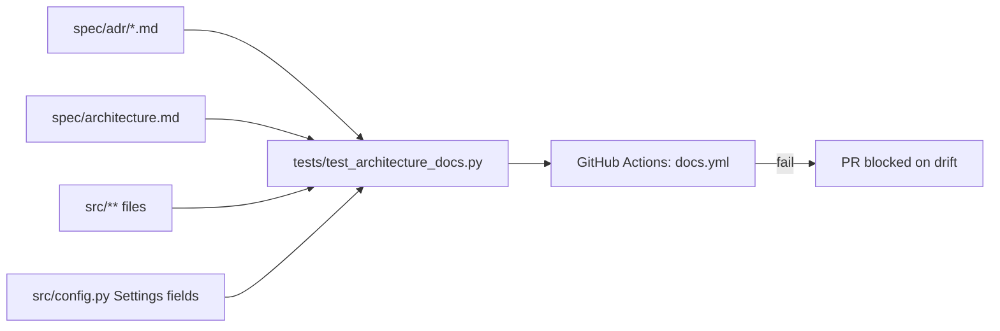

# Feature Plan: Feature 4.9 — Architecture Decision Records (ADRs) & Diagram-as-Code (`spec/adr/`, `spec/architecture.md`)

> Parent spec: `spec/features/feature-400-enterprise-ai-architecture-and-resilience/plan.md` (Group 7, step 7.4).
> Decisions in this plan were resolved in a structured design interview (Q1–Q10) with the human supervisor.

---

## 1. Objective and Why

### Objective
Capture the architectural reasoning behind Phase 4 (Features 4.1–4.8) as **9 Arabic (RTL) Architecture Decision Records** and a single **Diagram-as-Code architecture document** (`spec/architecture.md`) containing **6 Mermaid diagrams** at C4 level. A lightweight **docs-drift test** plus a dedicated **GitHub Actions workflow** keep the documentation honest against the real code.

### Why
1. **Decisions decay faster than code**: Phase 4 introduced nine non-obvious trade-offs (0.97 cache cutoff, Gemini fallback, deterministic gates over prompt rules, self-hosted Langfuse…). Without ADRs, future contributors (or AI agents) will "simplify" them away and re-introduce the very risks they mitigate.
2. **Spec drift already exists**: The parent plan names OpenAI as the fallback provider while the code (`src/config.py`) uses Gemini `gemini-2.0-flash`. `implementation_plan.md` phase numbering no longer matches `roadmap.md`. The code is the source of truth; the docs must catch up.
3. **Onboarding & review**: Phases 5–8 (voice worker, LLMOps, dashboard, deployment) will plug into the Phase 4 core. A visual map of what is *built* vs *planned* prevents wiring mistakes.
4. **Docs-as-code**: Mermaid diagrams live in git, are diffable, render natively on GitHub, and can be checked by tests — unlike binary diagram files.

---

## 2. Scope and Exclusions

### In Scope
- **9 ADRs** in `spec/adr/` (Arabic, RTL):
  | # | File | Decision | Feature |
  |:--|:--|:--|:--|
  | 001 | `001-hybrid-search-rrf.md` | Hybrid Dense + BM25 via RRF over vector-only | 4.3 |
  | 002 | `002-deterministic-gates-vs-prompt-rules.md` | Python code gates + idempotency keys over prompt rules | 4.5 |
  | 003 | `003-multi-tier-model-gateway.md` | Groq primary + **Gemini** fallback + circuit breaker + 4-tier degradation (OpenAI rejected, with reasons) | 4.1 |
  | 004 | `004-self-hosted-langfuse-tracing.md` | Self-hosted Langfuse over LangSmith SaaS (data sovereignty) | 4.6 |
  | 005 | `005-finops-budgets-and-stage-routing.md` | Token budgets, $10/day cost breaker, stage-bound model tiers | 4.7 |
  | 006 | `006-ragas-ci-evaluation.md` | RAGAS metrics, thresholds, cross-family judge (`gpt-4o-mini`) | 4.8 |
  | 007 | `007-owasp-trust-layer.md` | CPU/regex hot-path guardrails + XML delimiters + Presidio + async Llama Guard | 4.4 |
  | 008 | `008-three-tier-cache-ladder.md` | Exact → metadata-scoped semantic (≥ 0.97) → prompt prefix | 4.2 |
  | 009 | `009-state-machine-over-agent-loop.md` | Deterministic state machine over open-ended agent loop (0.95¹⁰ law) | 4.5 |
- **ADR template**: 4 fixed sections with bilingual headings — `السياق (Context)`, `القرار (Decision)`, `البدائل المرفوضة (Alternatives Rejected)`, `العواقب (Consequences)` — preceded by a Metadata block: Status, Date, Related Feature, Code References (file paths + `Settings` config keys).
- **`spec/adr/README.md`**: Index table (number, title, status, feature).
- **`spec/adr/template.md`**: Blank template for future ADRs.
- **`spec/architecture.md`** (Arabic, RTL) with 6 Mermaid diagrams:
  1. System Context (C4 L1) — callers, staff, external providers.
  2. Container/Components (C4 L2/L3) — `src/ai_core`, `src/rag`, `src/tools`, `src/db`, `src/config.py`.
  3. Sequence diagram — full booking call lifecycle.
  4. State diagram — Circuit Breaker (CLOSED/OPEN/HALF_OPEN) + 4 degradation tiers.
  5. State diagram — Booking workflow state machine.
  6. ER diagram — clinic database models.
  - Built components drawn solid; planned components (Phases 5/6/8) drawn dashed with a distinct `classDef` and a `[Planned]` label.
  - A **Technical Debt** section listing legacy restaurant files (`src/tools/order_status.py`, `src/tools/reservation.py`, `src/tools/legacy_schemas.py`, related tests) excluded from diagrams.
- **Docs-drift test** `tests/test_architecture_docs.py` (pytest).
- **CI workflow** `.github/workflows/docs.yml` running only the docs-drift test on `spec/**` or `src/**` changes (no API keys).
- **Spec-drift corrections**:
  - Fix the fallback-provider line in `feature-400.../plan.md` (OpenAI → Gemini).
  - Re-align phase numbering in `implementation_plan.md` with `roadmap.md`.
  - Add links from `spec/tech.md` to `spec/architecture.md` and `spec/adr/README.md`.

### Exclusions
- No application code changes under `src/` (documentation + test + CI only).
- No deletion/refactor of legacy restaurant files (only documented as Technical Debt).
- No mermaid-cli / Node rendering in CI (rejected in Q6 — no Node toolchain in repo).
- No deployment diagram for Phase 8 as a separate artifact (planned nodes appear dashed in the container diagram only).
- No ADRs for Phases 1–3 decisions (SQLite/PostgreSQL, FastEmbed) — out of scope for 4.9.

---

## 3. Relevant Existing Architecture
- `src/ai_core/`: `gateway.py`, `circuit_breaker.py`, `cache.py`, `text_normalizer.py`, `guardrails.py`, `workflow.py`, `tracing.py`, `finops.py`, `evals.py`.
- `src/rag/`: `hybrid_retriever.py`, `sanitizer.py`, `ingestion.py`, `retriever.py`, `embeddings.py`.
- `src/tools/`: clinic tools + `gates.py`.
- `src/db/models.py`: `Specialty`, `Doctor`, `DoctorSchedule`, `Patient`, `Appointment` (+ escalation model).
- `src/config.py`: Single `Settings` class holding all thresholds referenced by ADRs.
- `spec/security/threat_model.md`: Existing OWASP threat model (ADR 007 links to it, does not duplicate it).
- `.github/workflows/evals.yml`: Existing CI pattern (uv + Python 3.11) reused by `docs.yml`.

---

## 4. Proposed Approach

### Data Flow of the Docs-Drift Guard


### Test Strategy (what "drift" means)
- Each of the 9 ADR files exists and is listed in `README.md`.
- Each ADR contains the Metadata fields and the 4 English heading markers `(Context)`, `(Decision)`, `(Alternatives Rejected)`, `(Consequences)`.
- Every backticked repo path in "Code References" (e.g. `src/ai_core/cache.py`) exists on disk.
- Every referenced config key (e.g. `cache_semantic_threshold`) exists in `Settings.model_fields`.
- `architecture.md` contains exactly 6 ```mermaid blocks with the required diagram types (`flowchart`/`graph`, `sequenceDiagram`, `stateDiagram-v2` ×2, `erDiagram`) and a `Planned` classDef.

---

## 5. Expected Files Affected

### New
- `spec/adr/README.md`, `spec/adr/template.md`, `spec/adr/001…009-*.md`
- `spec/architecture.md`
- `tests/test_architecture_docs.py`
- `.github/workflows/docs.yml`
- `spec/features/feature-409-adrs-diagram-as-code/{plan,requirements,validation,summary_ar}.md`

### Modified
- `spec/tech.md` (links section only)
- `spec/features/feature-400-enterprise-ai-architecture-and-resilience/plan.md` (fallback provider line)
- `implementation_plan.md` (phase numbering)
- `spec/roadmap.md` (mark 4.9 complete — after validation only)

---

## 6. Execution Groups

### Group 1: ADR Framework
- 1.1 `spec/adr/template.md` with Metadata + 4 bilingual sections.
- 1.2 `spec/adr/README.md` index.

### Group 2: ADRs 001–009
- 2.1 Read each feature's code + spec (`feature-401…408`) to extract real values (thresholds, timeouts, model IDs).
- 2.2 Author ADRs 001–009 in Arabic with Code References pointing to real files/config keys.

### Group 3: Architecture Document
- 3.1 Author `spec/architecture.md` with the 6 Mermaid diagrams, Built/Planned styling, and Technical Debt section.

### Group 4: Drift Guard
- 4.1 `tests/test_architecture_docs.py`.
- 4.2 `.github/workflows/docs.yml`.

### Group 5: Spec Alignment
- 5.1 Fix feature-400 plan fallback provider; re-number `implementation_plan.md`; add links in `tech.md`.

---

## 7. Risks and Trade-Offs

| Risk / Trade-Off | Mitigation |
|:---|:---|
| Mermaid syntax errors not caught without mermaid-cli | Test checks block count/types; supervisor visually verifies render on GitHub/VS Code (Tier 6). Labels with special chars are quoted. |
| Arabic RTL + Mermaid rendering: Arabic labels inside diagrams may render with mixed direction | Keep diagram node IDs/labels in English technical terms; Arabic prose surrounds diagrams. |
| Drift test too strict → noisy failures on legitimate refactors | Test only checks paths/config keys explicitly listed in Code References, not prose. Failure message tells the dev which ADR to update. |
| `docs.yml` on `src/**` runs on every code PR | Test is pure file-I/O + `Settings` import (< 2s, no network, no secrets). |
| ADRs written retroactively may rationalize rather than record | Each ADR cites concrete values from code and the original feature spec; Alternatives Rejected must list ≥ 2 real options. |
