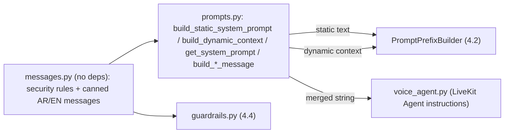

# Feature Plan: Feature 5.1 — Egyptian Clinic Assistant Persona, System Prompts & Medical Guardrails (`src/agent/prompts.py`)

> Roadmap: Phase 5 — Real-Time LiveKit Voice Agent Core & Medical Persona.
> Folder prefix `51x` is used for Phase 5 because `feature-501..503` are reserved for Phase 7 (see `spec/roadmap.md` note).
> Design decisions were resolved through a `/grill-me` interview (Q1–Q12) and are recorded in §9.

---

## 1. Objective & Why

Replace the legacy **restaurant** persona in `src/agent/prompts.py` with a production **Egyptian polyclinic medical receptionist** persona whose system prompt:

- Encodes the medical safety invariants from `spec/tech.md` §3 (no diagnosis, no drugs/dosages, emergency → 123 + `transfer_to_receptionist`).
- Is split into a **static, cache-friendly prefix** and a **dynamic per-call context**, so it is compatible with the Tier 3 `PromptPrefixBuilder` (Feature 4.2) and does not break provider KV-cache hits.
- Provides a **single source of truth** for deterministic spoken messages (greeting, handoff, emergency, refusal, fillers, goodbye) that both the agent and the guardrail layer (Feature 4.4) reuse.

**Why now:** every Phase 5 feature (5.2 session, 5.3 LiveKit worker, 5.4 CLI runner, 5.5 tests) consumes the persona/prompt. Today the agent would introduce itself as a restaurant host and reference non-existent restaurant tools — a correctness and liability risk.

## 2. Scope & Exclusions

### In Scope
- Full rewrite of `src/agent/prompts.py` for the clinic domain (zero restaurant references).
- New dependency-free module `src/agent/messages.py` holding security rules text + deterministic spoken messages (AR/EN).
- `src/ai_core/guardrails.py`: import its emergency / injection / medical-refusal texts and `SYSTEM_UNTRUSTED_DATA_RULES` from `messages.py` (re-exported for backward compatibility; behavior unchanged).
- `src/agent/__init__.py`: update public exports.
- `src/agent/voice_agent.py`: minimal touch only if needed to keep imports/call signatures valid (the `get_system_prompt(custom_instructions=..., language=...)` signature is preserved).
- Rewrite `tests/test_prompts.py`; add an optional manual live-LLM smoke script `scripts/prompt_smoke.py`.

### Out of Scope (deferred)
- Registering clinic tools in the LiveKit worker / removing restaurant tools → **Feature 5.3**.
- Session metrics and token accounting changes → **Feature 5.2**.
- Automated LLM-behavior test suite → **Feature 5.5**.
- Changing `finops.py` or the 8,000 tokens/call budget (see Risk R-1).
- Adding prompt-behavior cases to `golden_dataset.json`.

## 3. Relevant Existing Architecture

| Component | File | Relevance |
|:---|:---|:---|
| Prompt Prefix Builder (Tier 3 cache) | `src/ai_core/cache.py` → `PromptPrefixBuilder` | Rejects `{current_datetime}` in static text; orders `[static system] → [dynamic system] → history`; exposes `prefix_hash`. |
| Input/Output Guardrails | `src/ai_core/guardrails.py` | Deterministic regex triage (emergency / injection / medical advice) with hard-coded Arabic response texts; `SYSTEM_UNTRUSTED_DATA_RULES`; XML wrapping `<caller_utterance>`, `<retrieved_context>`; `OutputGuardrail.validate()`. |
| Emergency detector | `src/tools/human_handoff.py` → `detect_emergency()` | Keyword safety net; emergency hotline `settings.emergency_phone` (`123`). |
| Degradation tiers | `src/ai_core/gateway.py` → `DegradationTier` | `TIER_1_PRIMARY`, `TIER_2_BACKUP`, `TIER_3_SEARCH_ONLY`, `TIER_4_HUMAN_ESCALATION`. |
| Clinic settings | `src/config.py` | `clinic_name`, `clinic_tagline`, `clinic_phone`, `clinic_address`, `clinic_working_hours`, `agent_name`, `emergency_phone`; legacy `restaurant_*` aliases. |
| Clinic tools (Phase 3) | `src/tools/*.py` | `check_doctor_availability`, `book_appointment`, `manage_appointment`, `search_clinic_knowledge`, `transfer_to_receptionist`. |
| Write gates | `src/ai_core/workflow.py`, `src/tools/gates.py` | Deterministic guarantee for booking writes; the prompt's confirmation protocol is defense-in-depth only. |

## 4. Proposed Approach

**Defense-in-depth layering** — the prompt is the *probabilistic* layer that covers paraphrases the regex layer misses; deterministic code (guardrails, gates, finops) remains the authoritative enforcement.

### 4.1 Static system prompt — `build_static_system_prompt()`
English instructions (better adherence, fewer tokens) with Egyptian Arabic phrase examples. Deterministic: same settings ⇒ byte-identical output ⇒ stable `prefix_hash`. No date/time, no session data. Sections:
1. **Identity & role** — `agent_name`, `clinic_name`, `clinic_tagline`, address, phone, working hours (static config values).
2. **Language & tone** — default polite Egyptian Arabic (يا فندم، حضرتك، تحت أمرك), mirror caller language (MSA/English).
3. **Voice output rules** — no Markdown/symbols, 1–3 short sentences, one question per turn, spoken numbers/times/currency, barge-in handling.
4. **Medical safety rules** — never diagnose, never name possible conditions, never suggest drugs/dosages, never give medical reassurance; *administrative specialty routing allowed* ("ممكن حضرتك تحجز عند دكتور العظام وهو يقيّم الحالة"); emergency symptoms → instruct to call `emergency_phone` / nearest ER + call `transfer_to_receptionist` immediately.
5. **Grounding rules** — fees, prep instructions, insurance, credentials, queue numbers only from tool results; never invent.
6. **Tool usage policy** — when to call each of the 5 clinic tools.
7. **Write confirmation protocol** — collect one field per turn; before `book_appointment` / cancel / reschedule, read back doctor, day, shift, visit type (كشف/استشارة), patient name, and mobile number grouped in digit chunks; require explicit yes; queue number & fee spoken only from the tool result.
8. **Untrusted data boundaries** — `SYSTEM_UNTRUSTED_DATA_RULES` (from `messages.py`).
9. **Few-shot examples (3, very compact)** — booking with confirmation; medical-advice refusal + specialty suggestion; emergency.

### 4.2 Dynamic context — `build_dynamic_context(...)`
Small per-call/per-turn block: current Cairo date/time (`Africa/Cairo`, weekday in Arabic), preferred caller language, and the current `DegradationTier` with a one-line instruction for Tier 3 (booking temporarily unavailable → info + offer receptionist) and Tier 4 (wrap up politely and transfer). Enforcement of tool blocking remains in code.

### 4.3 LiveKit wrapper — `get_system_prompt(...)`
Keeps the existing signature (`custom_instructions`, `language`, optional overrides) and returns `static + "\n\n" + dynamic (+ custom instructions)` because LiveKit `Agent(instructions=...)` takes a single string. Restaurant-named parameters are removed.

### 4.4 Deterministic spoken messages (AR/EN) — in `messages.py`, wrapped by `prompts.py`
| Builder | Purpose |
|:---|:---|
| `build_greeting_message()` | صباح/مساء الخير by Cairo hour + clinic & agent name |
| `build_handoff_message()` | Transfer to reception (department, optional wait) |
| `build_error_fallback_message()` | Tool failure / delay apology |
| `build_tool_filler_message(tool_name)` | Filler when a tool exceeds 400 ms (e.g. "ثواني يا فندم بشوف المواعيد") |
| `build_emergency_message()` | Call 123 / nearest ER + transferring now |
| `build_out_of_scope_message()` / medical refusal | Polite refusal + redirect to booking/specialty |
| `build_goodbye_message()` | Call closing |
| `build_interruption_acknowledgment()` | Kept for backward compatibility |

## 5. Components, Boundaries & Data Flow
- `messages.py` imports **only** stdlib (no `src.*`), so both `src/agent` and `src/ai_core` can import it without circular imports. Settings-dependent values (clinic name, emergency phone) are passed as arguments.
- `prompts.py` → imports `messages.py`, `src.config.settings`, and `DegradationTier` (type only, lazily or via string values to avoid importing the gateway at module load).
- `guardrails.py` → imports texts from `messages.py`; keeps `SYSTEM_UNTRUSTED_DATA_RULES` name available (re-export).

## 6. Expected Files Affected
| File | Change |
|:---|:---|
| `src/agent/messages.py` | **New** |
| `src/agent/prompts.py` | **Rewrite** |
| `src/agent/__init__.py` | Update exports |
| `src/ai_core/guardrails.py` | Source texts from `messages.py` (no behavior change) |
| `src/agent/voice_agent.py` | Minimal / possibly none |
| `tests/test_prompts.py` | **Rewrite** |
| `scripts/prompt_smoke.py` | **New** (manual, optional, live Groq) |
| `spec/roadmap.md`, `implementation_plan.md` | Mark 5.1 done (after validation) |

## 7. Execution Groups
1. **EG-1 Messages module** — create `messages.py` (security rules + AR/EN canned messages); switch `guardrails.py` to import from it; run `tests/test_guardrails.py` to prove zero behavior change.
2. **EG-2 Static prompt** — persona, rules, tool policy, confirmation protocol, few-shots; token-estimate helper; verify ≤ 1,200 tokens and compatibility with `PromptPrefixBuilder`.
3. **EG-3 Dynamic context + wrapper** — Cairo time, language, degradation tier; `get_system_prompt()`; `__init__.py` exports; `voice_agent.py` import check.
4. **EG-4 Tests & smoke** — rewrite `tests/test_prompts.py`; add `scripts/prompt_smoke.py`; full regression + ruff.

## 8. Risks & Trade-offs
| ID | Risk / Trade-off | Mitigation |
|:---|:---|:---|
| **R-1 (open)** | `finops.py` counts `prompt_tokens` against the 8,000 tokens/call budget. A ~1,200-token static prompt + growing history may exhaust the budget after ~4–5 turns, while a typical booking call needs 8–12 turns. | Kept out of 5.1 by decision. To be resolved in **5.2/5.3**: count cached-prefix tokens separately, or adjust the budget via a new ADR. Documented here as an open risk. |
| R-2 | Prompt rules are probabilistic; the LLM may still drift. | Deterministic layers (InputGuardrail, OutputGuardrail, write gates) remain authoritative; automated behavior tests in 5.5. |
| R-3 | Specialty routing could be perceived as triage. | Strict wording: specialty only, "the doctor will assess", no condition names, no reassurance; emergencies always escalate. |
| R-4 | Moving guardrail texts could break 4.4 tests. | EG-1 runs `tests/test_guardrails.py` before anything else; texts kept byte-identical where tests assert them. |
| R-5 | Circular import via `src/agent/__init__.py` when `guardrails.py` imports `src.agent.messages`. | `messages.py` has no `src.*` imports; `prompts.py` takes security rules from `messages.py` (not from `guardrails.py`); verified by an import test. |
| R-6 | `voice_agent.py` / `tests/test_agent.py` still reference restaurant tools until 5.3. | Accepted; tool wiring is 5.3 scope. `restaurant_name` alias still equals `clinic_name`, so existing assertions keep passing. |
| Trade-off | English instructions vs Arabic prompt | English chosen for adherence & token cost; Arabic examples preserve dialect. |

## 9. Decision Log (`/grill-me`)
| # | Decision |
|:---|:---|
| Q1 | Full clinic rewrite of `prompts.py`; minimal `voice_agent.py` touch; tool wiring stays in 5.3. |
| Q2 | Static/dynamic split compatible with `PromptPrefixBuilder`; `get_system_prompt()` merges both for LiveKit. |
| Q3 | English instructions + Egyptian Arabic phrase examples; default Egyptian Arabic, mirror caller language. |
| Q4 | Administrative specialty routing allowed; no conditions/drugs/reassurance; emergencies → 123 + transfer. |
| Q5 | One field per turn; spoken read-back (mobile in digit groups) + explicit yes before write tools; queue number/fee only from tool output. |
| Q6 | Dynamic context carries degradation tier with short instruction; enforcement stays in code. |
| Q7 | Canned messages: greeting (time-aware), handoff, error + 400 ms fillers, emergency, out-of-scope/medical refusal, goodbye. |
| Q8 | New dependency-free `src/agent/messages.py` shared by prompts and guardrails. |
| Q9 | Static prompt ≤ 1,200 tokens (estimated test) with 3 compact few-shots. |
| Q10 | Keep 1,200 cap; record finops conflict as open risk R-1; resolve in 5.2/5.3. |
| Q11 | Deterministic pytest checks + optional manual live Groq smoke script; full behavior tests in 5.5. |
| Q12 | Folder `feature-511-clinic-persona-system-prompts`. |
