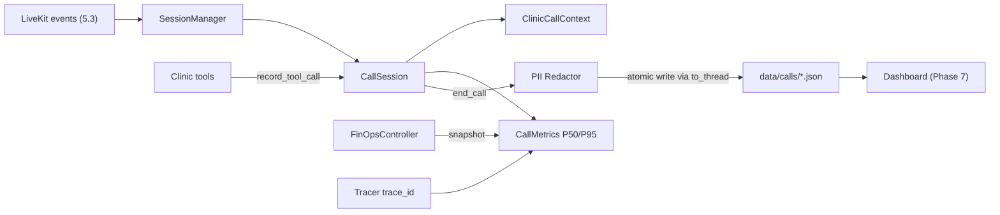

# Feature 5.2 — Medical Call Session State & Metric Tracking (Plan)

## 1. Objective & Why
Convert `src/agent/session_manager.py` from a restaurant-era session tracker (orders, reservations, allergies) into a **clinic-first** call session layer that:
- Tracks the medical call context (patient, specialty, doctor, date, visit type, bookings, escalation, emergency).
- Records per-turn latency breakdown (STT / LLM TTFT / TTS / tool / end-to-end) and computes P50/P95/max against the 800ms SLO.
- Reads tokens/cost from the existing `FinOpsController` (single source of truth) and links each call to its Langfuse `trace_id`.
- Persists **PII-redacted** call artifacts atomically without blocking the asyncio event loop, and evicts ended sessions from memory.

**Why:** Feature 5.3 (LiveKit worker), 5.4 (call runner), Phase 6 (Prometheus/SLO) and Phase 7 (dashboard) all consume session state. Today it speaks the wrong domain, leaks memory, stores raw phone numbers on disk, and cannot answer "what is our P95 per turn?".

## 2. Scope & Exclusions
### In Scope
- `src/agent/session_manager.py` (main change).
- New config keys in `src/config.py` (history window, SLO thresholds, eviction).
- `src/agent/__init__.py` exports.
- `tests/test_session_manager.py` (rewrite/extend).
- **Minimal** compatibility edits in `voice_agent.py`, `scripts/test_call.py`, `src/dashboard/*` **only** if an import or existing test breaks.

### Out of Scope (deferred)
- Full LiveKit event wiring (→ 5.3), clinic call runner scenarios (→ 5.4), dashboard UI changes (→ Phase 7), Prometheus export (→ 6.1).
- Moving sessions to a DB table.
- New emergency-detection logic (re-use guardrails / handoff).
- Removal of legacy restaurant fields (→ Phase 7 cleanup).
- Regenerating `data/calls/*.json` sample files.

## 3. Relevant Existing Architecture
| Component | File | Relationship |
|:---|:---|:---|
| FinOps per-session ledger | `src/ai_core/finops.py` (`get_finops_controller().get_session_snapshot(session_id)`) | Source of tokens/cost |
| Hierarchical tracer | `src/ai_core/tracing.py` (`get_current_trace_id()`) | Source of `trace_id` |
| PII redactor | `src/ai_core/guardrails.py` (`get_pii_redactor().redact / redact_dict`) | Redaction before persistence |
| Verified caller scope | `src/tools/gates.py` (`caller_session_scope`, `CallerSessionContext`) | Only trusted source of `patient_phone` |
| Tool outputs | `src/tools/schemas.py` (`AppointmentBookingOutput`, `ManageAppointmentOutput`, `DoctorAvailabilityOutput`, `ReceptionistHandoffInput`) | Inputs to context extraction |
| Consumers | `voice_agent.py`, `scripts/test_call.py`, `src/dashboard/calls_data.py`, `analytics_data.py` | Must keep working |

## 4. Proposed Approach
### 4.1 Data Model
- **`CallLifecycle`** (new enum): `INITIATED → ACTIVE → {ESCALATED, ENDED, FAILED}`; `ESCALATED → {ENDED, FAILED}`. Terminal states are final. Invalid transitions raise/log and are rejected.
- **`CallActivity`** (new enum, display-only): `idle | listening | speaking | tool_calling`.
- **`CallStatus`** (kept as a backward-compatible alias): legacy values (`speaking`, `listening`, `tool_calling`) loaded from old JSON are mapped → `ACTIVE` + matching activity.
- **`ClinicCallContext`** (replaces `ExtractedContext`, alias kept): `patient_name`, `patient_phone` (verified scope only), `language`, `requested_specialty`, `requested_doctor_id`, `requested_doctor_name`, `requested_date`, `visit_type`, `bookings: list[BookingRef]` (`booking_code`, `action` = booked/cancelled/rescheduled, `queue_number`, `appointment_date`, `doctor_name`), `escalation` (`reason`, `department`, `urgency`), `emergency_flag`, `current_intent`, `sentiment`. Legacy restaurant fields remain `Optional` and marked deprecated.
- **`TurnLatency`**: `stt_ms`, `llm_ttft_ms`, `tts_ms`, `tool_ms`, `e2e_ms`.
- **`CallMetrics`** (extended): counters (turns, interruptions, tool success/failure/timeout), latency samples, computed `p50/p95/max` per stage, `slo_breach_turns` (e2e > 800ms), `finops_snapshot` (tokens/cost copied from FinOps at end/read time), `trace_ids: list[str]`.

### 4.2 Behavior
- `record_tool_call()` dispatches by **clinic tool name** to deterministic extractors; legacy tool names still handled for old data.
- `patient_phone` is set only from `caller_session_scope` (never from LLM tool arguments).
- `emergency_flag` set from `InputGuardrail` `ESCALATE_EMERGENCY` result or `transfer_to_receptionist` with `urgency=emergency`.
- `get_conversation_history(max_messages=settings.session_history_window)` — sliding window that never orphans a `tool` message from its `assistant` request; prepends a deterministic `build_context_summary()` system message (no LLM call).
- Persistence: `to_persisted_dict()` runs `redact_dict` over context + message contents → atomic write (`tmp` + `os.replace`) → `async_save_session()` wraps via `asyncio.to_thread`. Save on `end_call()` and on escalation. `evict_session()` removes ended sessions from memory after successful save.

## 5. Expected Files Affected
| File | Change |
|:---|:---|
| `src/agent/session_manager.py` | Major refactor (models, extractors, metrics, persistence, eviction) |
| `src/config.py` | `session_history_window=12`, `session_slo_turn_ms=800`, `session_tool_timeout_ms=400`, `session_evict_on_end=True`, `session_storage_dir="data/calls"` |
| `src/agent/__init__.py` | Export new symbols, keep old aliases |
| `tests/test_session_manager.py` | Rewrite for clinic behavior |
| `voice_agent.py`, `scripts/test_call.py`, `src/dashboard/*` | Only if needed to keep imports/tests green |

## 6. Execution Groups
1. **G1 — Models & lifecycle**: enums, `ClinicCallContext`, `BookingRef`, `TurnLatency`, transition table, legacy mapping validator.
2. **G2 — Context extraction**: clinic tool extractors, verified-phone binding, emergency flag hook.
3. **G3 — Metrics**: latency recording, percentile computation, SLO breach + tool timeout counters, FinOps snapshot, trace_id capture, aggregated metrics.
4. **G4 — Memory window**: sliding window with tool-pair integrity + deterministic context summary.
5. **G5 — Persistence & lifecycle mgmt**: redaction, atomic write, `async_save_session`, eviction, legacy JSON loading.
6. **G6 — Config, exports, tests, regression fixes**.

## 7. Risks & Trade-offs
| Risk | Mitigation |
|:---|:---|
| Breaking dashboard / old JSON files | Aliases + legacy field mapping + regression run of `test_calls_page.py`, `test_analytics_page.py` |
| Redaction makes transcripts less readable for staff | Accepted: full data stays in DB bookings; masked format keeps last 2 digits |
| Percentiles on small samples are noisy | Use nearest-rank; document; reported per-call and aggregated |
| FinOps ledger evicted before snapshot | Snapshot copied into session at `end_call()` |
| RLock in async code | In-memory ops are µs; only file I/O offloaded to thread |
| Strict lifecycle rejects odd LiveKit event order | Invalid transitions are logged & ignored (never crash the call) |
