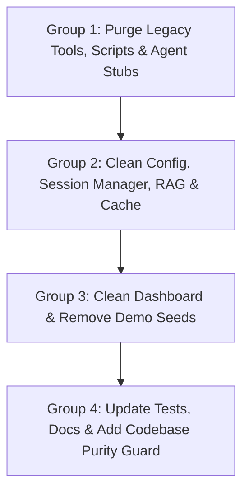

# Plan: Feature 5.3 — Legacy Restaurant Purge & Codebase Sanitization

- **Roadmap ID**: Feature 5.3
- **Folder**: `spec/features/feature-513-legacy-restaurant-purge/`
- **Phase branch**: `phase/5-livekit-voice-core`
- **Size**: Medium (4 execution groups across tools/agent, config/session/RAG, dashboard, and tests/docs — no new architectural components)
- **Status**: Committed

---

## 1. Objective & Why
Eliminate every remnant of the legacy restaurant template across the codebase so that the Egyptian polyclinic voice agent (`spec/mission.md`, `spec/roadmap.md` → Phase 5) operates on a 100% clinic-pure runtime, configuration, session state, and admin UI. Removing legacy restaurant tools (`get_order_status`, `book_reservation`), schemas, aliases, demo seed data, and deprecated fields before building the LiveKit worker guarantees that no non-clinic tool or restaurant terminology can ever reach the LLM or caller (`spec/tech.md` §10).

## 2. Scope
### In scope
- Delete legacy restaurant tool modules (`src/tools/order_status.py`, `src/tools/reservation.py`, `src/tools/legacy_schemas.py`), legacy ingestion script (`scripts/ingest_knowledge.py`), and their dedicated unit test files (`tests/test_order_status.py`, `tests/test_reservation.py`).
- Delete the three legacy restaurant voice/CLI/test files (`src/agent/voice_agent.py`, `scripts/test_call.py`, `tests/test_agent.py`) so Features 5.4, 5.5, and 5.6 can recreate them cleanly from scratch without breaking intermediate test runs.
- Remove `get_order_status` and `book_reservation` from `TOOL_REGISTRY` and `__all__` in `src/tools/__init__.py`; remove `search_restaurant_knowledge` / `async_search_restaurant_knowledge` aliases from `src/tools/knowledge_search.py`; clean legacy docstrings in `src/tools/schemas.py`.
- Remove legacy restaurant fields (`order_id`, `reservation_draft`, `dietary_preferences`, `allergies`) and legacy tool-outcome branches from `ClinicCallContext` and `CallSession` in `src/agent/session_manager.py`.
- Remove legacy `restaurant_*` settings fields and compatibility `@model_validator` aliases from `src/config.py`.
- Remove legacy restaurant keywords and docstrings from `src/rag/ingestion.py`, `src/rag/retriever.py`, and `src/ai_core/cache.py`.
- Remove restaurant demo seed generator from `src/dashboard/calls_data.py` (leaving a clean empty-state loader), update `src/dashboard/analytics_data.py`, `src/dashboard/i18n.py`, `src/dashboard/app.py`, and `src/dashboard/pages/01_calls.py` to use clinic-only fields and labels.
- Update affected tests (`tests/test_tools.py`, `tests/test_rag.py`, `tests/test_knowledge_search.py`, `tests/test_database_engine.py`, `tests/test_calls_page.py`, `tests/test_analytics_page.py`, `tests/test_architecture_docs.py`) and add an automated guard test verifying zero restaurant modules or symbols remain.
- Clean remaining restaurant references in `README.md` and `spec/architecture.md`.

### Out of scope (explicit exclusions)
- Building the new LiveKit voice worker (`src/agent/voice_agent.py` — Feature 5.4).
- Building the new CLI simulated call runner (`scripts/test_call.py` — Feature 5.5).
- Building the new voice orchestration test suite (`tests/test_agent.py` — Feature 5.6).
- Full Phase 7 dashboard redesign (only restaurant references and demo seeds are purged here so existing dashboard tests stay green with clinic fixtures).
- Modifying historical spec folders (`spec/features/feature-102..512-*` or `spec/archive/`).

## 3. Decisions
| # | Decision | Source | Rationale |
|:---|:---|:---|:---|
| D1 | Purge all three layers (tools/agent, session/config/RAG, and dashboard demo data/i18n/views) in a dedicated Feature 5.3 before building the worker. | Human Q2, Q3, Q4 (`phase-overview.md` P3, P4) | Gives an atomic rollback checkpoint and ensures Feature 5.4 builds on a clean clinic-only foundation. |
| D2 | Remove dashboard demo seed data completely rather than replacing it with fake clinic calls; the dashboard renders an empty state when `data/calls/` has no sessions, and dashboard unit tests construct their own clinic `CallSession` fixtures. | Human Q5 (`phase-overview.md` P5) | Avoids shipping synthetic data in production modules while keeping dashboard analytics and call log tests deterministic. |
| D3 | Delete legacy `src/agent/voice_agent.py`, `scripts/test_call.py`, and `tests/test_agent.py` in Feature 5.3 and recreate them in Features 5.4–5.6. | `phase-overview.md` §2 | Legacy `voice_agent.py` and `test_call.py` import `order_status` and `reservation`; deleting them in 5.3 prevents broken imports and keeps `pytest` green after 5.3. |
| D4 | Keep `tests/test_prompts.py` and `tests/test_human_handoff.py` negative guard assertions that check responses do *not* contain forbidden restaurant words. | Agent default (existing Feature 3.6 & 5.1 specs) | Those tests enforce the absence of restaurant terms in prompts/messages and remain valid safety guards. |

## 4. Relevant Existing Architecture
- **`src/tools/__init__.py`**: Central `TOOL_REGISTRY` and `get_session_scoped_tool_definitions()`. Must expose strictly the 5 clinic tools (`check_doctor_availability`, `book_appointment`, `manage_appointment`, `search_clinic_knowledge`, `transfer_to_receptionist`).
- **`src/agent/session_manager.py`**: `ClinicCallContext` and `CallSession.record_tool_call()` / `to_summary_dict()`.
- **`src/config.py`**: `Settings` Pydantic model.
- **`src/dashboard/`**: `calls_data.py`, `analytics_data.py`, `i18n.py`, `app.py`, `pages/01_calls.py`.
- **`spec/tech.md` Invariants**: §5 Tool Execution & Error Resilience, §6 Session State & Privacy Separation, §10 Identity & Tenant Isolation (caller role may only invoke clinic booking/inquiry/escalation tools).

## 5. Proposed Approach

1. **Tools & Agent Layer**: Delete `order_status.py`, `reservation.py`, `legacy_schemas.py`, `scripts/ingest_knowledge.py`, `src/agent/voice_agent.py`, `scripts/test_call.py`, `tests/test_order_status.py`, `tests/test_reservation.py`, and `tests/test_agent.py`. Strip legacy registrations and aliases from `src/tools/__init__.py` and `src/tools/knowledge_search.py`.
2. **Core Config, Session & Retrieval Layer**: Remove `restaurant_*` settings and validator from `src/config.py`; remove deprecated restaurant fields and tool tracking branches from `src/agent/session_manager.py`; replace restaurant keywords/docstrings in `src/rag/ingestion.py`, `src/rag/retriever.py`, and `src/ai_core/cache.py`.
3. **Dashboard Layer**: Remove demo seed generation from `src/dashboard/calls_data.py` so `load_call_sessions` returns only persisted sessions (or `[]` when empty). Update `analytics_data.py`, `i18n.py`, `app.py`, and `pages/01_calls.py` to reference `settings.clinic_name` and `ClinicCallContext` fields (`bookings`, `escalation`, `patient_name`, `doctor_name`, `specialty`).
4. **Tests & Documentation Layer**: Update `test_tools.py`, `test_rag.py`, `test_knowledge_search.py`, `test_database_engine.py`, `test_calls_page.py`, `test_analytics_page.py`, and `test_architecture_docs.py` to use clinic fixtures and assert clinic-only behavior. Add a repository-wide purity test confirming deleted modules are gone and no active source file in `src/` or `scripts/` contains legacy restaurant identifiers. Update `README.md` and `spec/architecture.md`.

## 6. Expected Files / Areas Affected
| Path | Change | Purpose |
|:---|:---|:---|
| `src/tools/order_status.py` | Delete | Remove legacy restaurant order tracking tool |
| `src/tools/reservation.py` | Delete | Remove legacy restaurant table reservation tool |
| `src/tools/legacy_schemas.py` | Delete | Remove legacy restaurant Pydantic schemas |
| `scripts/ingest_knowledge.py` | Delete | Remove legacy restaurant KB ingestion script (`ingest_clinic_knowledge.py` is the clinic replacement) |
| `src/agent/voice_agent.py` | Delete | Remove legacy restaurant worker (rebuilt in Feature 5.4) |
| `scripts/test_call.py` | Delete | Remove legacy restaurant CLI runner (rebuilt in Feature 5.5) |
| `tests/test_order_status.py` | Delete | Remove legacy order status unit tests |
| `tests/test_reservation.py` | Delete | Remove legacy table reservation unit tests |
| `tests/test_agent.py` | Delete | Remove legacy restaurant agent tests (rebuilt in Feature 5.6) |
| `src/tools/__init__.py` | Modify | Keep only the 5 clinic tools in `TOOL_REGISTRY` and exports |
| `src/tools/knowledge_search.py` | Modify | Remove `search_restaurant_knowledge` and `async_search_restaurant_knowledge` aliases |
| `src/tools/schemas.py` | Modify | Remove reference to `legacy_schemas` in module docstring |
| `src/agent/session_manager.py` | Modify | Remove `order_id`, `reservation_draft`, `dietary_preferences`, `allergies` and legacy tool handlers |
| `src/config.py` | Modify | Remove `restaurant_name`, `restaurant_phone`, `restaurant_address`, `restaurant_hours` and legacy alias validator |
| `src/rag/ingestion.py` | Modify | Remove legacy restaurant category keywords; keep clinic category mapping |
| `src/rag/retriever.py` | Modify | Update docstring from restaurant KB to clinic KB |
| `src/ai_core/cache.py` | Modify | Replace `"my reservation"` personal keyword with clinic appointment phrasing |
| `src/dashboard/calls_data.py` | Modify | Remove restaurant demo seed generator; return empty list when no call files exist |
| `src/dashboard/analytics_data.py` | Modify | Replace restaurant tool/session references with clinic tool names and booking outcomes |
| `src/dashboard/i18n.py` | Modify | Replace restaurant UI translation strings with clinic strings (`sidebar_clinic_name`, etc.) |
| `src/dashboard/app.py` | Modify | Display `settings.clinic_name` and clinic i18n keys |
| `src/dashboard/pages/01_calls.py` | Modify | Render clinic context (`bookings`, `escalation`, `patient_name`, `specialty`) instead of `order_id`/`reservation_draft`/`allergies` |
| `tests/test_tools.py` | Modify | Test 5 clinic tools in registry + codebase restaurant-purity guard assertions |
| `tests/test_rag.py` | Modify | Use `clinic_kb.md` instead of non-existent `restaurant_kb.md` |
| `tests/test_knowledge_search.py` | Modify | Remove tests for deleted `search_restaurant_knowledge` aliases |
| `tests/test_database_engine.py` | Modify | Remove `test_legacy_restaurant_aliases` |
| `tests/test_calls_page.py` | Modify | Test empty state and explicit clinic `CallSession` fixtures |
| `tests/test_analytics_page.py` | Modify | Use clinic tool names (`book_appointment`, `check_doctor_availability`, `manage_appointment`) in fixtures |
| `tests/test_architecture_docs.py` | Modify | Update architecture doc checks if legacy file references are removed |
| `README.md` | Modify | Replace remaining restaurant mentions with clinic equivalents |
| `spec/architecture.md` | Modify | Remove references to legacy restaurant modules |
| `scripts/generate_token.py` | Modify | Remove dead `src.agent.voice_agent` import after deleting legacy worker |
| `src/dashboard/health.py` | Modify | Modernize dict type annotations and health-check exception boundary lint markers |
| `src/dashboard/pages/02_analytics.py` | Modify | Remove `seed_analytics_call_sessions` auto-seeder so empty storage renders clean empty state |
| `tests/test_session_manager.py` | Modify | Add `T1.5` and `T3.2` checks verifying absence and rejection of legacy restaurant context fields |
| `tests/test_cache_ladder.py` | Modify | Update personal query phrase check (`"my queue number"`, no `"my reservation"`) for `T1.7` |
| `tests/test_dashboard_app.py` | Modify | Verify `settings.clinic_name` renders in sidebar and clean unused imports |
| `tests/test_prompts.py` | Modify | Guard `test_i3_voice_pipeline_instructions_use_clinic_prompt` with `pytest.importorskip("src.agent.voice_agent")` until Feature 5.4 recreates `voice_agent.py` (preserving all negative restaurant assertions) |

## 7. Execution Groups
- **Group 1 — Purge Legacy Tools, Scripts & Agent Stubs**: Delete `order_status.py`, `reservation.py`, `legacy_schemas.py`, `scripts/ingest_knowledge.py`, `src/agent/voice_agent.py`, `scripts/test_call.py`, `tests/test_order_status.py`, `tests/test_reservation.py`, `tests/test_agent.py`. Update `src/tools/__init__.py`, `src/tools/knowledge_search.py`, `src/tools/schemas.py`, and `scripts/generate_token.py`. Update `tests/test_tools.py` and `tests/test_knowledge_search.py`.
- **Group 2 — Clean Config, Session Manager, RAG & Cache**: Remove `restaurant_*` fields/validator from `src/config.py`; remove deprecated restaurant fields/branches from `src/agent/session_manager.py`; clean `src/rag/ingestion.py`, `src/rag/retriever.py`, and `src/ai_core/cache.py`. Update `tests/test_database_engine.py`, `tests/test_session_manager.py`, `tests/test_cache_ladder.py`, and `tests/test_rag.py`.
- **Group 3 — Clean Dashboard & Remove Demo Seeds**: Remove demo seed generators from `src/dashboard/calls_data.py` and `src/dashboard/analytics_data.py`; update `src/dashboard/i18n.py`, `src/dashboard/app.py`, `src/dashboard/health.py`, `src/dashboard/pages/01_calls.py`, and `src/dashboard/pages/02_analytics.py`; update `tests/test_calls_page.py`, `tests/test_analytics_page.py`, and `tests/test_dashboard_app.py` to test empty state and clinic session fixtures.
- **Group 4 — Docs Cleanup & Codebase Purity Guard**: Clean `README.md` and `spec/architecture.md`; update `tests/test_architecture_docs.py` and `tests/test_prompts.py` (`importorskip` bridge until Feature 5.4); add automated codebase purity tests verifying zero legacy restaurant modules/identifiers remain in `src/` and `scripts/`; run full test suite and ruff.

## 8. Risks & Trade-offs
| Risk / Trade-off | Impact | Mitigation |
|:---|:---|:---|
| Existing tests in `test_session_manager.py` or `test_database_engine.py` assert legacy backward-compatibility aliases | Test failure after removing `restaurant_*` or `order_id` | Inspect and update those specific compatibility tests in Group 2 so they assert strict rejection/absence of legacy fields. |
| Dashboard pages crash when `load_call_sessions` returns `[]` | Empty-state bug in UI or `test_calls_page.py` / `test_analytics_page.py` | Ensure `calls_data.py` and `analytics_data.py` handle empty session lists gracefully with zero-division guards and dedicated unit tests. |
| Deleting `src/agent/voice_agent.py` in 5.3 temporarily removes the worker module until 5.4 | Any test importing `src.agent.voice_agent` would fail during 5.3 | Delete legacy `tests/test_agent.py` (recreated in 5.6) and use `pytest.importorskip("src.agent.voice_agent")` in `tests/test_prompts.py::test_i3_voice_pipeline_instructions_use_clinic_prompt` so it skips cleanly in 5.3 and automatically re-activates in 5.4. |

## 9. Open Questions
None — all scope and design decisions were resolved during the Phase 5 interview.
