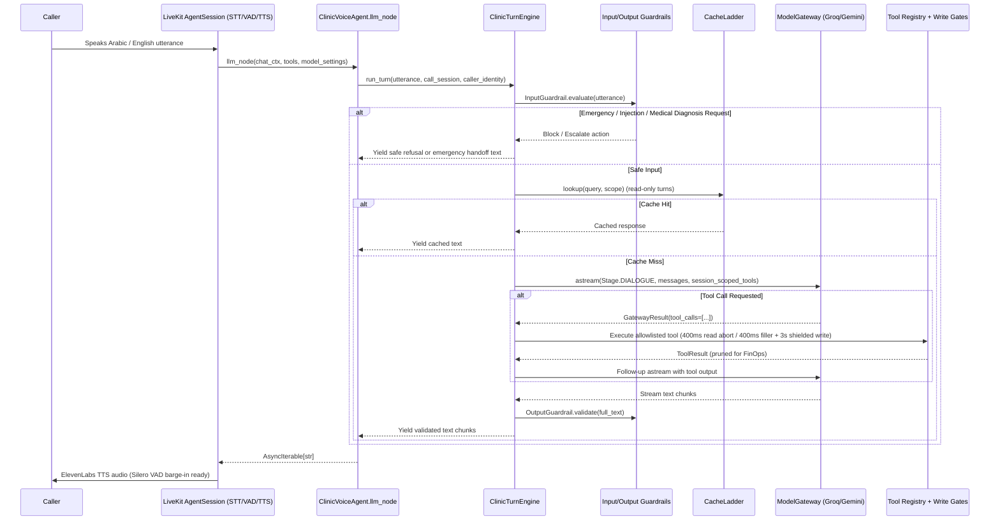

# Plan: Feature 5.4 — LiveKit Voice Pipeline Worker & Clinic Turn Engine

- **Roadmap ID**: Feature 5.4
- **Folder**: `spec/features/feature-514-livekit-voice-worker/`
- **Phase branch**: `phase/5-livekit-voice-core`
- **Size**: Medium/Large (4 execution groups: LiveKit-agnostic Clinic Turn Engine, Verified Caller Identity & Token Utility, LiveKit Worker + `llm_node` Adapter, and Unit Verification)
- **Status**: Committed

---

## 1. Objective & Why
Deliver the real-time WebRTC voice worker and conversational turn engine (`src/agent/voice_agent.py`, `src/agent/turn_engine.py`, `scripts/generate_token.py`) that connects LiveKit rooms, Deepgram STT (`nova-3`), ElevenLabs TTS (`eleven_turbo_v2_5`), and Silero VAD (`v4`) to the Phase 4 enterprise AI stack (`ModelGateway`, `CacheLadder`, `InputGuardrail`/`OutputGuardrail`, `FinOpsController`, `HierarchicalTracer`, `CallerSessionContext`, and the 5 clinic tools). This fulfills the core mission (`spec/mission.md`, `spec/roadmap.md` → Phase 5) of handling live Egyptian clinic calls safely within latency, FinOps, and OWASP guardrails.

## 2. Scope
### In scope
- **Clinic Turn Engine (`src/agent/turn_engine.py`)**: A LiveKit-agnostic async engine that executes a conversational turn end-to-end:
  1. Opens a hierarchical trace (`trace_scope`) and binds `finops_session_scope` and `caller_session_scope` (when a verified caller phone is present).
  2. Runs `InputGuardrail.evaluate()` (<20ms): blocks prompt injections, refuses diagnosis requests, and immediately escalates medical emergencies (`detect_emergency` / `GuardrailCategory.MEDICAL_EMERGENCY`) via `async_transfer_to_receptionist` + emergency spoken message (`build_emergency_message`).
  3. Checks `FinOpsController.check_budget()`: degrades to Tier 3 (`SEARCH_ONLY`) or Tier 4 (`RECEPTIONIST`) when token/daily spend thresholds are breached.
  4. Wraps untrusted caller text in XML delimiters (`wrap_caller_utterance`) and checks `CacheLadder` for read-only non-personal queries.
  5. Streams dialogue completions via `ModelGateway.astream(Stage.DIALOGUE, ...)` with the caller tool allowlist (`check_doctor_availability`, `book_appointment`, `manage_appointment`, `search_clinic_knowledge`, `transfer_to_receptionist`), using session-scoped schemas (`get_session_scoped_tool_definitions()`) that omit phone fields.
  6. Executes tool calls in a bounded loop (`max_tool_rounds_per_turn`, default `3` in `src/config.py`) with differentiated read vs. write timeouts:
     - **Read tools** (`check_doctor_availability`, `search_clinic_knowledge`, `manage_appointment(action='lookup')`): abort after `session_tool_timeout_ms` (`400ms`) and yield a localized filler (`build_tool_filler_message`).
     - **Write tools** (`book_appointment`, `manage_appointment(action='cancel'|'reschedule')`, `transfer_to_receptionist`): if no verified caller phone is bound in `CallerSessionContext` (for booking/cancel/reschedule), do **not** touch the DB—immediately route to `transfer_to_receptionist` and explain politely. Otherwise, if execution exceeds `400ms`, yield a spoken filler (`build_tool_filler_message`) while the write task continues shielded (`asyncio.shield`) up to `write_tool_hard_cap_ms` (`3000ms`), escalating to the receptionist only if the 3s hard cap is exceeded.
  7. Prunes tool payloads (`prune_tool_payload`), wraps RAG context in XML delimiters (`wrap_retrieved_context`), runs `OutputGuardrail.validate()` on final spoken text, records token usage in `FinOpsController`, updates `CallSession` metrics/turns/tool calls, and schedules async `AsyncLlamaGuardClassifier` checks.
- **LiveKit Voice Worker (`src/agent/voice_agent.py`)**:
  - Subclasses `livekit.agents.voice.Agent` (`ClinicVoiceAgent`) and overrides `llm_node(self, chat_ctx, tools, model_settings)` to stream plain-text chunks from `ClinicTurnEngine` directly to ElevenLabs TTS.
  - Provides plugin factories `create_stt`, `create_tts`, `create_vad`, and `create_voice_pipeline` (using Deepgram `nova-3`, ElevenLabs `eleven_turbo_v2_5`, and Silero VAD `v4` for instant barge-in).
  - Extracts verified caller identity (`caller_phone`, `caller_name`, `tenant_id`, `branch_id`, `language`) strictly from LiveKit participant attributes (`sip.phoneNumber` / `sip.trunkPhoneNumber` for SIP calls, or signed token attributes `caller_phone` / `lang` for web/console) and room metadata—never from voice transcript.
  - Applies LiveKit JWT clock-skew compensation lazily inside `run_worker()` / `entrypoint()` (never as an import-time network call).
  - Wires `AgentSession` lifecycle events (`user_input_transcribed`, `speech_created`, `agent_state_changed`, `close`) to `CallSession` state transitions, barge-in interruption recording (`record_interruption`), and PII-redacted disk persistence (`async_end_and_persist`).
- **Token Generator Enhancement (`scripts/generate_token.py`)**: Add `--phone`, `--lang`, `--tenant-id`, and `--branch-id` CLI flags that embed signed participant attributes (`caller_phone`, `lang`, `tenant_id`, `branch_id`) into the LiveKit JWT for web playground and console testing.
- **Config & Dependency Pin Updates (`src/config.py`, `pyproject.toml`)**: Add `write_tool_hard_cap_ms: float = 3000.0` and `max_tool_rounds_per_turn: int = 3` to `Settings`; update `pyproject.toml` `livekit-agents` constraint to `>=1.7.0` to match `uv.lock`.

### Out of scope (explicit exclusions)
- CLI simulated call runner and scenario catalog (`scripts/test_call.py` — Feature 5.5).
- Full multi-scenario voice orchestration test suite (`tests/test_agent.py` — Feature 5.6, though 5.4 includes smoke/unit checks to verify its own groups).
- Mid-call automatic language switching (deferred to `spec/backlog/` per P11).
- Keycloak / Entra ID staff OAuth2/OIDC SSO (Phase 6 Feature 6.4).

## 3. Decisions
| # | Decision | Source | Rationale |
|:---|:---|:---|:---|
| D1 | Custom `llm_node` override on a `livekit.agents.voice.Agent` subclass delegating to a LiveKit-agnostic `ClinicTurnEngine`. | Human Q1 (`phase-overview.md` P1) | LiveKit 1.7.1 `Agent.llm_node` natively accepts an `AsyncIterable[str]`; yielding strings from `ClinicTurnEngine` streams directly into TTS while keeping all Phase 4 components on the hot path. |
| D2 | Verified caller phone is derived strictly from SIP participant attributes (`sip.phoneNumber`) or signed token attributes (`caller_phone` from `generate_token.py --phone`). Without a verified phone, read tools work normally, while booking/cancel/reschedule intents trigger a polite receptionist handoff without any DB write. | Human Q6 (`phase-overview.md` P6, `tech.md` §10) | Eliminates voice phone spoofing while supporting both telephony SIP trunks and web/console testing. |
| D3 | Enforce an explicit `CALLER_TOOL_ALLOWLIST` (`check_doctor_availability`, `book_appointment`, `manage_appointment`, `search_clinic_knowledge`, `transfer_to_receptionist`) in the turn engine and tool dispatcher. | Human Q2 (`phase-overview.md` P7, `tech.md` §10) | Defense-in-depth so only caller-approved clinic tools can ever be advertised to the LLM or executed. |
| D4 | Differentiated tool timeout policy: read tools abort at `400ms` with a spoken filler; write tools emit a spoken filler at `400ms` while continuing shielded (`asyncio.shield`) up to `3000ms` (`write_tool_hard_cap_ms`), escalating to the receptionist if `3000ms` is exceeded. | Human Q9 (`phase-overview.md` P10, amended `tech.md` §2.1) | Prevents telling a patient their booking failed when the DB transaction actually committed. |
| D5 | One language per call resolved at session start from participant/room attributes (`lang` / `language`, default `settings.deepgram_language` = `"ar"`), configuring STT, greeting, and system prompt together. | Human Q10 (`phase-overview.md` P11) | Maximizes Deepgram `nova-3` Egyptian Arabic accuracy and avoids mid-call pipeline re-initialization latency. |
| D6 | Apply LiveKit JWT clock-skew patch lazily via an explicit helper called at worker/entrypoint startup rather than at module import time. | `phase-overview.md` P13, `tech.md` §2.6 | Importing `src.agent.voice_agent` in unit tests or CLI offline mode must complete in <50ms with zero outbound HTTP calls. |

## 4. Relevant Existing Architecture
- **`src/ai_core/gateway.py`**: `ModelGateway.astream(stage, messages, temperature, max_tokens, tools, session_id)` yields `(text_chunk, final_gateway_result)` including `tool_calls`.
- **`src/ai_core/cache.py`**: `CacheLadder`, `CacheScope`, `PromptPrefixBuilder`.
- **`src/ai_core/guardrails.py`**: `InputGuardrail`, `OutputGuardrail`, `EgyptianPIIRedactor`, `AsyncLlamaGuardClassifier`, `wrap_caller_utterance`, `wrap_retrieved_context`.
- **`src/ai_core/finops.py`**: `FinOpsController`, `finops_session_scope`, `prune_tool_payload`, `format_pruned_tool_message`.
- **`src/ai_core/tracing.py`**: `HierarchicalTracer`, `trace_scope`, `span_scope`, `SpanKind`.
- **`src/tools/__init__.py` & `src/tools/gates.py`**: `get_session_scoped_tool_definitions()`, `async_execute_tool()`, `caller_session_scope()`.
- **`src/agent/prompts.py` & `src/agent/session_manager.py`**: `get_system_prompt()`, message builders (`build_greeting_message`, `build_tool_filler_message`, `build_emergency_message`, etc.), `CallSession`, `SessionManager`.

## 5. Proposed Approach

## 6. Expected Files / Areas Affected
| Path | Change | Purpose |
|:---|:---|:---|
| `src/config.py` | Modify | Add `write_tool_hard_cap_ms: float = 3000.0` and `max_tool_rounds_per_turn: int = 3` |
| `pyproject.toml` | Modify | Update `livekit-agents` and plugin constraints to `>=1.7.0` to match lockfile |
| `uv.lock` | Modify | Sync project metadata lock entry with updated `pyproject.toml` constraints |
| `src/agent/session_manager.py` | Modify | Add `ClinicCallContext.is_emergency` and `CallMetrics.tool_timeout_count` property aliases synced with `emergency_flag` and `tool_timeouts` |
| `src/agent/turn_engine.py` | Create | LiveKit-agnostic `ClinicTurnEngine`, `VerifiedCallerIdentity`, allowlist enforcement, read/write timeout orchestration, and Phase 4 integration |
| `src/agent/voice_agent.py` | Create | `ClinicVoiceAgent(Agent)` with `llm_node` override, STT/TTS/VAD factories, verified identity extraction, barge-in & lifecycle hooks, lazy clock-skew patch, and `entrypoint` / `run_worker` |
| `src/agent/__init__.py` | Modify | Export `ClinicTurnEngine`, `VerifiedCallerIdentity`, `ClinicVoiceAgent`, and worker factories |
| `scripts/generate_token.py` | Modify | Add `--phone`, `--lang`, `--tenant-id`, `--branch-id` options writing signed JWT participant attributes |
| `tests/test_voice_worker.py` | Create | Unit, integration, and edge-case tests verifying `T1.1`–`T1.8`, `T2.1`–`T2.6`, and `T3.1`–`T3.6` |

## 7. Execution Groups
- **Group 1 — Config, Dependency Pin & Signed Token Attributes**: Add `write_tool_hard_cap_ms` and `max_tool_rounds_per_turn` to `src/config.py`; update `pyproject.toml` `livekit-agents>=1.7.0` (`uv.lock`); enhance `scripts/generate_token.py` to embed `caller_phone`, `lang`, `tenant_id`, and `branch_id` into LiveKit JWT claims (`attributes`).
- **Group 2 — Clinic Turn Engine (`src/agent/turn_engine.py`)**: Implement `VerifiedCallerIdentity`, `CALLER_TOOL_ALLOWLIST`, `WRITE_TOOLS` vs `READ_TOOLS` classification, and `ClinicTurnEngine.run_turn()` integrating `trace_scope`, `finops_session_scope`, `caller_session_scope`, `InputGuardrail`, `FinOpsController`, `CacheLadder`, `ModelGateway.astream`, shielded write-tool timeout with 400ms filler and 3s hard cap, unverified-caller write interception, `OutputGuardrail`, and `CallSession` metric/turn recording.
- **Group 3 — LiveKit Voice Worker (`src/agent/voice_agent.py` & `src/agent/__init__.py`)**: Implement `extract_verified_caller_identity(participant, room)`, lazy `_apply_livekit_clock_skew_patch()`, `create_stt()`, `create_tts()`, `create_vad()`, `ClinicVoiceAgent(Agent)` with `llm_node` override bridging `llm.ChatContext` to `ClinicTurnEngine`, `create_voice_pipeline()`, event hooks (`user_input_transcribed`, `speech_created`, `agent_state_changed`, `close`, barge-in interruption tracking), `prewarm()`, `get_worker_options()`, and `entrypoint()`.
- **Group 4 — Automated Worker & Turn Engine Verification (`tests/test_voice_worker.py`)**: Verify all unit (`T1.1`–`T1.8`), integration (`T2.1`–`T2.6`), and edge-case (`T3.1`–`T3.6`) requirements offline.

## 8. Risks & Trade-offs
| Risk / Trade-off | Impact | Mitigation |
|:---|:---|:---|
| Streaming chunks to TTS before `OutputGuardrail` has seen the complete sentence could leak a diagnosis phrase | Medical safety violation (`tech.md` §2.3) | Buffer streamed tokens to sentence boundaries (or validate full turn text when tool/short response) through `OutputGuardrail.validate()` before yielding each sentence chunk to TTS; since voice turns are capped at `max_tokens=150` and Groq generates >300 tok/s, buffering to sentence punctuation adds <80ms while guaranteeing zero unsafe speech. |
| Caller interrupts (barge-in) while a write tool (`book_appointment`) is mid-commit | Cancelled coroutine could leave DB state ambiguous | Wrap write-tool execution in `asyncio.shield()` inside `ClinicTurnEngine` so the DB transaction and idempotency store record complete cleanly even if the outer `llm_node` async generator is closed by barge-in. |
| Missing provider API keys in local/CI environments | Plugin instantiation errors | Maintain offline placeholder key fallback in `create_stt()` / `create_tts()` when env vars are unset so pipeline assembly can be tested without cloud keys. |

## 9. Open Questions
None — all architectural and safety decisions are locked in `phase-overview.md`.
