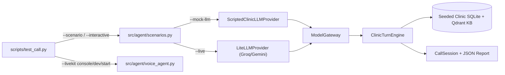

# Plan: Feature 5.5 — CLI Simulated Call Runner & Clinic Scenarios

- **Roadmap ID**: Feature 5.5
- **Folder**: `spec/features/feature-515-cli-simulated-call-runner/`
- **Phase branch**: `phase/5-livekit-voice-core`
- **Size**: Medium (3 execution groups: Scripted Clinic LLM Provider & Scenario Catalog in `src/agent/scenarios.py`, CLI Runner in `scripts/test_call.py`, and CLI Smoke/Integration Verification)
- **Status**: Committed

---

## 1. Objective & Why
Provide a deterministic, developer- and CI-friendly CLI call simulator (`scripts/test_call.py`) backed by an importable scenario catalog and scripted LLM provider (`src/agent/scenarios.py`) that drives the exact same `ClinicTurnEngine` built in Feature 5.4 (`spec/mission.md`, `spec/roadmap.md` → Phase 5). This enables testing complete multi-turn Egyptian clinic calls—booking, cancellation/rescheduling, RAG knowledge inquiries, medical emergency escalation, prompt-injection defense, and unverified-caller write protection—both offline in `--mock-llm` mode and against real Groq/Gemini models in `--live` mode, as well as launching `livekit console`.

## 2. Scope
### In scope
- **Importable Clinic Scenario Catalog & Scripted Provider (`src/agent/scenarios.py`)**:
  - `ScriptedClinicLLMProvider`: Implements the `LLMProvider` protocol (`astream`) from `src/ai_core/gateway.py` so `ModelGateway` executes its full routing, circuit-breaker, FinOps, and tracing logic while returning deterministic tool calls and Egyptian Arabic responses for scripted turns.
  - Pre-defined multi-turn clinic scenarios (`CLINIC_SCENARIOS`):
    1. `booking`: Greeting → check internal medicine (`الباطنة`) doctor availability → book examination (`كشف جديد`) for a verified caller phone → verify queue number confirmation.
    2. `manage`: Look up an existing appointment → reschedule or cancel it for the verified caller.
    3. `knowledge`: Ask about clinic services, lab preparation (fasting hours), or insurance (`knowledge_base/clinic_kb.md` via `search_clinic_knowledge`).
    4. `emergency`: Caller reports severe chest pain (`ألم شديد في الصدر`) → immediate emergency instruction + receptionist handoff (`transfer_to_receptionist`) with zero LLM diagnosis.
    5. `guardrail`: Caller attempts prompt injection and asks for a medical diagnosis/prescription → blocked by `InputGuardrail` with safe Egyptian Arabic refusal.
    6. `unverified-booking`: Caller without a verified session phone (`caller_phone=None`) requests a booking → read inquiry succeeds, booking attempt is intercepted before DB write and escalated to receptionist.
  - `run_simulated_scenario()` & `run_all_scenarios()` helpers returning structured `ScenarioRunReport` objects (turn transcripts, tool invocations, latency breakdown, FinOps tokens, persisted session path, pass/fail assertions).
- **CLI Simulated Call Runner (`scripts/test_call.py`)**:
  - Modes:
    - `--mock-llm` (default): Runs against `ScriptedClinicLLMProvider` + seeded in-memory/temp SQLite clinic DB and local Qdrant clinic KB, requiring zero network or API keys.
    - `--live`: Uses the real `LiteLLMProvider` (Groq `llama-3.3-70b-versatile` / Gemini fallback) through `ModelGateway`.
    - `--scenario <name|all>`: Runs one or all benchmark scenarios (`booking`, `manage`, `knowledge`, `emergency`, `guardrail`, `unverified-booking`) and exits with code `0` on pass or `1` on failure.
    - `--interactive`: Interactive terminal chat loop driving `ClinicTurnEngine` turn-by-turn with configurable `--phone` and `--lang`.
    - `--livekit <console|dev|start>`: Direct pass-through to the LiveKit worker CLI (`src.agent.voice_agent`).
  - Persists PII-redacted call JSON reports via `SessionManager` (when `--save-session` or default temp storage is used) and prints a formatted summary table of turn latencies, tools executed, and FinOps token consumption.

### Out of scope (explicit exclusions)
- Comprehensive pytest edge-case suite for voice orchestration (`tests/test_agent.py` — Feature 5.6, which imports `src/agent/scenarios.py` and `ClinicTurnEngine`).
- Load testing at 50 concurrent calls (Phase 6 Feature 6.6).

## 3. Decisions
| # | Decision | Source | Rationale |
|:---|:---|:---|:---|
| D1 | Place `ScriptedClinicLLMProvider`, `CLINIC_SCENARIOS`, and `run_simulated_scenario` in `src/agent/scenarios.py` rather than embedding them inside `scripts/test_call.py`. | `phase-overview.md` §4 (Interfaces 5.5 → 5.6), Human Q7 | Allows both `scripts/test_call.py` (5.5) and `tests/test_agent.py` (5.6) to share the exact same scripted provider and scenario definitions without importing from `scripts/`. |
| D2 | Default CLI mode is `--mock-llm` (deterministic offline execution); `--live` opts into real Groq/Gemini API calls; `--livekit` bridges to `livekit-agents` CLI. | Human Q7 (`phase-overview.md` P8) | Guarantees CI and key-less environments can run all clinic call flows deterministically while keeping a 1-flag switch for live LLM testing. |
| D3 | Seed a self-contained SQLite clinic database and in-memory Qdrant `clinic_kb` collection automatically when running scenarios in `--mock-llm` mode. | Agent default | Ensures `scripts/test_call.py --scenario all` works out-of-the-box on a fresh checkout without manual DB/Qdrant setup steps. |

## 4. Relevant Existing Architecture
- **`src/agent/turn_engine.py`** (Feature 5.4): `ClinicTurnEngine`, `VerifiedCallerIdentity`.
- **`src/ai_core/gateway.py`**: `LLMProvider` protocol (`astream`), `ModelGateway`.
- **`src/db/repository.py` & `scripts/seed_clinic_db.py`**: Clinic database seeding utilities (specialties, doctors, shifts, patients).
- **`src/rag/hybrid_retriever.py` & `scripts/ingest_clinic_knowledge.py`**: Clinic knowledge base ingestion (`knowledge_base/clinic_kb.md`).
- **`src/agent/session_manager.py`**: `SessionManager`, `CallSession`.

## 5. Proposed Approach

## 6. Expected Files / Areas Affected
| Path | Change | Purpose |
|:---|:---|:---|
| `src/agent/scenarios.py` | Create | `ScriptedClinicLLMProvider`, `ScenarioDefinition`, `CLINIC_SCENARIOS` (`booking`, `manage`, `knowledge`, `emergency`, `guardrail`, `unverified-booking`), `run_simulated_scenario()`, and `run_all_scenarios()` |
| `src/agent/__init__.py` | Modify | Export scenario runner types and `ScriptedClinicLLMProvider` |
| `scripts/test_call.py` | Create | CLI entrypoint supporting `--scenario`, `--mock-llm`, `--live`, `--interactive`, `--phone`, `--lang`, `--save-session`, and `--livekit` |
| `tests/test_simulated_scenarios.py` | Create | Dedicated unit, integration, and CLI edge-case verification suite (`T1.1`–`T1.3`, `T2.1`–`T2.4`, `T3.1`–`T3.2`), leaving `tests/test_agent.py` clean for Feature 5.6 |

## 7. Execution Groups
- **Group 1 — Scripted Clinic Provider & Scenario Catalog (`src/agent/scenarios.py`)**: Implement `ScriptedClinicLLMProvider` conforming to `LLMProvider`, self-contained test DB/KB bootstrap helper, the 6 clinic scenarios (`booking`, `manage`, `knowledge`, `emergency`, `guardrail`, `unverified-booking`), `run_simulated_scenario()`, and `run_all_scenarios()`.
- **Group 2 — CLI Simulated Call Runner (`scripts/test_call.py`)**: Build the `argparse` CLI supporting `--scenario <name|all>`, `--mock-llm` / `--live`, `--interactive`, `--phone`, `--lang`, `--save-session`, and `--livekit`, with formatted console output and non-zero exit codes on failed assertions.
- **Group 3 — Automated Scenario & CLI Verification (`tests/test_simulated_scenarios.py`)**: Verify `ScriptedClinicLLMProvider` streaming, `CLINIC_SCENARIOS` keys, `test_call.py` flag parsing, multi-turn `ClinicTurnEngine` execution across all 6 scenarios, PII-redacted session JSON persistence, and missing-key / unknown-scenario error handling.

## 8. Risks & Trade-offs
| Risk / Trade-off | Impact | Mitigation |
|:---|:---|:---|
| `--mock-llm` scenarios mutate the local `data/clinic.db` file if using the default DB URL | Pollutes local dev database across test runs | In `--mock-llm` scenario mode, default to an isolated temporary/in-memory SQLite database seeded via `seed_clinic_db` unless `--use-default-db` is passed. |
| FastEmbed model download on cold Qdrant ingestion in `--mock-llm` mode | Slows down `knowledge` scenario or fails offline | Use the existing lightweight hybrid/BM25 + mock/cached embedding fallback when offline so `knowledge` scenario runs in <1s without network access. |

## 9. Open Questions
None.
