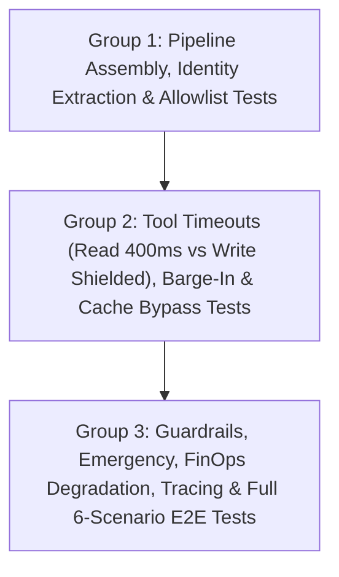

# Plan: Feature 5.6 — Automated Voice Orchestration & Guardrail Test Suite

- **Roadmap ID**: Feature 5.6
- **Folder**: `spec/features/feature-516-voice-orchestration-test-suite/`
- **Phase branch**: `phase/5-livekit-voice-core`
- **Size**: Medium (3 execution groups: Worker/Identity/Pipeline tests, Turn Engine/Tool Timeout/Barge-In/Cache tests, and Multi-Turn Scenario & Guardrail Integration tests in `tests/test_agent.py`)
- **Status**: Approved (Phase Gate 1)

---

## 1. Objective & Why
Deliver the comprehensive automated pytest suite (`tests/test_agent.py`) verifying the entire Phase 5 LiveKit voice agent core, `ClinicTurnEngine`, tool timeout & barge-in shielding rules, verified caller identity enforcement, cache bypass rules for personal/tool turns, FinOps budget degradation, hierarchical trace spans, and medical safety guardrails (`spec/mission.md`, `spec/roadmap.md` → Phase 5). This replaces the deleted legacy restaurant agent test file with high-signal clinic voice orchestration tests.

## 2. Scope
### In scope
- Create `tests/test_agent.py` covering:
  1. **Plugin Factories & Pipeline Assembly**: `create_stt`, `create_tts`, `create_vad`, `create_voice_pipeline`, `get_worker_options`, `ClinicVoiceAgent(Agent)` subclassing, single-language configuration (`ar` default and `en` override), and zero import-time network side effects.
  2. **Verified Caller Identity & Signed JWT Attributes**: `extract_verified_caller_identity` from SIP (`sip.phoneNumber`, `sip.trunkPhoneNumber`) and signed token attributes (`caller_phone`, `lang`, `tenant_id`, `branch_id`); `scripts/generate_token.py` JWT attribute round-trip; blocking unverified caller write attempts (`book_appointment`, `manage_appointment` cancel/reschedule) before any DB write while allowing read tools (`check_doctor_availability`, `search_clinic_knowledge`, `manage_appointment` lookup).
  3. **Caller Tool Allowlist & Session-Scoped Schemas**: Confirming only the 5 clinic tools are advertised with phone fields stripped, and verifying that a rogue LLM tool call for an unallowed tool (`get_order_status`, `drop_table`, etc.) is rejected.
  4. **Read vs. Write Tool Timeouts & Barge-In Shielding**:
     - Read tool >400ms aborts immediately, increments `tool_timeout_count`, and yields localized filler.
     - Write tool >400ms (within 3s cap) yields localized filler at 400ms and completes the shielded DB commit (`asyncio.shield`), returning the booking confirmation.
     - Write tool exceeding `write_tool_hard_cap_ms` (3s, tested with a short configured cap) escalates to `transfer_to_receptionist`.
     - Mid-turn cancellation (barge-in) while a write tool is in flight does not abort the shielded write transaction, and `record_interruption()` updates `CallSession` metrics.
  5. **Phase 4 Stack Integration on the Voice Path**:
     - `InputGuardrail` & `OutputGuardrail` blocking prompt injection and medical diagnosis output on `ClinicTurnEngine`.
     - Emergency utterance short-circuiting LLM generation, calling `transfer_to_receptionist(urgency='critical')`, setting `is_emergency=True`, and yielding `build_emergency_message`.
     - `CacheLadder` serving exact/semantic hits on general clinic FAQ turns while strictly bypassing cache on personal/booking/tool turns.
     - `FinOpsController` token budget enforcement (degrading to `SEARCH_ONLY` / `RECEPTIONIST` when call budget is exhausted) and `HierarchicalTracer` emitting PII-redacted nested spans per turn.
  6. **End-to-End Multi-Turn Scenarios**: Running all 6 `CLINIC_SCENARIOS` from `src/agent/scenarios.py` and `ClinicVoiceAgent.llm_node` with `livekit.agents.llm.ChatContext`.

### Out of scope (explicit exclusions)
- Live cloud audio/SIP load testing at 50 concurrent calls (Phase 6 Feature 6.6).
- Modifying application logic outside `tests/test_agent.py` (unless fixing a defect uncovered by the new tests).

## 3. Decisions
| # | Decision | Source | Rationale |
|:---|:---|:---|:---|
| D1 | Reuse `ScriptedClinicLLMProvider` and `CLINIC_SCENARIOS` from `src/agent/scenarios.py` (Feature 5.5) alongside targeted custom mock providers for fault-injection (timeouts, barge-in, unallowed tools, unsafe output). | `phase-overview.md` §4, Human Q7, Q8 | Keeps scenario definitions DRY while testing both happy-path clinic flows and adversarial/failure boundaries. |
| D2 | Test write-tool hard-cap escalation and 400ms filler thresholds using configurable `Settings(session_tool_timeout_ms=..., write_tool_hard_cap_ms=...)` overrides so timeout tests run in <300ms rather than sleeping 3+ seconds per test. | Agent default | Keeps the pytest suite fast (<5s for `test_agent.py`) and deterministic. |

## 4. Relevant Existing Architecture
- **`src/agent/voice_agent.py`, `src/agent/turn_engine.py`, `src/agent/scenarios.py`** (Features 5.4 & 5.5).
- **`src/agent/session_manager.py` & `src/agent/prompts.py`** (Features 5.1 & 5.2).
- **`src/ai_core/*` & `src/tools/*`** (Phases 3 & 4).

## 5. Proposed Approach

## 6. Expected Files / Areas Affected
| Path | Change | Purpose |
|:---|:---|:---|
| `tests/test_agent.py` | Create | Comprehensive automated unit, integration, and guardrail test suite for the Phase 5 voice agent |

## 7. Execution Groups
- **Group 1 — Pipeline Assembly, Identity Extraction & Allowlist Tests**: Create `tests/test_agent.py` with tests for STT/TTS/VAD factories, single-language setup, `ClinicVoiceAgent.llm_node` bridging `ChatContext`, `extract_verified_caller_identity` (SIP + JWT + unverified), `generate_token.py` attribute round-trip, and `CALLER_TOOL_ALLOWLIST` enforcement.
- **Group 2 — Read/Write Timeouts, Barge-In Shielding & Cache Bypass Tests**: Add tests for read tool >400ms abort + filler, write tool >400ms filler + shielded completion, write tool hard-cap receptionist escalation, mid-turn barge-in cancellation safety + `record_interruption`, and `CacheLadder` hit on general FAQ vs. bypass on personal/booking turns.
- **Group 3 — Guardrails, Emergency, FinOps, Tracing & Multi-Turn Scenarios**: Add tests for prompt injection blocking, output diagnosis scrubbing/refusal, emergency short-circuit + `transfer_to_receptionist`, FinOps token budget degradation (`SEARCH_ONLY` / `RECEPTIONIST`), PII-redacted hierarchical trace spans, and all 6 `CLINIC_SCENARIOS`.

## 8. Risks & Trade-offs
| Risk / Trade-off | Impact | Mitigation |
|:---|:---|:---|
| Flaky timing in async timeout tests under CI CPU load | Intermittent test failures | Use generous margins between configured thresholds (e.g. `50ms` filler threshold vs `180ms` simulated tool vs `500ms` hard cap) in unit tests. |

## 9. Open Questions
None.
