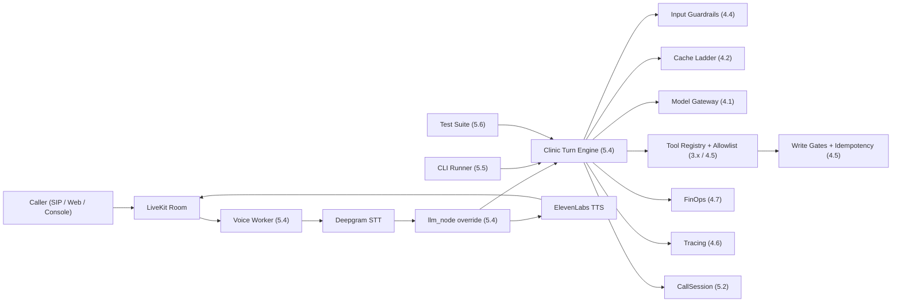

# Phase Overview: Phase 5 — Real-Time LiveKit Voice Agent Core & Medical Persona

- **Phase branch**: `phase/5-livekit-voice-core`
- **Roadmap section**: `spec/roadmap.md` → Phase 5
- **Execution mode**: Phase mode (default, chosen by the human)
- **Status**: Implementing (Approved at Phase Gate 1)

---

## 1. Phase Goal & Why
Serve the mission's core promise (`spec/mission.md`): an Egyptian-Arabic voice receptionist that answers clinic calls in real time, books/cancels/reschedules appointments safely, and escalates emergencies to a human. Features 5.1 (persona/prompts) and 5.2 (call session state) are done. The remaining work turns the Phase 4 enterprise core (gateway, cache, guardrails, write gates, tracing, FinOps) into a **live LiveKit call path**, removes every remnant of the legacy restaurant project, and proves the whole flow with a simulated-call runner and an automated orchestration test suite.

## 2. Features in This Phase
| Order | Roadmap ID | Folder | Size | Status | Depends on |
|:---|:---|:---|:---|:---|:---|
| 1 | Feature 5.1 | `spec/features/feature-511-clinic-persona-system-prompts/` | M | ✅ Done | — |
| 2 | Feature 5.2 | `spec/features/feature-512-medical-call-session-state-metrics/` | M | ✅ Done | 5.1 |
| 3 | Feature 5.3 | `spec/features/feature-513-legacy-restaurant-purge/` | M | 🆕 New | — |
| 4 | Feature 5.4 | `spec/features/feature-514-livekit-voice-worker/` | M/L | 🆕 New | 5.1, 5.2, 5.3 |
| 5 | Feature 5.5 | `spec/features/feature-515-cli-simulated-call-runner/` | M | 🆕 New | 5.4 |
| 6 | Feature 5.6 | `spec/features/feature-516-voice-orchestration-test-suite/` | M | 🆕 New | 5.4, 5.5 |

**Merge/split decisions made during the interview:**
- New **Feature 5.3 — Legacy Restaurant Purge** inserted before the worker (human, Q2–Q4). Former 5.3/5.4/5.5 are renumbered 5.4/5.5/5.6.
- The three legacy restaurant files (`src/agent/voice_agent.py`, `scripts/test_call.py`, `tests/test_agent.py`) are **deleted in 5.3** and **re-created from scratch** in 5.4/5.5/5.6, so the suite stays green between features.

## 3. Shared Decisions (apply to all features)
| # | Decision | Source | Rationale |
|:---|:---|:---|:---|
| P1 | The LLM turn runs through a custom `llm_node` override that delegates to a LiveKit-agnostic **Clinic Turn Engine**: input guardrails → cache ladder → `ModelGateway.astream` (stage-routed) → tool execution via the registry → output guardrail → FinOps accounting → hierarchical trace. LiveKit plugins are used only for STT (Deepgram), TTS (ElevenLabs) and VAD (Silero). | Human Q1 | Only option that makes Phase 4 (ADRs 003–009, `tech.md` §7–§9) real on live calls. |
| P2 | The turn engine owns the tool loop (bounded number of LLM↔tool rounds per turn, value in `src/config.py`). The CLI runner and tests drive the **same engine code** as the live worker. | Agent default (follows P1, Q7) | Parity between simulated and live calls; deterministic testing. |
| P3 | All restaurant remnants are removed from every layer: tools, schemas, aliases, scripts, RAG keywords, config aliases, session legacy fields, dashboard demo data/i18n/views, README, architecture docs, tests. | Human Q2, Q3 | Clinic-only codebase; no restaurant tool can ever reach the LLM. |
| P4 | The purge is its own feature (5.3), done first. | Human Q4 | Separate commit/rollback point; worker built on a clean base. |
| P5 | Dashboard demo seed data is removed entirely; the dashboard shows a proper empty state until real calls are persisted. | Human Q5 | No fake data; tests build their own fixtures. |
| P6 | Caller phone identity comes **only** from the SIP participant attribute (telephony) or a signed LiveKit token attribute (web/console, issued by `scripts/generate_token.py --phone`). Without a verified phone, read tools work but any write intent is routed to the human receptionist before any DB write. The caller can never supply their phone by voice. | Human Q6, `tech.md` §10, ADR-009, Feature 4.5 | Prevents caller-identity spoofing. |
| P7 | An explicit **caller tool allowlist** (the 5 clinic tools) is enforced by the voice agent, independent of the registry contents. | `tech.md` §10, human Q2 | Defense in depth. |
| P8 | The CLI runner has two modes: `--mock-llm` (default, scripted deterministic scenarios, offline) and `--live` (real Groq/Gemini via the gateway); it can also launch `livekit console`. | Human Q7 | CI-friendly deterministic scenarios + real-quality checks. |
| P9 | Validation gate = automated tests (mock-based), simulated scenarios, `ruff`, golden evals. A **real voice call** is performed manually by the human at Phase Gate 2 with exact commands. Latency is measured and logged, not a merge gate. | Human Q8 | The VM has no audio and no provider keys. |
| P10 | Tool timeouts: **read** tools abort at 400 ms with a spoken filler; **write** tools (book/cancel/reschedule) speak a filler at 400 ms and continue (shielded from cancellation/barge-in) up to a hard cap of 3 s, then escalate to the receptionist. Idempotency keys prevent duplicates. `tech.md` §1 is amended accordingly. | Human Q9 | Never tell a patient "not booked" when a booking actually committed. |
| P11 | One language per call, taken from a room/token attribute (default `ar`); it configures STT, greeting and prompt together. No mid-call switching. Auto-detection goes to the backlog. | Human Q10, Feature 5.1 R3.1 | Highest Egyptian-Arabic accuracy, deterministic. |
| P12 | `livekit-agents` / plugin constraints in `pyproject.toml` and `tech.md` are corrected to the 1.x API actually locked in `uv.lock` (`livekit-agents 1.7.1`). | Agent default (lockfile evidence) | Code uses `Agent`/`AgentSession` (1.x); the `>=0.8.0` pin is misleading. |
| P13 | LiveKit JWT clock-skew compensation (`tech.md` §6) is kept but applied at worker start, never as a network call at import time. | `tech.md` §6 + agent default | Importing the module in tests must have no side effects. |

### Constitution changes requested by this phase (listed explicitly for Phase Gate 1)
- `spec/tech.md` §1 Stack table: LiveKit Agents `SDK >= 0.8.0` → `SDK >= 1.7` (P12).
- `spec/tech.md` §2.1 Voice Latency Budget: tool timeout rule split into read (400 ms abort) vs write (400 ms filler, 3 s hard cap, then escalation) (P10).
- `spec/roadmap.md` Phase 5 section: insert Feature 5.3, renumber 5.4–5.6 (P4).
- `spec/backlog/`: new item "Deepgram language auto-detection for Egyptian Arabic / English" (P11).

## 4. Cross-Feature Architecture & Data Flow

**Interfaces between features:**
- **5.3 → 5.4**: registry contains only the 5 clinic tools; `ClinicCallContext` contains only clinic fields; no restaurant module importable.
- **5.4 → 5.5/5.6**: the Clinic Turn Engine is a plain async component that takes a caller utterance + call session + verified caller identity and yields speakable text chunks (including fillers), records metrics on the `CallSession`, and is constructed with injectable dependencies (gateway/provider, cache, clock) so a scripted LLM provider can replace the real one.
- **5.5 → 5.6**: the scripted provider and the scenario catalog live in an importable module under `src/agent/` (not inside the script) so tests reuse them.

**Phase-wide `tech.md` invariants:** §1 latency budget (as amended), §3 medical safety (no diagnosis, emergency → instruction + `transfer_to_receptionist`), §4 barge-in, §5 tool resilience, §6 session/privacy, §7 tracing hygiene (PII masked), §8 FinOps (150 max tokens/turn, 8,000/call, $10/day), §9 untrusted content (XML delimiters), §10 identity & allowlist.

## 5. Phase-Level Integration Validation
- [ ] PI.1 — Simulated booking call end-to-end (`uv run python scripts/test_call.py --scenario booking`) → greeting, availability check, booking committed with queue number, session persisted PII-redacted, trace emitted.
- [ ] PI.2 — Simulated emergency call (`--scenario emergency`) → emergency instruction + receptionist escalation, no LLM diagnosis.
- [ ] PI.3 — Simulated unverified-caller booking attempt (`--scenario unverified-booking`) → no DB write, receptionist handoff offered.
- [ ] PI.4 — No restaurant term or module remains anywhere in `src/`, `scripts/`, `tests/` (guard test from 5.3 stays green after 5.4–5.6).
- [ ] PI.5 — Full suite: `uv run pytest -v`
- [ ] PI.6 — Lint: `uv run ruff check .`
- [ ] PI.7 — Golden evals (prompts/ai_core paths touched): `uv run pytest tests/evals/test_golden_evals.py -v`
- [ ] PI.8 — Worker imports and builds its options without network/keys: `uv run python -c "import src.agent.voice_agent"`
- [ ] PI.9 — Manual (human, Phase Gate 2): real voice call through `livekit console` or the LiveKit playground with a token from `scripts/generate_token.py --phone …`; book, then cancel, then interrupt the agent mid-sentence, then say an emergency phrase.

## 6. Risks & Stop Conditions
| Risk | Mitigation |
|:---|:---|
| LiveKit 1.x `llm_node` contract differs from what the engine yields (chunk types, cancellation) | Thin adapter in 5.4, covered by unit tests with a fake LiveKit chat context; verify against the installed SDK source, not memory. |
| Purge breaks dashboard pages or tests of Phase 7 features (5xx folders) | Dedicated execution groups per layer in 5.3; full suite after each group; guard test. |
| Gateway streaming + tool calls under cancellation (barge-in) leak tasks or half-written bookings | P10 shielding for writes; idempotency keys; explicit cancellation tests in 5.6. |
| Cache serving a stale answer for a personal/booking turn | Rely on Feature 4.2 cacheability policy (tool turns and PII turns bypass); explicit test in 5.6. |
| No provider keys in VM → live path unverified | P9: manual call by the human at Phase Gate 2. |

Stop and ask the human if: a feature stays red after 2 fix attempts, or a fix needs a change to intent, scope, or a `tech.md` invariant.

## 7. Execution Log (filled by the orchestrator)
| Feature | Subagent result | Validation | Local commit | Notes |
|:---|:---|:---|:---|:---|
| Feature 5.3 | ✅ Implemented | ✅ 160 targeted / 533 full passed, ruff clean | `ca8828a` | Deleted 9 legacy files, cleaned 31 files, added purity guard |
