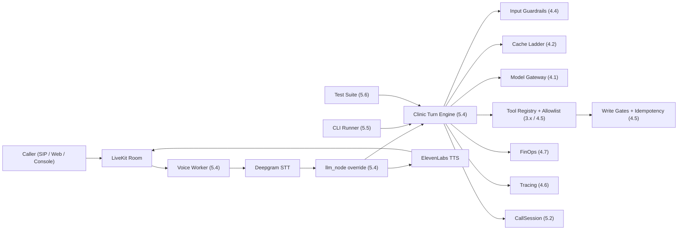

# نظرة عامة على المرحلة الخامسة: نواة الوكيل الصوتي الفوري والشخصية الطبية (`Phase 5`)

- **فرع المرحلة:** `phase/5-livekit-voice-core`
- **القسم في خارطة الطريق:** `spec/roadmap.md` ← المرحلة الخامسة (`Phase 5`)
- **وضع التنفيذ:** وضع المرحلة الكاملة (`Phase mode` — الوضع الافتراضي باختيارك)
- **الحالة:** تم التحقق — بانتظار اعتماد `Phase Gate 2` (`Validated — Awaiting Phase Gate 2`)

---

## ١. هدف المرحلة ولماذا نبنيها
تحقيق الوعد الأساسي للمشروع في `spec/mission.md`: موظف استقبال صوتي بالعامية المصرية يرد على مكالمات العيادة في الوقت الفعلي، ويحجز المواعيد أو يلغيها أو يعيد جدولتها بأمان، ويحوّل حالات الطوارئ فوراً لموظف بشري.

الميزتان `Feature 5.1` (الشخصية والـ Prompts) و`Feature 5.2` (حالة جلسة المكالمة والمقاييس) اكتملتا بالفعل. العمل المتبقي في هذه المرحلة يحوّل البنية المؤسسية التي بنيناها في المرحلة الرابعة (بوابة النماذج `Gateway`، والـ `Cache`، وحواجز الأمان `Guardrails`، وبوابات الكتابة، والتتبّع `Tracing`، وضبط التكلفة `FinOps`) إلى **مسار مكالمات صوتية حية عبر LiveKit**، ويزيل كل أثر متبقٍ من مشروع المطعم القديم، ويثبت سلامة التدفق بالكامل عبر أداة محاكاة للمكالمات وحزمة اختبارات آلية شاملة.

---

## ٢. الميزات داخل هذه المرحلة

| الترتيب | المعرّف في خارطة الطريق | المجلد | الحجم | الحالة | يعتمد على |
|:---|:---|:---|:---|:---|:---|
| ١ | `Feature 5.1` | `spec/features/feature-511-clinic-persona-system-prompts/` | متوسط (`M`) | ✅ مكتملة | — |
| ٢ | `Feature 5.2` | `spec/features/feature-512-medical-call-session-state-metrics/` | متوسط (`M`) | ✅ مكتملة | `5.1` |
| ٣ | `Feature 5.3` | `spec/features/feature-513-legacy-restaurant-purge/` | متوسط (`M`) | ✅ مكتملة | — |
| ٤ | `Feature 5.4` | `spec/features/feature-514-livekit-voice-worker/` | متوسط/كبير (`M/L`) | ✅ مكتملة | `5.1`, `5.2`, `5.3` |
| ٥ | `Feature 5.5` | `spec/features/feature-515-cli-simulated-call-runner/` | متوسط (`M`) | ✅ مكتملة | `5.4` |
| ٦ | `Feature 5.6` | `spec/features/feature-516-voice-orchestration-test-suite/` | متوسط (`M`) | ✅ مكتملة | `5.4`, `5.5` |

### قرارات الدمج والتقسيم أثناء المقابلة
- **إدراج ميزة جديدة أولاً (`Feature 5.3 — Legacy Restaurant Purge`):** تُنفَّذ قبل بناء الـ Worker (بناءً على إجابات الأسئلة ٢–٤)، مع إعادة ترقيم الميزات السابقة `5.3` و`5.4` و`5.5` لتصبح `5.4` و`5.5` و`5.6`.
- **حذف وإعادة بناء الملفات الثلاثة القديمة:** الملفات `src/agent/voice_agent.py` و`scripts/test_call.py` و`tests/test_agent.py` تُحذف بالكامل في `5.3` ثم تُبنى من الصفر في `5.4` و`5.5` و`5.6` حتى تظل حزمة الاختبارات خضراء بين كل ميزة والتي تليها.

---

## ٣. القرارات المشتركة (تُطبَّق على كل ميزات المرحلة)

| # | القرار | المصدر | السبب |
|:---|:---|:---|:---|
| `P1` | يمر كل دور محادثة عبر دالة مخصّصة `llm_node` تفوّض التنفيذ لمحرّك مستقل عن LiveKit اسمه **Clinic Turn Engine** بالترتيب: فحص المدخلات `InputGuardrail` ← سلّم الكاش `CacheLadder` ← البث عبر `ModelGateway.astream` ← تنفيذ الأدوات من السجل ← فحص المخرجات `OutputGuardrail` ← حساب التوكنز `FinOps` ← التتبّع الهرمي `Tracing`. وتُستخدم إضافات LiveKit فقط للـ STT (`Deepgram`) والـ TTS (`ElevenLabs`) والـ VAD (`Silero`). | إجابتك (س١) | الخيار الوحيد الذي يفعّل مكوّنات المرحلة الرابعة فعلياً في المكالمات الحية (`ADRs 003–009`، و`tech.md` §7–§9). |
| `P2` | يمتلك محرّك الدور حلقة استدعاء الأدوات بعدد جولات محدود لكل دور (مُعرَّف في `src/config.py`)، وتشغّل أداة الـ CLI والاختبارات **نفس كود المحرّك تماماً** الذي يشغّله الـ Worker الحي. | افتراضي تابع لـ `P1` و(س٧) | تطابق تام بين المكالمات المحاكاة والحية مع قابلية اختبار حتمية. |
| `P3` | إزالة كل بقايا مشروع المطعم من جميع الطبقات: الأدوات، والـ Schemas، والـ Aliases، والسكربتات، وكلمات الـ RAG، وإعدادات `config.py`، والحقول القديمة في الجلسة، وبيانات العرض الوهمية والترجمات والصفحات في الـ Dashboard، و`README.md`، ووثائق المعمارية، والاختبارات. | إجابتك (س٢، س٣) | كود خاص بالعيادة بنسبة ١٠٠٪؛ يستحيل وصول أي أداة مطعم للـ LLM. |
| `P4` | عملية التنظيف ميزة مستقلة بذاتها (`Feature 5.3`) وتُنفَّذ أولاً. | إجابتك (س٤) | نقطة رجوع (`commit`) مستقلة وبناء الـ Worker على أساس نظيف. |
| `P5` | حذف بيانات المكالمات الوهمية (`Demo Seed`) من الـ Dashboard نهائياً؛ ويعرض الـ Dashboard حالة فارغة نظيفة حتى تُحفظ مكالمات حقيقية، بينما تبني الاختبارات بياناتها الخاصة (`Fixtures`). | إجابتك (س٥) | عدم شحن بيانات وهمية في كود الإنتاج. |
| `P6` | رقم هاتف المتصل الموثّق يأتي **فقط** من خصائص SIP في المكالمات الهاتفية (`sip.phoneNumber`) أو من خاصية موقّعة داخل LiveKit JWT للويب/الـ Console عبر `scripts/generate_token.py --phone`. بدون رقم موثّق تعمل أدوات القراءة بشكل طبيعي، بينما يُحوَّل أي طلب كتابة (حجز/إلغاء/تأجيل) لموظف الاستقبال قبل لمس قاعدة البيانات، ولا يُؤخذ الرقم من صوت المتصل أبداً. | إجابتك (س٦)، و`tech.md` §10، و`ADR-009`، والميزة `4.5` | منع انتحال هوية المتصل (`Caller Spoofing`). |
| `P7` | فرض قائمة بيضاء صريحة لأدوات المتصل (`CALLER_TOOL_ALLOWLIST` للأدوات الخمس الطبية فقط) داخل الوكيل الصوتي، بغض النظر عمّا في السجل العام. | إجابتك (س٢)، و`tech.md` §10 | دفاع متعدد الطبقات (`Defense in Depth`). |
| `P8` | تعمل أداة المحاكاة بوضعين: الوضع الافتراضي `--mock-llm` (سيناريوهات مبرمجة حتمية بدون إنترنت) والوضع `--live` (اتصال حقيقي بـ Groq/Gemini عبر البوابة)، مع إمكانية تمرير التشغيل إلى `livekit console`. | إجابتك (س٧) | سيناريوهات حتمية سريعة للـ CI مع إمكانية فحص جودة النموذج الحقيقي. |
| `P9` | بوابة التحقق الإلزامية تشمل الاختبارات الآلية، وسيناريوهات المحاكاة، و`ruff`، واختبارات `golden evals`. أما **المكالمة الصوتية الحية** فتجريها أنت يدوياً عند `Phase Gate 2` بأوامر جاهزة، ويُقاس زمن الاستجابة ويُسجَّل دون أن يمنع الدمج. | إجابتك (س٨) | بيئة الـ VM لا تحتوي على مايكروفون/صوت أو مفاتيح المزوّدين السحابية. |
| `P10` | مهلة تنفيذ الأدوات: **أدوات القراءة** تُلغى عند `400ms` مع نطق جملة انتظار لطيفة (`Filler`)؛ أما **أدوات الكتابة** (الحجز/الإلغاء/التأجيل) فتنطق جملة الانتظار عند `400ms` وتكمل التنفيذ محمية (`asyncio.shield`) من الإلغاء والمقاطعة حتى سقف أقصى `3s`، ثم تحوّل للاستقبال لو تجاوزت `3s`، مع منع التكرار عبر مفاتيح `Idempotency`. ويُعدَّل `tech.md` §1 وفقاً لذلك. | إجابتك (س٩) | حتى لا نخبر المريض أبداً أن الحجز فشل بينما تم تسجيله فعلياً في قاعدة البيانات. |
| `P11` | لغة واحدة لكل مكالمة تُحدَّد من خاصية الغرفة أو التوكن (الافتراضي `ar`)، وتضبط الـ STT والتحية والـ System Prompt معاً بدون تبديل أثناء المكالمة، ويُرحَّل الكشف التلقائي للغة إلى الـ `Backlog`. | إجابتك (س١٠)، والميزة `5.1` | أعلى دقة تعرّف على العامية المصرية وسلوك حتمي. |
| `P12` | تصحيح قيد إصدار `livekit-agents` في `pyproject.toml` و`tech.md` ليطابق واجهة `1.x` المثبّتة فعلياً في `uv.lock` (`livekit-agents 1.7.1`). | افتراضي مبني على `uv.lock` | الكود يستخدم `Agent` و`AgentSession` من إصدار `1.x`، والقيد القديم `>=0.8.0` مضلّل. |
| `P13` | الإبقاء على معالجة فرق التوقيت في توكن LiveKit (`tech.md` §6) ولكن بتشغيلها عند بدء الـ Worker فقط، وليس كطلب شبكة لحظة عمل `import` للملف. | `tech.md` §6 + افتراضي هندسي | استيراد الملفات داخل الاختبارات يجب أن يتم بدون أي اتصال خارجي أو آثار جانبية. |

### تعديلات الدستور وخارطة الطريق المطلوبة في هذه المرحلة (معروضة للاعتماد في `Phase Gate 1`)
- **تعديل `spec/tech.md` (§1 جدول التقنيات):** تحديث إصدار LiveKit Agents من `SDK >= 0.8.0` إلى `SDK >= 1.7.0` (`P12`).
- **تعديل `spec/tech.md` (§2.1 ميزانية زمن الاستجابة):** فصل قاعدة مهلة الأدوات إلى أدوات قراءة (إلغاء عند `400ms`) مقابل أدوات كتابة (جملة انتظار عند `400ms`، وسقف محمي حتى `3,000ms`، ثم تصعيد للاستقبال) (`P10`).
- **تعديل `spec/roadmap.md` (قسم المرحلة الخامسة):** إدراج `Feature 5.3` وإعادة ترقيم الميزات إلى `5.4`–`5.6` (`P4`).
- **إضافة بند في `spec/backlog/`:** بحث الكشف التلقائي للغة بين العامية المصرية والإنجليزية في Deepgram (`P11`).

---

## ٤. المعمارية وتدفّق البيانات عبر الميزات

### نقاط الالتقاء بين الميزات (`Interfaces`)
- **من `5.3` إلى `5.4`:** يحتوي سجل الأدوات على الأدوات الخمس للعيادة فقط؛ ويحتوي `ClinicCallContext` على حقول العيادة فقط؛ ولا يمكن استيراد أي ملف خاص بالمطعم.
- **من `5.4` إلى `5.5` و`5.6`:** مكوّن `ClinicTurnEngine` هو مكوّن `async` مستقل يستقبل جملة المتصل وجلسة المكالمة وهوية المتصل الموثّقة، ويولّد مقاطع نصية قابلة للنطق (بما فيها جمل الانتظار `Fillers`)، ويسجّل المقاييس في `CallSession`، ويقبل حقن الاعتماديات (`Gateway`، و`Cache`، والوقت) حتى يسهل استبدال المزوّد الحقيقي بمزوّد مبرمج في الاختبارات.
- **من `5.5` إلى `5.6`:** المزوّد المبرمج (`ScriptedClinicLLMProvider`) وكتالوج السيناريوهات موجودان في ملف قابل للاستيراد داخل `src/agent/` (وليس داخل سكربت الـ CLI) لتعيد الاختبارات استخدامهما مباشرة.

### ثوابت `tech.md` المطبّقة على مستوى المرحلة كلها
- **§1 ميزانية زمن الاستجابة** (بعد تعديل القراءة والكتابة).
- **§3 السلامة الطبية** (ممنوع التشخيص، والطوارئ تؤدي لتعليمات فورية + `transfer_to_receptionist`).
- **§4 المقاطعة اللحظية (`Barge-in`)** عبر Silero VAD.
- **§5 مرونة الأدوات** وعدم إسقاط المكالمة عند أي خطأ.
- **§6 فصل حالة الجلسة والخصوصية.**
- **§7 نظافة التتبّع** وتقنيع البيانات الشخصية (`PII`) قبل التصدير.
- **§8 ميزانيات `FinOps`** (`150` توكن كحد أقصى للدور، و`8,000` للمكالمة، وسقف يومي `$10`).
- **§9 عزل المحتوى غير الموثوق** داخل وسوم XML.
- **§10 هوية المتصل الموثّقة والقائمة البيضاء للأدوات.**

---

## ٥. التحقق التكاملي على مستوى المرحلة (`Phase-Level Validation`)
- [x] **فحص `PI.1` — محاكاة مكالمة حجز كاملة** (`uv run python scripts/test_call.py --scenario booking`): الترحيب، وفحص المواعيد المتاحة، وتأكيد الحجز برقم الدور، وحفظ الجلسة بعد تقنيع البيانات الشخصية، وإصدار أثر التتبّع (`Trace`).
- [x] **فحص `PI.2` — محاكاة مكالمة طوارئ** (`--scenario emergency`): نطق توجيه الطوارئ مع التحويل لموظف الاستقبال بدون أي تشخيص من الـ LLM.
- [x] **فحص `PI.3` — محاكاة حجز لمتصل غير موثّق الرقم** (`--scenario unverified-booking`): عدم كتابة أي سجل في قاعدة البيانات وعرض التحويل لموظف الاستقبال.
- [x] **فحص `PI.4` — نقاء الكود من المطعم:** عدم بقاء أي مصطلح أو ملف خاص بالمطعم في `src/` أو `scripts/` أو `tests/` (بقاء اختبار الحماية من `5.3` أخضر بعد اكتمال `5.4`–`5.6`).
- [x] **فحص `PI.5` — حزمة الاختبارات الكاملة:** نجاح الأمر `uv run pytest -v` (`594 passed, 0 failed, 0 skipped`).
- [x] **فحص `PI.6` — فحص جودة الكود:** نظافة مخرجات `uv run ruff check .` (`All checks passed!`).
- [x] **فحص `PI.7` — التقييمات الذهبية (`Golden Evals`):** نجاح الأمر `uv run pytest tests/evals/test_golden_evals.py -v` (`10 passed`).
- [x] **فحص `PI.8` — استيراد الـ Worker بدون إنترنت أو مفاتيح:** نجاح الأمر `uv run python -c "import src.agent.voice_agent"` (`ServerType.ROOM`).
- [ ] **فحص `PI.9` — فحص يدوي بواسطتك عند `Phase Gate 2`:** إجراء مكالمة صوتية حقيقية عبر `livekit console` أو LiveKit Playground باستخدام توكن من `scripts/generate_token.py --phone …`؛ لتجربة الحجز، ثم الإلغاء، ثم مقاطعة الوكيل أثناء الكلام (`Barge-in`)، ثم قول جملة طوارئ.

---

## ٦. المخاطر وشروط التوقف

| الخطر | خطة التخفيف |
|:---|:---|
| اختلاف عقد `llm_node` في LiveKit `1.x` عن نوع المخرجات أو الإلغاء المتوقع | بناء محوّل رفيع (`Thin Adapter`) في `5.4` مع اختبارات وحدة بسياق محادثة LiveKit فعلي، والتحقق من كود الـ SDK المثبّت مباشرة. |
| تسبُّب حذف بقايا المطعم في كسر صفحات أو اختبارات الـ Dashboard الخاصة بالمرحلة السابعة | تقسيم `5.3` إلى مجموعات تنفيذ منفصلة لكل طبقة، وتشغيل الاختبارات بعد كل مجموعة، مع اختبار حماية آلي. |
| تسرّب المهام أو حدوث حجز نصف مكتمل عند مقاطعة المتصل (`Barge-in`) أثناء البث أو استدعاء الأدوات | حماية أدوات الكتابة عبر `asyncio.shield` في `P10`، ومفاتيح `Idempotency`، واختبارات إلغاء صريحة في `5.6`. |
| إرجاع إجابة قديمة من الـ Cache في دور شخصي أو دور حجز | الاعتماد على سياسة صلاحية الكاش من الميزة `4.2` (تخطّي الكاش في أدوار الأدوات والبيانات الشخصية) مع اختبار صريح في `5.6`. |
| غياب مفاتيح المزوّدين السحابية داخل الـ VM يمنع تجربة الصوت الحي آلياً | تطبيق `P9`: مكالمة صوتية يدوية بواسطتك عند `Phase Gate 2`. |

**شرط التوقف الإلزامي:** يتوقف التنفيذ فوراً ونرجع لسؤالك إذا بقيت أي ميزة حمراء بعد محاولتي إصلاح، أو إذا تطلّب الإصلاح تغييراً في الهدف أو النطاق أو أي ثابت من ثوابت `spec/tech.md`.

---

## ٧. سجل التنفيذ (يُملأ أثناء التنفيذ بعد اعتماد `Phase Gate 1`)

| الميزة | نتيجة التنفيذ | التحقق (`Validation`) | الـ Commit المحلي | ملاحظات |
|:---|:---|:---|:---|:---|
| `Feature 5.3` | ✅ تم التنفيذ | ✅ `160` اختبار مستهدف / `533` شامل، و`ruff` نظيف | `92aac2c` | حذف `9` ملفات مطعم قديمة، وتطهير `31` ملفاً، وإضافة اختبار حماية نقاء الكود |
| `Feature 5.4` | ✅ تم التنفيذ | ✅ `24` اختبار Worker / `558` شامل، و`ruff` نظيف | `d478aa0` | بناء `turn_engine.py` و`voice_agent.py` و`test_voice_worker.py` وتوكن JWT موقّع (`--phone`/`--lang`) |
| `Feature 5.5` | ✅ تم التنفيذ | ✅ `11` اختبار سيناريو + `6/6` سيناريوهات CLI / `569` شامل | `e903cec` | بناء `scenarios.py` و`scripts/test_call.py` و`test_simulated_scenarios.py` |
| `Feature 5.6` | ✅ تم التنفيذ | ✅ `17` اختبار وكيل (`11.0s`) + `10` تقييمات ذهبية / `586` شامل | `b45f66e` | بناء حزمة اختبارات التوجيه الصوتي وحواجز الأمان في `tests/test_agent.py` |
| مراجعة عميقة (`Deep Review`) | ✅ فحص ٤ عدسات وإصلاح كامل | ✅ `19` اختبار وكيل (`~8s`) + `6/6` CLI + `10` ذهبية / `594` شامل | `fix(phase5)` | معالجة ملاحظات الأمان والـ PII والمعمارية وعزل قواعد بيانات الاختبار وتحديث التوثيق وكتابة `phase-review.md` |

